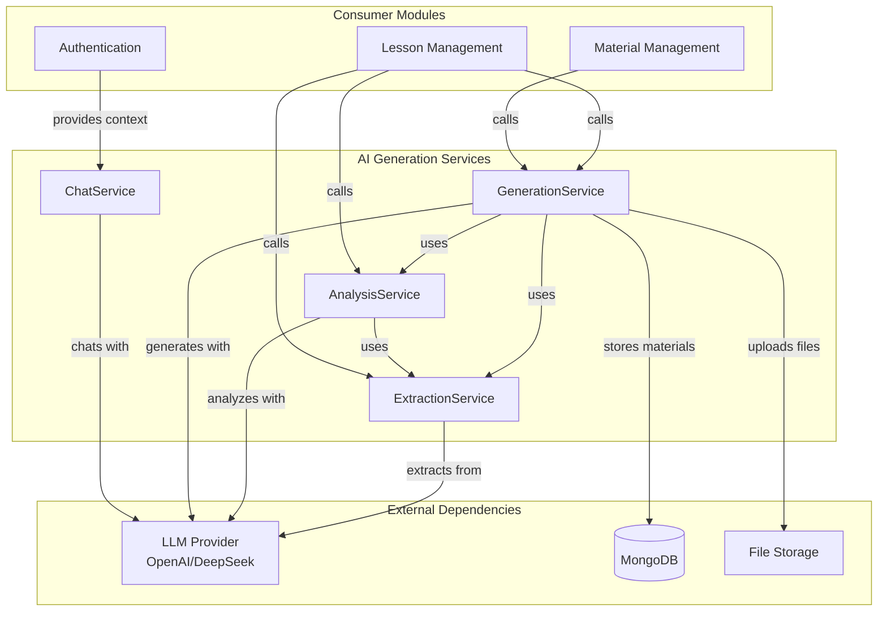
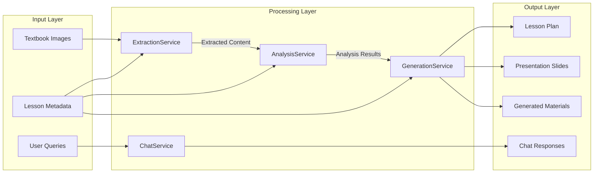
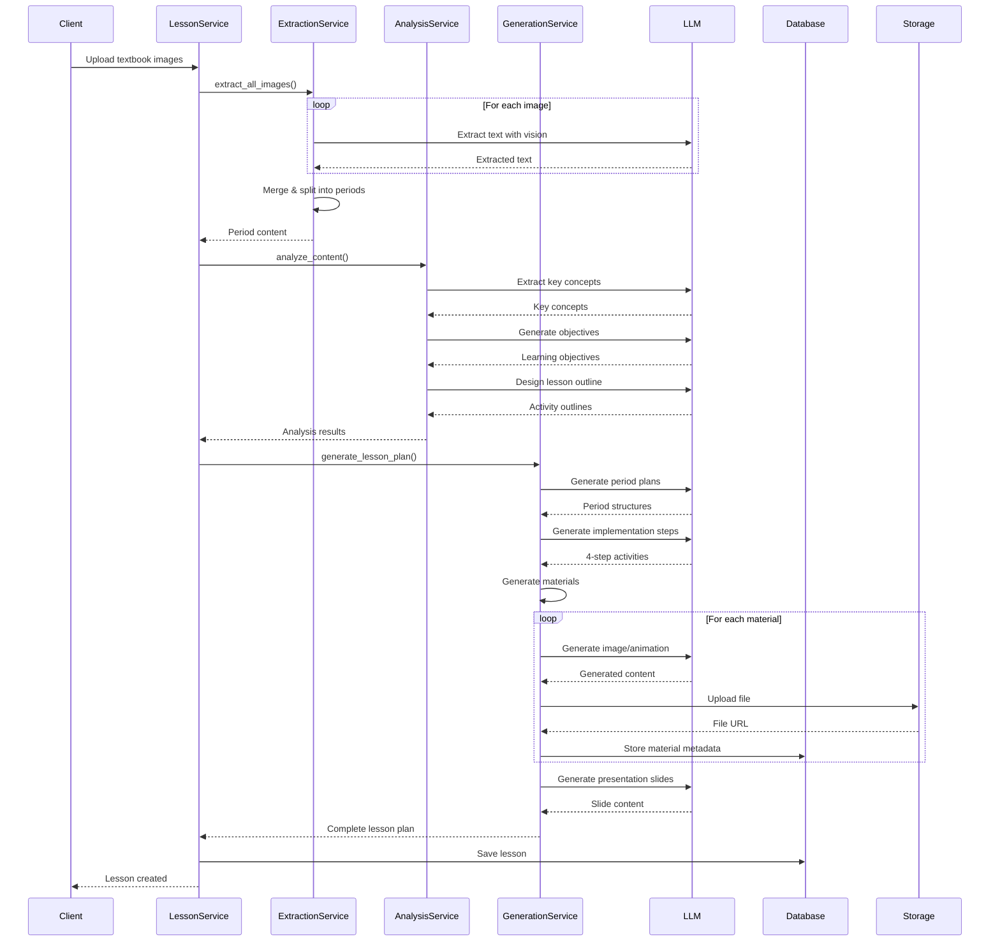
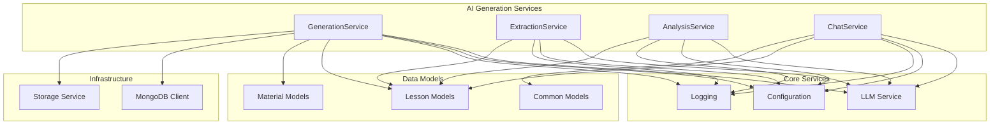
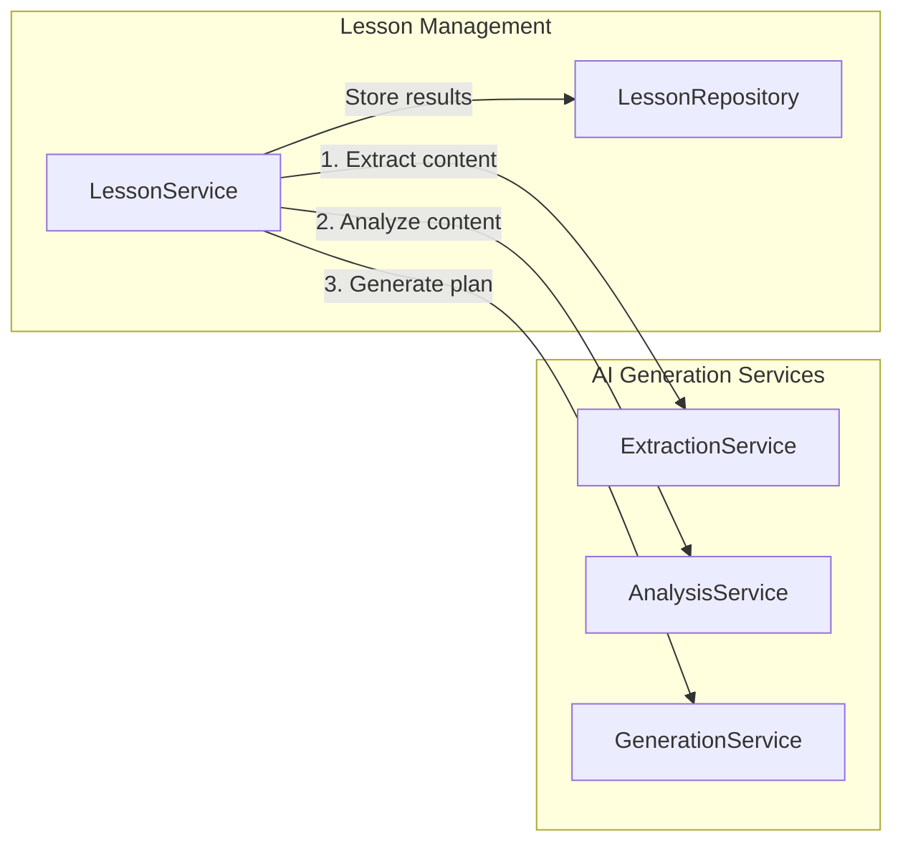
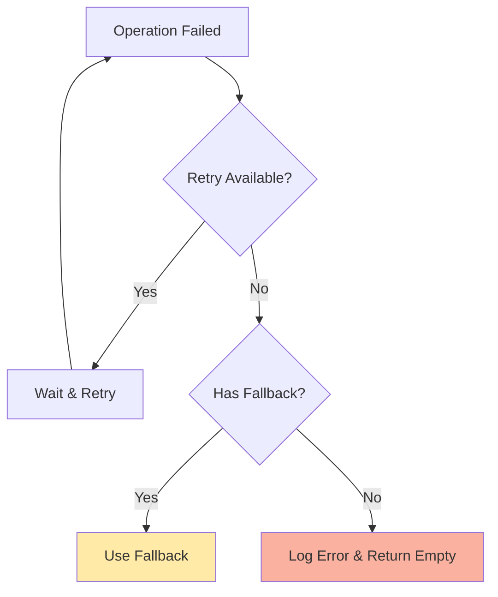

# AI Generation Services Module

## Overview

The **AI Generation Services** module is the core intelligence layer of the ConnectED educational platform, responsible for transforming raw educational content into structured, pedagogically sound lesson plans and interactive learning materials. This module leverages Large Language Models (LLMs) and specialized AI services to automate the entire lesson planning workflow from content extraction to final presentation generation.

### Purpose

The module serves as the brain of the ConnectED platform, providing:
- **Intelligent Content Processing**: Extract and analyze textbook content from images
- **Pedagogical Planning**: Generate lesson plans following Vietnamese educational standards (Thông tư 5512)
- **Multimedia Material Generation**: Create images, animations, and interactive experiments
- **Interactive Assistance**: Provide context-aware AI chat support for users

### Key Capabilities

1. **End-to-End Lesson Generation**: Transform textbook images into complete lesson plans with objectives, activities, and presentations
2. **Multi-Modal Content Generation**: Generate images, animations, and interactive experiments based on lesson content
3. **Smart Content Extraction**: Extract and structure text from textbook images using LLMs
4. **Pedagogical Analysis**: Analyze content to generate learning objectives, key concepts, and activity outlines
5. **Context-Aware Assistance**: Provide intelligent chat support with awareness of current application state

## Architecture

### High-Level Architecture



### Data Flow Architecture



### Component Interaction Flow



## Sub-Modules

The AI Generation Services module is composed of four specialized sub-modules, each handling a specific aspect of the AI-powered lesson generation pipeline:

### 1. [Generation Service](ai_generation_services_generation.md)
**Purpose**: Core lesson plan generation and multimedia material creation

**Key Responsibilities**:
- Generate complete lesson plans from analysis results
- Create period-based teaching plans with time allocation
- Generate teaching materials (images, animations, experiments)
- Create presentation slides with multimedia integration
- Manage shared material repository for reusability

**Core Features**:
- Multi-period lesson plan generation
- 4-step activity implementation (Thông tư 5512)
- Intelligent material generation and caching
- Presentation slide generation with LLM
- Shared material storage and reuse

### 2. [Extraction Service](ai_generation_services_extraction.md)
**Purpose**: Extract and structure content from textbook images

**Key Responsibilities**:
- Extract text from textbook images using LLM vision
- Merge content from multiple pages
- Split content into teaching periods
- Handle both student and teacher textbooks
- Support semantic splitting for teacher guides

**Core Features**:
- Multi-image concurrent processing
- Intelligent content merging and splitting
- Support for different textbook types (student/teacher)
- Semantic section recognition for teacher guides
- Fallback mechanisms for extraction failures

### 3. [Analysis Service](ai_generation_services_analysis.md)
**Purpose**: Analyze content and generate pedagogical structures

**Key Responsibilities**:
- Extract key concepts and formulas from content
- Generate learning objectives (knowledge, competencies, qualities)
- Design lesson outlines with activity sequences
- Extract logic flow from textbook content
- Ensure pedagogical alignment with Vietnamese standards

**Core Features**:
- Key concept and formula extraction
- Learning objective generation (Thông tư 5512)
- Activity outline design with material suggestions
- Logic flow extraction (removes image/table references)
- Incremental activity generation with context

### 4. [Chat Service](ai_generation_services_chat.md)
**Purpose**: Provide context-aware AI chat assistance

**Key Responsibilities**:
- Process user queries with context awareness
- Provide app usage guidance
- Explain displayed content and data
- Support learning with guided questions
- Adapt responses based on current page/screen

**Core Features**:
- Context-aware response generation
- Multi-page context understanding (lessons, materials, playground)
- App functionality guidance
- Learning support with Socratic method
- Error handling and fallback responses

## Dependencies

### Internal Dependencies



### External Dependencies

| Service | Purpose | Configuration |
|---------|---------|---------------|
| LLM Provider (OpenAI/DeepSeek) | Text generation, vision processing, chat | `api_key`, `base_url`, `model` |
| MongoDB | Store generated materials and lesson data | `mongodb_uri`, `database_name` |
| File Storage | Store generated images, videos, experiments | `storage_endpoint`, `bucket_name` |

## Integration with Other Modules

### Lesson Management Integration

The AI Generation Services module is primarily consumed by the [Lesson Management](lesson_management.md) module:



**Integration Points**:
- **Content Upload**: LessonService calls ExtractionService to process textbook images
- **Content Analysis**: LessonService calls AnalysisService to generate objectives and outlines
- **Plan Generation**: LessonService calls GenerationService to create final lesson plans
- **Material Generation**: LessonService coordinates with GenerationService for multimedia materials

### Material Management Integration

The [Material Management](material_management.md) module interacts with GenerationService for:
- Reusing existing generated materials
- Incrementing material usage counts
- Searching for similar materials

### Authentication Integration

The [Authentication](authentication.md) module provides user context to ChatService for personalized responses.

## Configuration

### Environment Variables

```bash
# LLM Configuration
API_KEY=your_api_key
BASE_URL=https://api.openai.com/v1
BASE_MODEL=gpt-4o

# Extraction LLM Configuration (optional, falls back to base)
EXTRACTION_LLM_API_KEY=your_extraction_key
EXTRACTION_LLM_BASE_URL=https://api.deepseek.com
EXTRACTION_LLM_MODEL=deepseek-chat

# Extraction Method
EXTRACTION_METHOD=llm  # or 'marker' for future support
EXTRACTION_MAX_RETRIES=3
EXTRACTION_RETRY_DELAY=1.0

# Generation Settings
MAX_RETRIES=3
RETRY_DELAY=1.0
```

### Service Configuration

Each service is configured through the `get_settings()` function from the configuration module, which loads environment variables and provides default values.

## Error Handling & Resilience

### Retry Mechanisms

All services implement exponential backoff retry logic:
- **Max Retries**: 3 attempts (configurable)
- **Retry Delay**: 1.0 second base, exponential backoff
- **Fallbacks**: Graceful degradation to default structures when LLM fails

### Error Recovery



### Monitoring & Logging

- **Structured Logging**: All services use the centralized logging system
- **Error Tracking**: Failed operations are logged with context
- **Performance Metrics**: Operation durations and success rates tracked
- **Debug Mode**: Detailed logs available for troubleshooting

## Performance Considerations

### Concurrent Processing

- **Image Extraction**: Multiple images processed concurrently using `asyncio.gather`
- **Material Generation**: Parallel generation of different material types
- **Non-blocking Operations**: All LLM calls are asynchronous

### Caching & Reuse

- **Shared Materials**: Generated materials stored in shared collection for reuse
- **Usage Tracking**: Materials track usage count to prioritize popular content
- **Similarity Search**: Existing materials checked before generation

### Resource Management

- **Connection Pooling**: MongoDB connections pooled for efficiency
- **Timeout Handling**: All LLM calls have configurable timeouts (120-180s)
- **Memory Optimization**: Streaming responses and incremental processing

## Security Considerations

### Data Privacy

- **API Key Management**: Keys stored in environment variables, not code
- **Content Filtering**: LLM prompts designed to avoid sensitive data exposure
- **Access Control**: Services respect user permissions from authentication module

### Input Validation

- **Image Validation**: Size and format checks before processing
- **Content Sanitization**: User inputs sanitized before inclusion in prompts
- **Prompt Injection Prevention**: Structured prompts with clear boundaries

## Future Enhancements

### Planned Features

1. **Multi-LLM Support**: Fallback between different LLM providers
2. **Advanced Caching**: Redis-based caching for frequently used materials
3. **Batch Processing**: Process multiple lessons in parallel
4. **Quality Scoring**: Automatic quality assessment of generated content
5. **Template System**: Customizable lesson plan templates
6. **Collaborative Editing**: Real-time collaboration on lesson plans

### Scalability Improvements

- **Microservices**: Split into independent deployable services
- **Message Queues**: Async processing of long-running generation tasks
- **CDN Integration**: Global distribution of generated materials
- **Database Sharding**: Horizontal scaling of material storage

## References

- [Lesson Management Module](lesson_management.md) - Primary consumer of AI services
- [Material Management Module](material_management.md) - Material storage and reuse
- [Database Models](database_models.md) - Data structures used by AI services
- [Database Layer](database_layer.md) - Database access patterns
- [Authentication Module](authentication.md) - User context for chat service

## Contributing

When extending the AI Generation Services module:

1. **Follow the Service Pattern**: Each service should be a singleton with clear responsibilities
2. **Implement Retry Logic**: All external calls must have retry mechanisms
3. **Add Comprehensive Logging**: Log all operations with appropriate levels
4. **Write Tests**: Include unit and integration tests for new features
5. **Update Documentation**: Keep this documentation current with changes
6. **Consider Fallbacks**: Always provide fallback behavior for LLM failures

---

*This documentation is auto-generated. Last updated: 2024*