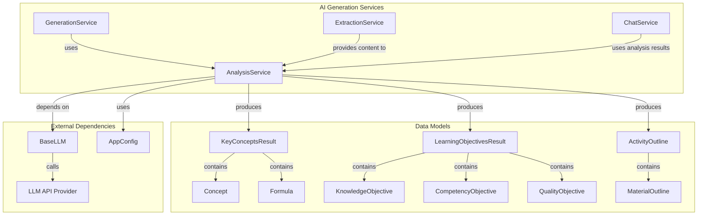
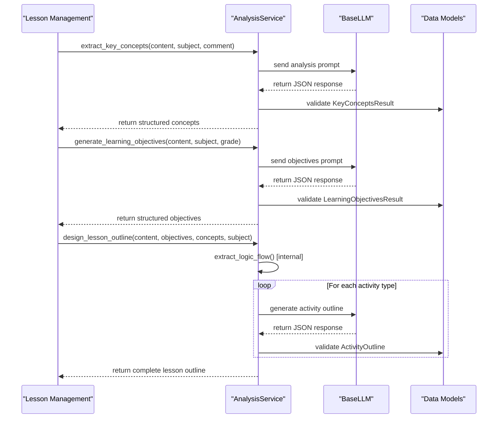
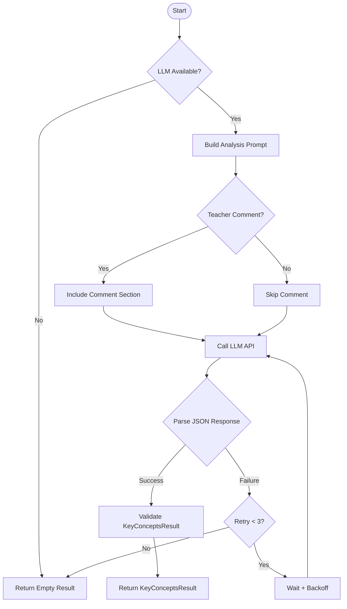
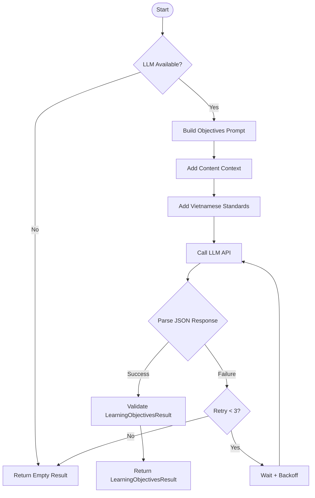
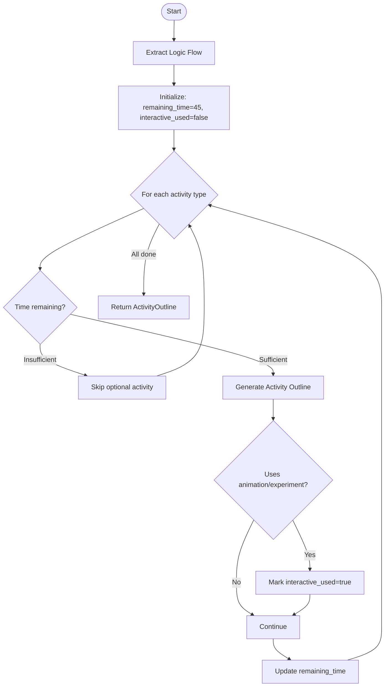
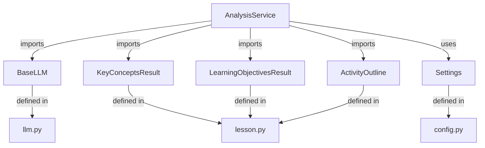
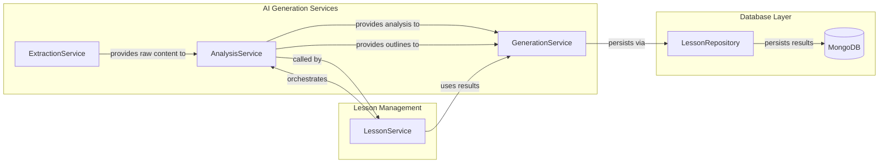
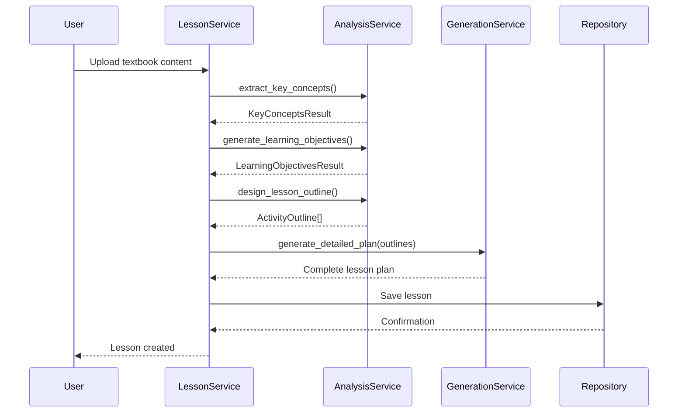

# AI Generation Services - Analysis Module

## Overview

The **Analysis Module** (`backend.app.services.ai.analysis`) is a core component of the ConnectED educational platform that provides intelligent content analysis and lesson planning capabilities. It leverages Large Language Models (LLMs) to analyze textbook content, extract educational concepts, generate learning objectives aligned with Vietnamese curriculum standards, and design structured lesson outlines.

## Purpose and Core Functionality

The Analysis Service serves as the "brain" of the lesson planning process, transforming raw textbook content into pedagogically sound lesson structures. It performs three primary functions:

1. **Content Analysis**: Extracts key concepts, definitions, and formulas from textbook content
2. **Objective Generation**: Creates learning objectives aligned with Vietnamese Ministry of Education standards (Thông tư 5512)
3. **Lesson Outline Design**: Generates structured activity sequences for 45-minute class periods

## Architecture

### Service Structure



### Component Interaction Flow



## Core Components

### AnalysisService Class

The `AnalysisService` is a singleton that provides all analysis capabilities. It initializes with a `BaseLLM` instance configured through application settings.

**Key Attributes:**
- `llm`: BaseLLM instance for making API calls
- `ACTIVITY_SEQUENCE`: Predefined activity types and time allocations for 45-minute lessons
- `ACTIVITY_MATERIALS_CONFIG`: Material type restrictions per activity
- `ACTIVITY_EXAMPLES`: Few-shot examples for each activity type

**Configuration Constants:**
- `MAX_RETRIES = 3`: Maximum retry attempts for LLM calls
- `RETRY_DELAY = 1.0`: Base delay between retries (with exponential backoff)

### Key Methods

#### 1. `extract_key_concepts()`

Extracts educational concepts, definitions, and formulas from textbook content.

**Process Flow:**


**Output Structure:**
```json
{
  "concepts": [
    {"name": "string", "description": "string"}
  ],
  "formulas": [
    {"name": "string", "formula": "string", "description": "string"}
  ]
}
```

#### 2. `generate_learning_objectives()`

Generates learning objectives aligned with Vietnamese curriculum standards (Thông tư 5512).

**Objective Categories:**
- **Knowledge Objectives**: Cognitive levels (nhận biết, thông hiểu, vận dụng, vận dụng cao)
- **Competency Objectives**: General and subject-specific competencies
- **Quality Objectives**: Character development (yêu nước, nhân ái, chăm chỉ, trung thực, trách nhiệm)

**Process Flow:**


#### 3. `extract_logic_flow()`

Cleans textbook content by removing references to images, tables, and diagrams, preserving only the logical flow of concepts.

**Key Features:**
- Removes phrases like "Quan sát hình...", "Xem bảng...", "Theo sơ đồ..."
- Preserves definitions, formulas, and logical arguments
- Skips processing for teacher textbooks (SGK giáo viên) as they already contain structured content
- Returns cleaned text suitable for activity generation

#### 4. `design_lesson_outline()`

Generates a complete lesson outline with sequential activities for a 45-minute class period.

**Activity Sequence (Vietnamese Lesson Structure):**

| Activity Type | Duration | Optional | Description |
|--------------|----------|----------|-------------|
| `khởi động` | 5 min | No | Warm-up, connect prior knowledge |
| `hình thành kiến thức` | 20-25 min | No | Main content delivery |
| `luyện tập` | 10-12 min | No | Practice exercises |
| `vận dụng` | 5-8 min | Yes | Application/extension activities |

**Material Constraints:**
- Only **1 animation OR 1 experiment** allowed per entire lesson
- Activity-specific material restrictions:
  - `khởi động`: Only images
  - `hình thành kiến thức`: Images, animations, experiments
  - `luyện tập`: Only images
  - `vận dụng`: Images, experiments

**Incremental Generation Process:**


## Data Models

### KeyConceptsResult

Contains extracted educational content from textbook material.

**Fields:**
- `concepts`: List of `Concept` objects (name, description)
- `formulas`: List of `Formula` objects (name, formula, description)

**Usage:** Provides the foundational knowledge base for generating learning objectives and activities.

### LearningObjectivesResult

Structured learning objectives aligned with Vietnamese educational standards.

**Fields:**
- `knowledge`: List of knowledge objectives with cognitive levels
- `competencies`: List of competency objectives (general and subject-specific)
- `qualities`: List of character development objectives

**Usage:** Guides the pedagogical focus of lesson activities and assessment strategies.

### ActivityOutline

Represents a single teaching activity within a lesson plan.

**Fields:**
- `type`: Activity category (khởi động, hình thành kiến thức, luyện tập, vận dụng)
- `title`: Concise activity title
- `objectives`: Learning objectives for this specific activity
- `content`: Detailed activity description
- `expected_products`: Anticipated student outputs
- `materials`: List of required teaching materials
- `time_estimate_min`: Duration in minutes

**Usage:** Forms the blueprint for the GenerationService to create detailed lesson plans.

## Dependencies

### Internal Dependencies



**Direct Imports:**
- `app.config.get_settings` - Application configuration
- `app.models.lesson.*` - Data models for analysis results
- `app.services.ai.llm.BaseLLM` - LLM client wrapper

### Module Relationships



**Related Modules:**
- [ai_generation_services](ai_generation_services.md) - Parent module overview
- [ai_generation_services_generation](ai_generation_services_generation.md) - Generates detailed lesson plans from outlines
- [ai_generation_services_extraction](ai_generation_services_extraction.md) - Extracts text from textbook images
- [lesson_management](lesson_management.md) - Orchestrates the lesson creation workflow
- [database_models](database_models.md) - Data models for persistence

## Configuration

### LLM Settings

The service uses application settings for LLM configuration:

```python
# From app.config.Settings
api_key: str        # LLM API authentication key
base_url: str       # LLM API endpoint URL
base_model: str     # Model identifier (e.g., "gpt-4", "claude-3")
```

### Activity Configuration

**Activity Sequence:**
```python
ACTIVITY_SEQUENCE = [
    ("khởi động", "Tạo tâm thế hứng thú...", (5, 5), False),
    ("hình thành kiến thức", "Truyền đạt nội dung chính...", (20, 25), False),
    ("luyện tập", "Bài tập củng cố...", (10, 12), False),
    ("vận dụng", "Áp dụng kiến thức...", (5, 8), True),
]
```

**Material Restrictions:**
```python
ACTIVITY_MATERIALS_CONFIG = {
    "khởi động": ["image"],
    "hình thành kiến thức": ["image", "animation", "experiment"],
    "luyện tập": ["image"],
    "vận dụng": ["image", "experiment"],
}
```

## Error Handling and Resilience

### Retry Mechanism

All LLM operations implement exponential backoff retry logic:

1. **Maximum 3 attempts** per operation
2. **Exponential backoff**: Delay increases with each attempt (`RETRY_DELAY * (attempt + 1)`)
3. **Graceful degradation**: Returns empty/default results after max retries
4. **Error logging**: Detailed error messages for debugging

### Fallback Strategies

- **LLM unavailable**: Returns empty result objects instead of raising exceptions
- **JSON parsing failure**: Attempts to extract JSON from markdown code blocks
- **Logic flow extraction failure**: Falls back to original content
- **Activity generation failure**: Skips failed activities, continues with others

## Usage Examples

### Basic Usage Pattern

```python
from app.services.ai.analysis import analysis_service
from app.models.lesson import KeyConceptsResult, LearningObjectivesResult

# Extract key concepts
concepts: KeyConceptsResult = await analysis_service.extract_key_concepts(
    period_content="Nội dung SGK...",
    subject="Toán",
    comment="Tập trung vào công thức diện tích"
)

# Generate learning objectives
objectives: LearningObjectivesResult = await analysis_service.generate_learning_objectives(
    period_content="Nội dung SGK...",
    subject="Toán",
    grade=9
)

# Design lesson outline
outline = await analysis_service.design_lesson_outline(
    period_content="Nội dung SGK...",
    period_objectives=objectives,
    period_key_concepts=concepts,
    subject="Toán",
    textbook_type="student"
)
```

### Integration with Lesson Creation Workflow



## Performance Considerations

### LLM Call Optimization

- **Parallel processing**: Key concepts and objectives can be extracted in parallel
- **Prompt caching**: Similar prompts benefit from LLM provider caching
- **Token usage**: Prompts optimized to minimize token consumption
- **Timeout handling**: Configurable timeouts prevent hanging operations

### Resource Management

- **Singleton pattern**: Single service instance reduces memory footprint
- **Connection pooling**: BaseLLM uses aiohttp session pooling
- **Async/await**: Non-blocking operations for better concurrency

## Security and Privacy

### Data Handling

- **No PII storage**: Analysis results don't contain personally identifiable information
- **Content filtering**: LLM prompts don't include sensitive user data
- **Secure API calls**: SSL/TLS encryption for LLM provider communications

### Access Control

- **Service-level authorization**: AnalysisService assumes validated user context
- **Content ownership**: Results tied to lesson ownership, not user sessions

## Future Enhancements

### Planned Features

1. **Multi-modal analysis**: Support for image-based concept extraction
2. **Curriculum mapping**: Automatic alignment with specific curriculum frameworks
3. **Difficulty adaptation**: Adjust objectives based on student performance data
4. **Collaborative analysis**: Support for team-based lesson planning
5. **Analytics integration**: Track analysis quality and LLM performance

### Potential Improvements

1. **Prompt engineering**: A/B testing for optimal prompt formulations
2. **Model fallback**: Support for multiple LLM providers
3. **Caching layer**: Cache analysis results for similar content
4. **Batch processing**: Analyze multiple lessons simultaneously
5. **Quality scoring**: Automatic assessment of analysis quality

## Conclusion

The Analysis Module is a critical component that bridges raw educational content with pedagogically sound lesson plans. Its design reflects deep understanding of Vietnamese educational standards while maintaining flexibility for future enhancements. The module's robust error handling, clear separation of concerns, and comprehensive data models make it a reliable foundation for the ConnectED platform's AI-powered lesson planning capabilities.