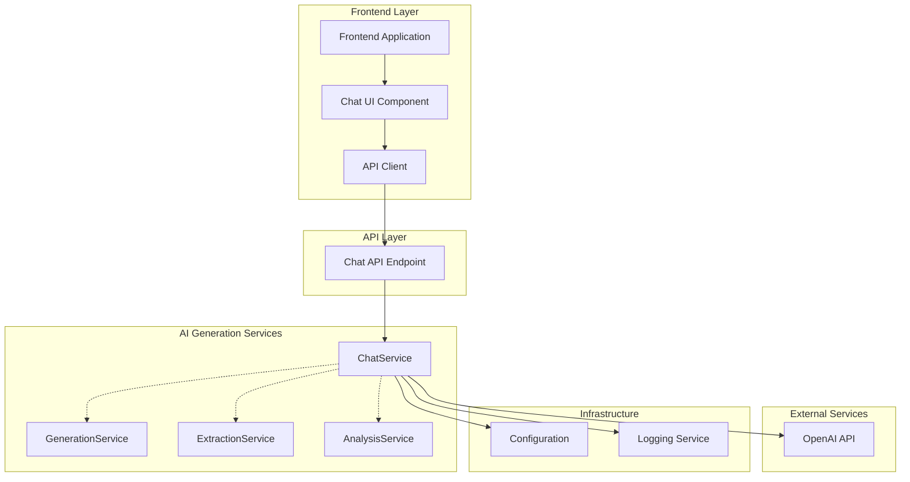
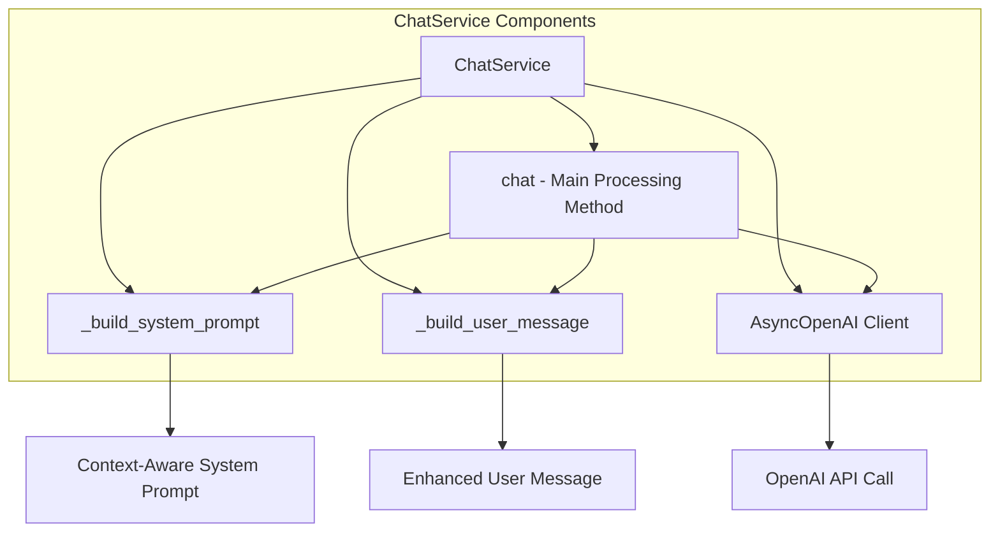
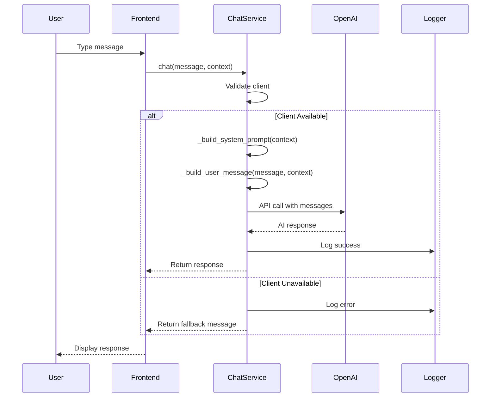
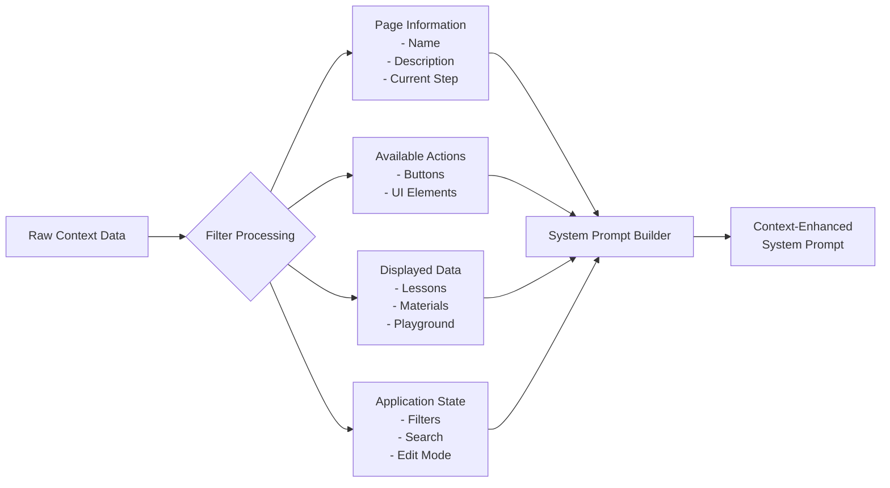
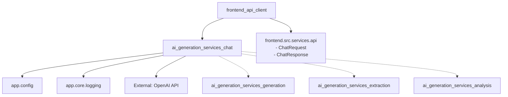
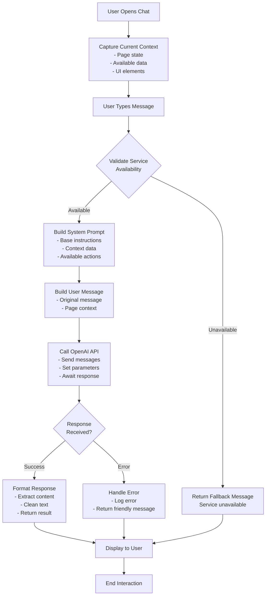
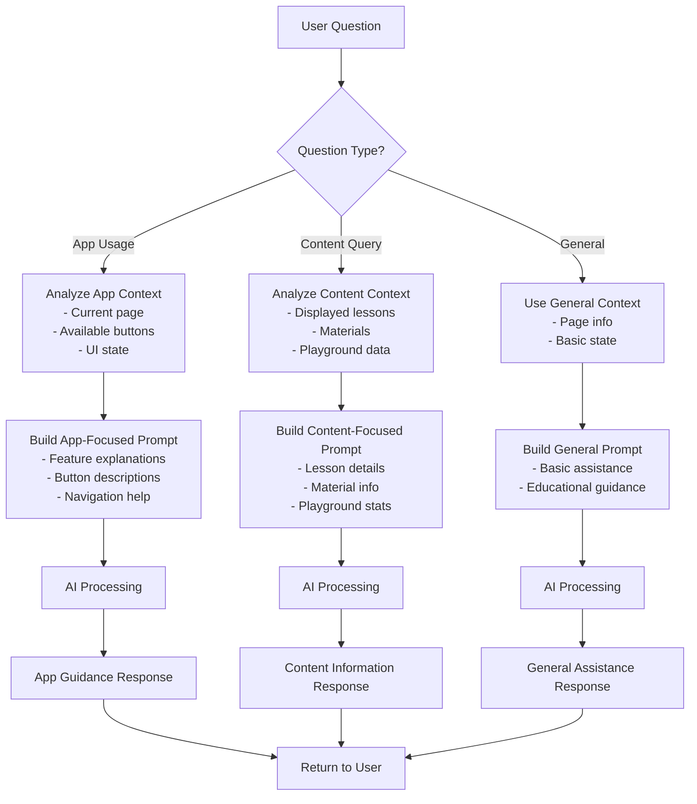

# AI Generation Services - Chat Module

## Overview

The **AI Generation Services Chat Module** provides an intelligent AI chat assistant service for the ConnectED educational platform. It enables context-aware conversational interactions that support both application usage guidance and educational assistance following pedagogical best practices.

### Key Features

- **Context-Aware Conversations**: Understands current page context, available actions, and displayed content
- **Dual-Purpose Assistance**: Supports both application usage help and educational guidance
- **Pedagogical Approach**: Follows educational principles by providing hints rather than direct answers
- **Multi-Language Support**: Primarily Vietnamese language support for the target audience
- **Error Handling**: Graceful degradation when AI services are unavailable

## Architecture

### High-Level Architecture



### Component Structure



## Core Components

### ChatService

The `ChatService` class is the main component that orchestrates AI-powered chat interactions.

**Location**: `backend/app/services/ai/chat.py`

**Key Responsibilities**:
- Initialize and manage OpenAI client connection
- Process incoming chat messages with context awareness
- Build dynamic system prompts based on current application context
- Handle errors and provide fallback responses
- Log interactions for monitoring and debugging

**Constructor**:
```python
def __init__(self)
```
- Initializes AsyncOpenAI client using configuration settings
- Sets up logging for the chat service
- Creates singleton instance pattern

**Main Methods**:

#### `async chat(message, context=None, user_id=None)`

Processes chat messages and returns AI-generated responses.

**Parameters**:
- `message` (str): User's input message
- `context` (Optional[dict]): Current page context including page info, available actions, displayed data
- `user_id` (Optional[str]): User identifier for personalization

**Returns**: AI response as string

**Flow**:
1. Validate OpenAI client availability
2. Build context-aware system prompt
3. Build enhanced user message with context
4. Call OpenAI API with constructed messages
5. Return response or error message

#### `_build_system_prompt(context)`

Constructs dynamic system prompt based on current application context.

**Features**:
- Base educational assistant prompt with pedagogical guidelines
- Context-aware enhancements including:
  - Current page information
  - Available actions and buttons
  - Displayed data (lessons, materials, playground info)
  - Filter and search status
  - User interface state

**Context Processing**:
- Page metadata (name, description, current step)
- Available actions and buttons with descriptions
- Lesson lists with filtering and search status
- Recent materials display
- Playground information (share code, questions, flashcards, attempts)
- Filter options and current selections

#### `_build_user_message(message, context)`

Enhances user message with contextual information.

**Features**:
- Prepends current page information to user message
- Helps AI understand the context of the question
- Improves response relevance

## Data Flow

### Chat Request Flow



### Context Processing Flow



## Integration with Other Modules

### Module Dependencies



### Related Modules

- **[ai_generation_services](ai_generation_services.md)**: Parent module containing all AI services
- **[ai_generation_services_generation](ai_generation_services_generation.md)**: Content generation capabilities
- **[ai_generation_services_extraction](ai_generation_services_extraction.md)**: Content extraction services
- **[ai_generation_services_analysis](ai_generation_services_analysis.md)**: Content analysis features
- **[frontend_api_client](frontend_api_client.md)**: Frontend API integration

### Configuration Dependencies

The ChatService relies on configuration settings:
- `api_key`: OpenAI API key
- `base_url`: OpenAI API base URL
- `base_model`: Model name for chat completions

## Process Flows

### Complete Chat Interaction Process



### Context-Aware Response Generation



## Key Features and Capabilities

### 1. Context-Aware Assistance

The chat service intelligently adapts its responses based on the current application context:

**Page-Specific Guidance**:
- Recognizes current page (dashboard, lesson editor, playground, etc.)
- Understands available actions and buttons
- Provides relevant feature explanations

**Content-Aware Responses**:
- Accesses displayed lesson information
- Understands material organization
- Provides accurate counts and details

**State Awareness**:
- Tracks editing modes
- Understands filter and search states
- Recognizes user permissions and roles

### 2. Educational Pedagogy

Follows established educational principles:

**Socratic Method**:
- Asks guiding questions instead of providing direct answers
- Encourages critical thinking
- Promotes self-discovery

**Progressive Assistance**:
- Starts with hints and guidance
- Provides more help only when needed
- Maintains learning engagement

**Positive Reinforcement**:
- Uses encouraging language
- Maintains friendly, supportive tone
- Celebrates learning progress

### 3. Multi-Context Support

Handles various context types effectively:

**Lesson Management Context**:
- Lists lesson counts and details
- Explains lesson statuses
- Describes filtering and search results

**Material Context**:
- Shows recent materials
- Explains material types and usage
- Provides organization guidance

**Playground Context**:
- Displays playground statistics
- Explains share codes and access
- Provides usage information

**UI Context**:
- Describes available buttons
- Explains current page features
- Guides navigation and actions

## Error Handling and Resilience

### Error Scenarios

1. **Service Unavailability**:
   - Detects missing API key or client initialization failure
   - Returns friendly Vietnamese message: "Xin lỗi, dịch vụ chat hiện không khả dụng..."

2. **API Call Failures**:
   - Catches exceptions during OpenAI API calls
   - Logs errors for monitoring
   - Returns user-friendly error message

3. **Context Processing Errors**:
   - Gracefully handles malformed context data
   - Falls back to basic prompt without context
   - Maintains core functionality

### Fallback Mechanisms

- **Primary**: Full context-aware AI response
- **Secondary**: Basic AI response without context
- **Tertiary**: Static fallback message in Vietnamese
- **Monitoring**: Comprehensive error logging

## Usage Examples

### Basic Chat Interaction

```python
from app.services.ai.chat import chat_service

# Simple message without context
response = await chat_service.chat("Xin chào, bạn có thể giúp gì?")

# Message with context
context = {
    "page": "Dashboard",
    "pageDescription": "Trang quản lý giáo án",
    "availableButtons": [
        {"label": "Tạo giáo án", "description": "Tạo giáo án mới"},
        {"label": "Lọc", "description": "Lọc giáo án theo môn học"}
    ],
    "data": {
        "lessons": [
            {"name": "Toán 12", "subject": "Toán", "grade": "12"}
        ]
    }
}
response = await chat_service.chat("Có bao nhiêu giáo án?", context=context)
```

### Context Structure

```python
context = {
    "page": "string",                    # Current page name
    "pageDescription": "string",         # Page description
    "currentStep": "string",             # Current step in process
    "editingMode": bool,                 # Whether editing is enabled
    "lessonStatus": "string",            # Current lesson status
    "availableActions": ["string"],      # List of available actions
    "availableButtons": [                 # List of button definitions
        {
            "label": "string",
            "description": "string"
        }
    ],
    "data": {                            # Page data
        "lessons": [...],                 # List of lessons
        "recent_materials": [...],        # Recent materials
        "filter_options": [...],          # Filter options
        "playground": {                   # Playground info
            "share_code": "string",
            "total_questions": int,
            "total_flashcards": int,
            "total_attempts": int,
            "average_score": float
        }
    }
}
```

## Configuration

### Required Settings

```python
# Configuration settings needed
settings.api_key        # OpenAI API key
settings.base_url       # OpenAI API base URL  
settings.base_model     # Model name (e.g., "gpt-3.5-turbo")
```

### Environment Variables

```bash
OPENAI_API_KEY=your_api_key
OPENAI_BASE_URL=https://api.openai.com/v1
CHAT_MODEL=gpt-3.5-turbo
```

## Performance Considerations

### Optimization Strategies

1. **Context Limiting**:
   - Limits lesson lists to 10 items in context
   - Limits materials to 5 items
   - Prevents prompt overflow

2. **Efficient Prompt Building**:
   - Only includes relevant context sections
   - Uses conditional logic for optional data
   - Minimizes token usage

3. **Caching Opportunities**:
   - System prompts could be cached per page type
   - Context templates could be pre-built
   - Response patterns could be cached for common questions

### Scalability Considerations

- **Concurrent Requests**: Uses AsyncOpenAI for concurrent processing
- **Connection Pooling**: OpenAI client handles connection management
- **Error Recovery**: Implements retry logic for transient failures
- **Resource Management**: Proper cleanup of API connections

## Security Considerations

### Data Privacy

- **User ID Handling**: Optional user ID for personalization without requiring it
- **Context Data**: Only includes necessary context information
- **API Key Management**: Uses configuration system for secure key storage
- **Logging**: Sanitizes sensitive data before logging

### Input Validation

- **Message Sanitization**: Implicit sanitization through OpenAI API
- **Context Validation**: Graceful handling of malformed context
- **Rate Limiting**: Should be implemented at API layer
- **Access Control**: User authentication handled by API endpoints

## Monitoring and Logging

### Logging Coverage

- **Service Initialization**: Logs client setup and configuration
- **Request Processing**: Logs incoming chat requests
- **API Calls**: Logs OpenAI API interactions
- **Errors**: Comprehensive error logging with context
- **Success Metrics**: Tracks successful response generation

### Monitoring Metrics

- **Response Time**: API call latency
- **Success Rate**: Percentage of successful responses
- **Error Types**: Categorization of failures
- **Context Usage**: Effectiveness of context in responses
- **User Satisfaction**: Implicit feedback through continued usage

## Future Enhancements

### Potential Improvements

1. **Advanced Context Processing**:
   - Machine learning-based context relevance scoring
   - Automatic context summarization for large datasets
   - Context versioning for conversation continuity

2. **Enhanced Personalization**:
   - User preference learning
   - Conversation history integration
   - Adaptive teaching style based on user role

3. **Multi-Modal Support**:
   - Image context understanding
   - Voice message processing
   - Rich media response generation

4. **Performance Optimizations**:
   - Prompt caching strategies
   - Response streaming for better UX
   - Batch processing for similar requests

5. **Integration Enhancements**:
   - Deeper integration with other AI services
   - Real-time content analysis
   - Collaborative filtering for common questions

## Conclusion

The AI Generation Services Chat Module provides a robust, context-aware chat assistant that enhances the ConnectED educational platform. By combining intelligent context processing with pedagogical best practices, it delivers meaningful assistance that supports both application usage and educational goals. The modular design allows for easy integration with other AI services while maintaining clean separation of concerns.

The service's emphasis on context awareness, error resilience, and educational pedagogy makes it a valuable component of the ConnectED ecosystem, providing users with intelligent, relevant, and helpful interactions that enhance their learning and teaching experience.