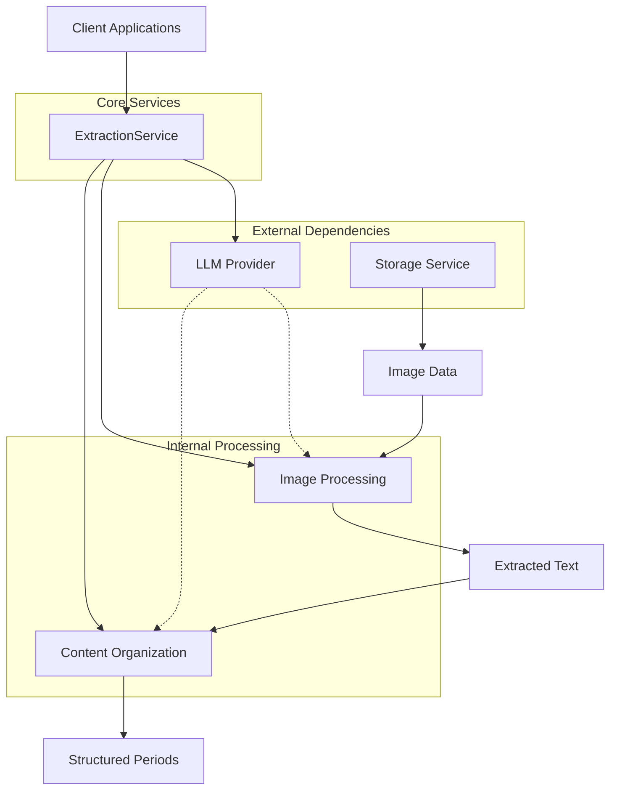
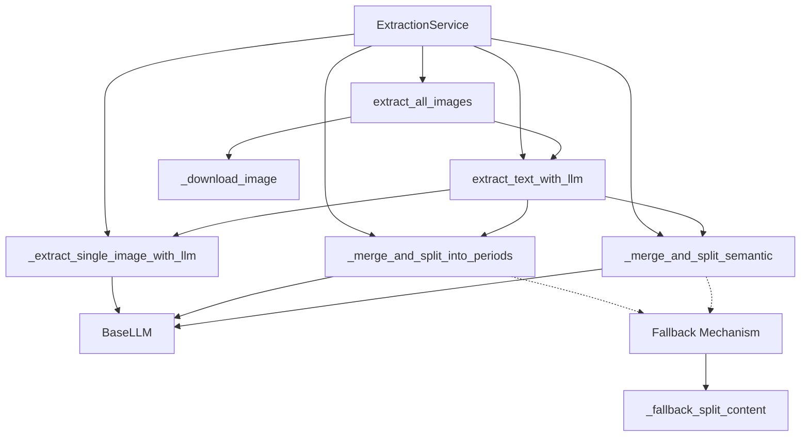
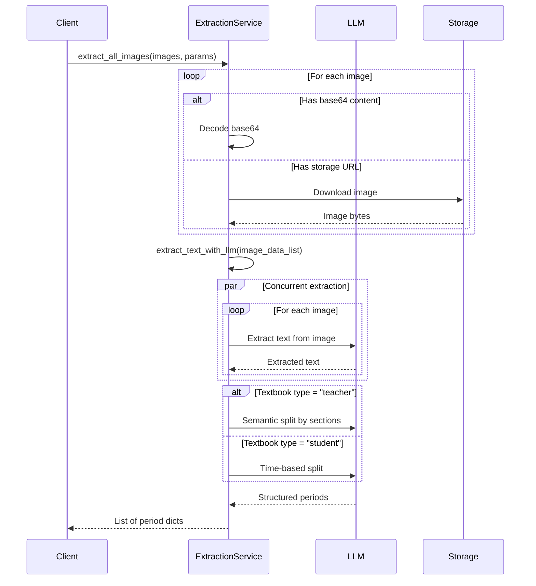
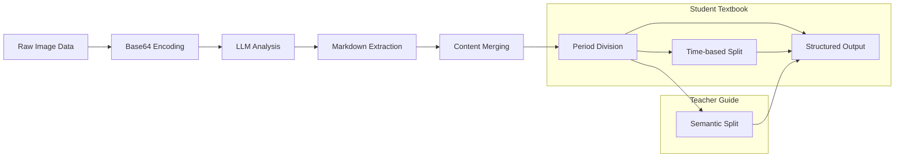
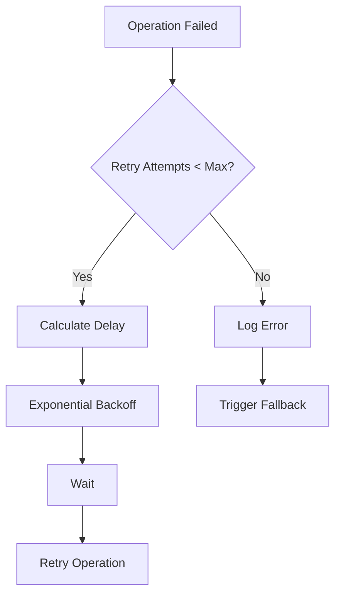
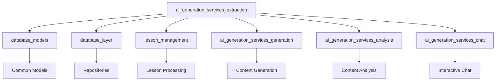
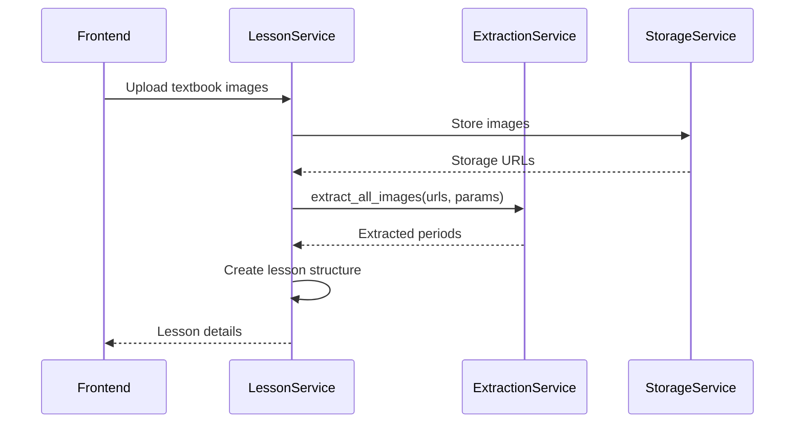

# AI Generation Services - Extraction Module

## Overview

The **Extraction Module** is a core component of the AI Generation Services layer that provides intelligent text extraction from Vietnamese textbook images. It leverages Large Language Models (LLMs) to extract, process, and organize educational content into structured teaching periods.

### Key Capabilities

- **Concurrent Image Processing**: Extracts text from multiple textbook pages simultaneously
- **Intelligent Content Organization**: Merges multi-page content and splits into logical teaching periods
- **Dual Textbook Support**: Handles both student textbooks and teacher guides with specialized processing
- **Semantic Understanding**: Recognizes educational content structures (objectives, activities, assessments)
- **Robust Error Handling**: Implements retry logic and fallback mechanisms for reliability

## Architecture

### High-Level Architecture



### Component Structure



## Core Components

### ExtractionService

The main service class that orchestrates the entire extraction pipeline. It is designed as a singleton instance (`extraction_service`) for efficient resource utilization.

**Key Responsibilities:**
- Initialize LLM client with extraction-specific configuration
- Manage SSL context for secure image downloads
- Coordinate concurrent image processing
- Implement retry logic with exponential backoff
- Provide fallback mechanisms for reliability

**Configuration Parameters:**
- `extraction_method`: Method used for extraction (LLM-based)
- `max_retries`: Maximum retry attempts for failed operations
- `retry_delay`: Base delay between retry attempts
- `poll_interval`: Interval for polling operations
- `extraction_llm_*`: LLM-specific settings (API key, base URL, model)

## Data Flow

### Extraction Pipeline



### Content Processing Flow



## Key Methods

### Public API Methods

#### `extract_all_images(images, num_periods, subject, grade, textbook_type)`

Main entry point for batch image extraction.

**Parameters:**
- `images`: List of image dictionaries with `content_base64` or `storage_url`
- `num_periods`: Number of teaching periods to divide content into
- `subject`: Subject context (e.g., "Toán", "Vật lý")
- `grade`: Grade level (e.g., 6, 7, 8)
- `textbook_type`: "student" or "teacher"

**Returns:** List of period dictionaries with `period_number` and `period_content`

**Process:**
1. Validates and prepares image data (base64 or download)
2. Delegates to `extract_text_with_llm`
3. Returns structured periods

#### `extract_text_with_llm(image_data_list, num_periods, subject, grade, textbook_type)`

Orchestrates the complete extraction pipeline.

**Process:**
1. **Concurrent Extraction**: Processes all images in parallel using `_extract_single_image_with_llm`
2. **Content Validation**: Filters out failed extractions
3. **Period Division**: Routes to appropriate splitting method based on textbook type
4. **Result Compilation**: Returns structured teaching periods

### Internal Processing Methods

#### `_extract_single_image_with_llm(image_bytes, page_number, subject, grade)`

Extracts text from a single image using LLM with specialized prompts for Vietnamese textbooks.

**Key Features:**
- **Contextual Prompting**: Includes subject and grade information for better accuracy
- **Markdown Formatting**: Enforces structured output with headers, formulas, tables
- **Error Correction**: Handles spelling errors from image quality issues
- **Retry Logic**: Implements exponential backoff for transient failures

**Prompt Strategy:**
- System prompt: "You are an expert at extracting text content from Vietnamese textbook images"
- User prompt: Detailed instructions in Vietnamese with specific formatting requirements
- Image context: Base64-encoded image with page number metadata

#### `_merge_and_split_into_periods(contents, num_periods, subject, grade)`

Merges multi-page content and splits into balanced teaching periods.

**Use Case:** Student textbooks where content should be divided by time/length

**Process:**
1. Joins all page contents with separators
2. Sends to LLM with instructions for balanced period division
3. Uses `===TIẾT X===` delimiters for structured output
4. Parses delimiter-based response into period dictionaries

#### `_merge_and_split_semantic(contents, num_periods, subject, grade)`

Specialized processing for teacher guides with semantic section recognition.

**Use Case:** Teacher textbooks with structured sections (objectives, activities, assessments)

**Recognized Sections:**
- **Mục tiêu**: Lesson objectives
- **Chuẩn bị**: Teaching materials and preparation
- **Thông tin bổ sung**: Additional teacher information
- **Hoạt động 1, 2, 3...**: Structured teaching activities
- **Hướng dẫn trả lời**: Answer guidelines
- **Ghi nhớ/Tổng kết**: Key takeaways

**Splitting Strategy:**
- Ensures each period contains complete activity sets
- Groups related objectives with corresponding activities
- Maintains pedagogical flow across periods
- Balances content while preserving semantic integrity

### Utility Methods

#### `_parse_delimiter_output(text, num_periods)`

Parses LLM output that uses `===TIẾT X===` delimiters.

**Pattern Matching:**
- Regex: `===\s*TIẾT\s*(\d+)\s*===`
- Case-insensitive matching
- Extracts period number and content
- Validates content presence

#### `_fallback_split_content(contents, num_periods)`

Rule-based fallback when LLM processing fails.

**Strategy:**
- Combines all content into single string
- Divides by character count for balanced length
- Finds natural break points (paragraphs, lines)
- Ensures last period gets remaining content

#### `_download_image(url)`

Downloads image from storage URL with SSL context management.

**Features:**
- Configurable SSL verification (disabled for development)
- Error handling for network issues
- Returns `None` on failure for graceful degradation

## Error Handling & Resilience

### Retry Strategy



**Exponential Backoff Formula:**
```
delay = retry_delay * (2 ^ attempt_number)
```

**Default Configuration:**
- `max_retries`: 3 attempts
- `retry_delay`: 5 seconds (base)
- Maximum delay: 20 seconds

### Fallback Mechanisms

1. **LLM Extraction Failure**: Returns `None` for individual images
2. **Merge/Split Failure**: Uses `_fallback_split_content` for rule-based division
3. **Image Download Failure**: Skips unavailable images, continues with available ones
4. **Complete Failure**: Returns empty list, logged for investigation

### Error Logging

- **task_logger**: Specialized logger for extraction operations
- **Log Levels**: 
  - `INFO`: Operation start/completion
  - `WARNING`: Retry attempts, fallback activation
  - `ERROR`: Final failures, critical issues
- **Context**: Includes page numbers, attempt counts, error details

## Configuration

### Settings Integration

The service integrates with the application settings system:

```python
# Extraction Method Configuration
extraction_method: str = "llm"  # Currently LLM-only
extraction_max_retries: int = 3
extraction_retry_delay: float = 5.0

# LLM Provider Settings
extraction_llm_api_key: Optional[str] = None
extraction_llm_base_url: Optional[str] = None
extraction_llm_model: Optional[str] = None

# Processing Settings
max_polls: int = 300
poll_interval: int = 5  # seconds
```

### SSL Configuration

**Development Mode:**
- SSL certificate verification disabled
- Hostname checking disabled
- Warning: Should be enabled in production

**Production Mode:**
- Proper SSL certificate configuration required
- Certificate verification enabled
- Secure connection to LLM providers

## Dependencies

### Internal Dependencies

- **[`backend.app.config`](backend.app.config.md)**: Settings management
- **[`backend.app.core.logging`](backend.app.core.logging.md)**: Task-specific logging
- **[`backend.app.services.ai.llm`](backend.app.services.ai.llm.md)**: LLM client abstraction

### External Dependencies

- **aiohttp**: Asynchronous HTTP client for image downloads
- **asyncio**: Concurrent processing coordination
- **base64**: Image encoding for LLM input
- **ssl**: SSL context management
- **json**: Data serialization (for potential future use)

### Module Relationships



## Usage Patterns

### Basic Usage

```python
from app.services.ai.extraction import extraction_service

# Extract from student textbook
periods = await extraction_service.extract_all_images(
    images=[{"content_base64": "..."}, {"content_base64": "..."}],
    num_periods=2,
    subject="Toán",
    grade=6,
    textbook_type="student"
)

# Result structure
# [
#     {"period_number": 1, "period_content": "..."},
#     {"period_number": 2, "period_content": "..."}
# ]
```

### Teacher Guide Processing

```python
# Extract from teacher guide with semantic splitting
periods = await extraction_service.extract_all_images(
    images=[{"storage_url": "https://..."}],
    num_periods=3,
    subject="Vật lý",
    grade=8,
    textbook_type="teacher"  # Enables semantic section recognition
)
```

### Integration with Lesson Management



## Performance Considerations

### Concurrent Processing

- **Image Extraction**: All images processed concurrently using `asyncio.gather`
- **LLM Calls**: Parallel API calls to maximize throughput
- **I/O Operations**: Non-blocking image downloads

### Optimization Strategies

1. **Base64 Preference**: Uses stored base64 data to avoid re-downloading
2. **Connection Reuse**: Maintains SSL context for efficient connections
3. **Timeout Configuration**: Extended timeout (180s) for extraction operations
4. **Token Limits**: High token limit (32000) for comprehensive content processing

### Bottlenecks

- **LLM API Rate Limits**: External API constraints may limit concurrency
- **Image Size**: Large images increase processing time and token usage
- **Network Latency**: Image downloads depend on storage service performance

## Security Considerations

### Data Handling

- **Image Data**: Transient processing, not stored by extraction service
- **Base64 Encoding**: Safe transmission of binary data
- **URL Validation**: Should be implemented for storage URLs

### API Security

- **API Keys**: Stored in configuration, not hardcoded
- **Base URLs**: Configurable for different environments
- **SSL/TLS**: Configurable verification (disabled in dev, enabled in prod)

## Future Enhancements

### Potential Improvements

1. **Multi-Provider Support**: Fallback to alternative LLM providers
2. **Caching Layer**: Cache extracted content to reduce API calls
3. **Progress Tracking**: Real-time extraction progress for large batches
4. **Quality Scoring**: Automatic quality assessment of extracted content
5. **OCR Integration**: Hybrid approach with traditional OCR for better accuracy
6. **Batch Optimization**: Smart batching based on image characteristics

### Scalability Considerations

- **Horizontal Scaling**: Stateless design supports multiple instances
- **Queue Integration**: Message queue for large extraction jobs
- **Database Persistence**: Store extraction results for reuse
- **CDN Integration**: Optimize image delivery for extraction

## Related Documentation

- **[AI Generation Services - Generation](ai_generation_services_generation.md)**: Content generation capabilities
- **[AI Generation Services - Analysis](ai_generation_services_analysis.md)**: Content analysis and insights
- **[AI Generation Services - Chat](ai_generation_services_chat.md)**: Interactive chat functionality
- **[Lesson Management](lesson_management.md)**: Lesson processing and management
- **[Database Models](database_models.md)**: Data structures and models
- **[Database Layer](database_layer.md)**: Data persistence and repositories

## API Reference

### ExtractionService Class

```python
class ExtractionService:
    """Service for extracting text from textbook images using LLM."""
    
    async def extract_all_images(
        self,
        images: list[dict],
        num_periods: int = 2,
        subject: str = "",
        grade: int = 0,
        textbook_type: str = "student",
    ) -> list[dict]:
        """Extract text from multiple images as a batch."""
    
    async def extract_text_with_llm(
        self,
        image_data_list: list[bytes],
        num_periods: int = 2,
        subject: str = "",
        grade: int = 0,
        textbook_type: str = "student",
    ) -> list[dict]:
        """Extract text from textbook images using LLM."""
```

### Return Format

```python
[
    {
        "period_number": int,      # Teaching period number (1, 2, 3...)
        "period_content": str      # Extracted and formatted content in Markdown
    },
    ...
]
```