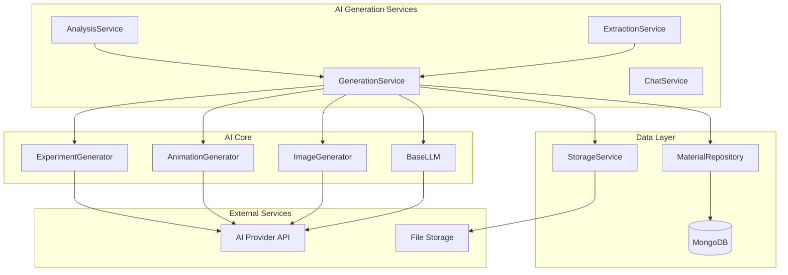
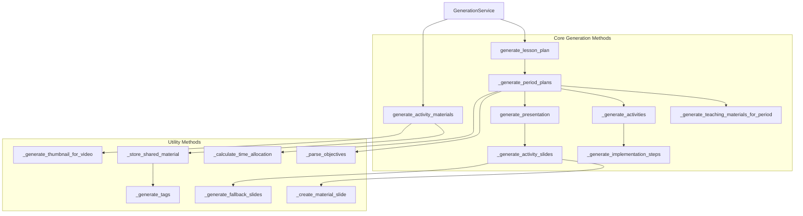
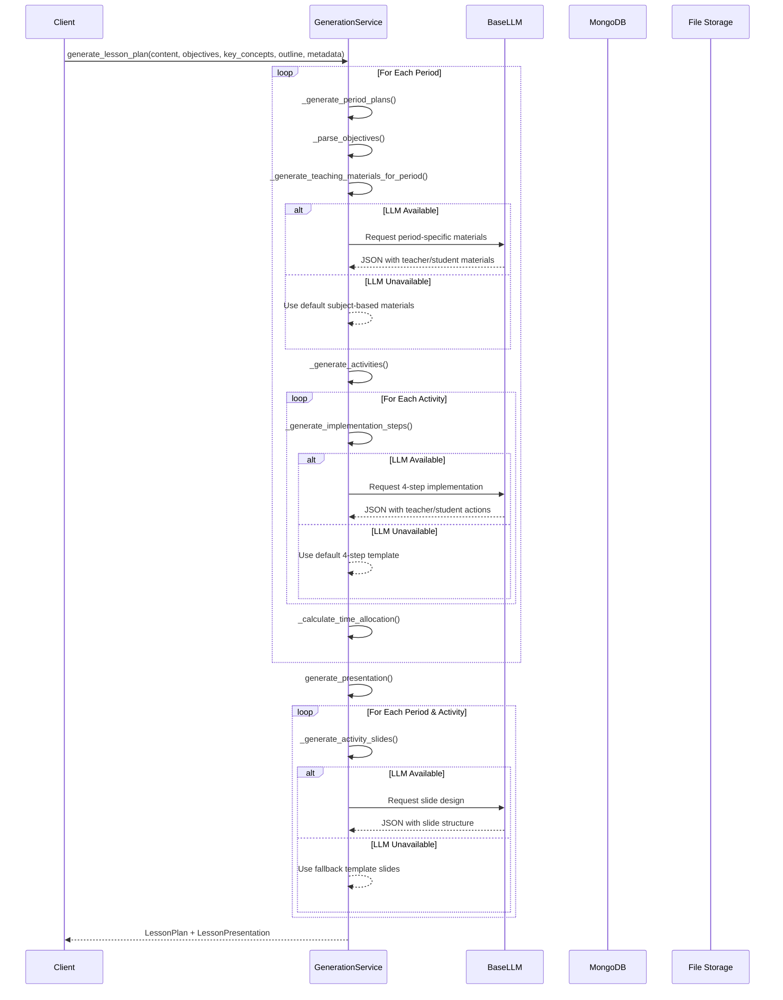
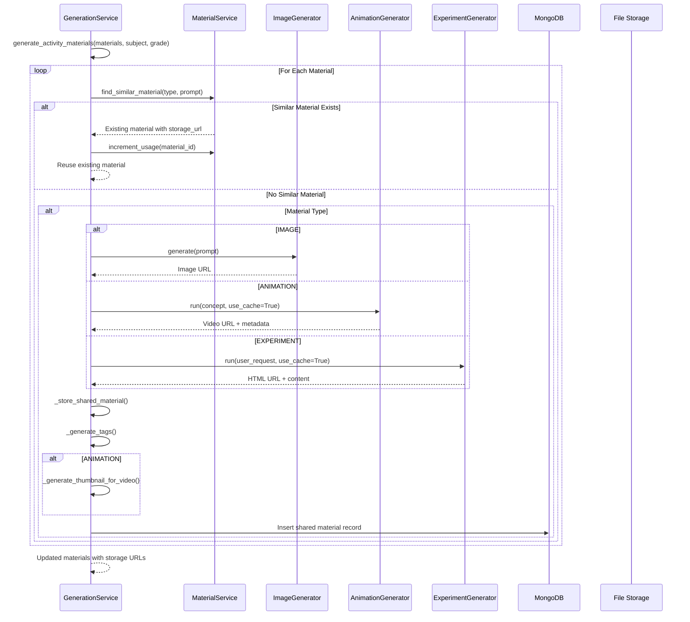
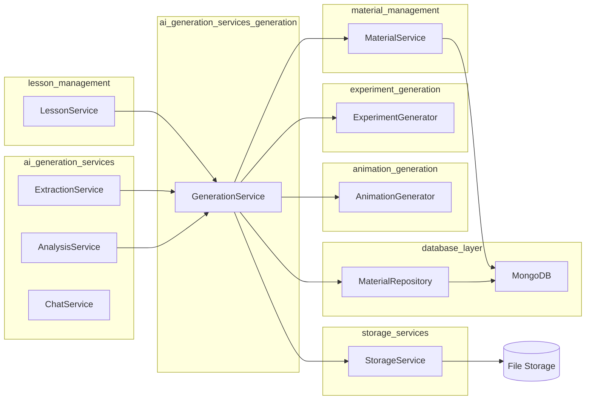
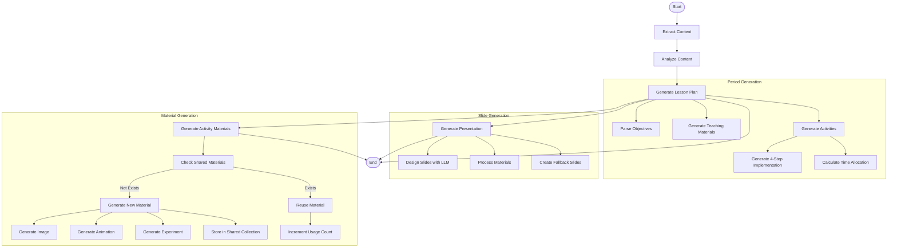
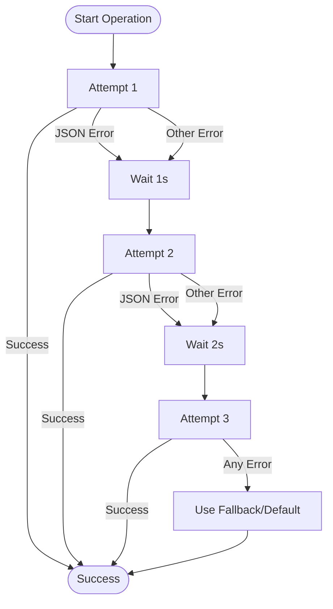

# AI Generation Services - Generation Module

## Overview

The **ai_generation_services_generation** module provides the core AI-powered lesson plan generation capabilities for the Connected Learning Platform. It transforms educational content analysis results into complete, structured lesson plans with teaching materials, activities, and presentation slides following Vietnamese educational standards (Thông tư 5512).

## Core Purpose

This module serves as the central orchestrator for:
- **Lesson Plan Generation**: Converting analysis results into structured lesson plans
- **Activity Design**: Creating pedagogically sound activities with 4-step implementation guides
- **Material Generation**: Producing visual aids (images, animations, experiments) for enhanced learning
- **Presentation Creation**: Generating slide decks for classroom delivery
- **Material Reusability**: Managing a shared repository of generated educational resources

## Architecture

### High-Level Component Architecture



### GenerationService Internal Structure



## Data Flow

### Lesson Plan Generation Flow



### Material Generation and Reusability Flow



## Component Relationships

### Integration with Other Modules



## Process Flows

### Complete Lesson Generation Pipeline



### Error Handling and Retry Logic



## Key Features

### 1. Multi-Period Lesson Plan Generation
- **Dynamic Period Detection**: Automatically determines number of periods from objectives, key concepts, and outline
- **Period-Specific Content**: Generates tailored teaching materials and activities for each period
- **Time Allocation**: Calculates and distributes time across activity types (khởi động, hình thành kiến thức, luyện tập, vận dụng)

### 2. 4-Step Implementation Framework (Thông tư 5512)
All activities follow the Vietnamese educational standard:
1. **Chuyển giao nhiệm vụ học tập** (Task Assignment)
2. **Thực hiện nhiệm vụ học tập** (Task Execution)
3. **Báo cáo kết quả hoạt động và thảo luận** (Reporting & Discussion)
4. **Đánh giá kết quả thực hiện nhiệm vụ học tập** (Evaluation)

### 3. Intelligent Material Generation
- **Type-Specific Generators**: Uses specialized generators for images, animations, and experiments
- **Smart Caching**: Checks shared material repository before generating new content
- **Automatic Tagging**: Generates relevant tags based on subject, grade, and content
- **Thumbnail Generation**: Creates thumbnails for video content using FFmpeg

### 4. Presentation Slide Generation
- **Template-Based Design**: Creates professional slides with multiple layouts (title, content, two-column, image, video, etc.)
- **Material Integration**: Embeds generated materials directly into slides
- **Teacher Notes**: Includes pedagogical guidance for each slide
- **Fallback Templates**: Provides default slides when LLM is unavailable

### 5. Material Reusability System
- **Shared Repository**: Stores generated materials in MongoDB for cross-lesson reuse
- **Similarity Detection**: Finds existing materials based on type and content similarity
- **Usage Tracking**: Monitors material usage to prioritize popular resources
- **Connection Pooling**: Uses sync MongoDB for reliable operation in both FastAPI and Celery contexts

## Data Models

### Input Models
- **LessonMetadata**: Lesson context (school, class, subject, duration, etc.)
- **ObjectivesData**: Learning objectives per period
- **KeyConceptsData**: Key concepts per period
- **OutlineData**: Activity outline per period
- **ActivityMaterial**: Material specifications for activities

### Output Models
- **LessonPlan**: Complete lesson structure with periods, activities, and materials
- **LessonPresentation**: Slide decks organized by period and activity
- **ActivityMaterial**: Generated materials with storage URLs
- **SharedMaterial**: Reusable materials stored in the shared collection

## Configuration

```python
# Environment Variables
API_KEY=<ai-provider-api-key>
BASE_URL=<ai-provider-base-url>
BASE_MODEL=<model-name>

# Constants
MAX_RETRIES = 3
RETRY_DELAY = 1.0  # seconds
```

## Integration Points

### Dependencies
- **[ai_generation_services](ai_generation_services.md)**: Parent module containing all AI services
- **[lesson_management](lesson_management.md)**: Uses generated lesson plans and presentations
- **[material_management](material_management.md)**: Integrates with material service for shared repository
- **[animation_generation](animation_generation.md)**: Delegates animation generation to specialized generator
- **[experiment_generation](experiment_generation.md)**: Delegates experiment generation to specialized generator
- **[database_layer](database_layer.md)**: Stores shared materials in MongoDB
- **[storage_services](storage_services.md)**: Stores generated files and thumbnails

### API Usage
- **BaseLLM**: Primary interface for text generation and JSON structuring
- **Specialized Generators**: Type-specific generation for visual content
- **MongoDB**: Shared material storage with connection pooling
- **File Storage**: Persistent storage for generated media files

## Error Handling

The module implements comprehensive error handling:

1. **Retry Logic**: Up to 3 attempts with exponential backoff for LLM calls
2. **JSON Parsing**: Robust parsing with fallback to default structures
3. **Graceful Degradation**: Falls back to templates when AI services are unavailable
4. **Logging**: Detailed logging for debugging and monitoring
5. **Partial Success**: Continues processing even if individual materials fail to generate

## Performance Considerations

- **Async Operations**: All generation methods are async for concurrent processing
- **Caching**: Materials are cached in shared repository to avoid regeneration
- **Connection Pooling**: Uses sync MongoDB with connection pooling for reliability
- **Timeout Handling**: Configurable timeouts for LLM calls (default: 120s)
- **Batch Processing**: Processes multiple materials and activities in parallel where possible

## Usage Example

```python
from app.services.ai.generation import generation_service
from app.models.lesson import LessonMetadata, ObjectivesData, KeyConceptsData, OutlineData

# Prepare input data
metadata = LessonMetadata(
    lesson_name="Phương trình bậc hai",
    subject="Toán",
    grade=9,
    duration_periods=2,
    school="THCS Nguyễn Trãi"
)

# Generate complete lesson plan
lesson_plan = await generation_service.generate_lesson_plan(
    content="Nội dung bài học...",
    objectives=[objectives_data_period1, objectives_data_period2],
    key_concepts=[concepts_data_period1, concepts_data_period2],
    outline=[outline_data_period1, outline_data_period2],
    metadata=metadata
)

# Generate presentation
presentation = await generation_service.generate_presentation(
    lesson_plan=lesson_plan,
    metadata=metadata
)

# Generate activity materials
materials = await generation_service.generate_activity_materials(
    materials=activity_materials,
    subject="Toán",
    grade=9
)
```

## Future Enhancements

- **Multi-Modal LLM**: Direct image generation from LLM instead of separate services
- **Template Library**: Pre-defined lesson templates for common subjects/topics
- **Collaborative Editing**: Real-time collaboration on generated lesson plans
- **Version Control**: Track changes and versions of generated content
- **Quality Scoring**: AI-powered quality assessment of generated lesson plans
- **Personalization**: Adapt generation based on teacher preferences and student profiles