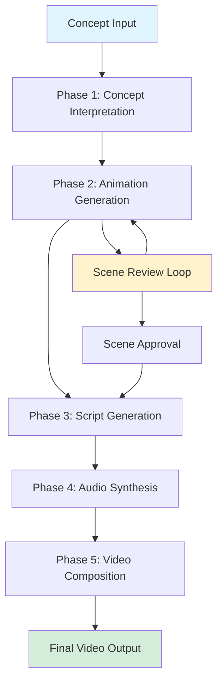
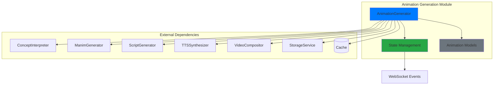
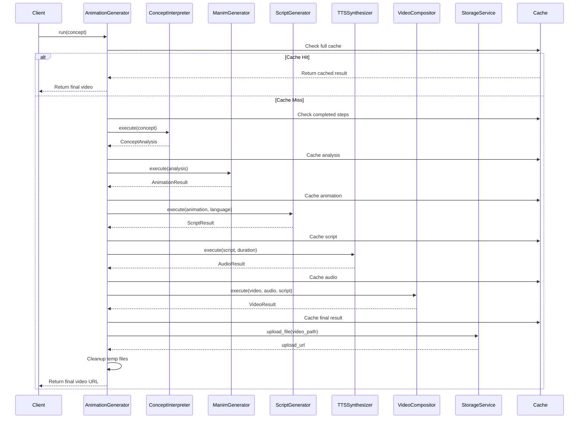
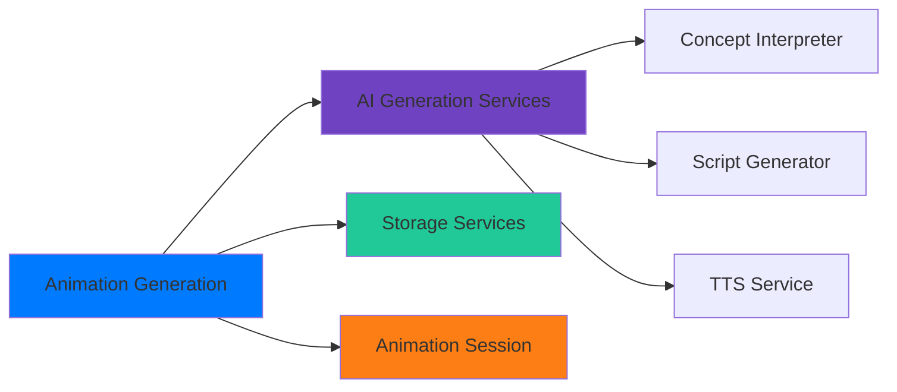

# Animation Generation Module

## Overview

The **Animation Generation Module** is a sophisticated pipeline that transforms STEM concepts into engaging, narrated video animations. It implements a multi-phase orchestration system with human-in-the-loop capabilities, enabling teachers to review and provide feedback on generated content before final composition.

### Key Features

- **Multi-Phase Pipeline**: 5 distinct phases from concept interpretation to final video composition
- **Step-Level Caching**: Resume capability from any point in the pipeline
- **Human-in-the-Loop**: Interactive scene review and feedback system
- **Modular Architecture**: Pluggable components for each generation phase
- **Real-time State Management**: WebSocket-based progress tracking and feedback
- **Automatic Cleanup**: Temporary file management after successful composition

### Pipeline Phases



## Architecture

### High-Level Component Structure



### Data Flow



## Sub-modules

The Animation Generation Module is organized into three specialized sub-modules:

### 1. [Animation Pipeline](animation_pipeline.md)
The core orchestration engine that coordinates all pipeline phases and manages execution flow.

**Key Components:**
- `AnimaionGenerator` - Main pipeline orchestrator
- `AnimationSteps` - Pipeline step definitions
- Step-level caching and resume logic
- Error handling and recovery

### 2. [Animation Models](animation_models.md)
Data structures and models that define the animation generation domain.

**Key Components:**
- `ScenePlan` - Individual scene specifications
- `SceneAction` - Atomic animation actions
- `AnimationResult` - Generation outcomes
- `AnimationConfig` - Generation parameters

### 3. [Generation State](generation_state.md)
State management system for human-in-the-loop feedback and review workflow.

**Key Components:**
- `GenerationState` - Overall generation progress
- `SceneGenerationState` - Per-scene tracking
- `SceneFeedback` - Human feedback records
- WebSocket event models for real-time updates

## Integration with Other Modules

### Dependencies



### Related Modules

- **[AI Generation Services](ai_generation_services.md)**: Provides the underlying AI capabilities for concept interpretation, script generation, and audio synthesis
- **[Storage Services](storage_services.md)**: Handles file uploads and storage operations for final video delivery
- **[Animation Session](animation_session.md)**: Manages WebSocket connections and real-time state synchronization for the human-in-the-loop workflow

## Usage Patterns

### Standard Pipeline Execution

```python
from animation_generation import animation_generator

# Execute full pipeline
result = await animation_generator.run(
    concept="Pythagorean Theorem",
    progress_callback=update_progress,
    use_cache=True
)

# Access results
if result["status"] == "success":
    video_url = result["final_video_url"]
    analysis = result["concept_analysis"]
    metadata = result["metadata"]
```

### Approved Plans Execution

```python
# Execute with pre-approved scene plans
result = await animation_generator.run_from_plans(
    concept="Quadratic Equations",
    analysis=approved_analysis,
    scene_plans=approved_plans,
    progress_callback=update_progress
)
```

### Human-in-the-Loop Workflow

```python
# Start generation with feedback workflow
response = await start_animation_with_feedback(
    request=StartAnimationWithFeedbackRequest(
        prompt="Newton's Laws of Motion",
        title="Physics: Newton's Laws",
        subject="Physics",
        grade=10
    )
)

# Monitor via WebSocket for scene review requests
# Submit feedback for scenes
feedback = SubmitFeedbackRequest(
    feedback_type=FeedbackType.LAYOUT,
    feedback_text="The diagram is overlapping with the text"
)

# Approve scenes when satisfied
await approve_scene(scene_id="scene_001")
```

## Configuration

The module uses centralized configuration through `app.config.Settings`:

### Key Configuration Groups

| Category | Settings | Description |
|----------|----------|-------------|
| **Manim** | `manim_quality`, `manim_frame_rate`, `manim_background_color` | Animation rendering settings |
| **LLM** | `base_model`, `multimodal_model`, `animation_temperature` | AI model configurations |
| **TTS** | `tts_voice_id`, `tts_model`, `tts_output_format` | Audio synthesis settings |
| **Video** | `video_codec`, `video_preset`, `video_crf` | Video composition settings |
| **Caching** | `visualisation_cache_enabled`, `visualisation_cache_ttl_seconds` | Cache behavior |
| **Retry** | `animation_max_retries_per_scene`, `max_fix_iterations` | Error recovery settings |

## Performance Characteristics

### Execution Time Breakdown

Typical execution times for a 3-scene animation:

| Phase | Duration | % of Total |
|-------|----------|------------|
| Concept Interpretation | 5-10s | 5% |
| Animation Generation | 60-120s | 60% |
| Script Generation | 10-20s | 10% |
| Audio Synthesis | 15-30s | 15% |
| Video Composition | 10-20s | 10% |
| **Total** | **100-200s** | **100%** |

### Resource Usage

- **Token Consumption**: ~50K-200K tokens per complete generation
- **Storage**: ~500MB-2GB temporary files during generation
- **Final Output**: ~10-50MB per 2-5 minute video
- **Cache Storage**: ~100MB-1GB depending on TTL and usage

## Error Handling

### Retry Strategies

1. **Scene-Level Retries**: Configurable retries per scene (`max_retries_per_scene`)
2. **LLM Fix Loop**: Automatic code fixing using LLM feedback (`max_fix_iterations`)
3. **Human Feedback**: Teacher-provided feedback for complex issues (`max_human_feedback_iterations`)
4. **Step-Level Recovery**: Resume from last successful step using cache

### Failure Modes

| Failure Point | Recovery Strategy | User Impact |
|---------------|-------------------|-------------|
| Concept Interpretation | Retry with same prompt | Minimal, fast retry |
| Animation Rendering | LLM fix → Human feedback → Skip scene | Can proceed with fewer scenes |
| Script Generation | Retry generation | Can use animation without narration |
| Audio Synthesis | Retry synthesis | Can produce silent video |
| Video Composition | Retry composition | Manual composition possible |

## Monitoring and Observability

### Logging

- **Pipeline Level**: Execution flow, phase transitions, cache hits/misses
- **Step Level**: Individual step execution times, success/failure rates
- **Token Usage**: Per-model token consumption and cost estimation
- **File Operations**: Save/load operations, cleanup activities

### Metrics

- `animation_generation_total_duration_seconds` - Histogram
- `animation_generation_step_duration_seconds` - Histogram (by step)
- `animation_generation_success_total` - Counter
- `animation_generation_cache_hits_total` - Counter
- `animation_generation_token_usage` - Counter (by model)
- `animation_generation_scenes_rendered_total` - Counter

## Security Considerations

### Input Validation

- Concept strings sanitized for file system operations
- Scene plans validated against schema before execution
- Feedback text sanitized to prevent injection attacks

### File Security

- All file operations use path sanitization
- Temporary files isolated per generation session
- Cleanup ensures no orphaned files

### API Security

- WebSocket connections authenticated via existing auth system
- State access restricted to material owners
- Feedback endpoints validate user permissions

## Future Enhancements

### Planned Features

1. **Parallel Scene Rendering**: Render multiple scenes concurrently
2. **Advanced Transitions**: More sophisticated scene transitions
3. **Template System**: Reusable animation templates for common concepts
4. **Multi-language Support**: Beyond Vietnamese (current default)
5. **Quality Scoring**: Automated quality assessment of generated scenes
6. **A/B Testing Framework**: Compare different generation strategies

### Scalability Improvements

1. **Distributed Cache**: Redis-based caching for multi-instance deployments
2. **Queue System**: Async task queue for scene rendering
3. **GPU Pooling**: Shared GPU resources for Manim rendering
4. **CDN Integration**: Direct upload to CDN for final videos