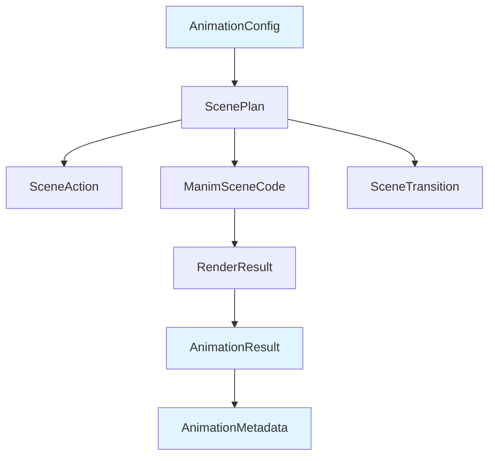
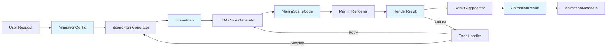
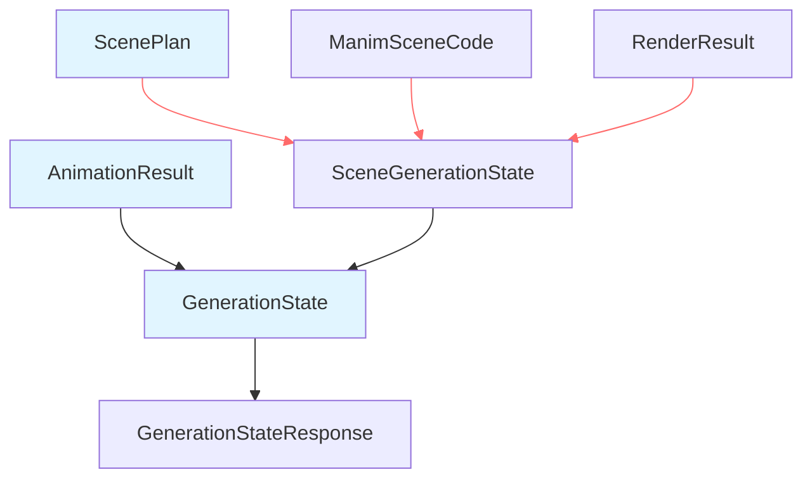
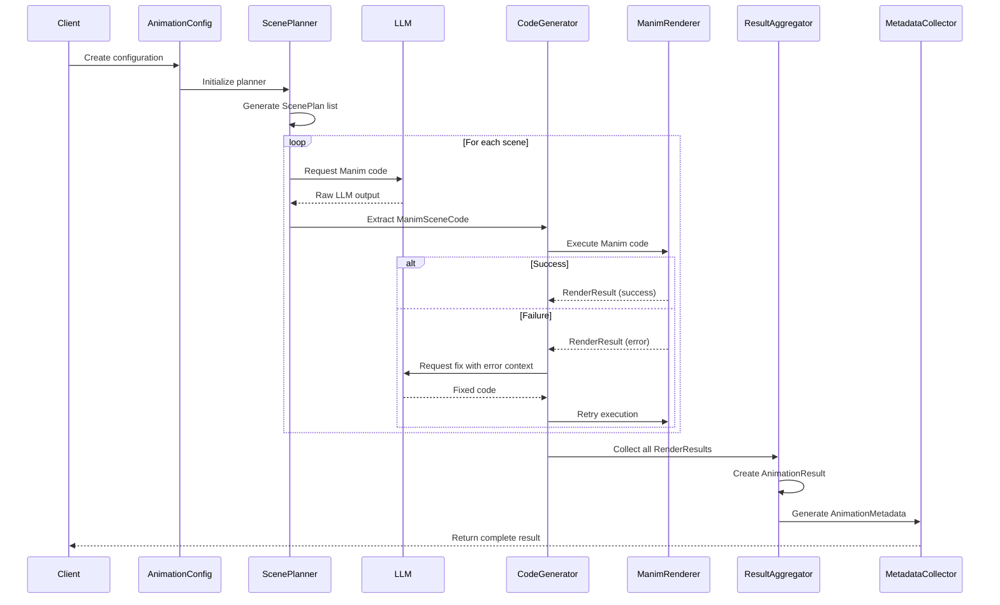
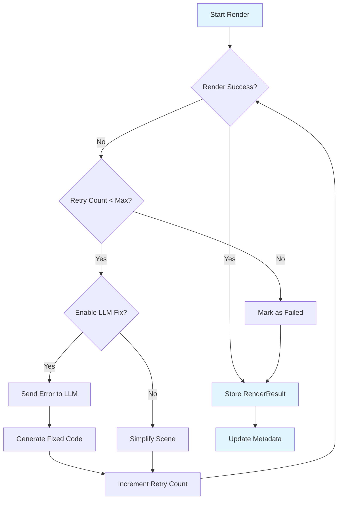
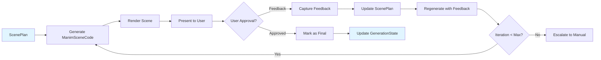
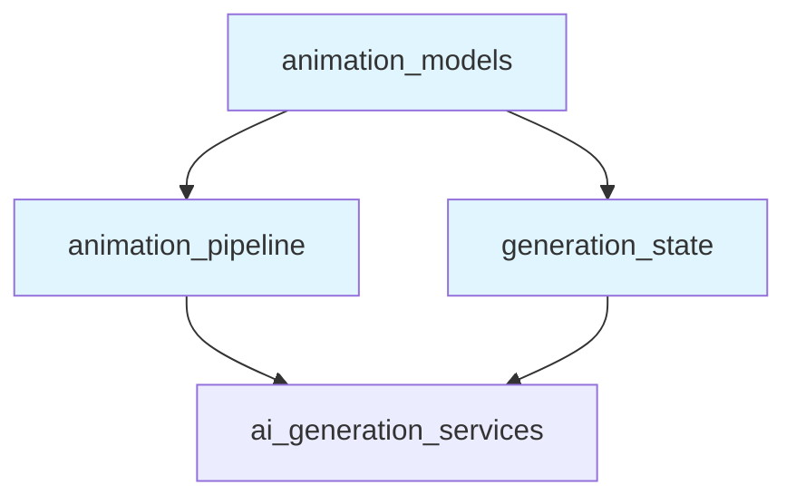
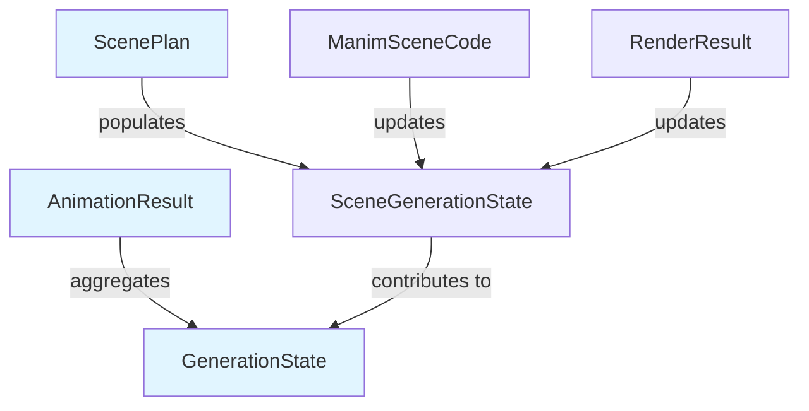

# Animation Models Module

## Overview

The **animation_models** module provides the core data models and schemas for the animation generation system, specifically designed for Manim (Mathematical Animation) code generation and rendering. This module defines the complete data structures needed to plan, generate, execute, and track the lifecycle of educational animations from concept to final rendered video.

## Purpose and Scope

This module serves as the foundational layer for the animation generation pipeline, providing:

- **Scene Planning Models**: Data structures for defining animation scenes, actions, and transitions
- **Code Generation Models**: Schemas for storing generated Manim code and extraction metadata
- **Rendering Models**: Results tracking for scene rendering operations
- **Configuration Management**: Comprehensive settings for animation generation parameters
- **Metadata Tracking**: Detailed statistics and performance metrics for the entire generation process

The models in this module are used throughout the [animation_pipeline](animation_pipeline.md) and work in conjunction with [generation_state](generation_state.md) to manage the complete animation workflow.

## Core Components

### 1. SceneAction Model

Represents a single visual action within an animation scene, defining the atomic operations that can be performed on visual elements.

**Key Attributes:**
- `action_type`: Type of animation (write, create, transform, fade_in, fade_out, move, highlight, grow, shrink, wait)
- `element_type`: Type of visual element (text, diagram, math_equation, graph, axis, shape, group, none)
- `description`: Human-readable description of the action
- `target`: Target element identifier
- `duration`: Animation duration in seconds
- `parameters`: Additional parameters dictionary for customization

**Usage:**
```python
action = SceneAction(
    action_type="write",
    element_type="text",
    description="Write the formula on screen",
    target="main_formula",
    duration=3.0,
    parameters={"text": "E = mc²", "color": "#3B82F6"}
)
```

### 2. ScenePlan Model

Complete plan for a single animation scene, aggregating multiple actions into a cohesive visual narrative.

**Key Attributes:**
- `id`: Unique scene identifier
- `title`: Scene title
- `description`: Scene description
- `actions`: List of SceneAction objects
- `scene_dependencies`: List of dependent scene IDs

**Relationships:**
- Contains multiple [SceneAction](#1-sceneaction-model) objects
- Referenced by [SceneTransition](#7-scenetransition-model) for flow control
- Used by [ManimSceneCode](#3-manimscenecode-model) for code generation

### 3. ManimSceneCode Model

Stores the generated Manim Python code for a single scene along with extraction metadata.

**Key Attributes:**
- `scene_id`: Reference to the corresponding ScenePlan
- `scene_name`: Name of the Manim scene class
- `manim_code`: Generated Python code string
- `raw_llm_output`: Original LLM response before extraction
- `extraction_method`: Method used to extract code (default: "tags")

**Process Flow:**
```
ScenePlan → LLM Generation → Raw Output → Code Extraction → ManimSceneCode
```

### 4. RenderResult Model

Tracks the result of rendering a single scene, including success/failure status and output metadata.

**Key Attributes:**
- `scene_id`: Reference to the rendered scene
- `success`: Boolean indicating render success
- `video_path`: Path to rendered video file (if successful)
- `error_message`: Error details (if failed)
- `duration`: Rendered video duration
- `resolution`: Video resolution as (width, height) tuple
- `render_time`: Time taken to render
- `file_size_mb`: Size of rendered video file

**Integration:**
- Consumed by [AnimationResult](#5-animationresult-model) for aggregate statistics
- Used by [animation_pipeline](animation_pipeline.md) for error handling and retry logic

### 5. AnimationResult Model

Complete result of animation generation for a concept, aggregating all scene results and metadata.

**Key Attributes:**
- `success`: Overall generation success
- `concept_id`: Associated concept identifier
- `total_duration`: Combined duration of all scenes
- `scene_count`: Number of scenes generated
- `silent_animation_path`: Path to final compiled video
- `scene_plan`: List of [ScenePlan](#2-sceneplan-model) objects
- `scene_codes`: List of [ManimSceneCode](#3-manimscenecode-model) objects
- `render_results`: List of [RenderResult](#4-renderresult-model) objects
- `generation_time`, `total_render_time`: Performance metrics
- `models_used`, `token_usage`: AI service usage tracking

### 6. AnimationConfig Model

Comprehensive configuration for animation generation, controlling quality, performance, and AI parameters.

**Key Configuration Groups:**

**Video Quality Settings:**
- `quality`: Output quality (default: "1080p60")
- `background_color`: Background color hex code
- `frame_rate`: Frames per second (default: 60)
- `max_scene_duration`: Maximum duration per scene
- `total_video_duration_target`: Target total video length

**AI Generation Settings:**
- `max_retries_per_scene`: Retry attempts for failed generations
- `temperature`: Creativity parameter for LLM

**Render Settings:**
- `render_timeout`: Maximum render time per scene
- `enable_simplification`: Auto-simplify complex scenes
- `simplify_on_retry`: Simplify when retrying failed renders

**Feedback Loop Settings:**
- `enable_llm_fix`: Enable automatic error fixing via LLM
- `max_fix_iterations`: Maximum fix attempts
- `fix_temperature`: Temperature for fix generation
- `human_feedback_temperature`: Temperature for human feedback integration
- `max_human_feedback_iterations`: Maximum human feedback loops

### 7. SceneTransition Model

Defines transitions between scenes, controlling the visual flow of the final compiled video.

**Key Attributes:**
- `from_scene`: Source scene ID
- `to_scene`: Destination scene ID
- `transition_type`: Type of transition (default: "fade")
- `duration`: Transition duration in seconds

**Usage:**
```python
transition = SceneTransition(
    from_scene="scene_1",
    to_scene="scene_2",
    transition_type="fade",
    duration=0.5
)
```

### 8. AnimationMetadata Model

Comprehensive metadata tracking the complete animation generation process for analytics and optimization.

**Key Attributes:**

**Identification:**
- `concept_name`: Name of the concept being animated
- `timestamp`: Generation timestamp
- `version`: Schema version (default: "2.0")

**Generation Statistics:**
- `total_scenes_planned`: Number of scenes in plan
- `total_scenes_rendered`: Number of scenes attempted
- `successful_renders`: Number of successful renders
- `failed_renders`: Number of failed renders

**Timing Information:**
- `planning_time`: Time spent in planning phase
- `code_generation_time`: Time spent generating code
- `rendering_time`: Time spent rendering scenes
- `concatenation_time`: Time spent compiling final video
- `total_time`: Total generation time

**Resource Usage:**
- `total_tokens_used`: Total AI tokens consumed
- `estimated_cost_usd`: Estimated generation cost
- `total_video_size_mb`: Final video file size
- `intermediate_files_count`: Number of intermediate files

## Architecture

### Component Hierarchy



### Data Flow Architecture



### State Management Integration



*Integration with [generation_state](generation_state.md) module*

## Process Flows

### Complete Animation Generation Workflow



### Error Handling and Retry Flow



### Human Feedback Integration Flow



## Dependencies

### Internal Dependencies



**Direct Dependencies:**
- **[animation_pipeline](animation_pipeline.md)**: Uses these models to orchestrate the animation generation process
- **[generation_state](generation_state.md)**: Stores generation state using ScenePlan and AnimationResult

**Indirect Dependencies:**
- **[ai_generation_services](ai_generation_services.md)**: Generates content that populates these models
- **[material_management](material_management.md)**: May trigger animation generation for materials

### External Dependencies

- **pydantic**: All models inherit from `BaseModel` for validation and serialization
- **typing**: Type hints for List, Optional, Dict, Any, Tuple

## Usage Examples

### Creating a Simple Animation Plan

```python
from backend.app.services.ai.visualisation.plaintext.animation.manim_models import (
    SceneAction, ScenePlan, AnimationConfig
)

# Define configuration
config = AnimationConfig(
    quality="1080p60",
    max_scene_duration=30.0,
    enable_llm_fix=True
)

# Create scene actions
actions = [
    SceneAction(
        action_type="write",
        element_type="text",
        description="Write the title",
        target="title",
        duration=2.0,
        parameters={"text": "Pythagorean Theorem", "color": "#3B82F6"}
    ),
    SceneAction(
        action_type="create",
        element_type="diagram",
        description="Draw right triangle",
        target="triangle",
        duration=3.0,
        parameters={"sides": ["a", "b", "c"]}
    )
]

# Create scene plan
scene_plan = ScenePlan(
    id="scene_1",
    title="Introduction",
    description="Introduce the Pythagorean Theorem",
    actions=actions,
    scene_dependencies=[]
)
```

### Processing Render Results

```python
from backend.app.services.ai.visualisation.plaintext.animation.manim_models import (
    RenderResult, AnimationResult, AnimationMetadata
)

# Example render result
render_result = RenderResult(
    scene_id="scene_1",
    success=True,
    video_path="/output/scene_1.mp4",
    duration=5.0,
    resolution=(1920, 1080),
    render_time=15.2,
    file_size_mb=12.5
)

# Create aggregate result
animation_result = AnimationResult(
    success=True,
    concept_id="pythagorean_theorem",
    total_duration=25.0,
    scene_count=3,
    silent_animation_path="/output/final_video.mp4",
    scene_plan=[scene_plan],
    scene_codes=[manim_code],
    render_results=[render_result],
    generation_time=45.0,
    total_render_time=38.5
)

# Generate metadata
metadata = AnimationMetadata(
    concept_name="Pythagorean Theorem",
    timestamp="2024-01-15T10:30:00Z",
    total_scenes_planned=3,
    total_scenes_rendered=3,
    successful_renders=3,
    failed_renders=0,
    total_time=45.0,
    total_tokens_used=15000
)
```

## Integration with Generation State

The models in this module are tightly integrated with the [generation_state](generation_state.md) module to track the progression of animation generation:



Each scene's progression is tracked through:
1. **Planning State**: ScenePlan created and stored
2. **Code Generation State**: ManimSceneCode generated and validated
3. **Rendering State**: RenderResult produced (success or failure)
4. **Aggregation State**: AnimationResult compiled with all scene data

## Best Practices

### 1. Configuration Management
- Use `AnimationConfig` to centralize all generation parameters
- Adjust `temperature` based on content complexity (lower for technical content)
- Set appropriate `max_retries_per_scene` based on time constraints

### 2. Error Handling
- Always check `success` flags in RenderResult and AnimationResult
- Implement fallback strategies when `enable_llm_fix` is enabled
- Monitor `failed_renders` count in AnimationMetadata for quality assurance

### 3. Performance Optimization
- Use `scene_dependencies` to enable parallel rendering of independent scenes
- Adjust `max_scene_duration` and `total_video_duration_target` based on content needs
- Enable `simplify_on_retry` for complex scenes that frequently fail

### 4. Metadata Tracking
- Always generate AnimationMetadata for analytics and cost tracking
- Monitor `token_usage` and `estimated_cost_usd` for budget management
- Use `models_used` to track which AI models were utilized

### 5. Human Feedback Integration
- Design ScenePlan structures to be easily modifiable based on feedback
- Use `human_feedback_temperature` for more deterministic regeneration
- Track `max_human_feedback_iterations` to prevent infinite loops

## Model Versioning

The `AnimationMetadata.version` field tracks schema versions:
- **"2.0"**: Current version with enhanced error handling and feedback loops
- Future versions will be documented as the schema evolves

## Related Documentation

- **[animation_pipeline](animation_pipeline.md)**: Orchestrates the animation generation process using these models
- **[generation_state](generation_state.md)**: Tracks generation progress and state using these models
- **[ai_generation_services](ai_generation_services.md)**: Provides AI services that populate these models
- **[material_management](material_management.md)**: May trigger animation generation workflows