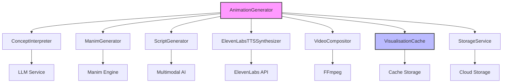
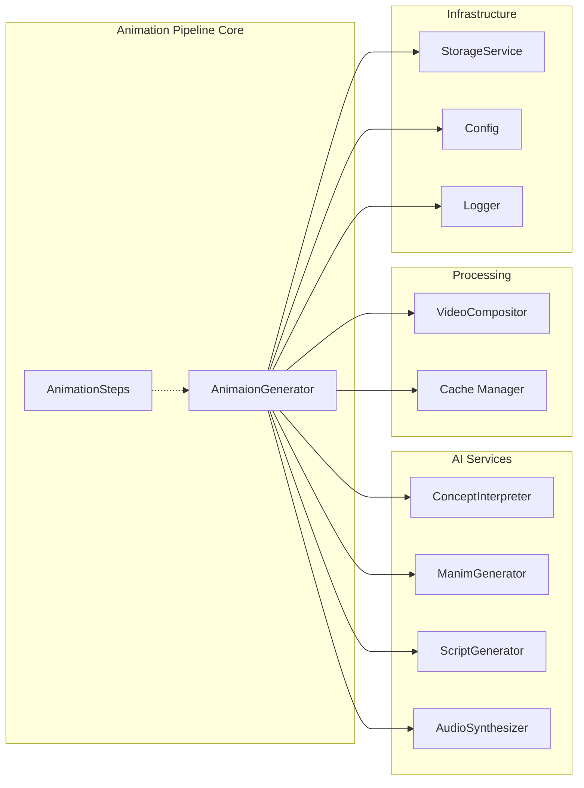
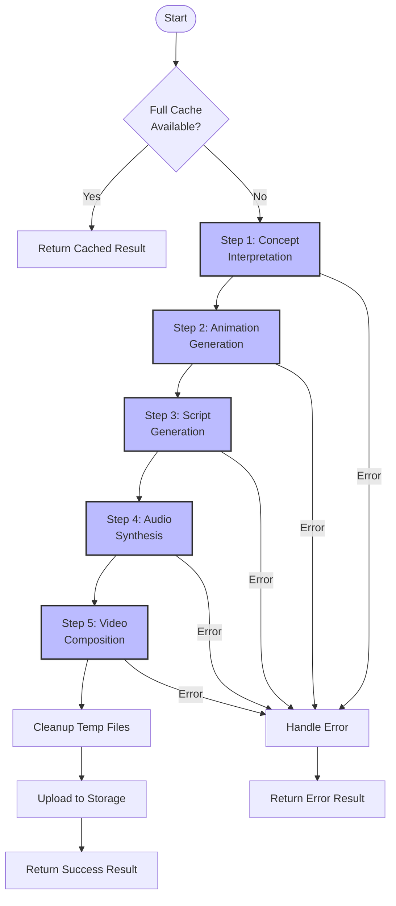
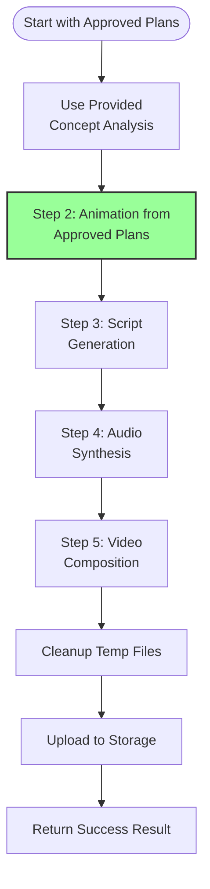
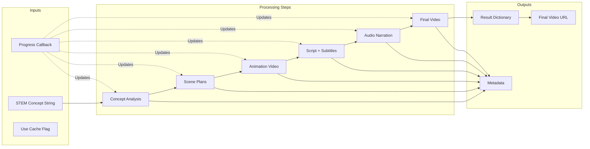
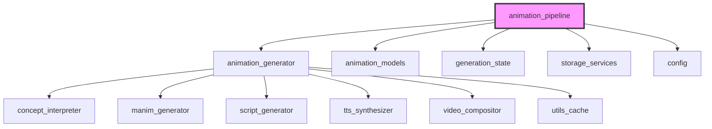
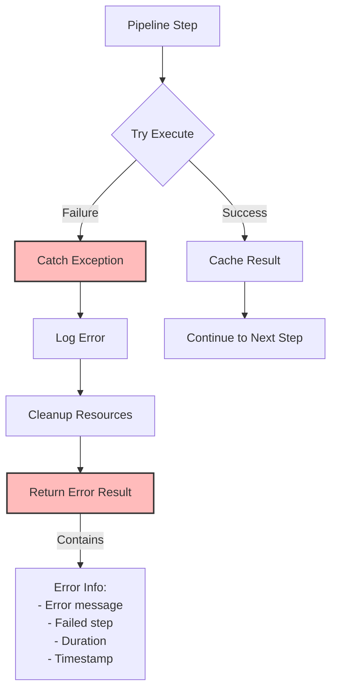

# Animation Pipeline Module

## Overview

The **Animation Pipeline** module is the core orchestration engine for STEM animation generation in the system. It implements a sophisticated 5-phase pipeline that transforms abstract STEM concepts into fully-produced educational videos with animations, narration, and subtitles. The module features intelligent step-level caching, comprehensive error handling, and support for both automated and teacher-approved workflow modes.

### Key Capabilities

- **End-to-End Automation**: Transforms STEM concepts into complete educational videos
- **Step-Level Caching**: Resume capability from any pipeline step after failures
- **Dual Workflow Support**: Both automatic generation and teacher-approved plan execution
- **Progress Tracking**: Real-time callbacks for UI updates
- **Comprehensive Error Handling**: Graceful degradation and detailed error reporting
- **Resource Management**: Automatic cleanup of temporary files
- **Multi-Language Support**: Currently optimized for Vietnamese narration

## Architecture

### High-Level Architecture



### Component Relationships



## Core Components

### 1. AnimationGenerator Class

The `AnimaionGenerator` class (note the intentional typo in the class name) is the main orchestrator that coordinates all pipeline activities. It manages the entire lifecycle from concept interpretation to final video delivery.

#### Key Responsibilities

- **Pipeline Orchestration**: Sequentially executes all pipeline steps
- **Cache Management**: Implements step-level caching with dependency tracking
- **Error Recovery**: Handles failures and provides resume capability
- **Progress Reporting**: Manages callback system for real-time updates
- **Resource Cleanup**: Automatically removes temporary files after successful completion
- **Metadata Collection**: Gathers comprehensive statistics and performance metrics

#### Initialization

```python
def __init__(self):
    # Initialize configuration and logging
    # Setup cache manager with TTL and enable/disable controls
    # Initialize all AI service agents:
    # - ConceptInterpreter (LLM-based concept analysis)
    # - ManimGenerator (Animation engine)
    # - ScriptGenerator (Narration script creation)
    # - ElevenLabsTTSSynthesizer (Text-to-speech)
    # - VideoCompositor (Final video assembly)
```

### 2. AnimationSteps Enum

The `AnimationSteps` enum defines the five distinct phases of the pipeline, enabling precise caching and progress tracking.

```python
class AnimationSteps:
    CONCEPT_INTERPRETATION = "concept_interpretation"  # Phase 1: Analyze STEM concept
    ANIMATION_GENERATION = "animation_generation"      # Phase 2-3: Create visual animations
    SCRIPT_GENERATION = "script_generation"           # Phase 3: Generate narration script
    AUDIO_SYNTHESIS = "audio_synthesis"               # Phase 3: Convert script to speech
    VIDEO_COMPOSITION = "video_composition"           # Phase 4: Combine all elements
```

## Pipeline Flow

### Standard Execution Flow



### Teacher-Approved Workflow



## Caching Mechanism

### Step-Level Caching Architecture

```mermaid
graph TB
    subgraph "Cache Manager"
        CM[VisualisationCache]
        CM --> CS[get_completed_steps]
        CM --> GS[get_step]
        CM --> SS[set_step]
        CM --> IS[invalidate_step]
        CM --> GR[get]
        CM --> SR[set]
    end
    
    subgraph "Cache Storage"
        DB[(Cache DB)]
        FS[File System]
    end
    
    subgraph "Pipeline Steps"
        S1[Concept Interpretation]
        S2[Animation Generation]
        S3[Script Generation]
        S4[Audio Synthesis]
        S5[Video Composition]
    end
    
    CM --> DB
    CM --> FS
    
    S1 -.->|Cache Result| CM
    S2 -.->|Cache Result| CM
    S3 -.->|Cache Result| CM
    S4 -.->|Cache Result| CM
    S5 -.->|Cache Result| CM
    
    CM -.->|Retrieve| S1
    CM -.->|Retrieve| S2
    CM -.->|Retrieve| S3
    CM -.->|Retrieve| S4
    CM -.->|Retrieve| S5
```



### Cache Invalidation Rules

1. **File Existence Check**: Cached steps are invalidated if output files are missing
2. **Dependency Tracking**: Steps are cached with dependencies on previous steps
3. **TTL Enforcement**: Cache entries expire based on configured time-to-live
4. **Manual Invalidation**: Explicit invalidation via `invalidate_step()` method

## Data Flow

### Input-Output Data Transformation



### Result Structure

```python
{
    "status": "success|error",
    "final_video_url": "https://...",
    "concept_analysis": {...},
    "analysis_path": "/path/to/analysis.json",
    "animation_result": {...},
    "script_result": {...},
    "audio_result": {...},
    "video_result": {...},
    "metadata": {
        "total_duration": 125.5,
        "steps_completed": [...],
        "steps_from_cache": [...],
        "timestamp": "2024-01-15T10:30:00",
        "token_usage": {...},
        "models_used": {...},
        "animation_stats": {...},
        "script_stats": {...},
        "audio_stats": {...},
        "video_stats": {...}
    },
    "error": None,
    "from_cache": False
}
```

## Integration Points

### Module Dependencies



### External Service Integrations

1. **LLM Services**: OpenAI/GPT for concept interpretation and script generation
2. **ElevenLabs**: Text-to-speech synthesis for narration
3. **Manim**: Mathematical animation engine for visual content
4. **FFmpeg**: Video composition and encoding
5. **Cloud Storage**: Final video delivery and persistence

## Error Handling & Recovery

### Error Handling Flow



### Recovery Mechanisms

1. **Step-Level Resume**: Pipeline can restart from any cached step
2. **Graceful Degradation**: Continues execution even if some steps fail
3. **Comprehensive Logging**: Detailed error logs with context
4. **Resource Cleanup**: Ensures temporary files are cleaned up on errors
5. **Partial Results**: Returns available results even on failure

## Key Features

### 1. Intelligent Caching
- **Step-level granularity**: Cache individual pipeline steps
- **Dependency awareness**: Understands relationships between steps
- **File validation**: Verifies cached files still exist before reuse
- **TTL support**: Automatic expiration of old cache entries

### 2. Progress Tracking
- **Real-time callbacks**: Progress updates at each step
- **Percentage completion**: Accurate progress reporting (0-100%)
- **Status messages**: Descriptive text updates for UI
- **Step identification**: Clear indication of current phase

### 3. Resource Management
- **Automatic cleanup**: Removes temporary files after success
- **Selective retention**: Keeps only final deliverables
- **Directory management**: Cleans up empty directories
- **Manim temp files**: Cleans up Manim's media directory

### 4. Comprehensive Metadata
- **Performance metrics**: Timing for each step and total duration
- **Token usage**: Tracks LLM token consumption
- **Model information**: Records which models were used
- **Statistics**: Detailed stats for each pipeline phase
- **Cache information**: Identifies which steps came from cache

### 5. Dual Workflow Support
- **Automatic mode**: Full pipeline from concept to video
- **Approved plans mode**: Skip concept interpretation, use teacher-approved plans
- **Consistent interface**: Same result structure for both modes
- **Metadata differentiation**: Tracks which mode was used

## Usage Examples

### Basic Usage

```python
from app.services.ai.visualisation.animation_generator import AnimaionGenerator

# Initialize the pipeline
generator = AnimaionGenerator()

# Run the pipeline
result = await generator.run(
    concept="Pythagorean Theorem",
    progress_callback=lambda msg, pct: print(f"{pct*100:.0f}%: {msg}"),
    use_cache=True
)

if result["status"] == "success":
    print(f"Video URL: {result['final_video_url']}")
else:
    print(f"Error: {result['error']}")
```

### Teacher-Approved Workflow

```python
# Use pre-approved concept analysis and scene plans
result = await generator.run_from_plans(
    concept="Quadratic Equations",
    analysis=approved_analysis,
    scene_plans=approved_scene_plans,
    progress_callback=lambda msg, pct: update_ui(msg, pct)
)
```

### Progress Tracking

```python
def progress_handler(message: str, percentage: float):
    # Update UI progress bar
    ui.progress_bar.value = percentage * 100
    # Update status text
    ui.status_text.text = message
    # Log for debugging
    logger.info(f"Pipeline: {message} ({percentage*100:.0f}%)")

result = await generator.run(
    concept="Newton's Laws",
    progress_callback=progress_handler
)
```

## Performance Considerations

### Optimization Strategies

1. **Caching**: Reduces redundant API calls and processing
2. **Parallelization**: Individual steps can be optimized internally
3. **File Management**: Efficient cleanup prevents disk space issues
4. **Timeout Handling**: Configurable timeouts for each service
5. **Retry Logic**: Automatic retries for transient failures

### Resource Usage

- **Memory**: Peak usage during video composition phase
- **Disk**: Temporary files cleaned up after successful completion
- **Network**: API calls to LLM, TTS, and storage services
- **CPU**: Intensive during Manim rendering and video composition

## Configuration

The pipeline behavior is controlled through settings:

```python
# Cache settings
visualisation_cache_enabled = True
visualisation_cache_ttl_seconds = 86400  # 24 hours
cache_dir = Path("./cache")

# Model settings
base_model = "gpt-4"
manim_model = "gpt-4"
multimodal_model = "gemini-pro"
tts_model = "eleven_multilingual_v2"

# Timeout settings
manim_render_timeout = 300
script_generation_timeout = 120
tts_timeout = 60
video_composition_timeout = 180

# Quality settings
manim_quality = "high"
video_codec = "libx264"
audio_codec = "aac"
```

## Dependencies

### Internal Modules

- **[animation_generator](../animation_generator.md)**: Core orchestration logic
- **[animation_models](../animation_models.md)**: Data models for animation components
- **[generation_state](../generation_state.md)**: State management for generation process
- **[storage_services](../storage_services.md)**: File upload and storage
- **[config](../config.md)**: Configuration management

### External Services

- **OpenAI API**: Concept interpretation and script generation
- **ElevenLabs API**: Text-to-speech synthesis
- **Manim**: Mathematical animation rendering
- **FFmpeg**: Video and audio processing
- **Cloud Storage**: Final video hosting

## Future Enhancements

1. **Parallel Step Execution**: Run independent steps concurrently
2. **Streaming Support**: Stream video generation progress
3. **Quality Metrics**: Automated quality assessment of outputs
4. **A/B Testing**: Support for multiple generation strategies
5. **Plugin Architecture**: Extensible step system for custom phases
6. **Advanced Caching**: Content-based caching vs. concept-based
7. **Cost Optimization**: Intelligent model selection based on complexity

## Conclusion

The Animation Pipeline module represents a sophisticated orchestration layer that seamlessly integrates multiple AI services to produce high-quality educational content. Its robust caching system, comprehensive error handling, and dual workflow support make it suitable for both automated and teacher-guided content creation scenarios. The modular design allows for easy extension and maintenance while providing detailed metadata for monitoring and optimization.