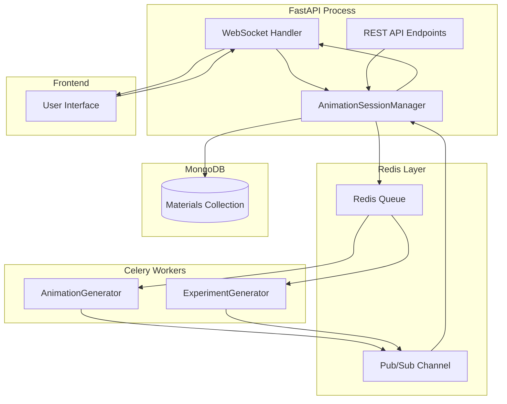
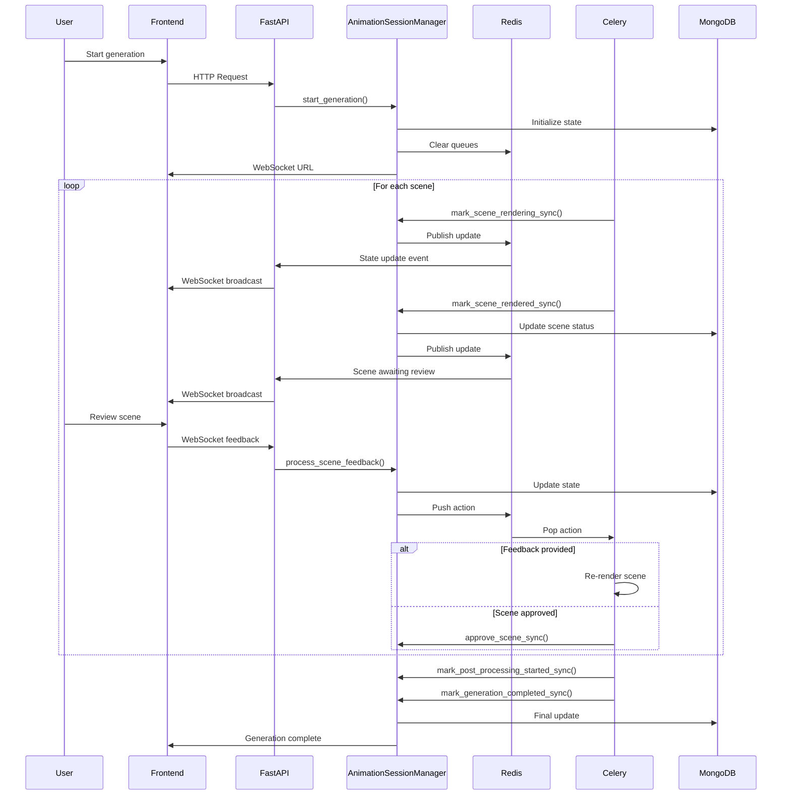
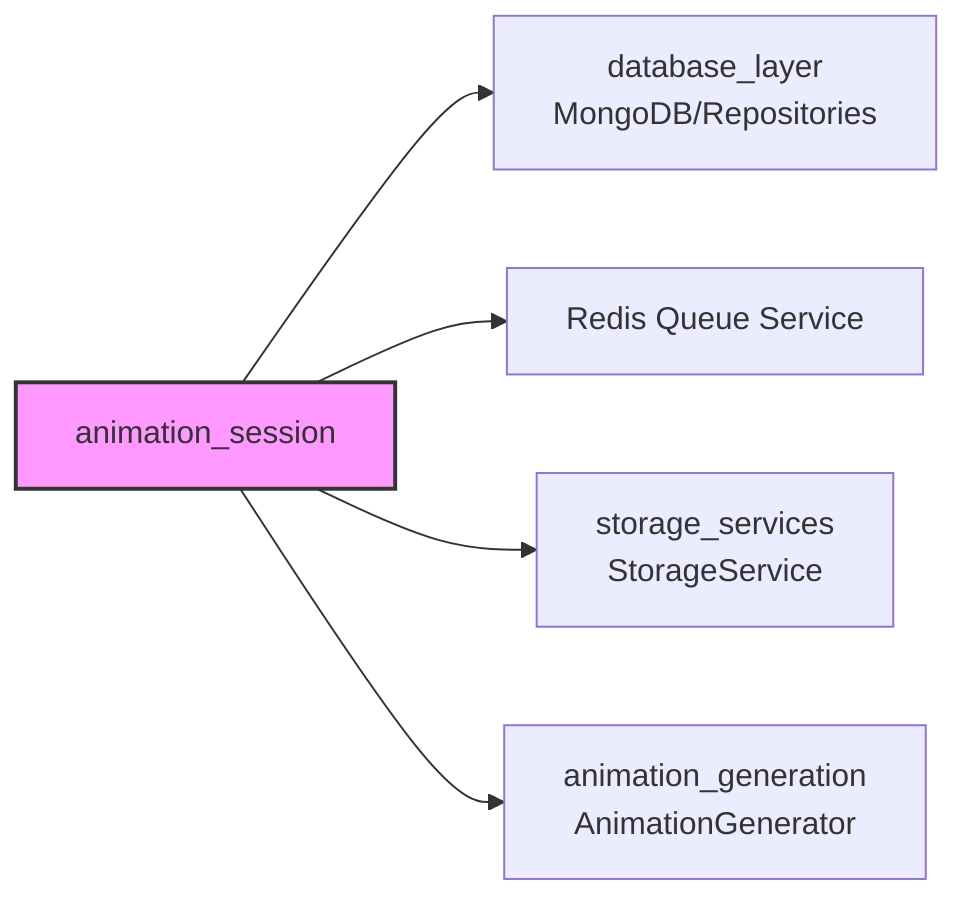

# Animation Session Module

## Overview

The **Animation Session** module provides a human-in-the-loop feedback workflow for scene-by-scene animation generation. It orchestrates the entire animation rendering process with real-time WebSocket updates, enabling users to review, provide feedback on, and approve individual scenes before final video composition.

## Purpose

This module addresses the critical need for quality control in AI-generated educational animations by:

- **Enabling Human Review**: Allows educators to review each scene before final compilation
- **Supporting Iterative Refinement**: Facilitates feedback loops for scene improvement
- **Providing Real-time Updates**: Streams progress updates via WebSocket connections
- **Coordinating Cross-Process Communication**: Bridges FastAPI and Celery workers via Redis
- **Managing Complex State**: Tracks scene-level and generation-level status across distributed processes

## Architecture

### System Architecture



### Component Interaction Flow



## Core Components

### 1. AnimationSessionManager Service

The central orchestrator that manages the entire animation generation lifecycle. See [animation_session_manager.md](animation_session_manager.md) for detailed documentation.

**Key Responsibilities:**
- WebSocket connection management
- Cross-process state synchronization
- Redis queue coordination
- Scene lifecycle management
- Real-time event broadcasting

### 2. Generation State Models

Comprehensive data models for tracking generation progress and scene states. See [generation_state_models.md](generation_state_models.md) for detailed documentation.

**Key Models:**
- `GenerationState`: Overall generation progress
- `SceneGenerationState`: Individual scene tracking
- `SceneFeedback`: Human feedback records
- `WSMessage`: WebSocket communication protocol

## Module Relationships

### Dependencies



### Integration Points

1. **Database Layer**: Persists generation state to MongoDB materials collection
2. **Redis Service**: Enables cross-process communication between FastAPI and Celery
3. **Storage Service**: Manages video file storage and URL generation
4. **Animation Generation**: Triggers scene rendering and re-rendering based on feedback

## Key Features

### Human-in-the-Loop Workflow

- **Scene-by-Scene Review**: Users review each scene individually
- **Feedback Categories**: Structured feedback types (layout, content, timing, visual, accuracy)
- **Iteration Tracking**: Monitors feedback loops and iteration limits
- **Approval System**: Explicit scene approval before final compilation

### Real-time Communication

- **WebSocket Connections**: Persistent connections for live updates
- **Event Broadcasting**: Immediate state updates to all connected clients
- **State Synchronization**: Automatic state sync on WebSocket connection
- **Heartbeat Mechanism**: Connection health monitoring

### Cross-Process Coordination

- **Redis Queues**: Scene-specific action queues
- **Pub/Sub Pattern**: State update events from Celery to FastAPI
- **Dual API Design**: Async methods for FastAPI, sync methods for Celery
- **State Consistency**: MongoDB as single source of truth

### Resilience & Recovery

- **Stuck Generation Recovery**: Resume capabilities for interrupted processes
- **Error Handling**: Comprehensive error tracking and reporting
- **Timeout Management**: Configurable timeouts for human actions
- **Queue Cleanup**: Automatic cleanup of stale Redis queues

## Usage Patterns

### Starting a Generation Session

```python
# Initialize generation with scene plans
await animation_session_manager.start_generation(
    material_id="material_123",
    scene_plans=[
        {"id": "scene_1", "title": "Introduction"},
        {"id": "scene_2", "title": "Main Concept"},
    ],
    concept_analysis={"key_concepts": ["concept1", "concept2"]}
)
```

### Processing Human Feedback

```python
# Process feedback for a scene
scene_state = await animation_session_manager.process_scene_feedback(
    material_id="material_123",
    scene_id="scene_1",
    feedback_type=FeedbackType.CONTENT,
    feedback_text="The explanation is too complex for this grade level"
)
```

### Scene Approval Flow

```python
# Approve a scene after review
scene_state = await animation_session_manager.approve_scene(
    material_id="material_123",
    scene_id="scene_1"
)
```

## WebSocket Event Flow

### Client → Server Events

- `SUBMIT_FEEDBACK`: User provides scene feedback
- `APPROVE_SCENE`: User approves a scene
- `SKIP_SCENE`: User skips a scene
- `CANCEL_GENERATION`: User cancels entire generation

### Server → Client Events

- `SCENE_AWAITING_REVIEW`: Scene ready for user review
- `SCENE_REVISION_STARTED`: Feedback processing initiated
- `SCENE_APPROVED`: Scene approved successfully
- `ALL_SCENES_RESOLVED`: All scenes processed
- `GENERATION_COMPLETED`: Final video ready

## Error Handling

### Scene-level Errors

- **Render Failures**: Automatic retry with error tracking
- **Max Iterations**: Prevents infinite feedback loops
- **Skip Option**: Users can skip problematic scenes

### Generation-level Errors

- **Process Cancellation**: Graceful shutdown and cleanup
- **State Corruption**: Recovery methods for stuck generations
- **Queue Management**: Automatic cleanup of stale queues

## Performance Considerations

### Scalability

- **Connection Pooling**: Efficient WebSocket connection management
- **Redis Optimization**: Scene-specific queues reduce contention
- **MongoDB Indexing**: Fast state lookups by material ID

### Resource Management

- **Async Operations**: Non-blocking I/O for all external calls
- **Connection Cleanup**: Automatic cleanup of dead connections
- **Queue Limits**: Prevents unbounded Redis memory growth

## Security Considerations

- **WebSocket Authentication**: Secure connection establishment
- **State Validation**: Pydantic models ensure data integrity
- **Access Control**: Material-level authorization checks
- **Input Sanitization**: Feedback text processing and validation

## Monitoring & Observability

### Logging

- **Structured Logging**: JSON logs with context
- **Event Tracking**: All state transitions logged
- **Error Context**: Comprehensive error details for debugging

### Metrics

- **Active Connections**: WebSocket connection count per material
- **Queue Depth**: Redis queue lengths
- **Generation Duration**: End-to-end timing metrics
- **Feedback Iterations**: Average iterations per scene

## Related Documentation

- [Animation Session Manager](animation_session_manager.md) - Detailed service documentation
- [Generation State Models](generation_state_models.md) - Complete data model reference
- [Animation Generation](animation_generation.md) - Scene rendering engine
- [Database Layer](database_layer.md) - MongoDB integration
- [Storage Services](storage_services.md) - Video file management
- [Database Models](database_models.md) - Common data models and enums
- [Redis Queue Service](redis_queue.md) - Cross-process communication layer

## API Reference

### REST Endpoints

The animation session module integrates with the main API through:

- `POST /materials/{material_id}/animation-with-feedback` - Start generation
- `GET /materials/{material_id}/generation-state` - Get current state
- `POST /materials/{material_id}/scenes/{scene_id}/feedback` - Submit feedback
- `POST /materials/{material_id}/scenes/{scene_id}/approve` - Approve scene
- `POST /materials/{material_id}/scenes/{scene_id}/skip` - Skip scene

### WebSocket Endpoint

- `WS /ws/materials/{material_id}/generation` - Real-time updates

## Future Enhancements

### Planned Features

- **Batch Operations**: Approve multiple scenes simultaneously
- **Feedback Templates**: Pre-defined common feedback options
- **Scene Comparison**: Side-by-side view of iterations
- **Collaborative Review**: Multiple reviewers per material
- **Generation Analytics**: Detailed performance insights

### Technical Improvements

- **Connection Persistence**: Reconnect on WebSocket failures
- **State Snapshots**: Periodic state backups for recovery
- **Queue Prioritization**: Priority-based scene rendering
- **Resource Quotas**: Per-user generation limits