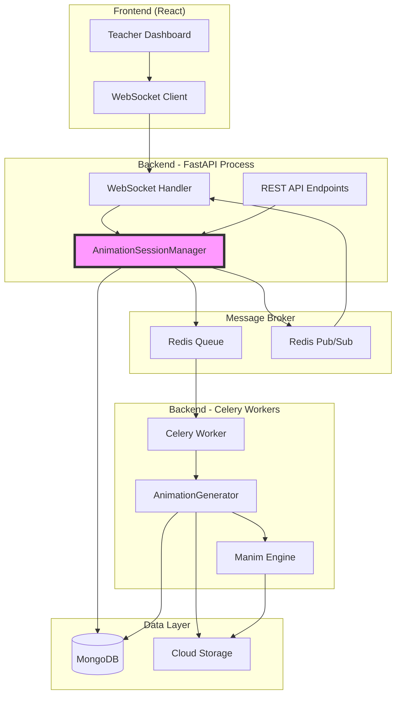
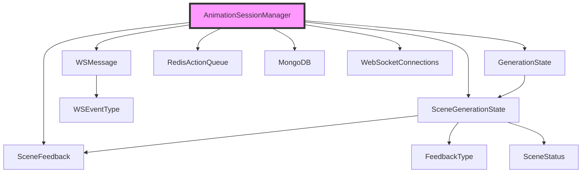
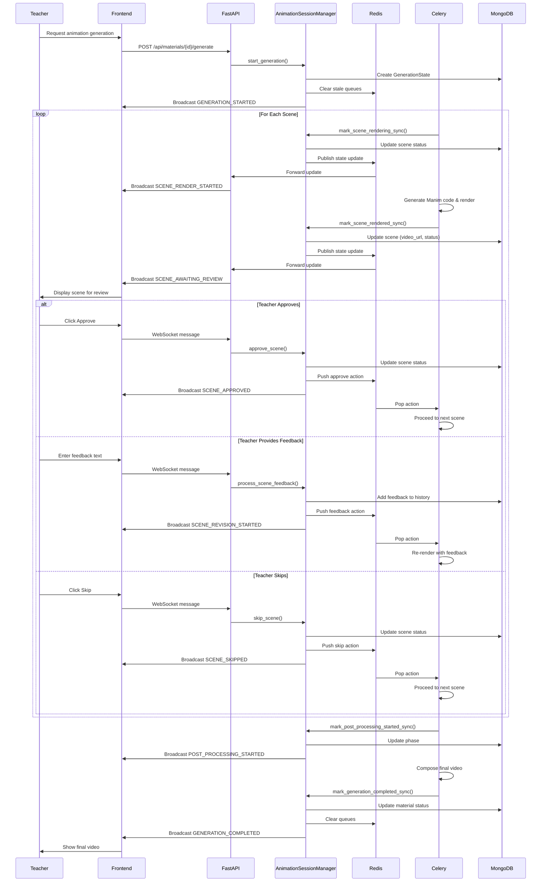
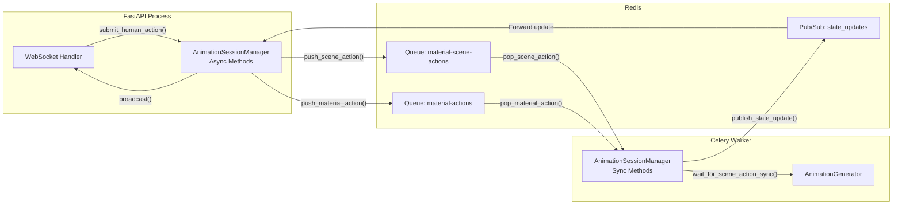
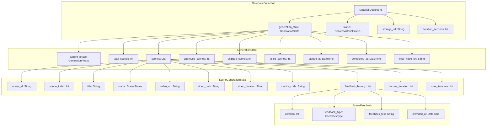
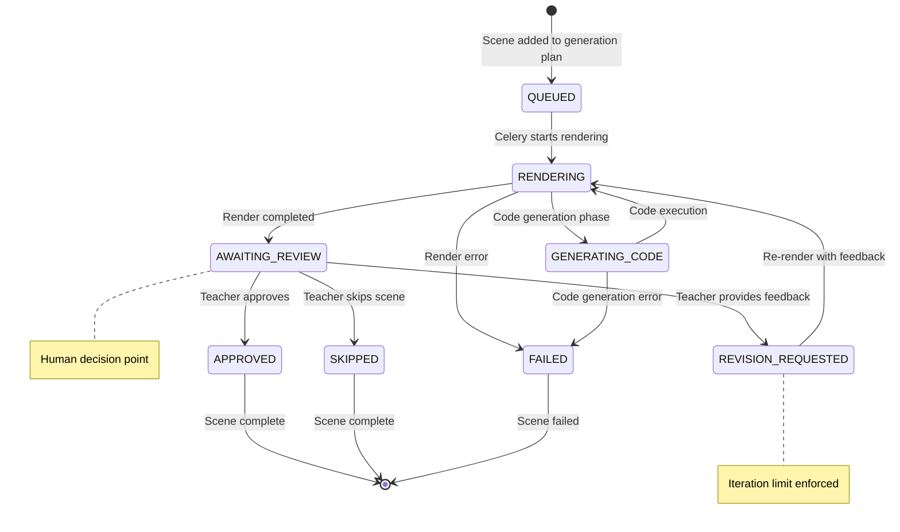
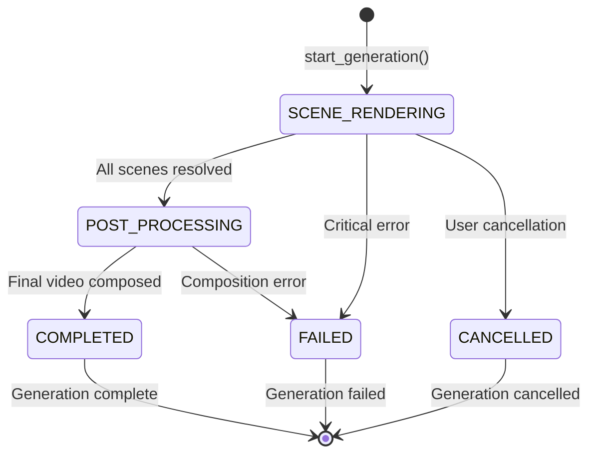
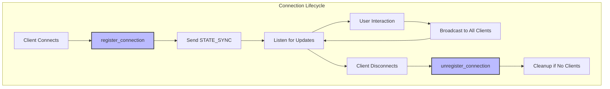
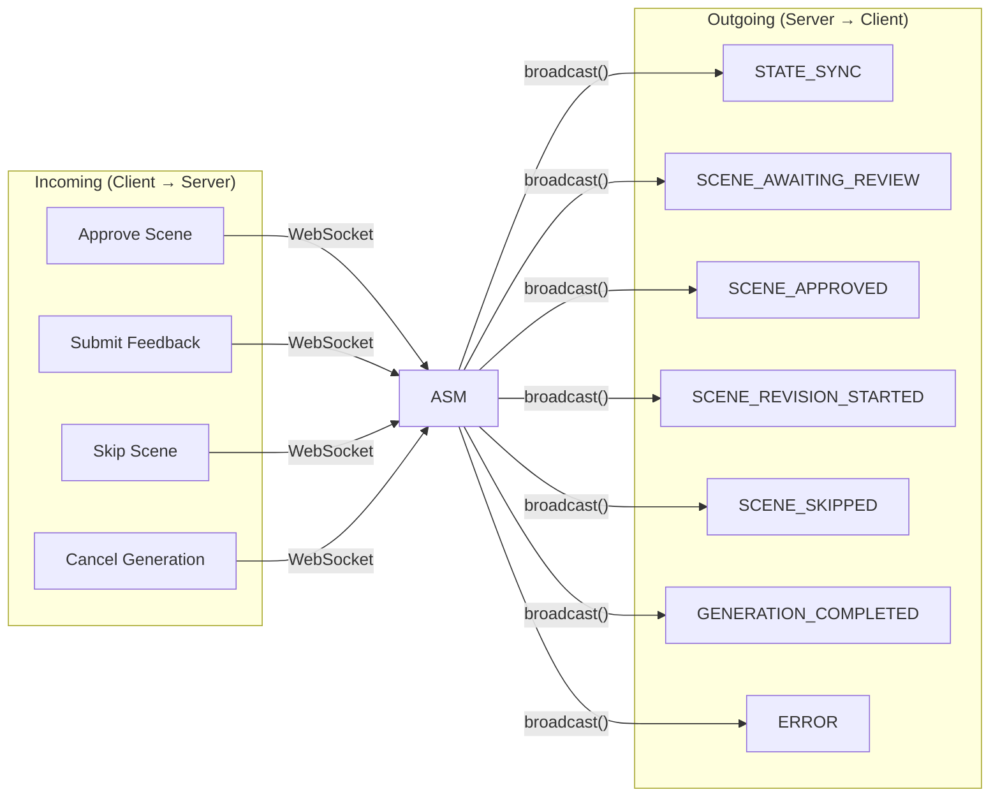

# Animation Session Manager

## Overview

The **Animation Session Manager** is a critical orchestration service that manages human-in-the-loop animation generation workflows. It coordinates the entire scene-by-scene rendering process with real-time streaming updates to the frontend and seamless integration of human feedback.

### Core Purpose

- **Real-time Collaboration**: Enables teachers to review and provide feedback on animation scenes as they're generated
- **Cross-Process Coordination**: Bridges FastAPI web server and Celery background workers via Redis
- **State Persistence**: Maintains generation state across process boundaries in MongoDB
- **Live Updates**: Broadcasts progress and status changes to connected WebSocket clients

### Key Features

- **Scene-by-Scene Rendering**: Processes animations one scene at a time with human review checkpoints
- **Feedback Integration**: Supports multiple feedback types (approve, reject, skip) with iteration tracking
- **Resilient State Management**: Survives process restarts through MongoDB persistence
- **Concurrent Session Handling**: Manages multiple simultaneous generation sessions
- **Automatic Recovery**: Resume capabilities for stuck or interrupted generations

## Architecture

### High-Level System Architecture



### Component Relationships



### Process Flow: Scene Generation with Feedback Loop



## Core Components

### AnimationSessionManager

The central orchestrator class that manages all aspects of animation generation sessions.

#### Key Responsibilities

1. **WebSocket Connection Management**
   - Track active connections per material
   - Handle client registration/unregistration
   - Broadcast state updates to all connected clients

2. **State Persistence**
   - Read/write generation state to MongoDB
   - Support both async (FastAPI) and sync (Celery) operations
   - Maintain state consistency across process boundaries

3. **Cross-Process Communication**
   - Push human actions to Redis queues (FastAPI → Redis)
   - Pop actions from Redis queues (Redis → Celery)
   - Publish state updates via Redis Pub/Sub

4. **Scene Lifecycle Management**
   - Track scene status transitions
   - Coordinate rendering, review, and feedback loops
   - Handle scene approval, rejection, and skipping

5. **Generation Orchestration**
   - Initialize generation sessions
   - Monitor overall progress
   - Handle completion and failure scenarios

#### Architecture Notes

**Process-Specific Behavior:**
- **FastAPI Process Only**: WebSocket connection tracking, real-time broadcasting
- **Celery Workers Only**: Heavy rendering tasks, blocking Redis queue operations
- **Both Processes**: MongoDB state access, Redis queue operations

**Thread Safety:**
- Uses `asyncio.Lock` for connection management
- Redis queues provide natural isolation between materials
- MongoDB atomic operations ensure state consistency

### Data Models

#### GenerationState

Tracks the overall state of an animation generation session.

**Key Fields:**
- `current_phase`: Current generation phase (e.g., SCENE_RENDERING, POST_PROCESSING)
- `total_scenes`: Total number of scenes to generate
- `scenes`: List of SceneGenerationState objects
- `approved_scenes`: Count of approved scenes
- `started_at`/`completed_at`: Timeline tracking

**See:** [generation_state_models.md](generation_state_models.md) for detailed schema

#### SceneGenerationState

Tracks the state of individual scenes within a generation session.

**Key Fields:**
- `scene_id`: Unique scene identifier
- `scene_index`: Order in the sequence
- `status`: Current scene status (QUEUED, RENDERING, AWAITING_REVIEW, etc.)
- `video_url`/`video_path`: Rendered video locations
- `manim_code`: Generated Manim code
- `feedback_history`: List of feedback iterations
- `current_iteration`: Current feedback iteration number
- `max_iterations`: Maximum allowed feedback iterations

**See:** [generation_state_models.md](generation_state_models.md) for detailed schema

#### SceneFeedback

Represents a single feedback entry from a teacher.

**Key Fields:**
- `iteration`: Which rendering iteration this feedback applies to
- `feedback_type`: Type of feedback (APPROVE, REVISE, etc.)
- `feedback_text`: Actual feedback content
- `provided_at`: Timestamp

**See:** [generation_state_models.md](generation_state_models.md) for detailed schema

#### WSMessage & WSEventType

WebSocket message format for real-time updates.

**Events:**
- `GENERATION_STARTED`: Generation process initiated
- `SCENE_RENDER_STARTED`: Scene rendering in progress
- `SCENE_AWAITING_REVIEW`: Scene ready for teacher review
- `SCENE_APPROVED`: Scene approved by teacher
- `SCENE_REVISION_STARTED`: Scene re-rendering with feedback
- `SCENE_SKIPPED`: Scene skipped by teacher
- `SCENE_RENDER_FAILED`: Scene rendering failed
- `ALL_SCENES_RESOLVED`: All scenes processed
- `POST_PROCESSING_STARTED`: Final video composition started
- `GENERATION_COMPLETED`: Final video ready
- `GENERATION_FAILED`: Generation failed
- `GENERATION_CANCELLED`: Generation cancelled by user
- `STATE_SYNC`: Full state synchronization

**See:** [generation_state_models.md](generation_state_models.md) for detailed schema

## Cross-Process Communication

### Redis Queue Architecture



### Communication Patterns

#### 1. Human Action Flow (FastAPI → Redis → Celery)

```python
# FastAPI: Teacher submits feedback
await animation_session_manager.submit_human_action(
    material_id="material_123",
    action={
        "type": "feedback",
        "scene_id": "scene_456",
        "feedback_type": "revise",
        "feedback_text": "Make the animation slower"
    }
)

# Redis: Action queued to scene-specific queue
# Key: "material-material_123-scene-scene_456-actions"

# Celery: Worker receives action
action = animation_session_manager.wait_for_scene_action_sync(
    material_id="material_123",
    scene_id="scene_456",
    timeout=0  # Block until action received
)
```

#### 2. State Update Flow (Celery → Redis → FastAPI → WebSocket)

```python
# Celery: Scene rendering completed
animation_session_manager.mark_scene_rendered_sync(
    material_id="material_123",
    scene_id="scene_456",
    video_path="/tmp/scene_456.mp4",
    video_url="https://storage.example.com/scene_456.mp4",
    duration=30.5,
    manim_code="..."
)

# Redis: State update published
# Channel: "state_updates"
# Message: {"material_id": "material_123", "event": "scene_awaiting_review", ...}

# FastAPI: Receives update and broadcasts to WebSocket clients
await animation_session_manager.broadcast(
    material_id="material_123",
    message=WSMessage(
        event=WSEventType.SCENE_AWAITING_REVIEW,
        material_id="material_123",
        data={"scene_id": "scene_456", "video_url": "..."}
    )
)
```

## State Management

### MongoDB Schema



### State Transitions

#### Scene Status Lifecycle



#### Generation Phase Transitions



## WebSocket Integration

### Connection Management



### Message Flow



## Key Workflows

### 1. Starting a Generation Session

```python
# FastAPI endpoint
async def generate_animation(material_id: str):
    # 1. Get scene plans from material
    scene_plans = await get_scene_plans(material_id)
    
    # 2. Initialize generation state
    await animation_session_manager.start_generation(
        material_id=material_id,
        scene_plans=scene_plans,
        concept_analysis={}
    )
    
    # 3. Trigger Celery task
    generate_animation_task.delay(material_id)
    
    # 4. Return initial state to client
    state = await animation_session_manager.get_generation_state(material_id)
    return {"status": "started", "state": state}
```

### 2. Scene Rendering Loop (Celery)

```python
# Celery task
def generate_animation_task(material_id: str):
    # Get generation state
    state = animation_session_manager.get_generation_state_sync(material_id)
    
    for scene in state.scenes:
        # 1. Mark as rendering
        animation_session_manager.mark_scene_rendering_sync(
            material_id, scene.scene_id
        )
        
        # 2. Generate Manim code
        animation_session_manager.mark_scene_code_generating_sync(
            material_id, scene.scene_id
        )
        manim_code = generate_code(scene)
        
        # 3. Render video
        video_path = render_with_manim(manim_code)
        video_url = upload_to_storage(video_path)
        
        # 4. Mark as awaiting review
        animation_session_manager.mark_scene_rendered_sync(
            material_id, scene.scene_id,
            video_path, video_url, duration, manim_code
        )
        
        # 5. Wait for human action
        action = animation_session_manager.wait_for_scene_action_sync(
            material_id, scene.scene_id, timeout=0
        )
        
        # 6. Process action
        if action["type"] == "approve":
            continue  # Next scene
        elif action["type"] == "feedback":
            # Re-render with feedback
            feedback_text = action["feedback_text"]
            # ... apply feedback and re-render
        elif action["type"] == "skip":
            continue  # Skip to next scene
```

### 3. Handling Teacher Feedback

```python
# WebSocket handler
async def handle_websocket_message(websocket, material_id, message):
    if message.type == "feedback":
        # Process feedback
        scene = await animation_session_manager.process_scene_feedback(
            material_id=material_id,
            scene_id=message.scene_id,
            feedback_type=FeedbackType.REVISE,
            feedback_text=message.text
        )
        
        # Notify Celery worker
        await animation_session_manager.submit_human_action(
            material_id=material_id,
            action={
                "type": "feedback",
                "scene_id": message.scene_id,
                "feedback_type": "revise",
                "feedback_text": message.text
            }
        )
```

### 4. Generation Recovery

```python
# Check if generation can be resumed
can_resume, reason = animation_session_manager.can_resume_to_post_processing(
    material_id="material_123"
)

if can_resume:
    # Get approved videos
    result = animation_session_manager.resume_post_processing_sync(
        material_id="material_123"
    )
    
    # Resume post-processing
    compose_final_video_task.delay(
        material_id="material_123",
        video_paths=result["approved_videos"]
    )
```

## Dependencies

### Internal Dependencies

| Module | Components | Purpose |
|--------|------------|---------|
| [database_models.md](database_models.md) | `GenerationState`, `SceneGenerationState`, `SceneFeedback`, `FeedbackType`, `WSEventType`, `WSMessage`, `SharedMaterialStatus` | Data models for state management |
| [database_layer.md](database_layer.md) | `MongoDB`, `SyncMongoDB` | Database connections and repositories |
| [storage_services.md](storage_services.md) | `StorageService` | Video file storage management |
| [animation_generation.md](animation_generation.md) | `AnimationGenerator`, `AnimationSteps`, `SceneAction`, `RenderResult` | Animation generation pipeline |
| [redis_queue.md](redis_queue.md) | `RedisActionQueue`, `STATE_UPDATE_CHANNEL` | Cross-process communication |

### External Dependencies

- **Redis**: Message broker for queue-based communication
- **MongoDB**: Persistent state storage
- **WebSocket**: Real-time client communication
- **Celery**: Background task processing

## Error Handling & Edge Cases

### 1. WebSocket Disconnection

```python
# During broadcast, dead connections are detected and cleaned up
dead_connections = set()
for websocket in connections:
    try:
        await websocket.send_json(message)
    except Exception as e:
        dead_connections.add(websocket)

# Clean up dead connections
for ws in dead_connections:
    self._connections[material_id].discard(ws)
```

### 2. Scene Rendering Failure

```python
# Celery worker detects failure
try:
    video_path = render_with_manim(manim_code)
except RenderError as e:
    animation_session_manager.mark_scene_failed_sync(
        material_id=material_id,
        scene_id=scene_id,
        error_message=str(e)
    )
    # Teacher can choose to skip the scene and continue
```

### 3. Maximum Feedback Iterations

```python
# Check iteration limit before accepting feedback
if scene.current_iteration >= scene.max_iterations - 1:
    scene.status = SceneStatus.FAILED
    scene.error_message = "Maximum feedback iterations reached"
    await self.update_generation_state(material_id, state)
    return scene
```

### 4. Process Restart Recovery

```python
# On startup, check for incomplete generations
async def recover_incomplete_generations():
    materials = await db.materials.find({
        "status": {"$in": [
            SharedMaterialStatus.SCENES_RENDERING.value,
            SharedMaterialStatus.AWAITING_SCENE_REVIEW.value,
            SharedMaterialStatus.POST_PROCESSING.value
        ]}
    })
    
    for material in materials:
        state = GenerationState(**material["generation_state"])
        
        # Check if all scenes are resolved but not completed
        if state.all_scenes_resolved() and state.current_phase != GenerationPhase.COMPLETED:
            # Resume post-processing
            await resume_generation(material["_id"])
```

## Performance Considerations

### 1. Redis Queue Optimization

- **Scene-specific queues**: Prevents head-of-line blocking
- **TTL on messages**: Auto-cleanup of stale actions
- **Batch operations**: Efficient queue clearing

### 2. MongoDB Operations

- **Atomic updates**: `$set` operations prevent race conditions
- **Indexed queries**: Material ID and status fields indexed
- **Projection**: Only fetch required fields (e.g., `generation_state`)

### 3. WebSocket Broadcasting

- **Connection pooling**: Reuse connections where possible
- **Dead connection cleanup**: Automatic cleanup on send failure
- **Selective broadcasting**: Only send to clients interested in specific material

### 4. State Synchronization

- **Optimistic updates**: Update UI immediately, confirm with server
- **Periodic sync**: Full state sync on reconnection
- **Delta updates**: Only send changed fields in updates

## Security Considerations

### 1. WebSocket Authentication

- **Token-based auth**: Validate JWT tokens on connection
- **Material ownership**: Verify user owns the material
- **Rate limiting**: Prevent message flooding

### 2. Redis Security

- **Namespace isolation**: Material-specific queue names
- **Input validation**: Sanitize all user inputs before queueing
- **Action authorization**: Verify user permissions for each action

### 3. State Integrity

- **MongoDB validation**: Pydantic models enforce schema
- **Status transitions**: Validated state machine prevents invalid transitions
- **Concurrent access**: Atomic operations prevent race conditions

## Future Enhancements

### 1. Advanced Features

- **Batch approval**: Approve multiple scenes at once
- **Scene reordering**: Change scene order during generation
- **Parallel rendering**: Render multiple scenes concurrently
- **A/B testing**: Generate multiple versions of same scene

### 2. Scalability Improvements

- **Redis Cluster**: Distribute queue load across multiple Redis instances
- **MongoDB Sharding**: Shard materials collection by user or organization
- **WebSocket Load Balancing**: Sticky sessions for WebSocket connections

### 3. Monitoring & Observability

- **Metrics**: Scene rendering times, feedback iteration counts
- **Tracing**: End-to-end trace from request to final video
- **Alerts**: Notify on generation failures or stuck sessions

## API Reference

### AnimationSessionManager Methods

#### Connection Management

```python
async def register_connection(self, material_id: str, websocket: Any) -> bool
async def unregister_connection(self, material_id: str, websocket: Any) -> None
async def broadcast(self, material_id: str, message: WSMessage) -> None
```

#### State Management

```python
async def get_generation_state(self, material_id: str) -> Optional[GenerationState]
async def update_generation_state(
    self, 
    material_id: str, 
    state: GenerationState, 
    status: Optional[SharedMaterialStatus] = None
) -> bool
async def update_scene_state(
    self, 
    material_id: str, 
    scene_id: str, 
    updates: Dict[str, Any]
) -> Optional[SceneGenerationState]
```

#### Human Action Handling

```python
async def submit_human_action(self, material_id: str, action: Dict[str, Any]) -> bool
async def wait_for_scene_action(
    self, 
    material_id: str, 
    scene_id: str, 
    timeout: float = 0
) -> Optional[Dict[str, Any]]
def wait_for_scene_action_sync(
    self, 
    material_id: str, 
    scene_id: str, 
    timeout: float = 0
) -> Optional[Dict[str, Any]]
```

#### Scene Feedback Processing

```python
async def process_scene_feedback(
    self, 
    material_id: str, 
    scene_id: str, 
    feedback_type: FeedbackType, 
    feedback_text: str
) -> Optional[SceneGenerationState]
async def approve_scene(self, material_id: str, scene_id: str) -> Optional[SceneGenerationState]
async def skip_scene(
    self, 
    material_id: str, 
    scene_id: str, 
    reason: Optional[str] = None
) -> Optional[SceneGenerationState]
```

#### Generation Orchestration

```python
async def start_generation(
    self, 
    material_id: str, 
    scene_plans: List[Dict[str, Any]], 
    concept_analysis: Dict[str, Any]
) -> bool
async def cancel_generation(self, material_id: str) -> bool
```

#### Scene Status Updates

```python
async def mark_scene_rendering(self, material_id: str, scene_id: str) -> None
async def mark_scene_code_generating(self, material_id: str, scene_id: str) -> None
async def mark_scene_rendered(
    self, 
    material_id: str, 
    scene_id: str, 
    video_path: str, 
    video_url: str, 
    duration: float, 
    manim_code: str
) -> None
async def mark_scene_failed(
    self, 
    material_id: str, 
    scene_id: str, 
    error_message: str
) -> None
```

#### Generation Completion

```python
async def mark_post_processing_started(self, material_id: str) -> None
async def mark_generation_completed(
    self, 
    material_id: str, 
    final_video_url: str, 
    duration_seconds: float
) -> None
async def mark_generation_failed(self, material_id: str, error_message: str) -> None
```

#### Recovery Methods

```python
def can_resume_to_post_processing(self, material_id: str) -> tuple[bool, str]
def resume_post_processing_sync(self, material_id: str) -> dict
```

## Usage Examples

### Example 1: Basic Generation Flow

```python
# Initialize generation
await animation_session_manager.start_generation(
    material_id="material_123",
    scene_plans=[
        {"id": "scene_1", "title": "Introduction"},
        {"id": "scene_2", "title": "Main Concept"},
        {"id": "scene_3", "title": "Conclusion"}
    ],
    concept_analysis={}
)

# Celery worker processes scenes
for scene in scenes:
    # Render scene
    animation_session_manager.mark_scene_rendered_sync(
        material_id="material_123",
        scene_id=scene["id"],
        video_path="/tmp/scene.mp4",
        video_url="https://storage.example.com/scene.mp4",
        duration=45.0,
        manim_code="..."
    )
    
    # Wait for teacher action
    action = animation_session_manager.wait_for_scene_action_sync(
        material_id="material_123",
        scene_id=scene["id"],
        timeout=0
    )
    
    # Process action...

# Complete generation
animation_session_manager.mark_generation_completed_sync(
    material_id="material_123",
    final_video_url="https://storage.example.com/final.mp4",
    duration_seconds=135.0
)
```

### Example 2: WebSocket Handler

```python
@app.websocket("/ws/materials/{material_id}")
async def websocket_endpoint(websocket: WebSocket, material_id: str):
    # Accept connection
    await websocket.accept()
    
    # Register with session manager
    try:
        await animation_session_manager.register_connection(
            material_id=material_id,
            websocket=websocket
        )
    except Exception:
        await websocket.close()
        return
    
    # Listen for messages
    try:
        while True:
            data = await websocket.receive_json()
            
            if data["type"] == "approve":
                await animation_session_manager.approve_scene(
                    material_id=material_id,
                    scene_id=data["scene_id"]
                )
            elif data["type"] == "feedback":
                await animation_session_manager.process_scene_feedback(
                    material_id=material_id,
                    scene_id=data["scene_id"],
                    feedback_type=FeedbackType.REVISE,
                    feedback_text=data["text"]
                )
            elif data["type"] == "skip":
                await animation_session_manager.skip_scene(
                    material_id=material_id,
                    scene_id=data["scene_id"],
                    reason=data.get("reason")
                )
    except WebSocketDisconnect:
        await animation_session_manager.unregister_connection(
            material_id=material_id,
            websocket=websocket
        )
```

### Example 3: Recovery from Failure

```python
# Check if generation is stuck
state = animation_session_manager.get_generation_state_sync("material_123")

if state and state.current_phase == GenerationPhase.SCENE_RENDERING:
    # Check if all scenes are resolved
    if state.all_scenes_resolved():
        # Resume post-processing
        result = animation_session_manager.resume_post_processing_sync(
            material_id="material_123"
        )
        
        if result["success"]:
            # Trigger post-processing task
            compose_final_video_task.delay(
                material_id="material_123",
                video_paths=result["approved_videos"]
            )
```

## Conclusion

The Animation Session Manager is the cornerstone of the human-in-the-loop animation generation system. It successfully bridges the gap between real-time user interaction and long-running background processing through a sophisticated combination of WebSocket connections, Redis queues, and MongoDB persistence.

Its design enables:

- **Real-time collaboration** between teachers and AI
- **Resilient state management** across process boundaries
- **Scalable architecture** supporting multiple concurrent sessions
- **Graceful error handling** with recovery capabilities

The module's clear separation between FastAPI and Celery concerns, combined with robust cross-process communication, makes it a maintainable and extensible foundation for interactive AI-generated content creation.

For more information on related components, see:
- [generation_state_models.md](generation_state_models.md) - Data models for generation state
- [animation_generation.md](animation_generation.md) - Animation generation pipeline
- [redis_queue.md](redis_queue.md) - Redis queue implementation
- [database_layer.md](database_layer.md) - Database operations