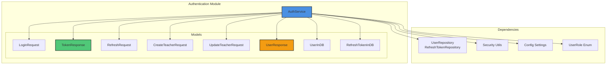
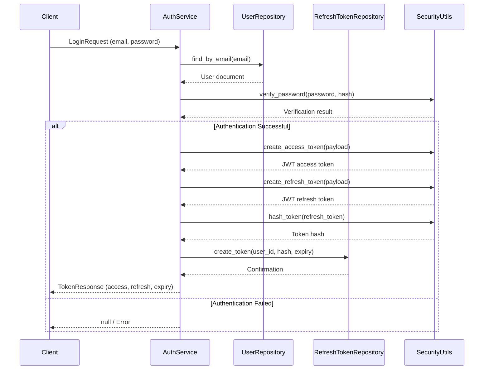
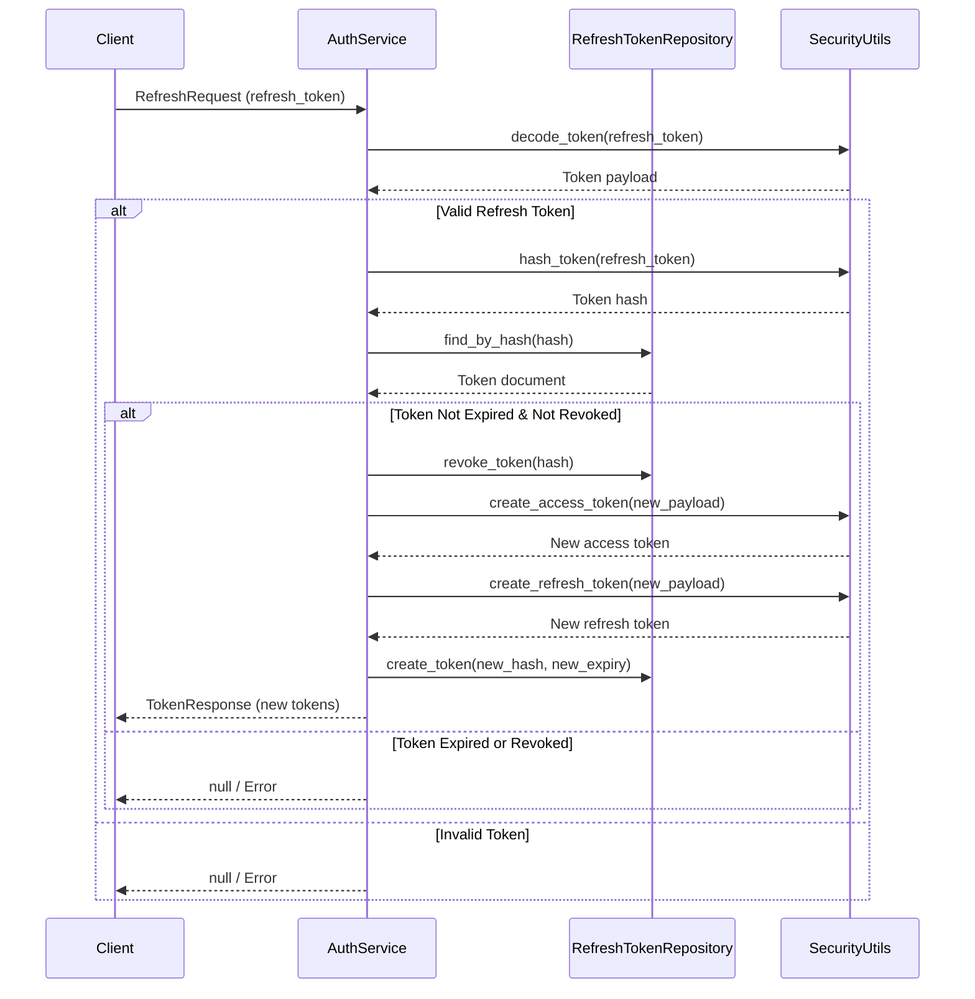
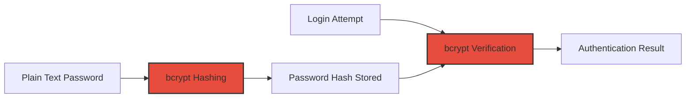
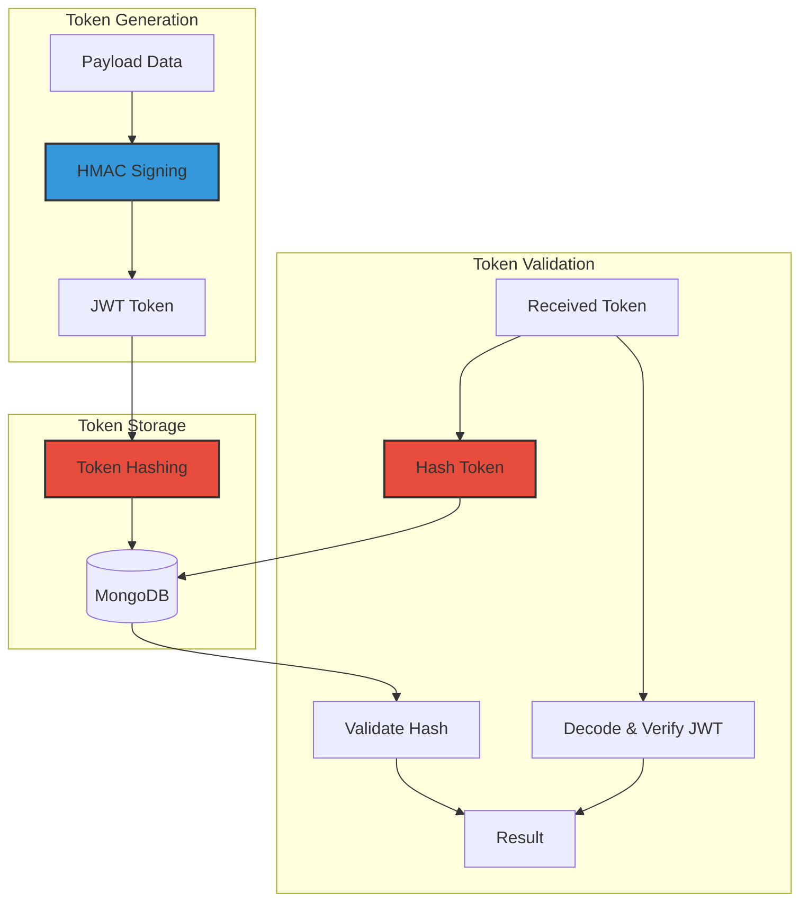
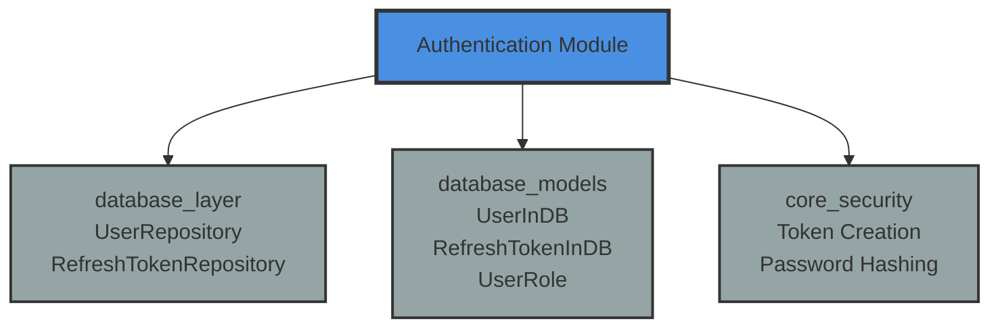

# Authentication Module Documentation

## Overview

The Authentication module provides secure user authentication and authorization services for the educational platform. It handles user login, token-based session management, and teacher account administration with role-based access control.

### Key Features

- **Secure Authentication**: Email/password-based authentication with bcrypt password hashing
- **Token Management**: JWT-based access and refresh tokens with secure storage
- **Role-Based Access Control**: Support for different user roles (TEACHER, ADMIN, etc.)
- **Teacher Management**: Complete CRUD operations for teacher accounts
- **Session Security**: Token revocation and expiration handling

## Architecture

### Component Structure



### Authentication Flow



### Token Refresh Flow



## Core Components

### AuthService

**Location**: `backend/app/services/auth.py`

The `AuthService` class is the central component that orchestrates all authentication and user management operations. It provides a singleton instance (`auth_service`) that is used throughout the application.

#### Key Responsibilities

- **User Authentication**: Validate user credentials and authenticate users
- **Token Lifecycle Management**: Create, refresh, and revoke JWT tokens
- **Teacher Account Management**: Create, read, update, and deactivate teacher accounts
- **Security Enforcement**: Ensure secure password handling and token storage

#### Public Methods

| Method | Parameters | Returns | Description |
|--------|------------|---------|-------------|
| `authenticate_user` | `email: str`, `password: str` | `Optional[dict]` | Authenticates user with email and password |
| `create_tokens` | `user: dict` | `TokenResponse` | Creates access and refresh tokens for a user |
| `refresh_tokens` | `refresh_token: str` | `Optional[TokenResponse]` | Refreshes access token using a valid refresh token |
| `logout` | `refresh_token: str` | `bool` | Revokes a refresh token (logout) |
| `create_teacher` | `request: CreateTeacherRequest` | `Optional[UserResponse]` | Creates a new teacher account |
| `get_teacher` | `teacher_id: str` | `Optional[UserResponse]` | Retrieves a teacher by ID |
| `list_teachers` | `page: int`, `limit: int` | `tuple[list[UserResponse], int]` | Lists teachers with pagination |
| `update_teacher` | `teacher_id: str`, `request: UpdateTeacherRequest` | `Optional[UserResponse]` | Updates teacher account information |
| `delete_teacher` | `teacher_id: str` | `bool` | Deactivates a teacher account and revokes all tokens |

#### Dependencies

- **UserRepository**: For user data access ([database_layer.md](database_layer.md))
- **RefreshTokenRepository**: For token storage and management ([database_layer.md](database_layer.md))
- **Security Utilities**: For password hashing, token creation/verification ([core_security.md](core_security.md))
- **Configuration**: For JWT settings and token expiration times
- **UserRole Enum**: For role-based access control ([database_models.md](database_models.md))

---

## Data Models

### Request Models

#### LoginRequest

**Purpose**: Validates user login credentials

**Fields**:
- `email: EmailStr` - Validated email address
- `password: str` - Password with minimum length of 8 characters

**Location**: `backend/app/models/user.py`

#### RefreshRequest

**Purpose**: Contains refresh token for token renewal

**Fields**:
- `refresh_token: str` - JWT refresh token string

**Location**: `backend/app/models/user.py`

#### CreateTeacherRequest

**Purpose**: Validates data for creating new teacher accounts

**Fields**:
- `email: EmailStr` - Teacher's email address
- `password: str` - Password (min 8 characters)
- `name: str` - Teacher's name (1-100 characters, auto-trimmed)

**Validation**: Name is automatically stripped of whitespace

**Location**: `backend/app/models/user.py`

#### UpdateTeacherRequest

**Purpose**: Validates data for updating existing teacher accounts

**Fields**:
- `name: Optional[str]` - Updated name (max 100 characters)
- `password: Optional[str]` - New password (min 8 characters)
- `is_active: Optional[bool]` - Account active status

**Location**: `backend/app/models/user.py`

### Response Models

#### TokenResponse

**Purpose**: Returns authentication tokens to the client

**Fields**:
- `access_token: str` - JWT access token for API authentication
- `refresh_token: str` - JWT refresh token for session renewal
- `token_type: str` - Token type (default: "bearer")
- `expires_in: int` - Access token lifetime in seconds

**Location**: `backend/app/models/user.py`

#### UserResponse

**Purpose**: Returns user information to the client (excludes sensitive data)

**Fields**:
- `id: str` - User ID as string
- `email: EmailStr` - User's email address
- `name: str` - User's full name
- `role: str` - User role (TEACHER, ADMIN, etc.)
- `is_active: bool` - Account status
- `created_at: datetime` - Account creation timestamp

**Class Method**: `from_db(user: dict) -> UserResponse` - Converts database document to response object

**Location**: `backend/app/models/user.py`

#### TeacherListResponse

**Purpose**: Returns paginated list of teachers

**Fields**:
- `items: list[UserResponse]` - List of teacher objects
- `total: int` - Total number of teachers
- `page: int` - Current page number
- `limit: int` - Items per page

**Location**: `backend/app/models/user.py`

### Database Models

#### UserInDB

**Purpose**: Represents user document stored in MongoDB

**Fields**:
- `id: Optional[PyObjectId]` - MongoDB ObjectId
- `email: EmailStr` - User's email address
- `password_hash: str` - Bcrypt-hashed password
- `name: str` - User's full name
- `role: UserRole` - User role enum
- `is_active: bool` - Account active status (default: True)
- `created_at: datetime` - Creation timestamp
- `updated_at: datetime` - Last update timestamp

**Inheritance**: Extends `MongoBaseModel` for MongoDB integration

**Location**: `backend/app/models/user.py`

#### RefreshTokenInDB

**Purpose**: Represents refresh token document stored in MongoDB

**Fields**:
- `id: Optional[PyObjectId]` - MongoDB ObjectId
- `user_id: PyObjectId` - Reference to user document
- `token_hash: str` - Hashed token for secure storage
- `expires_at: datetime` - Token expiration timestamp
- `created_at: datetime` - Creation timestamp
- `revoked: bool` - Revocation status (default: False)

**Security**: Only token hashes are stored, never the actual tokens

**Location**: `backend/app/models/user.py`

---

## Security Implementation

### Password Security



- **Password Hashing**: Uses bcrypt with salt for one-way hashing
- **Password Verification**: Secure comparison using bcrypt's built-in verification
- **Minimum Requirements**: 8 character minimum length enforced
- **Storage**: Only password hashes are stored, never plain text

### Token Security



- **JWT Tokens**: Signed with HMAC using secret key
- **Token Types**: Separate access and refresh tokens
- **Token Storage**: Only hashed tokens stored in database
- **Token Revocation**: Refresh tokens can be revoked on logout
- **Expiration**: Configurable expiration times for both token types

### Session Management

- **Access Tokens**: Short-lived (configurable, typically minutes)
- **Refresh Tokens**: Longer-lived (configurable, typically days)
- **Token Rotation**: New refresh token issued on each refresh
- **Revocation**: All user tokens revoked on account deactivation
- **Automatic Cleanup**: Expired tokens can be cleaned up by database maintenance jobs

---

## Integration with Other Modules

### Dependencies



### Database Layer Integration

The Authentication module relies heavily on the [database_layer](database_layer.md) for data persistence:

- **UserRepository**: Handles all user data operations
  - `find_by_email()`: Email-based user lookup
  - `find_by_id()`: ID-based user retrieval
  - `create_user()`: New user creation
  - `update_user()`: User data updates
  - `deactivate_user()`: Account deactivation
  - `email_exists()`: Email uniqueness check
  - `find_teachers()`: Paginated teacher listing

- **RefreshTokenRepository**: Manages token lifecycle
  - `create_token()`: Store new refresh token hash
  - `find_by_hash()`: Token lookup by hash
  - `revoke_token()`: Single token revocation
  - `revoke_all_user_tokens()`: Bulk token revocation

### Database Models Integration

Uses models from [database_models](database_models.md):

- **UserInDB**: Extends `MongoBaseModel` for MongoDB serialization
- **RefreshTokenInDB**: Token storage with proper indexing
- **UserRole**: Enum for role-based access control
- **PyObjectId**: MongoDB ObjectId handling

### Security Integration

Depends on core security utilities:

- **Token Creation**: `create_access_token()`, `create_refresh_token()`
- **Token Decoding**: `decode_token()` with validation
- **Password Security**: `get_password_hash()`, `verify_password()`
- **Token Hashing**: `hash_token()` for secure storage

---

## API Usage Patterns

### Login Flow

```python
# 1. Client sends login request
login_request = LoginRequest(email="teacher@example.com", password="securepass123")

# 2. Service authenticates user
user = await auth_service.authenticate_user(login_request.email, login_request.password)

# 3. If successful, create tokens
token_response = await auth_service.create_tokens(user)

# 4. Client receives tokens
# {
#   "access_token": "eyJhbGc...",
#   "refresh_token": "eyJhbGc...",
#   "token_type": "bearer",
#   "expires_in": 3600
# }
```

### Token Refresh Flow

```python
# 1. Client sends refresh request
refresh_request = RefreshRequest(refresh_token="eyJhbGc...")

# 2. Service validates and refreshes tokens
new_tokens = await auth_service.refresh_tokens(refresh_request.refresh_token)

# 3. Old token is revoked, new tokens issued
# {
#   "access_token": "new_access_token...",
#   "refresh_token": "new_refresh_token...",
#   "token_type": "bearer",
#   "expires_in": 3600
# }
```

### Teacher Management Flow

```python
# Create teacher
create_request = CreateTeacherRequest(
    email="newteacher@example.com",
    password="securepass123",
    name="Jane Doe"
)
teacher = await auth_service.create_teacher(create_request)

# Update teacher
update_request = UpdateTeacherRequest(name="Jane Smith", is_active=True)
updated = await auth_service.update_teacher(teacher_id, update_request)

# Delete teacher
success = await auth_service.delete_teacher(teacher_id)
# Revokes all tokens and deactivates account
```

---

## Error Handling

### Authentication Errors

- **Invalid Credentials**: Returns `None` for authentication failures
- **Inactive Accounts**: Authentication fails if `is_active=False`
- **Token Expiration**: Refresh tokens are validated for expiration
- **Token Revocation**: Revoked tokens cannot be used for refresh

### Validation Errors

- **Email Validation**: Pydantic `EmailStr` ensures valid email format
- **Password Length**: Minimum 8 characters enforced
- **Name Validation**: Length constraints and automatic trimming
- **Role Validation**: UserRole enum ensures valid roles

### Database Errors

- **Duplicate Emails**: `email_exists()` check prevents duplicates
- **Missing Records**: Returns `None` for non-existent users/tokens
- **Type Safety**: PyObjectId ensures valid MongoDB IDs

---

## Configuration

### JWT Settings

The module uses application settings for token configuration:

- `jwt_access_token_expire_minutes`: Access token lifetime (default: 60 minutes)
- `jwt_refresh_token_expire_days`: Refresh token lifetime (default: 7 days)
- `jwt_secret_key`: Secret key for token signing
- `jwt_algorithm`: Algorithm for token signing (default: HS256)

### Security Best Practices

- **Token Expiration**: Short-lived access tokens minimize risk
- **Refresh Rotation**: New refresh token on each use prevents replay attacks
- **Hash Storage**: Tokens hashed before storage (treated as passwords)
- **Revocation**: Immediate revocation on logout/account deactivation
- **Rate Limiting**: Should be implemented at API layer

---

## Performance Considerations

### Database Indexes

Recommended indexes for optimal performance:

```javascript
// Users collection
db.users.createIndex({ "email": 1 }, { unique: true })
db.users.createIndex({ "role": 1 })
db.users.createIndex({ "is_active": 1 })

// Refresh tokens collection
db.refresh_tokens.createIndex({ "token_hash": 1 })
db.refresh_tokens.createIndex({ "user_id": 1 })
db.refresh_tokens.createIndex({ "expires_at": 1 }, { expireAfterSeconds: 0 })
db.refresh_tokens.createIndex({ "revoked": 1 })
```

### Caching Opportunities

- **User Data**: Cache active user sessions to reduce DB queries
- **Token Validation**: Cache valid token signatures temporarily
- **Teacher Lists**: Cache paginated results with short TTL

---

## Testing Considerations

### Unit Test Scenarios

1. **Authentication**
   - Valid credentials return user data
   - Invalid credentials return None
   - Inactive users cannot authenticate

2. **Token Management**
   - Token creation generates valid JWTs
   - Token refresh issues new tokens and revokes old
   - Expired tokens cannot refresh
   - Revoked tokens cannot refresh

3. **Teacher Management**
   - Create teacher with valid data
   - Prevent duplicate email registration
   - Update teacher information
   - Deactivate teacher revokes all tokens

4. **Security**
   - Passwords are properly hashed
   - Tokens are hashed before storage
   - No sensitive data in responses

### Integration Test Scenarios

- Full login → refresh → logout flow
- Concurrent token refresh handling
- Teacher CRUD operations end-to-end
- Token expiration and cleanup

---

## Future Enhancements

### Potential Features

- **Multi-Factor Authentication**: SMS/email OTP support
- **Social Login**: Google, Microsoft OAuth integration
- **Password Reset**: Self-service password recovery
- **Session Management UI**: User-facing session control
- **API Key Support**: Programmatic access for integrations
- **Audit Logging**: Comprehensive authentication event logging
- **IP-based Restrictions**: Geographic or IP whitelisting
- **Account Lockout**: Brute force protection

### Scalability Improvements

- **Distributed Sessions**: Redis for token blacklisting
- **Async Token Cleanup**: Background job for expired tokens
- **Read Replicas**: User data read scaling
- **CDN Integration**: Token delivery optimization

---

## Related Documentation

- [Database Layer](database_layer.md) - User and token repository implementations
- [Database Models](database_models.md) - Base models and type definitions
- [Core Security](core_security.md) - Token creation and password hashing utilities
- [API Routes](../backend/app/api/routes/auth.py) - HTTP endpoint implementations