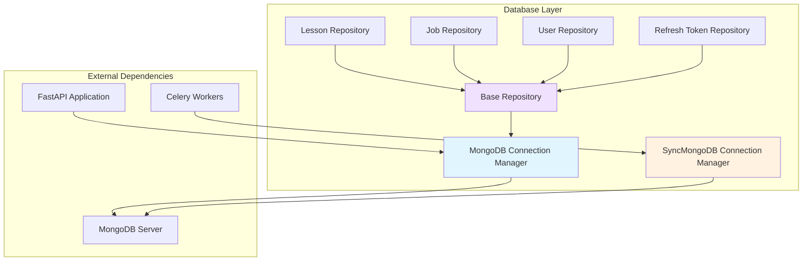
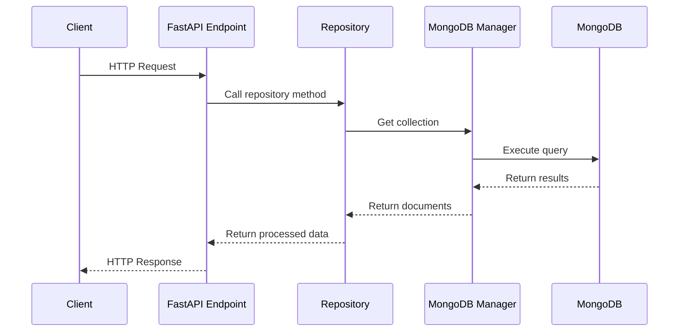

# Database Layer

## Overview

The `database_layer` module provides the core data persistence infrastructure for the educational content generation platform. It implements a robust, scalable database abstraction layer using MongoDB with both asynchronous (for FastAPI) and synchronous (for Celery workers) connection management, following the repository pattern for clean data access.

## Purpose and Scope

This module is responsible for:
- **Connection Management**: Managing MongoDB connections for both FastAPI application and Celery background workers
- **Data Access Abstraction**: Providing a clean, reusable repository pattern for database operations
- **Entity Management**: Handling CRUD operations for core entities (Lessons, Users, Jobs, Refresh Tokens)
- **Performance Optimization**: Implementing database indexes and connection pooling for optimal performance
- **Data Integrity**: Ensuring consistent data access patterns across the application

## Architecture Overview



### Key Architectural Decisions

1. **Dual Connection Management**: Separate async and sync connection managers to support both FastAPI's async nature and Celery's synchronous worker processes
2. **Repository Pattern**: Abstracts database operations behind clean, testable interfaces
3. **Singleton Instances**: Repository instances are created as singletons for efficient resource usage
4. **Index Management**: Automated index creation on startup for query optimization
5. **Connection Pooling**: Configured pool sizes for both async (100 max) and sync (10 max per worker) connections

## Sub-modules

### 1. [MongoDB Connection Management](mongodb.md)

Manages MongoDB connections with both async (Motor) and sync (PyMongo) drivers, including:
- Connection lifecycle management (connect/disconnect)
- Connection pooling configuration
- Database index creation and management
- Collection access utilities

**Key Components:**
- `MongoDB` - Async connection manager for FastAPI
- `SyncMongoDB` - Sync connection manager for Celery workers
- Connection initialization and cleanup functions
- Index creation for performance optimization

### 2. [Repository Pattern Implementation](repositories.md)

Implements the repository pattern for clean data access, including:
- Base repository with common CRUD operations
- Specialized repositories for each entity type
- Type-safe operations with generic typing
- Consistent error handling and data transformation

**Key Components:**
- `BaseRepository` - Abstract base class with common database operations
- `LessonRepository` - Lesson entity operations and business logic
- `JobRepository` - Background job tracking and management
- `UserRepository` - User account management
- `RefreshTokenRepository` - Authentication token handling

## Data Flow



## Integration with Other Modules

The database layer serves as the foundation for several other modules:

- **[Lesson Management](../lesson_management.md)**: Uses `LessonRepository` for lesson CRUD operations
- **[Authentication](../authentication.md)**: Uses `UserRepository` and `RefreshTokenRepository` for auth flows
- **[AI Generation Services](../ai_generation_services.md)**: Uses repositories to persist generated content
- **[Export Services](../export_services.md)**: Retrieves lesson data for export operations

## Performance Considerations

### Connection Pooling
- **Async Pool**: 10-100 connections for FastAPI (configurable)
- **Sync Pool**: 2-10 connections per Celery worker
- **Idle Timeout**: 30 seconds to release unused connections

### Database Indexes
The module automatically creates comprehensive indexes on startup:

**Users Collection:**
- `email` (unique) - For authentication lookups
- `role` - For role-based queries

**Lessons Collection:**
- `teacher_id` - For teacher-specific lesson queries
- `status` - For status-based filtering
- `created_at` (descending) - For chronological ordering

**Jobs Collection:**
- `status` - For pending job queries
- `lesson_id` - For lesson job correlation
- `created_at` - For job queue ordering

**Refresh Tokens Collection:**
- `token_hash` (unique) - For token validation
- `user_id` - For user token revocation
- `expires_at` (TTL) - Automatic token cleanup

**Materials Collection:**
- Multi-field indexes for search and filtering
- Text index on `title`, `description`, and `prompt` for full-text search

## Error Handling

The database layer implements consistent error handling patterns:

- **Connection Errors**: Graceful degradation with clear error messages
- **Not Found**: Returns `None` for single document queries, empty lists for multi-document queries
- **Unique Constraints**: Leverages MongoDB unique indexes (e.g., email, token_hash)
- **Type Safety**: Uses Python type hints and generic types for compile-time safety

## Security Considerations

- **Data Sanitization**: All user inputs are properly handled through repository methods
- **Access Control**: Repository methods enforce ownership checks (e.g., `find_by_id_and_teacher`)
- **Token Security**: Refresh tokens are hashed and stored with expiration
- **Index Security**: Sensitive fields like emails have unique constraints

## Configuration

Database configuration is managed through the application settings:

```python
# Key settings
mongodb_uri = "mongodb://..."  # Connection string
mongodb_database = "edtech_platform"  # Database name
```

Connection pool sizes and timeouts are configured in the connection managers:

```python
# Async connection (FastAPI)
maxPoolSize=100
minPoolSize=10
maxIdleTimeMS=30000

# Sync connection (Celery)
maxPoolSize=10
minPoolSize=2
connectTimeoutMS=5000
serverSelectionTimeoutMS=5000
```

## Usage Examples

### Basic Repository Usage

```python
from app.db.repositories.lesson import lesson_repository

# Find a lesson by ID
lesson = await lesson_repository.find_by_id(lesson_id)

# Create a new lesson
lesson_id = await lesson_repository.create_lesson(
    teacher_id="...",
    metadata={"subject": "Physics", "grade": "10"}
)

# Update lesson status
await lesson_repository.update_status(
    lesson_id=lesson_id,
    status=LessonStatus.PROCESSING
)
```

### Direct Collection Access

```python
from app.db.mongodb import get_collection

# Get a collection for custom queries
collection = get_collection("lessons")
result = await collection.aggregate([...]).to_list()
```

## Testing

The repository pattern makes testing straightforward:

- **Mock Repositories**: Easy to mock for unit tests
- **Test Database**: Can use separate test database instances
- **Fixture Support**: Clean setup/teardown for each test

## Maintenance and Monitoring

### Connection Health
- Monitor connection pool usage
- Track connection establishment times
- Watch for connection leaks

### Query Performance
- Monitor slow queries via MongoDB profiler
- Review index usage statistics
- Analyze query patterns for optimization opportunities

### Data Growth
- Track collection sizes
- Monitor index sizes
- Plan for sharding if needed

## Future Enhancements

Potential improvements for the database layer:

1. **Query Builder**: Fluent API for complex queries
2. **Caching Layer**: Redis integration for frequently accessed data
3. **Audit Logging**: Automatic change tracking for compliance
4. **Soft Deletes**: Implement soft delete pattern across repositories
5. **Pagination Helpers**: Standardized pagination utilities
6. **Transaction Support**: Multi-document transaction handling
7. **Backup Integration**: Automated backup verification

## Related Documentation

- [MongoDB Connection Management](mongodb.md) - Detailed connection management docs
- [Repository Pattern Implementation](repositories.md) - Repository pattern deep dive
- [Lesson Management](../lesson_management.md) - Lesson entity usage
- [Authentication](../authentication.md) - User and token management
- [Database Models](../database_models.md) - Data model definitions