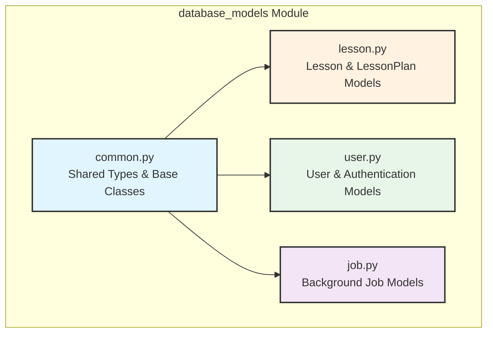
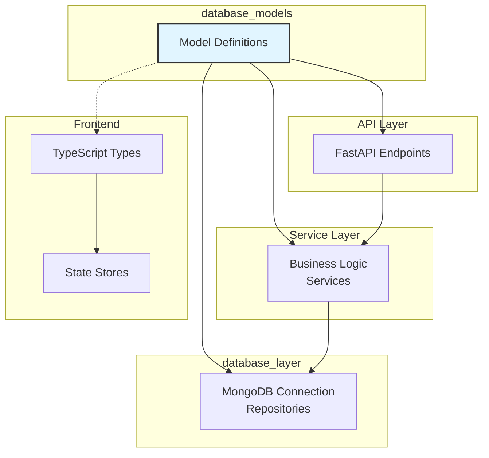
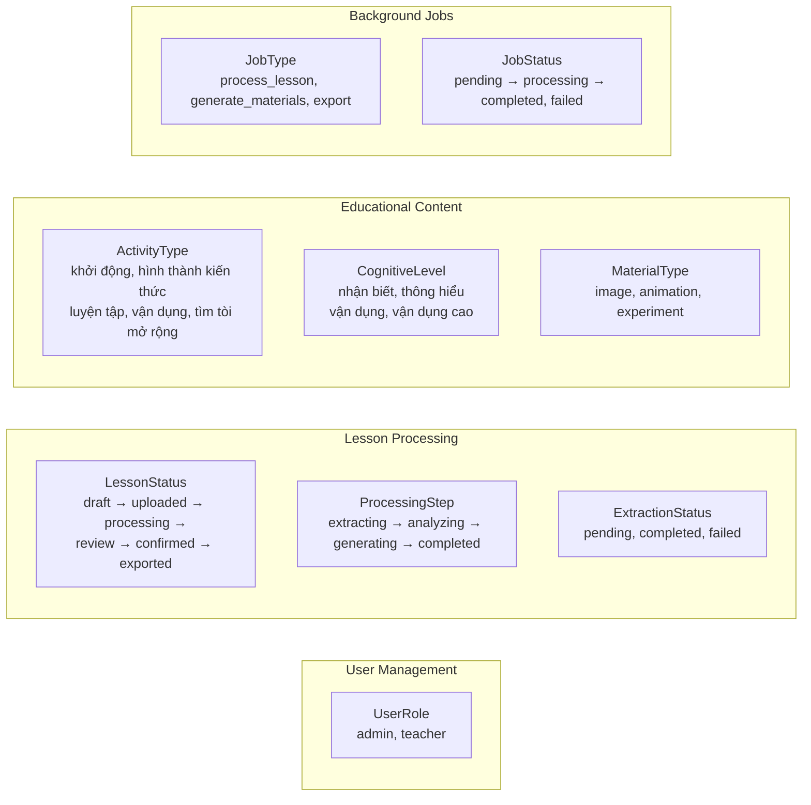
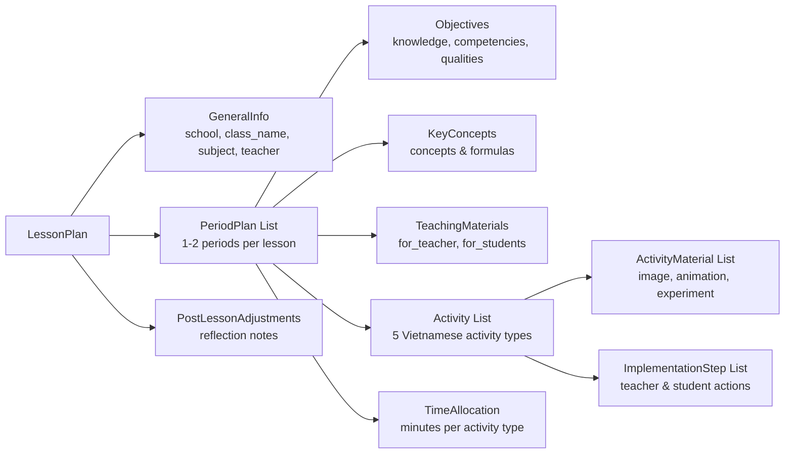
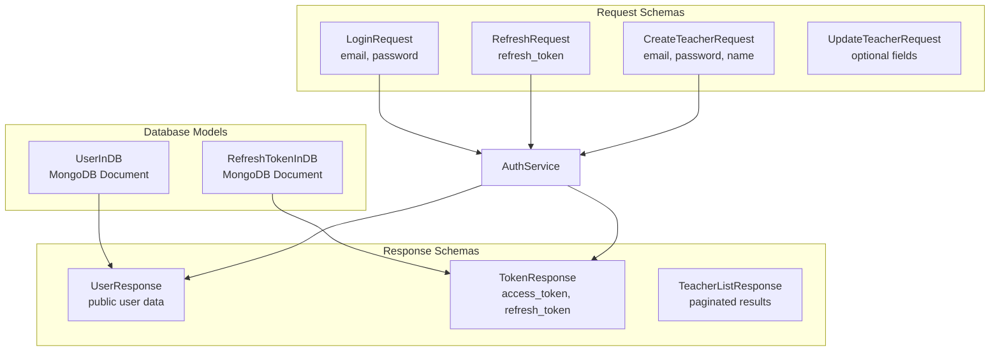
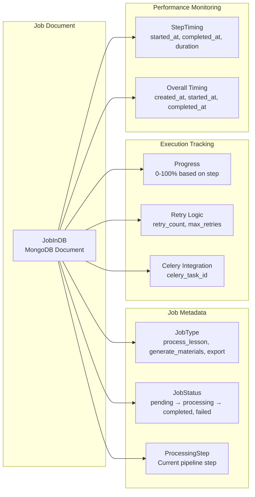
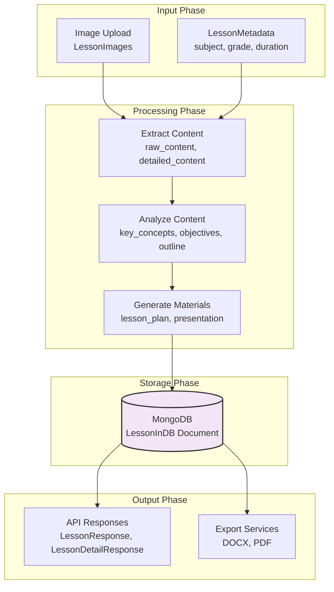
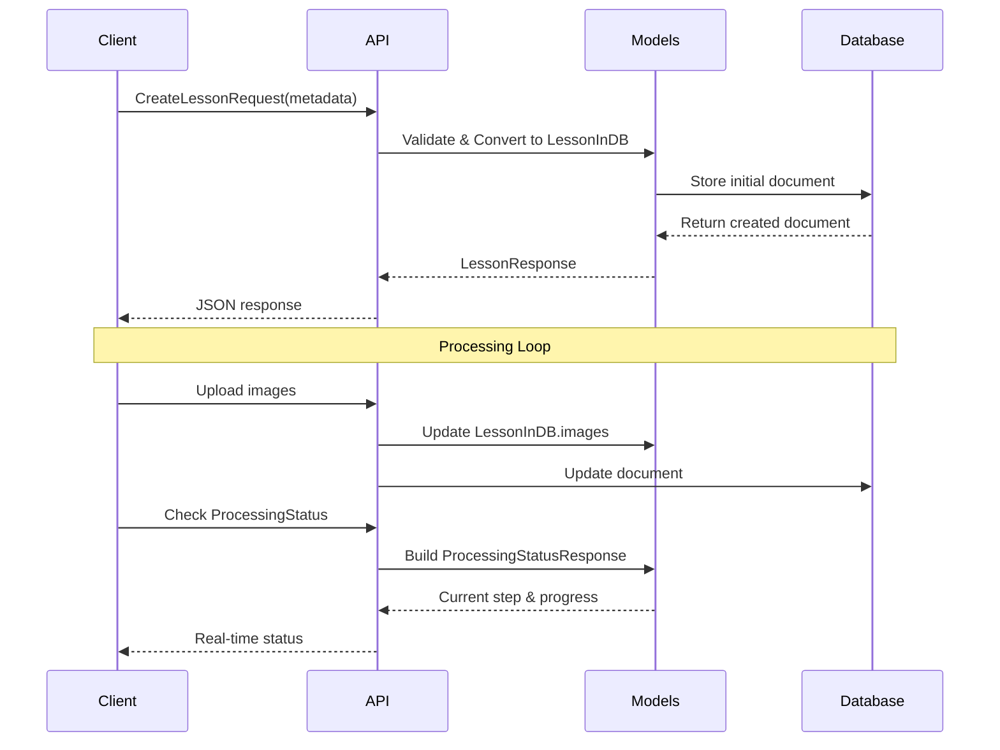
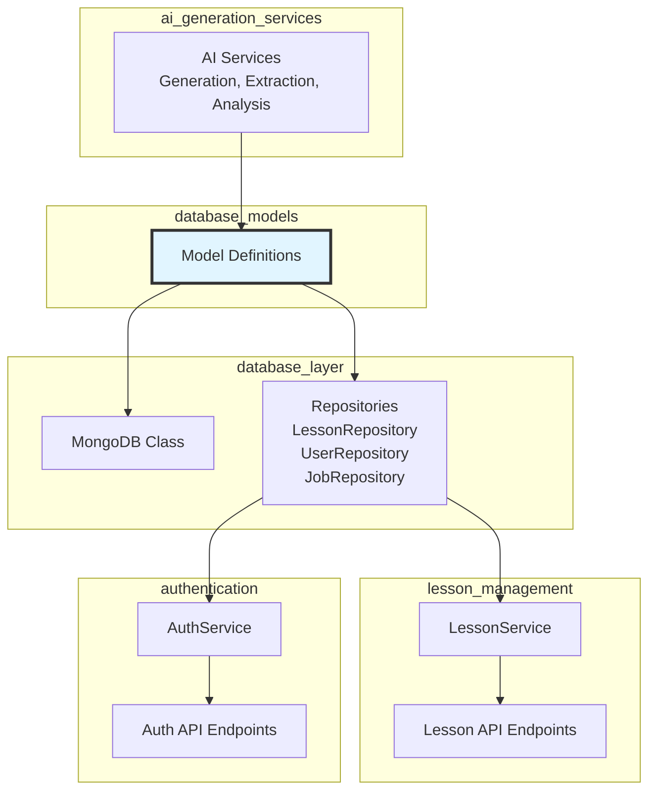

# Database Models Module Documentation

## Overview

The `database_models` module defines the core data structures and schemas for the entire application using Pydantic models. It serves as the single source of truth for data validation, serialization, and MongoDB document mapping across both backend and frontend components.

**Key Characteristics:**
- **Centralized Schema Definition**: All data structures are defined in one place
- **Type Safety**: Full Python type hints with Pydantic validation
- **MongoDB Integration**: Custom types and configurations for MongoDB document mapping
- **API Contract**: Request and response models for all API endpoints
- **Cross-Platform**: Models are used by both backend services and frontend TypeScript types

## Architecture

### Module Structure



### Integration with System Architecture



## Core Components

### 1. Common Models (`common.py`)

**Purpose**: Provides shared types, enumerations, and base classes used across all other model files.

**Key Components:**

#### Base Classes
- **`MongoBaseModel`**: Foundation for all MongoDB document models
  - Configured for MongoDB compatibility (ObjectId handling, datetime serialization)
  - Enables arbitrary types and population by name
  
- **`TimestampMixin`**: Adds `created_at` and `updated_at` fields with automatic timestamping

#### Custom Types
- **`PyObjectId`**: Custom Pydantic type for MongoDB ObjectId
  - Handles validation and serialization of MongoDB IDs
  - Supports both string and ObjectId inputs
  - Provides proper JSON schema generation

#### Enumerations
The module defines comprehensive enums for the Vietnamese education domain:



**Usage Example:**
```python
from app.models.common import MongoBaseModel, PyObjectId, LessonStatus, MaterialType

class LessonInDB(MongoBaseModel):
    id: Optional[PyObjectId] = Field(default=None, alias="_id")
    status: LessonStatus = LessonStatus.DRAFT
    material_type: MaterialType
```

### 2. Lesson Models (`lesson.py`)

**Purpose**: Defines the complete data structure for lesson planning and processing in the Vietnamese education system.

**File Size**: ~800 lines - The most complex model in the system

**Architecture:**



```mermaid
graph TB
    subgraph "LessonInDB (Root Document)"
        ID[LessonInDB<br/>MongoDB Document]
    end
    
    subgraph "Metadata & State"
        META[LessonMetadata<br/>subject, grade, lesson_name, duration]
        STATUS[Processing State<br/>status, current_step, error_message]
        TIMING[Timestamps<br/>created_at, updated_at, processing timestamps]
    end
    
    subgraph "Analysis Results"
        CONTENT[Content Analysis<br/>raw_content, detailed_content, web_research_notes]
        CONCEPTS[Key Concepts<br/>concepts, formulas]
        OBJECTIVES[Learning Objectives<br/>knowledge, competencies, qualities]
        OUTLINE[Lesson Outline<br/>activities, materials, time_allocation]
    end
    
    subgraph "Final Outputs"
        PLAN[LessonPlan<br/>general_info, periods, adjustments]
        PRESENTATION[LessonPresentation<br/>slides, activities, periods]
    end
    
    subgraph "Sharing & Collaboration"
        SHARE[Share Tokens<br/>share_token, edit_token, is_public]
        COMMENTS[Step Comments<br/>Teacher feedback for regeneration]
    end
    
    ID --> META
    ID --> STATUS
    ID --> TIMING
    ID --> CONTENT
    ID --> CONCEPTS
    ID --> OBJECTIVES
    ID --> OUTLINE
    ID --> PLAN
    ID --> PRESENTATION
    ID --> SHARE
    ID --> COMMENTS
    
    style ID fill:#fff2e1,stroke:#333,stroke-width:3px
```

#### Key Embedded Models

**LessonMetadata**: Captures lesson identification information
- Subject, grade level (6-12), lesson name, duration (1-2 periods)
- Textbook type (student vs teacher versions)
- Scheduling information (school, week, teaching date)

**LessonPlan**: The complete Vietnamese lesson plan structure


**LessonPresentation**: Template-based slide system
- **SlideType** enum: title, content, two-column, image, image-text, video, comparison, timeline, experiment
- **PeriodPresentation**: Slides organized by teaching period
- **ActivitySlides**: Slides grouped by activity
- **SlideContent**: Individual slide with type-specific fields

**Processing State Management**: The lesson goes through a detailed workflow
- **LessonStatus**: 13 different statuses from draft to exported
- **ProcessingStep**: 8-step pipeline from extraction to materials preparation
- **Step Comments**: Teacher feedback captured at each step for regeneration

**Request/Response Schemas**: The file includes 15+ schema classes for API communication
- Create/Update requests for lessons, plans, and step data
- Detailed responses for lesson lists, processing status, and shared lessons
- Specialized responses for each processing step (content, concepts, objectives, outline)

### 3. User Models (`user.py`)

**Purpose**: Handles user authentication, authorization, and profile management.

**Components:**



**Key Features:**
- **UserInDB**: Stores hashed passwords, role-based access (admin/teacher), activation status
- **RefreshTokenInDB**: Secure token storage with expiration and revocation support
- **Validation**: Pydantic validators for email format, password length, name sanitization
- **Response Filtering**: UserResponse excludes sensitive fields like password_hash

### 4. Job Models (`job.py`)

**Purpose**: Tracks background job execution for asynchronous processing tasks.

**Architecture:**



**Key Features:**
- **Step-Based Progress**: Predefined progress percentages for each processing step
- **Retry Mechanism**: Automatic retry logic with configurable limits
- **Celery Integration**: Tracks Celery task IDs for job management
- **Performance Metrics**: Detailed timing information for each step and overall execution
- **Error Handling**: Captures error messages for failed jobs

**Progress Calculation:**
```python
STEP_PROGRESS = {
    ProcessingStep.EXTRACTING: 10,
    ProcessingStep.ANALYZING_CONTENT: 20,
    ProcessingStep.ANALYZING_CONCEPTS: 35,
    ProcessingStep.ANALYZING_OBJECTIVES: 50,
    ProcessingStep.DESIGNING_OUTLINE: 65,
    ProcessingStep.GENERATING_PLAN: 80,
    ProcessingStep.GENERATING_PRESENTATION: 90,
    ProcessingStep.PREPARING_MATERIALS: 95,
    ProcessingStep.COMPLETED: 100,
}
```

## Data Flow Architecture

### Lesson Processing Pipeline



### Request/Response Flow



## Integration with Other Modules

### Dependencies



### Cross-Module References

- **[database_layer.md](database_layer.md)**: Uses these models for MongoDB serialization/deserialization
- **[lesson_management.md](lesson_management.md)**: Depends on lesson models for service logic and API schemas
- **[authentication.md](authentication.md)**: Uses user models for authentication flow
- **[ai_generation_services.md](ai_generation_services.md)**: Populates analysis result fields in LessonInDB
- **[export_services.md](export_services.md)**: Reads lesson plans and presentations for document generation

## Design Patterns

### 1. **Inheritance with MongoBaseModel**
All database models inherit from `MongoBaseModel` for consistent MongoDB handling:
```python
class LessonInDB(MongoBaseModel):
    id: Optional[PyObjectId] = Field(default=None, alias="_id")
    # ... fields
```

### 2. **Embedded Document Pattern**
Complex nested structures using Pydantic models:
```python
class LessonInDB(MongoBaseModel):
    metadata: LessonMetadata
    lesson_plan: Optional[LessonPlan] = None
    presentation: Optional[LessonPresentation] = None
```

### 3. **Enum-Driven State Management**
All statuses and types use enums for type safety:
```python
status: LessonStatus = LessonStatus.DRAFT
type: MaterialType
```

### 4. **Factory Methods for Responses**
Class methods to convert DB documents to API responses:
```python
@classmethod
def from_db(cls, lesson: dict) -> "LessonResponse":
    # Extract and transform data
    return cls(...)
```

### 5. **Optional Fields for Progressive Enhancement**
Models support partial data during processing:
```python
lesson_plan: Optional[LessonPlan] = None
presentation: Optional[LessonPresentation] = None
```

## Performance Considerations

### Indexing Strategy
The models support efficient querying through:
- **Primary Keys**: `_id` (PyObjectId) for all documents
- **Foreign Keys**: `teacher_id`, `lesson_id`, `user_id` for relationships
- **Status Fields**: `status`, `current_step` for filtering
- **Timestamps**: `created_at`, `updated_at` for time-range queries

### Data Size Management
- **Selective Loading**: Response schemas exclude large fields when not needed
- **Pagination**: List responses include pagination metadata
- **Embedded vs References**: Heavy use of embedded documents to avoid joins

### Caching Opportunities
- **Lesson Plans**: Finalized plans can be cached
- **Presentations**: Generated presentations are stored in the document
- **User Profiles**: User data changes infrequently

## Security Considerations

### Data Protection
- **Password Hashing**: UserInDB stores only password hashes
- **Token Management**: Refresh tokens are hashed and have expiration
- **Share Tokens**: Unique tokens for view-only and edit access
- **Field Filtering**: Response schemas exclude sensitive fields

### Validation
- **Pydantic Validation**: All input is validated at the model level
- **Email Validation**: Using Pydantic's EmailStr type
- **String Sanitization**: Name fields are stripped of whitespace
- **Range Validation**: Numeric fields have min/max constraints

## Future Enhancements

### Potential Model Extensions
1. **Versioning**: Add version fields for lesson plan iterations
2. **Audit Trail**: Enhanced edit history with user attribution
3. **Tags**: Taxonomy system for lesson categorization
4. **Collaboration**: Multi-teacher editing with conflict resolution
5. **Analytics**: Usage metrics and performance tracking

### Schema Evolution
- **Backward Compatibility**: Use optional fields for new features
- **Migration Strategy**: Pydantic's flexible parsing supports gradual migration
- **Deprecation**: Mark old fields as deprecated while maintaining support

## Conclusion

The `database_models` module is the foundation of the entire application, providing:
- **Type Safety**: Comprehensive type hints and validation
- **Domain Modeling**: Rich representation of Vietnamese education concepts
- **API Contract**: Consistent request/response schemas
- **MongoDB Integration**: Seamless document database mapping
- **Maintainability**: Clear organization and documentation

Its design enables the complex lesson processing pipeline while maintaining data integrity and providing a stable API for frontend and backend components.