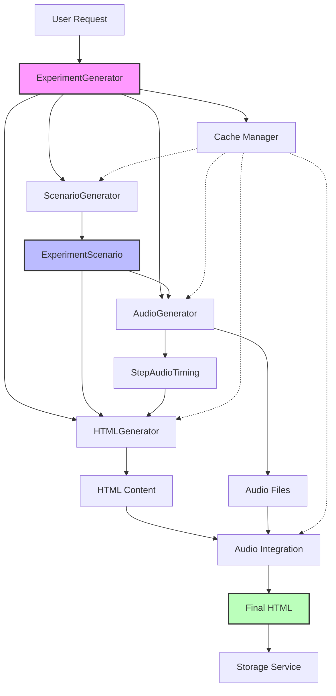
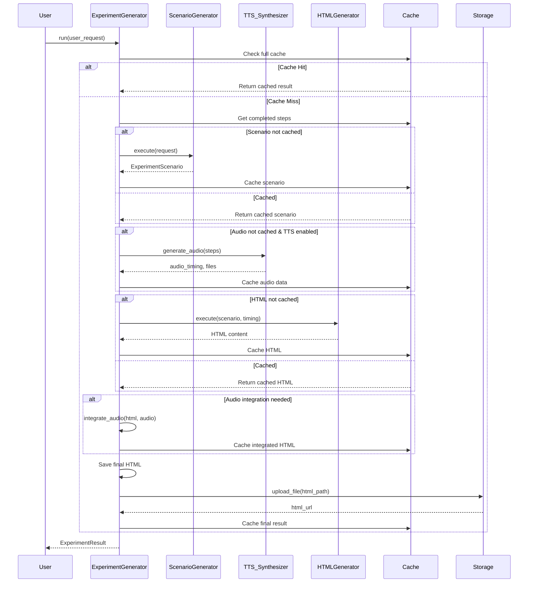
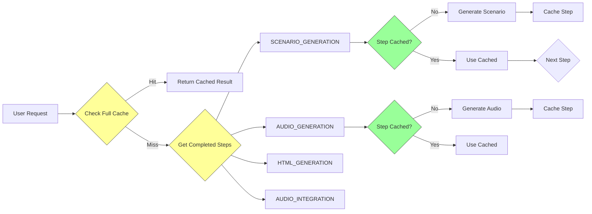
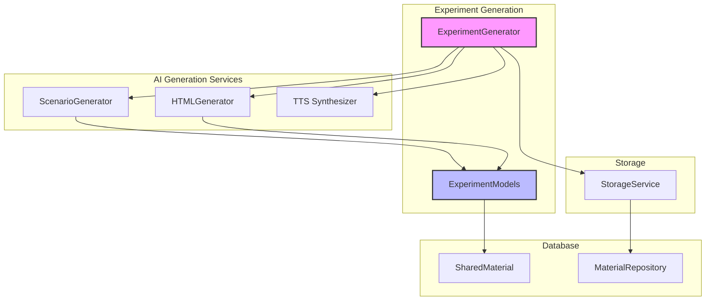

# Experiment Generation Module

## Overview

The **Experiment Generation Module** is a sophisticated AI-powered system that creates interactive 3D web-based experiment visualizations for chemistry and physics education. It transforms simple user requests into complete, narrated HTML experiments with synchronized audio and 3D animations.

### Key Features

- **Multi-Stage Pipeline**: 4-step generation process with intelligent caching
- **3D Visualization**: Interactive web-based 3D experiment simulations
- **Audio Narration**: Synchronized voice-over for each experiment step
- **Step-Level Caching**: Resume capability from any pipeline stage
- **Approval Workflow**: Support for human-in-the-loop review processes
- **Multi-LLM Architecture**: Uses different AI models for optimal performance

## Architecture

### High-Level Architecture



### Component Interaction Flow



## Core Components

### 1. ExperimentGenerator

**Location**: `backend.app.services.ai.visualisation.experiment_generator.ExperimentGenerator`

The main orchestrator class that manages the entire experiment generation pipeline. It coordinates all sub-generators and handles caching, error recovery, and result compilation.

**Key Responsibilities**:
- Pipeline orchestration and step management
- Cache coordination across all generation stages
- Error handling and recovery
- Result compilation and metadata tracking
- File management and storage integration

**Constructor Parameters**:
```python
ExperimentGenerator(
    api_key: str,              # API key for scenario LLM
    base_url: str,              # Base URL for scenario LLM
    base_model: str,            # Model name for scenario generation
    html_llm_api_key: str,      # API key for HTML generation LLM
    html_llm_base_url: str,     # Base URL for HTML generation LLM
    html_model: str,            # Model name for HTML generation (Claude Sonnet 4.5)
    elevenlabs_api_key: Optional[str] = None,  # ElevenLabs API key
    elevenlabs_voice_id: str = "TX3LPaxmHKxFdv7VOQHJ",
    elevenlabs_model: str = "eleven_v3",
    output_dir: Path = Path("output/experiments")
)
```

**Main Methods**:

#### `async run(user_request: str, use_cache: bool = True) -> ExperimentResult`

The primary entry point for generating experiments from scratch.

**Pipeline Steps**:
1. **Scenario Generation**: Analyze user request → Create detailed experiment scenario
2. **Audio Generation**: Generate narration audio for each step → Calculate timing
3. **HTML Generation**: Create 3D visualization HTML with audio synchronization
4. **Audio Integration**: Embed audio files into HTML
5. **Storage**: Upload final HTML to storage service

**Parameters**:
- `user_request`: Short description of the experiment to visualize
- `use_cache`: Whether to use cached results and resume from failed steps

**Returns**: `ExperimentResult` with HTML URL, paths, metadata, and timing information

#### `async run_from_scenario(scenario: ExperimentScenario, user_request: str) -> ExperimentResult`

Generates experiment from a pre-approved scenario (skips scenario generation).

**Use Case**: Human-in-the-loop approval workflow where teachers review and approve scenarios before full generation.

**Parameters**:
- `scenario`: Pre-approved `ExperimentScenario` object
- `user_request`: Original user request for metadata

**Returns**: `ExperimentResult` with generated HTML

### 2. ExperimentSteps

**Location**: `backend.app.services.ai.visualisation.experiment_generator.ExperimentSteps`

Enumeration of pipeline steps for caching and resumption.

**Values**:
- `SCENARIO_GENERATION`: Experiment scenario creation
- `AUDIO_GENERATION`: Text-to-speech audio generation
- `HTML_GENERATION`: HTML visualization generation
- `AUDIO_INTEGRATION`: Audio embedding into HTML

### 3. Data Models

#### ExperimentScenario

**Location**: `backend.app.services.ai.visualisation.plaintext.experiment.experiment_models.ExperimentScenario`

Complete experiment specification generated by the scenario generator.

**Fields**:
```python
experiment_name: str              # Human-readable name
experiment_type: str              # "chemistry", "physics", or "biology"
objective: str                    # Learning objective
materials: List[str]              # Required equipment and chemicals
safety_notes: List[str]           # Safety warnings and precautions
steps: List[ExperimentStep]       # Sequential experiment steps
expected_result: str              # Expected outcome description
scientific_explanation: str       # Scientific principles explanation
total_duration: float             # Total estimated time in seconds
```

#### ExperimentStep

**Location**: `backend.app.services.ai.visualisation.plaintext.experiment.experiment_models.ExperimentStep`

Individual step within an experiment scenario.

**Fields**:
```python
step_number: int                  # Step order (1, 2, 3...)
title: str                        # Short step title
description: str                  # Detailed action description
duration_seconds: float           # Estimated duration
visual_elements: List[str]        # 3D elements to display
narration: str                    # Voice-over script
audio_start_time: Optional[float] # Actual start time (after TTS)
audio_duration: Optional[float]   # Actual duration (after TTS)
```

#### StepAudioTiming

**Location**: `backend.app.services.ai.visualisation.plaintext.experiment.experiment_models.StepAudioTiming`

Audio synchronization data for each step.

**Fields**:
```python
step_number: int
start_time: float                 # Audio start time in seconds
duration: float                   # Audio duration in seconds
audio_path: Optional[str]         # Path to audio file
```

#### ExperimentResult

**Location**: `backend.app.services.ai.visualisation.plaintext.experiment.experiment_models.ExperimentResult`

Complete generation result with all outputs and metadata.

**Fields**:
```python
success: bool                     # Generation success status
html_url: Optional[str]          # Public URL to HTML file
html_path: Optional[str]         # Local file path
audio_path: Optional[str]        # Combined audio file path
scenario: Optional[ExperimentScenario]  # Generated scenario
error_message: Optional[str]     # Error message if failed
generation_time: Optional[float] # Total generation time in seconds
models_used: Dict[str, str]      # Models used for each stage
token_usage: Dict[str, int]      # Token consumption by model
from_cache: bool                 # Whether result was cached
```

#### UpdateExperimentScenarioRequest

**Location**: `backend.app.models.material.UpdateExperimentScenarioRequest`

Request schema for updating experiment scenarios during approval workflow.

**Use Case**: Allows teachers to modify generated scenarios before approval.

**Fields**: All fields are optional to support partial updates
```python
experiment_name: Optional[str]
experiment_type: Optional[str]
objective: Optional[str]
materials: Optional[List[str]]
safety_notes: Optional[List[str]]
steps: Optional[List[Dict[str, Any]]]
expected_result: Optional[str]
scientific_explanation: Optional[str]
total_duration: Optional[float]
```

## Pipeline Details

### Step 1: Scenario Generation

**Component**: `ScenarioGenerator` (small LLM)

**Process**:
1. Analyze user request for experiment type and requirements
2. Generate structured `ExperimentScenario` with:
   - Detailed step-by-step procedures
   - Equipment and material lists
   - Safety considerations
   - Scientific explanations
   - Narration scripts for each step

**Output**: Complete experiment blueprint

### Step 2: Audio Generation

**Component**: `ElevenLabsTTSSynthesizer` (optional)

**Process**:
1. Generate audio for each step's narration
2. Calculate actual audio timing and duration
3. Add padding to match step duration requirements
4. Combine all step audio into single file with gaps

**Output**: 
- Individual audio files per step
- Combined audio file
- `StepAudioTiming` array for synchronization

### Step 3: HTML Generation

**Component**: `HTMLGenerator` (Claude Sonnet 4.5)

**Process**:
1. Create 3D visualization using Three.js or similar
2. Implement step-by-step animation system
3. Synchronize animations with audio timing
4. Add interactive controls and UI elements

**Output**: Complete HTML file with embedded 3D experiment

### Step 4: Audio Integration

**Process**:
1. Embed audio files as base64 data URIs
2. Add audio player controls
3. Implement audio-event synchronization
4. Ensure cross-browser compatibility

**Output**: Final self-contained HTML file

## Caching Strategy

### Step-Level Caching

The module implements sophisticated step-level caching to enable resumption from any pipeline stage:



**Cache Keys**:
- Full result: User request hash
- Step results: User request hash + step name

**Cache Dependencies**:
- Audio generation depends on scenario generation
- HTML generation depends on scenario and audio
- Audio integration depends on HTML and audio

**Cache Invalidation**:
- Automatic invalidation if cached output files are missing
- TTL-based expiration (configurable)
- Manual cache clearing via `VisualisationCache`

## Integration with Other Modules

### Dependencies

#### AI Generation Services
- **ScenarioGenerator**: Small LLM for experiment analysis and planning
- **HTMLGenerator**: Claude Sonnet 4.5 for HTML/3D visualization generation
- **ElevenLabsTTSSynthesizer**: Text-to-speech for narration (optional)

#### Storage Services
- **StorageService**: Uploads final HTML files to cloud storage
- Returns public URLs for accessing experiments

#### Database Layer
- **SharedMaterial**: Stores experiment metadata and generation state
- **MaterialRepository**: Manages experiment records in MongoDB

### Module Interactions



## Configuration

### Settings

The module uses centralized configuration via `get_settings()`:

```python
# LLM Configuration
api_key: str                    # API key for scenario LLM
base_url: str                   # Base URL for scenario LLM
base_model: str                 # Model for scenario generation
html_llm_api_key: str           # API key for HTML LLM
html_llm_base_url: str          # Base URL for HTML LLM
html_model: str                 # Claude Sonnet 4.5

# ElevenLabs TTS
tts_api_key: Optional[str]     # ElevenLabs API key
tts_voice_id: str               # Voice ID for narration
tts_model: str                  # TTS model version

# Output Configuration
experiments_dir: Path           # Output directory for HTML files

# Cache Configuration
cache_dir: Path                 # Cache directory
visualisation_cache_ttl_seconds: int  # Cache TTL
visualisation_cache_enabled: bool     # Enable/disable caching
```

### Global Instance

A pre-configured global instance is created at module load:

```python
experiment_generator = ExperimentGenerator(
    api_key=settings.api_key,
    base_url=settings.base_url,
    base_model=settings.base_model,
    html_llm_api_key=settings.html_llm_api_key,
    html_llm_base_url=settings.html_llm_base_url,
    html_model=settings.html_model,
    elevenlabs_api_key=settings.tts_api_key,
    elevenlabs_voice_id=settings.tts_voice_id,
    elevenlabs_model=settings.tts_model,
    output_dir=settings.experiments_dir
)
```

## Usage Examples

### Basic Experiment Generation

```python
from app.services.ai.visualisation.experiment_generator import experiment_generator

# Generate a chemistry experiment
result = await experiment_generator.run(
    user_request="Create a visualization of acid-base titration with pH indicator"
)

if result.success:
    print(f"Experiment URL: {result.html_url}")
    print(f"Generation time: {result.generation_time:.2f}s")
    print(f"Total steps: {len(result.scenario.steps)}")
else:
    print(f"Error: {result.error_message}")
```

### Using Pre-Approved Scenario

```python
from app.services.ai.visualisation.plaintext.experiment.experiment_models import ExperimentScenario

# Load or create approved scenario
approved_scenario = ExperimentScenario(
    experiment_name="Electrolysis of Water",
    experiment_type="chemistry",
    objective="Demonstrate water decomposition into hydrogen and oxygen",
    materials=["Water", "Battery", "Electrodes", "Test tubes"],
    safety_notes=["Wear safety goggles", "Ensure proper ventilation"],
    steps=[...],  # Pre-defined steps
    expected_result="Bubbles of gas at each electrode",
    scientific_explanation="Electrical current splits water molecules...",
    total_duration=300.0
)

# Generate from approved scenario
result = await experiment_generator.run_from_scenario(
    scenario=approved_scenario,
    user_request="Electrolysis demonstration"
)
```

### Approval Workflow Integration

```python
from app.models.material import UpdateExperimentScenarioRequest

# 1. Generate initial scenario (stops at plan stage)
initial_result = await experiment_generator.run(
    user_request="Create photosynthesis experiment",
    use_cache=True
)

# 2. Teacher reviews and modifies scenario
update_request = UpdateExperimentScenarioRequest(
    experiment_name="Photosynthesis with Elodea Plant",
    steps=[...],  # Modified steps
    safety_notes=["Add: Handle glassware carefully"]  # Additional safety notes
)

# 3. Approve and generate final experiment
approved_scenario = apply_updates(initial_result.scenario, update_request)
final_result = await experiment_generator.run_from_scenario(
    scenario=approved_scenario,
    user_request="Photosynthesis experiment"
)
```

## File Structure

```
experiment_generation/
├── experiment_generator.py          # Main orchestrator
├── plaintext/
│   └── experiment/
│       ├── experiment_models.py     # Data models
│       ├── scenario_generator.py    # Scenario LLM interface
│       └── html_generator.py        # HTML/3D generation LLM
└── multimodal/
    └── tts/
        └── elevenlabs_provider.py   # TTS integration
```

## Error Handling

### Pipeline Error Recovery

The module implements robust error handling with resume capability:

```python
try:
    result = await experiment_generator.run(user_request)
    if not result.success:
        # Check which steps completed
        completed = experiment_generator.cache.get_completed_steps(user_request)
        print(f"Failed at step. Completed: {completed}")
        
        # Retry with cache to resume from last successful step
        retry_result = await experiment_generator.run(user_request, use_cache=True)
except Exception as e:
    logger.error(f"Generation failed: {e}")
    # All intermediate files are still saved for debugging
```

### Common Error Scenarios

1. **LLM API Errors**: Automatic retry with exponential backoff
2. **TTS Generation Failures**: Falls back to estimated timing
3. **File System Issues**: Saves to alternative paths
4. **Network Timeouts**: Configurable timeout values
5. **Invalid Scenarios**: Validation before proceeding to next step

## Performance Considerations

### Generation Time Breakdown

Typical generation times:
- Scenario Generation: 5-15 seconds
- Audio Generation: 10-30 seconds (depends on step count)
- HTML Generation: 20-60 seconds (Claude Sonnet 4.5)
- Audio Integration: 2-5 seconds
- **Total**: 37-110 seconds average

### Optimization Strategies

1. **Caching**: Reuse completed steps across requests
2. **Parallel Processing**: Audio generation for multiple steps
3. **Model Selection**: Small LLM for scenarios, powerful LLM for HTML
4. **Incremental Generation**: Resume from failed steps
5. **Storage Optimization**: Base64 audio embedding for portability

### Resource Usage

- **Memory**: ~2-4GB peak during HTML generation
- **Disk**: ~10-50MB per experiment (HTML + audio)
- **Network**: API calls to LLM and TTS services
- **CPU**: Moderate, mostly during audio processing

## Security Considerations

### Input Validation

- User requests sanitized before LLM processing
- Scenario validation against schema
- File path sanitization to prevent directory traversal

### API Key Management

- Keys stored in environment variables
- Separate keys for different services
- Key rotation support

### Content Safety

- LLM prompts include safety guidelines
- Experiment scenarios include mandatory safety notes
- Content filtering for inappropriate requests

## Future Enhancements

### Planned Features

1. **Multi-language Support**: Generate experiments in different languages
2. **Advanced 3D Models**: More realistic chemical/physics simulations
3. **Interactive Assessments**: Built-in quizzes and evaluations
4. **Collaborative Editing**: Multiple teachers can review scenarios
5. **Version Control**: Track changes to experiments over time
6. **Analytics**: Usage tracking and performance metrics

### Technical Improvements

1. **Streaming Generation**: Real-time progress updates
2. **GPU Acceleration**: Faster 3D rendering
3. **Microservices**: Decompose into smaller services
4. **Advanced Caching**: Redis-based distributed caching
5. **A/B Testing**: Compare different generation strategies

## Related Documentation

- [AI Generation Services](ai_generation_services.md) - LLM integration details
- [Storage Services](storage_services.md) - File upload and management
- [Material Management](material_management.md) - Experiment metadata and sharing
- [Animation Generation](animation_generation.md) - Related visualization system
- [Database Models](database_models.md) - Common data models

## API Reference

### ExperimentGenerator Methods

#### `async run(user_request: str, use_cache: bool = True) -> ExperimentResult`

Generate a complete experiment from user request.

**Parameters**:
- `user_request` (str): Description of the experiment to create
- `use_cache` (bool): Whether to use caching (default: True)

**Returns**: `ExperimentResult` object

**Example**:
```python
result = await experiment_generator.run(
    "Demonstrate Newton's third law with rocket propulsion"
)
```

#### `async run_from_scenario(scenario: ExperimentScenario, user_request: str) -> ExperimentResult`

Generate experiment from pre-approved scenario.

**Parameters**:
- `scenario` (ExperimentScenario): Approved experiment blueprint
- `user_request` (str): Original request for metadata

**Returns**: `ExperimentResult` object

**Example**:
```python
result = await experiment_generator.run_from_scenario(
    scenario=approved_scenario,
    user_request="Rocket propulsion experiment"
)
```

### Data Model Schemas

#### ExperimentScenario

Complete experiment specification.

**Fields**:
- `experiment_name`: str
- `experiment_type`: str ("chemistry", "physics", "biology")
- `objective`: str
- `materials`: List[str]
- `safety_notes`: List[str]
- `steps`: List[ExperimentStep]
- `expected_result`: str
- `scientific_explanation`: str
- `total_duration`: float

#### ExperimentResult

Generation result with all outputs.

**Fields**:
- `success`: bool
- `html_url`: Optional[str]
- `html_path`: Optional[str]
- `audio_path`: Optional[str]
- `scenario`: Optional[ExperimentScenario]
- `error_message`: Optional[str]
- `generation_time`: Optional[float]
- `models_used`: Dict[str, str]
- `token_usage`: Dict[str, int]
- `from_cache`: bool

## Troubleshooting

### Common Issues

1. **Generation Stuck at HTML Stage**
   - Check Claude API key and rate limits
   - Verify network connectivity
   - Review HTML generator prompts

2. **Audio Not Generated**
   - Confirm ElevenLabs API key is set
   - Check voice ID validity
   - Verify audio output directory permissions

3. **Cache Not Working**
   - Ensure `visualisation_cache_enabled` is True
   - Check cache directory permissions
   - Verify TTL settings

4. **3D Visualization Not Rendering**
   - Check browser WebGL support
   - Verify HTML file integrity
   - Review browser console for errors

### Debug Mode

Enable debug logging:

```python
import logging
logging.basicConfig(level=logging.DEBUG)
logging.getLogger('ExperimentGenerator').setLevel(logging.DEBUG)

result = await experiment_generator.run(user_request)
```

### Intermediate Files

All generation stages save intermediate files for debugging:

```
output/experiments/
├── intermediate/
│   ├── scenarios/           # JSON scenario files
│   ├── scripts/             # Narration text files
│   ├── html/                # Raw HTML before audio integration
│   └── summaries/           # Generation metadata
├── audio/
│   ├── steps/               # Individual step audio
│   └── *.mp3                # Combined audio files
└── *.html                   # Final experiment files
```

## Conclusion

The Experiment Generation Module provides a powerful, flexible system for creating interactive 3D science experiments. Its multi-stage pipeline, intelligent caching, and support for approval workflows make it suitable for both automated and human-in-the-loop generation scenarios. The modular architecture allows for easy extension and customization while maintaining high-quality output through specialized AI models for different generation stages.