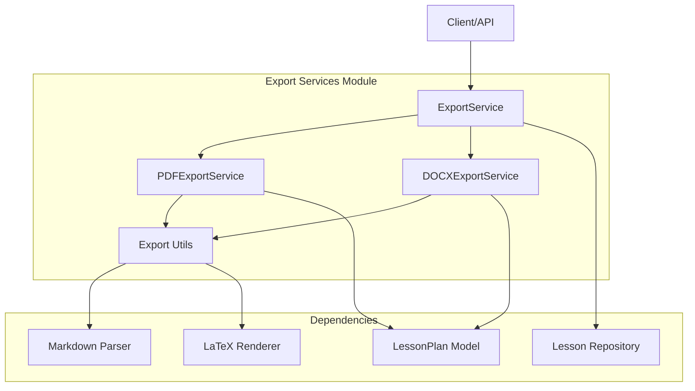
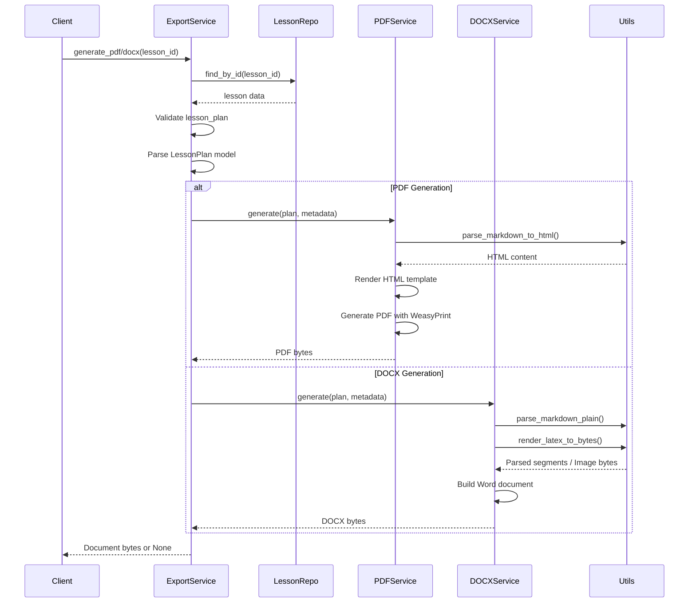
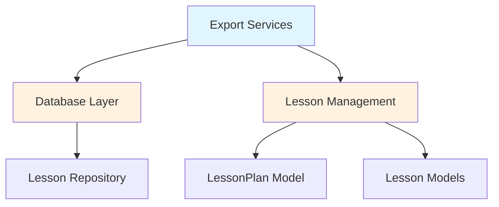

# Export Services Module

## Overview

The **Export Services** module provides document generation capabilities for lesson plans, supporting both PDF and DOCX formats. It acts as a centralized export layer that transforms structured lesson plan data into professionally formatted documents suitable for educational use.

### Purpose

- Generate PDF documents from lesson plans using HTML/CSS rendering
- Generate DOCX (Microsoft Word) documents with rich formatting
- Support markdown and LaTeX content within lesson plans
- Provide consistent document formatting across different export formats
- Enable teachers to download and share lesson plans in standard document formats

## Architecture

### Component Structure



### Core Components

#### 1. ExportService (`backend.app.services.export.__init__.py`)

The main facade service that provides a unified interface for document generation.

**Responsibilities:**
- Acts as the primary entry point for export operations
- Delegates to format-specific export services (PDF/DOCX)
- Retrieves lesson plan data from the repository
- Handles lesson plan validation and data preparation

**Key Methods:**
- `generate_pdf(lesson_id: str) -> Optional[bytes]`: Generates PDF document for a lesson
- `generate_docx(lesson_id: str) -> Optional[bytes]`: Generates DOCX document for a lesson

**Design Pattern:** Facade/Delegation pattern - isolates clients from the complexity of different export implementations.

#### 2. PDFExportService (`backend.app.services.export.pdf.py`)

Specialized service for generating PDF documents using HTML/CSS rendering.

**Responsibilities:**
- Converts lesson plans to HTML using Jinja2 templates
- Applies CSS styling for professional document appearance
- Renders markdown content to HTML
- Handles LaTeX formula rendering
- Generates PDF using WeasyPrint engine

**Key Features:**
- Template-based HTML generation
- Custom CSS for Vietnamese educational documents
- Support for markdown and LaTeX content
- Proper page layout and formatting
- Table-based implementation steps

**Dependencies:**
- Jinja2 for HTML templating
- WeasyPrint for PDF generation
- Export utils for markdown/LaTeX processing

#### 3. DOCXExportService (`backend.app.services.export.docx.py`)

Specialized service for generating Microsoft Word documents using python-docx.

**Responsibilities:**
- Creates Word documents with structured formatting
- Implements Vietnamese educational document standards
- Supports markdown formatting (bold, italic, code)
- Embeds LaTeX formulas as images
- Adds hyperlinks and rich text formatting

**Key Features:**
- Direct Word document manipulation
- Markdown parsing and formatting
- LaTeX formula rendering to images
- Table-based layout for implementation steps
- Custom styling and formatting

**Dependencies:**
- python-docx for Word document creation
- Export utils for markdown/LaTeX processing

### Data Flow



## Document Structure

Both PDF and DOCX exporters generate documents following Vietnamese educational standards with the following structure:

### 1. General Information Section
- School name
- Class information
- Subject and lesson title
- Duration and week information
- Teacher name

### 2. Teaching Process (Per Period)
Each period contains:
- **Objectives**: Knowledge, competencies, and qualities
- **Key Concepts**: Main concepts and formulas with LaTeX support
- **Teaching Materials**: Resources for teachers and students
- **Learning Activities**: Detailed activities with:
  - Objectives and content
  - Expected products
  - Materials with hyperlinks
  - Implementation steps (teacher and student actions)
- **Time Allocation**: Breakdown of lesson time

### 3. Post-Lesson Adjustments
- Notes and reflections for future improvements

## Content Processing

### Markdown Support
Both exporters support markdown formatting:
- **Bold** text
- *Italic* text
- `Code` formatting
- Hyperlinks
- Lists and structured content

### LaTeX Support
- Inline and block LaTeX formulas
- Automatic rendering to images (DOCX) or HTML (PDF)
- Fallback text rendering if rendering fails
- Mathematical expressions for educational content

## Dependencies

### Internal Dependencies



- **Database Layer**: Uses `LessonRepository` to retrieve lesson data
- **Lesson Management**: Depends on `LessonPlan` model and related lesson models
- **Export Utils**: Shared utilities for markdown parsing and LaTeX rendering

### External Dependencies
- **Jinja2**: HTML templating for PDF generation
- **WeasyPrint**: PDF rendering engine
- **python-docx**: Microsoft Word document creation
- **LaTeX rendering libraries**: For mathematical formula processing

## Usage Examples

### Generating a PDF

```python
from app.services.export import export_service

# Generate PDF for a lesson
pdf_bytes = await export_service.generate_pdf("lesson_id_123")

if pdf_bytes:
    with open("lesson_plan.pdf", "wb") as f:
        f.write(pdf_bytes)
```

### Generating a DOCX

```python
from app.services.export import export_service

# Generate DOCX for a lesson
docx_bytes = await export_service.generate_docx("lesson_id_123")

if docx_bytes:
    with open("lesson_plan.docx", "wb") as f:
        f.write(docx_bytes)
```

## Error Handling

- Returns `None` if lesson is not found or has no lesson plan
- Graceful handling of LaTeX rendering failures (fallback to text)
- Exception handling for document generation errors
- Validation of lesson plan data before processing

## Performance Considerations

- Document generation is CPU-intensive due to rendering
- LaTeX formula rendering adds processing overhead
- PDF generation with WeasyPrint requires significant resources
- Consider async processing for large documents
- Cache generated documents when possible

## Future Enhancements

- Additional export formats (e.g., PPTX, HTML)
- Template customization options
- Batch export capabilities
- Progress tracking for large documents
- Export scheduling and background processing
- Custom styling and branding options

## Related Documentation

- [Database Layer](database_layer.md) - For lesson repository details
- [Lesson Management](lesson_management.md) - For lesson plan structure
- [Database Models](database_models.md) - For data models reference

## Implementation Notes

### Singleton Pattern
All export services use singleton instances:
- `export_service = ExportService()`
- `pdf_export_service = PDFExportService()`
- `docx_export_service = DOCXExportService()`

### Document Standards
The module implements Vietnamese educational document standards ("KẾ HOẠCH BÀI DẠY" format) with proper section numbering and educational terminology.

### Extensibility
The delegation pattern makes it easy to add new export formats by:
1. Creating a new export service class
2. Implementing the `generate(plan, metadata)` method
3. Adding a corresponding method to `ExportService`
4. Updating the client interface

This architecture ensures clean separation of concerns and makes the module maintainable and extensible.