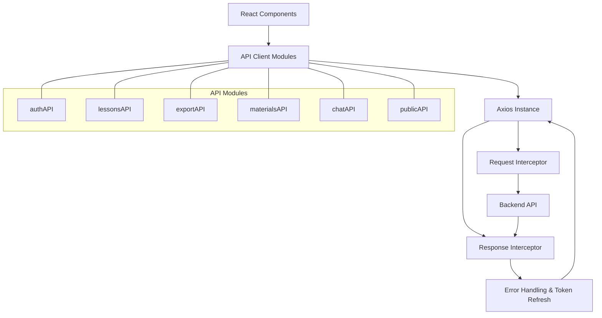
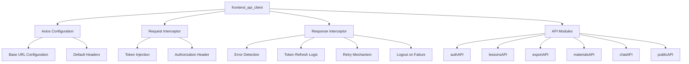
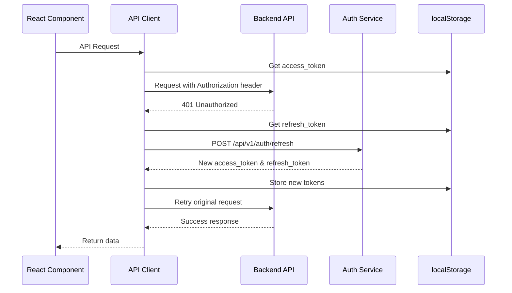
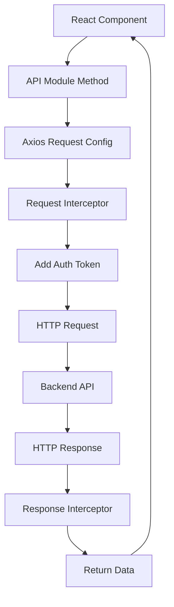
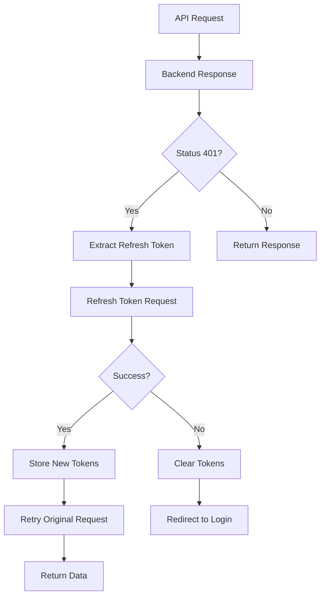
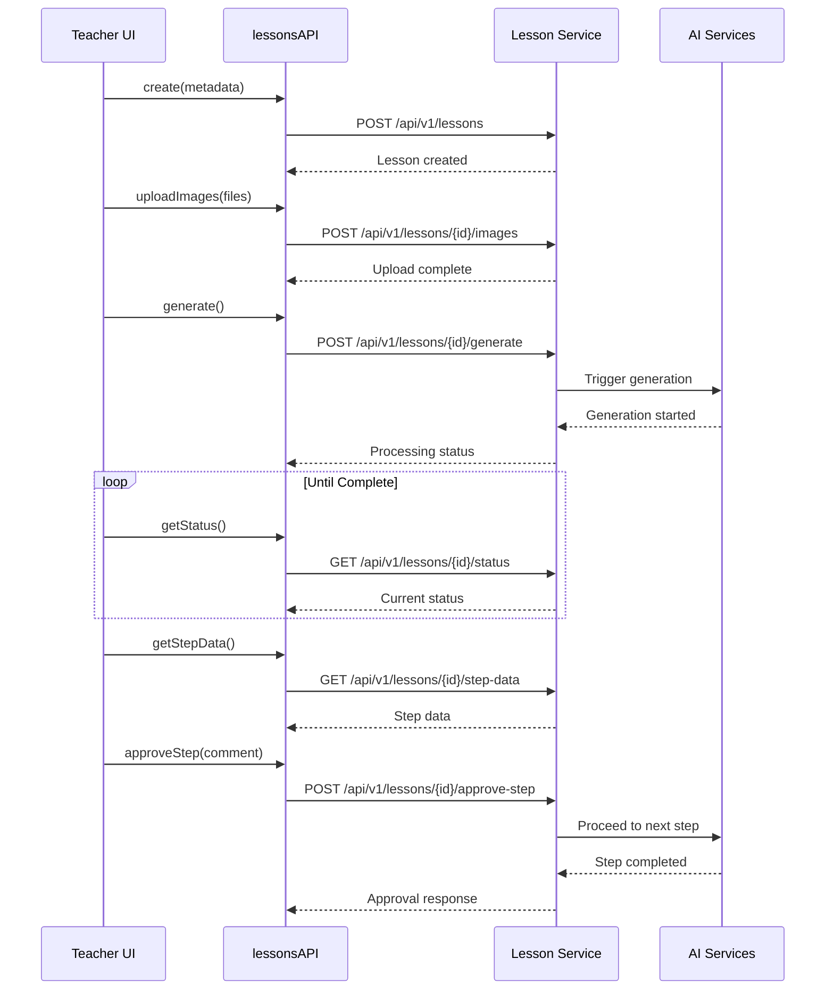
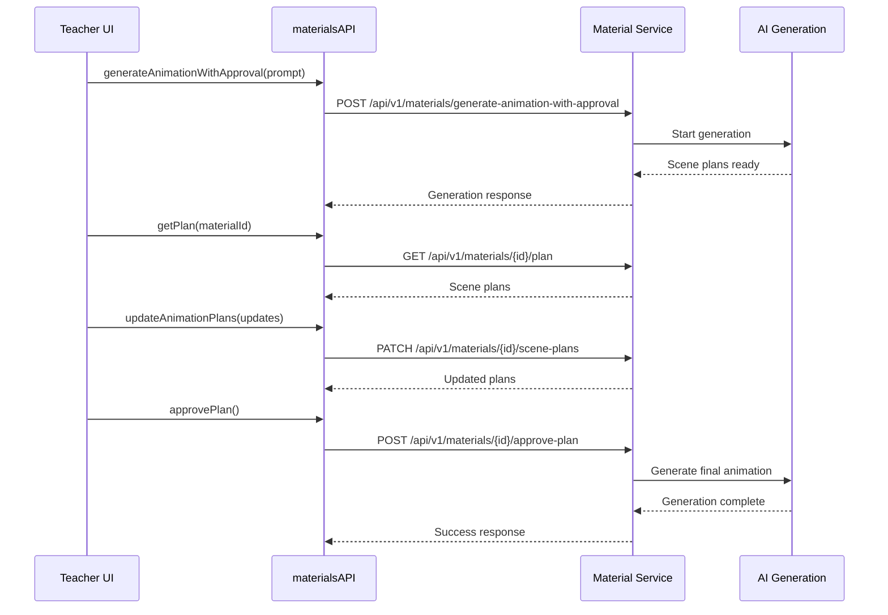
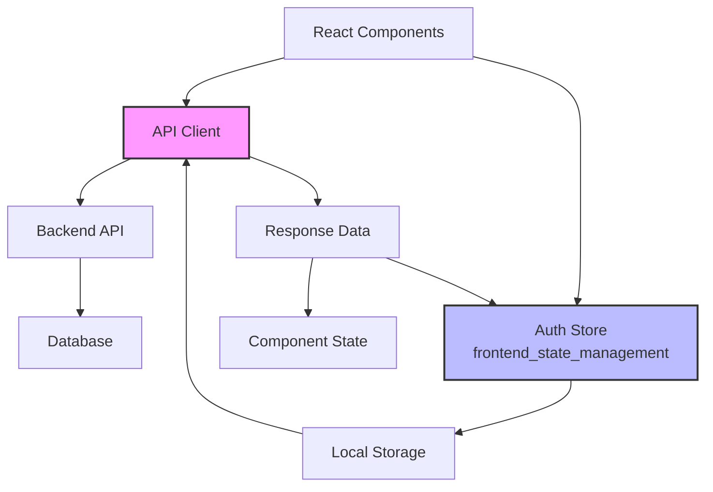

# Frontend API Client

## Overview

The **Frontend API Client** is the central HTTP communication layer that enables the React frontend application to interact with the backend REST API. Built on top of Axios, it provides a type-safe, interceptor-driven architecture for handling authentication, request/response processing, and error management.

This module serves as the single source of truth for all API communications, organizing endpoints into logical modules and providing consistent error handling and authentication token management across the entire frontend application.

## Architecture

### Core Architecture



### Component Structure



## Key Components

### Axios Instance Configuration

The module creates a centralized Axios instance with default configuration:

- **Base URL**: Configured via `VITE_API_URL` environment variable
- **Default Headers**: `Content-Type: application/json`
- **Request Interceptor**: Automatically injects JWT access tokens
- **Response Interceptor**: Handles 401 errors with automatic token refresh

### Request Interceptor

```typescript
// Automatically adds authentication token to all requests
api.interceptors.request.use((config) => {
  const token = localStorage.getItem('access_token');
  if (token) {
    config.headers.Authorization = `Bearer ${token}`;
  }
  return config;
});
```

### Response Interceptor

The response interceptor implements sophisticated error handling:

1. **Token Expiration Detection**: Catches 401 Unauthorized responses
2. **Automatic Token Refresh**: Attempts to refresh tokens using stored refresh token
3. **Request Retry**: Automatically retries failed requests with new tokens
4. **Graceful Degradation**: Redirects to login on persistent authentication failures



## API Modules

### 1. Authentication API (`authAPI`)

Handles user authentication and session management.

**Endpoints:**
- `POST /api/v1/auth/login` - User login
- `POST /api/v1/auth/logout` - User logout
- `GET /api/v1/auth/me` - Get current user profile

**Dependencies:**
- [authentication](authentication.md) - Backend auth service
- [frontend_types](frontend_types.md) - TypeScript interfaces
- [frontend_state_management](frontend_state_management.md) - Frontend state synchronization

### 2. Lessons API (`lessonsAPI`)

Comprehensive lesson management covering the entire lesson lifecycle.

**Core Functionality:**
- **CRUD Operations**: Create, read, update, delete lessons
- **Media Upload**: Image upload with multipart/form-data support
- **Generation Pipeline**: Trigger and monitor AI lesson generation
- **Step-by-Step Review**: Granular control over lesson creation process
- **Presentation Management**: Sync materials to presentation slides
- **Sharing**: Public link generation and management

**Key Methods:**
- `list()` - Filterable lesson listing with pagination
- `uploadImages()` - Batch image upload for lesson content
- `generate()` - Trigger AI lesson generation
- `getStepData()` - Retrieve current step data for review
- `approveStep()` - Advance lesson through generation pipeline
- `syncMaterialsToPresentation()` - Update slides with generated materials
- `createShareLink()` - Generate public sharing links

**Dependencies:**
- [lesson_management](lesson_management.md) - Backend lesson service
- [lesson_core](lesson_core.md) - Core lesson models and CRUD operations
- [lesson_processing](lesson_processing.md) - Generation pipeline and status tracking
- [lesson_review](lesson_review.md) - Step-by-step review and approval
- [lesson_plan_presentation](lesson_plan_presentation.md) - Presentation sync and management
- [lesson_sharing](lesson_sharing.md) - Sharing functionality and public links
- [frontend_types](frontend_types.md) - TypeScript interfaces
- [ai_generation_services](ai_generation_services.md) - AI generation services
- [export_services](export_services.md) - Export functionality

### 3. Export API (`exportAPI`)

Handles lesson export functionality in multiple formats.

**Endpoints:**
- `POST /api/v1/export/{lessonId}/pdf` - Export as PDF
- `POST /api/v1/export/{lessonId}/docx` - Export as Word document

**Dependencies:**
- [export_services](export_services.md) - Backend export service

### 4. Materials API (`materialsAPI`)

Manages the materials library with advanced generation workflows.

**Core Functionality:**
- **Discovery**: List, search, and filter shared materials
- **Generation**: Create animations, experiments, and images
- **Approval Workflows**: Step-by-step generation with teacher review
- **Human-in-the-Loop**: Real-time feedback during generation
- **State Management**: Track generation progress and resume capabilities

**Advanced Features:**
- **Parallel Generation**: Generate multiple materials simultaneously
- **Scene-by-Scene Review**: Granular feedback on animation scenes
- **Resume Capability**: Recover from failed or interrupted generations
- **Usage Tracking**: Monitor material usage statistics

**Dependencies:**
- [material_management](material_management.md) - Backend material service
- [ai_generation_services](ai_generation_services.md) - AI generation
- [animation_generation](animation_generation.md) - Animation pipeline
- [experiment_generation](experiment_generation.md) - Experiment generation
- [animation_session](animation_session.md) - Real-time feedback
- [frontend_types](frontend_types.md) - TypeScript interfaces

### 5. Chat API (`chatAPI`)

Provides AI assistant chat functionality.

**Endpoints:**
- `POST /api/v1/chat` - Send message to AI assistant

**Features:**
- Context-aware responses based on current page and data
- Integration with lesson and material generation workflows

**Dependencies:**
- [ai_generation_services_chat](ai_generation_services_chat.md) - AI chat service

### 6. Public API (`publicAPI`)

Handles unauthenticated endpoints for shared content access.

**Endpoints:**
- `GET /api/v1/lessons/shared/{shareToken}` - Access shared lessons
- `PUT /api/v1/lessons/shared/{editToken}` - Update shared lessons

**Characteristics:**
- Bypasses authentication interceptors
- Uses direct axios calls for public access
- Supports both view and edit tokens

## Data Flow Patterns

### Standard Request Flow



### Authentication Error Recovery Flow



### Lesson Generation Workflow



### Material Generation with Feedback Flow



## Integration with Frontend State

The API client works seamlessly with frontend state management, particularly the [frontend_state_management](frontend_state_management.md) module:



**Integration Points:**
- **Authentication State**: API client automatically updates localStorage tokens, which syncs with `AuthState` in [frontend_state_management](frontend_state_management.md)
- **Error Handling**: Global error responses trigger UI notifications through the state management system
- **Loading States**: Interceptors can trigger global loading indicators managed by the state store
- **Data Synchronization**: API responses automatically update frontend stores, maintaining consistency across components
- **Token Management**: The `AuthState` interface in [frontend_state_management](frontend_state_management.md) reflects tokens stored by the API client

## Error Handling Strategy

The module implements a multi-layered error handling approach:

1. **Network Errors**: Caught by Axios and passed to interceptors
2. **Authentication Errors**: Automatic token refresh with fallback to login
3. **API Errors**: Standardized error responses propagated to components
4. **Retry Logic**: Failed requests are retried once after token refresh

```typescript
// Error handling hierarchy
Component Error Boundary
    ↓
API Client Interceptor
    ↓
Token Refresh Logic
    ↓
Redirect to Login (if refresh fails)
```

## Security Considerations

- **Token Storage**: JWT tokens stored in localStorage (consider httpOnly cookies for enhanced security)
- **Automatic Token Injection**: Prevents accidental token omission
- **Token Refresh**: Silent refresh prevents user disruption
- **Logout Cleanup**: Tokens cleared on authentication failure
- **Public API Separation**: Unauthenticated endpoints bypass token injection

## Performance Optimizations

- **Axios Instance Reuse**: Single instance reduces overhead
- **Interceptor Caching**: Token retrieval optimized with localStorage
- **Request Retry**: Automatic retry prevents manual refresh requirements
- **Modular API Design**: Lazy loading of API modules not currently needed

## Module Relationships

```mermaid
graph TB
    A[frontend_api_client] --> B[frontend_types]
    A --> C[authentication]
    A --> D[lesson_management]
    A --> E[material_management]
    A --> F[export_services]
    A --> G[ai_generation_services]
    A --> H[animation_generation]
    A --> I[experiment_generation]
    A --> J[animation_session]
    A --> K[frontend_state_management]
    
    D --> D1[lesson_core]
    D --> D2[lesson_processing]
    D --> D3[lesson_review]
    D --> D4[lesson_plan_presentation]
    D --> D5[lesson_sharing]
    
    E --> E1[material_management]
    
    G --> G1[ai_generation_services_generation]
    G --> G2[ai_generation_services_extraction]
    G --> G3[ai_generation_services_analysis]
    G --> G4[ai_generation_services_chat]
    
    H --> H1[animation_pipeline]
    H --> H2[animation_models]
    H --> H3[generation_state]
    
    I --> I1[experiment_generation]
    
    J --> J1[animation_session_manager]
    J --> J2[generation_state_models]
```



## Dependencies

### Runtime Dependencies
- **axios**: HTTP client library for making HTTP requests
- **Browser APIs**: localStorage for token persistence

### Module Dependencies
- [frontend_types](frontend_types.md) - TypeScript interfaces for all request/response types
- [authentication](authentication.md) - Backend authentication service
- [lesson_management](lesson_management.md) - Backend lesson operations
- [lesson_core](lesson_core.md) - Core lesson models and CRUD operations
- [lesson_processing](lesson_processing.md) - Lesson generation pipeline
- [lesson_review](lesson_review.md) - Step-by-step lesson review
- [lesson_plan_presentation](lesson_plan_presentation.md) - Presentation management
- [lesson_sharing](lesson_sharing.md) - Lesson sharing functionality
- [material_management](material_management.md) - Backend material operations
- [export_services](export_services.md) - Backend export functionality
- [ai_generation_services](ai_generation_services.md) - Backend AI services
- [ai_generation_services_chat](ai_generation_services_chat.md) - AI chat service
- [animation_generation](animation_generation.md) - Animation generation pipeline
- [animation_pipeline](animation_pipeline.md) - Animation generation steps
- [animation_models](animation_models.md) - Animation data models
- [generation_state](generation_state.md) - Generation state tracking
- [experiment_generation](experiment_generation.md) - Experiment generation
- [animation_session](animation_session.md) - Real-time feedback session
- [animation_session_manager](animation_session_manager.md) - Session management
- [generation_state_models](generation_state_models.md) - Generation state models
- [frontend_state_management](frontend_state_management.md) - Frontend state store

## Usage Examples

### Basic API Call

```typescript
import { lessonsAPI } from '@/services/api';

// List lessons with filters
const lessons = await lessonsAPI.list({
  status: 'completed',
  subject: 'mathematics',
  page: 1,
  limit: 10
});
```

### Authentication Flow

```typescript
import { authAPI } from '@/services/api';

// Login
const tokens = await authAPI.login({
  email: 'teacher@example.com',
  password: 'password'
});

// Get current user
const user = await authAPI.getCurrentUser();

// Logout
await authAPI.logout(refreshToken);
```

### Lesson Generation with Monitoring

```typescript
import { lessonsAPI } from '@/services/api';

// Create lesson
const lesson = await lessonsAPI.create(metadata);

// Upload images
await lessonsAPI.uploadImages(lesson.id, imageFiles);

// Start generation
await lessonsAPI.generate(lesson.id);

// Monitor progress
const checkStatus = async () => {
  const status = await lessonsAPI.getStatus(lesson.id);
  if (status.status === 'completed') {
    // Generation complete
  } else {
    setTimeout(checkStatus, 2000);
  }
};
```

### Material Generation with Approval

```typescript
import { materialsAPI } from '@/services/api';

// Start generation with approval workflow
const material = await materialsAPI.generateAnimationWithApproval(
  'Explain photosynthesis process'
);

// Review and modify plans
const plan = await materialsAPI.getPlan(material.id);
await materialsAPI.updateAnimationPlans(material.id, modifications);

// Approve and complete generation
await materialsAPI.approvePlan(material.id);
```

## Best Practices

1. **Error Handling**: Always wrap API calls in try-catch blocks
2. **Type Safety**: Leverage TypeScript interfaces for request/response types
3. **Token Management**: Never manually manipulate tokens; use API client methods
4. **Loading States**: Use interceptors for global loading indicators
5. **Retry Logic**: Allow the interceptor to handle retries; don't implement manually
6. **Public Endpoints**: Use `publicAPI` for unauthenticated access to avoid interceptor overhead

## Future Enhancements

- **Request Deduplication**: Prevent duplicate simultaneous requests
- **Offline Support**: Queue requests when offline and sync when online
- **WebSocket Integration**: Real-time updates for generation progress
- **Request Cancellation**: AbortController integration for cancellable requests
- **Advanced Caching**: Intelligent caching of frequently accessed data