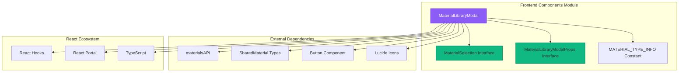
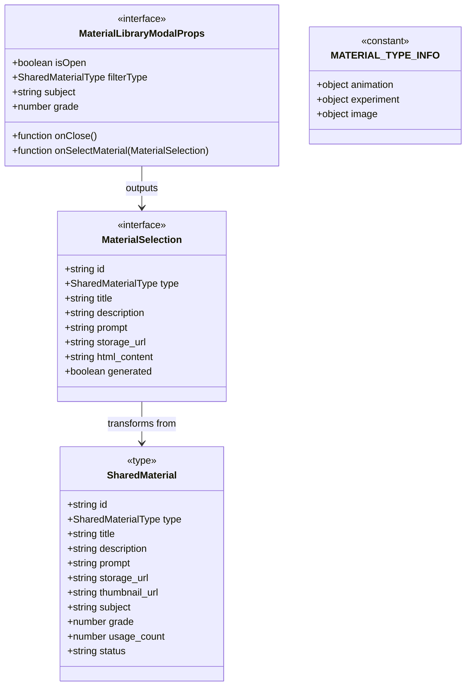
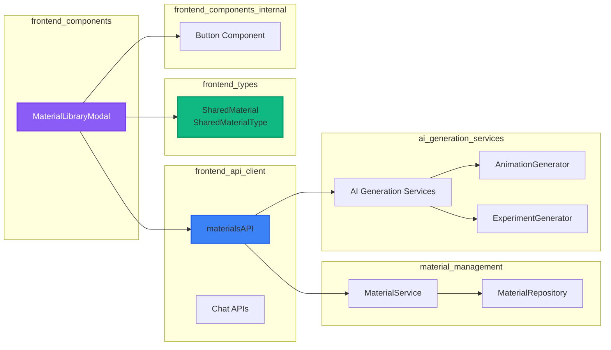
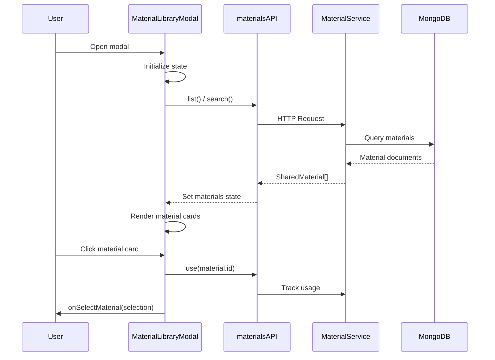
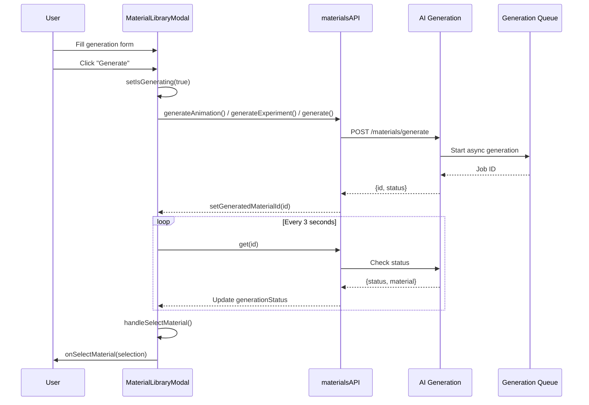
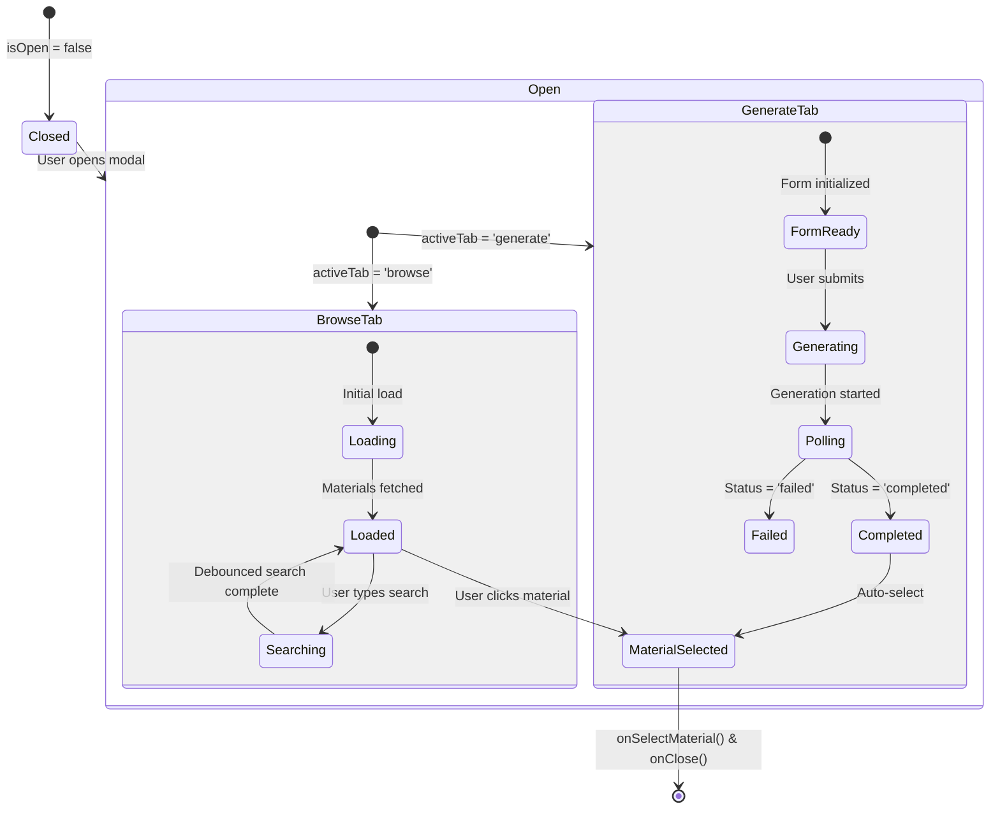
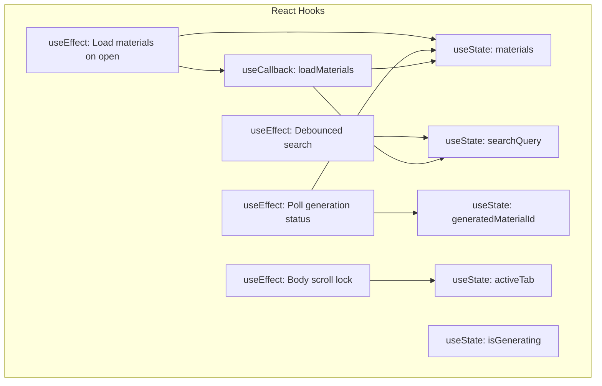
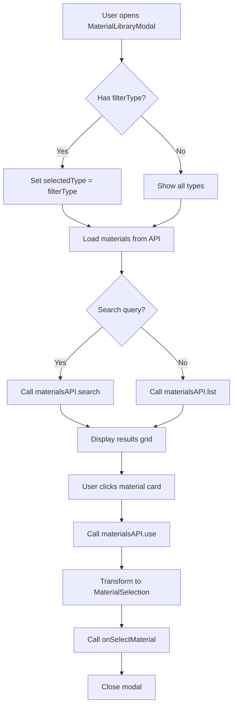
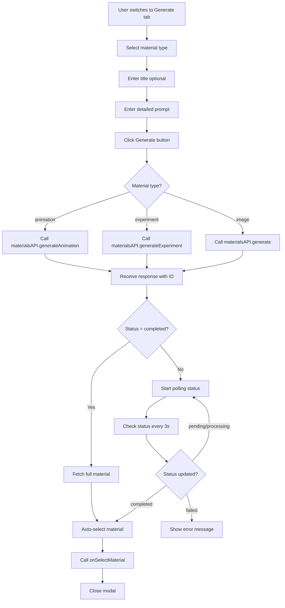

# Frontend Components Module

## Overview

The **Frontend Components** module provides reusable React components that encapsulate complex UI functionality for the educational content creation platform. The primary component in this module is the `MaterialLibraryModal`, which offers a unified interface for browsing, searching, and generating educational materials including animations, interactive experiments, and images.

## Core Functionality

### MaterialLibraryModal Component

The `MaterialLibraryModal` is a sophisticated React component that serves as a comprehensive material management interface with the following capabilities:

**Browse & Search Features:**
- Search materials by keywords with debounced input (300ms delay)
- Filter materials by type (animation, experiment, image)
- Optional filtering by subject and grade level
- Real-time loading indicators and error handling
- Visual preview of materials with thumbnails

**Material Generation Features:**
- Create new animations, experiments, or images from natural language prompts
- Support for optional titles and detailed descriptions
- Real-time generation status polling (3-second intervals)
- Automatic selection of completed materials
- Usage tracking integration

**User Experience:**
- Modal dialog with backdrop blur and body scroll lock
- Tab-based navigation between Browse and Generate modes
- Responsive grid layout for material cards
- Hover effects and visual feedback
- Comprehensive loading and empty states

## Architecture

### Component Structure



### Data Models



## Dependencies

### Module Dependencies



### External Libraries

- **React**: Core UI framework with hooks (useState, useEffect, useCallback)
- **ReactDOM**: Portal API for modal rendering
- **TypeScript**: Type safety and interfaces
- **Lucide React**: Icon components (X, Search, Plus, Video, FlaskConical, Image, etc.)
- **Tailwind CSS**: Utility-first styling (implied by class names)

## Data Flow

### Browse Materials Flow



### Generate Material Flow



## Component Interactions

### State Management



### Hook Dependencies



## Process Flows

### Material Selection Process



### Material Generation Process



## API Integration

### materialsAPI Methods Used

The component integrates with the following API endpoints through the `materialsAPI` service:

| Method | Endpoint | Purpose |
|--------|----------|---------|
| `list()` | GET /materials | Fetch paginated materials with filters |
| `search()` | GET /materials/search | Search materials by keywords |
| `get(id)` | GET /materials/:id | Get single material by ID |
| `use(id)` | POST /materials/:id/use | Track material usage |
| `generate()` | POST /materials/generate | Generate generic material |
| `generateAnimation()` | POST /materials/animations/generate | Generate animation |
| `generateExperiment()` | POST /materials/experiments/generate | Generate experiment |

### Request/Response Formats

**List Request:**
```typescript
{
  type?: SharedMaterialType;
  subject?: string;
  grade?: number;
  limit?: number;
  sort_by?: string;
  sort_order?: 'asc' | 'desc';
}
```

**Generate Request:**
```typescript
{
  type: SharedMaterialType;
  title: string;
  prompt: string;
  subject?: string;
  grade?: number;
}
```

**Generation Response:**
```typescript
{
  id: string;
  status: 'pending' | 'processing' | 'completed' | 'failed';
  material?: SharedMaterial;
}
```

## UI/UX Features

### Visual Design System

The component implements a sophisticated UI with:

- **Gradient Headers**: Purple-to-lime gradient backgrounds for visual hierarchy
- **Type-based Color Coding**: 
  - Animation: Violet theme (`bg-violet-50`, `text-violet-700`)
  - Experiment: Lime theme (`bg-lime-50`, `text-lime-700`)
  - Image: Pink theme (`bg-pink-50`, `text-pink-700`)
- **Interactive States**: Hover effects, focus rings, and transition animations
- **Loading States**: Spinners and skeleton-like feedback
- **Empty States**: Helpful messages with action prompts

### Accessibility Features

- Semantic HTML structure
- Keyboard navigation support
- Focus management
- ARIA labels (implied by semantic elements)
- High contrast color schemes
- Responsive design for mobile and desktop

## Performance Considerations

### Optimization Strategies

1. **Debounced Search**: 300ms delay prevents excessive API calls
2. **useCallback Hook**: `loadMaterials` function is memoized to prevent unnecessary re-renders
3. **Conditional Polling**: Generation status polling only occurs when `generatedMaterialId` is set
4. **Lazy Loading**: Materials are loaded only when modal opens
5. **Portal Rendering**: Modal renders outside normal DOM hierarchy to avoid CSS conflicts

### Resource Management

- **Body Scroll Lock**: Prevents background scrolling when modal is open
- **Cleanup Effects**: Proper cleanup of timers and event listeners
- **Memory Management**: State reset on modal close

## Error Handling

### Error Scenarios

1. **API Failures**: Try-catch blocks with user-friendly error messages
2. **Generation Failures**: Status polling detects failed jobs
3. **Network Issues**: Graceful degradation with loading states
4. **Invalid Input**: Form validation before submission

### User Feedback

- Loading spinners for async operations
- Status messages for generation progress
- Alert dialogs for critical errors
- Visual feedback for successful actions

## References

This module integrates with and depends on:

- **[frontend_api_client](frontend_api_client.md)**: Provides the `materialsAPI` service for backend communication
- **[frontend_types](frontend_types.md)**: Defines `SharedMaterial`, `SharedMaterialType`, and related type definitions
- **[material_management](material_management.md)**: Backend service handling material CRUD operations
- **[ai_generation_services](ai_generation_services.md)**: Backend AI services for generating animations and experiments
- **[animation_generation](animation_generation.md)**: Specialized service for animation generation pipeline
- **[experiment_generation](experiment_generation.md)**: Specialized service for interactive experiment generation

For information about state management, see [frontend_state_management](frontend_state_management.md).

For context and page-level integration, see [frontend_contexts](frontend_contexts.md).