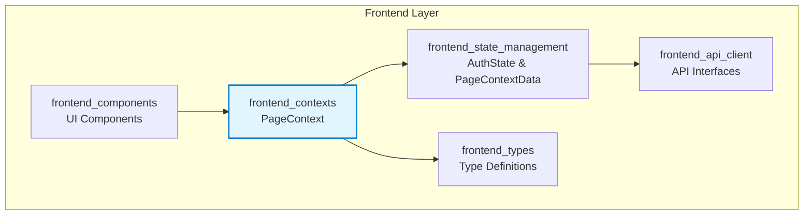
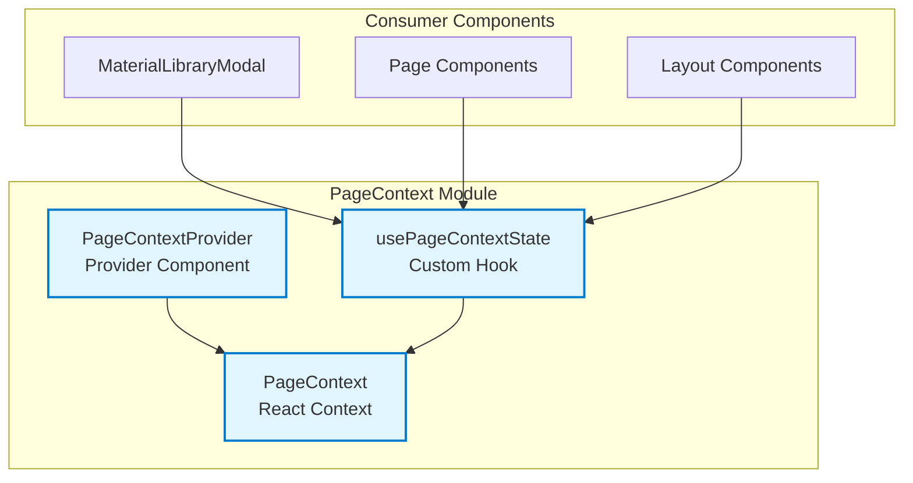
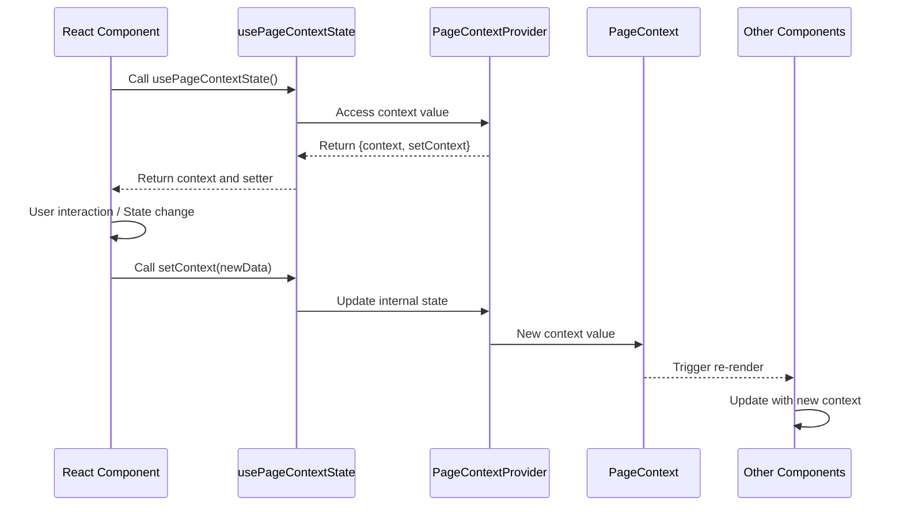
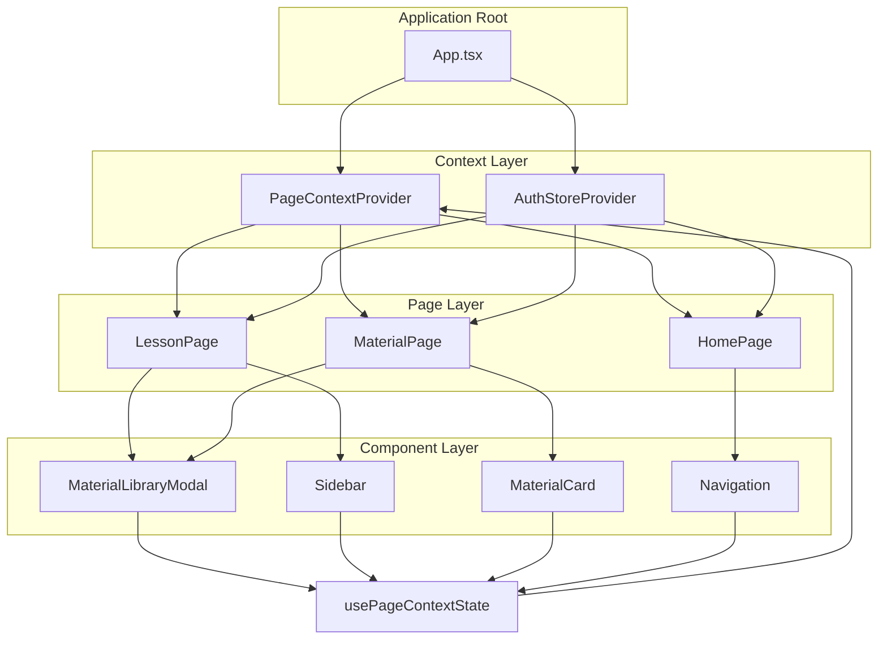

# Frontend Contexts Module

## Overview

The **frontend_contexts** module provides React context management for page-level state sharing across the frontend application. It implements a centralized context system that allows components to share and synchronize page-specific data without prop drilling.

## Purpose and Core Functionality

The primary purpose of this module is to:

1. **Provide Global Page State Management**: Enable sharing of page-level context data across component hierarchies
2. **Prevent Prop Drilling**: Allow deep-nested components to access page context without passing props through intermediate components
3. **Context Synchronization**: Ensure consistent state updates across all consuming components
4. **Type-Safe Context Access**: Provide typed hooks for safe context consumption

The module consists of a single core context (`PageContext`) that manages `PageContextData`, which is defined in the [frontend_state_management](frontend_state_management.md) module.

## Core Components

### PageContextType Interface

```typescript
interface PageContextType {
  context: Partial<PageContextData>;
  setContext: (context: Partial<PageContextData>) => void;
}
```

The context type provides:
- `context`: Current page context data (partial, allowing incremental updates)
- `setContext`: Function to update the context with new data

### PageContextProvider Component

A React provider component that wraps the application (or specific page sections) to make context available to child components.

**Features:**
- Uses React's `useState` for internal state management
- Implements `useCallback` for stable `setContext` function reference
- Uses `useMemo` to optimize context value and prevent unnecessary re-renders

### usePageContextState Hook

A custom React hook that provides access to the page context.

**Features:**
- Throws error if used outside of provider (development-time safety)
- Returns the full `PageContextType` (both context data and setter)
- Type-safe access to context values

## Architecture

### Module Architecture



### Component Structure



## Data Flow

### Context Update Flow



### Context Data Structure

The context manages `PageContextData` which is defined in the [frontend_state_management](frontend_state_management.md) module. This typically includes:

- **Page metadata**: Current page, route information
- **User interface state**: Modal states, sidebar visibility
- **Data caching**: Pre-fetched data for the current page
- **Cross-component state**: State shared between unrelated components

## Component Relationships

### Dependencies

The **frontend_contexts** module depends on:

1. **[frontend_state_management](frontend_state_management.md)**: For `PageContextData` type definition and `AuthState`
2. **[frontend_types](frontend_types.md)**: For shared type definitions used in context data

### Dependents

The module is used by:

1. **[frontend_components](frontend_components.md)**: UI components like `MaterialLibraryModal` consume the context
2. **Page-level components**: Various page components throughout the application
3. **Layout components**: Navigation, headers, and layout wrappers

## Integration with Frontend Architecture

### Context in Component Hierarchy



## Usage Patterns

### Basic Usage

```typescript
// In a top-level component
import { PageContextProvider } from '@/contexts/PageContext';

function App() {
  return (
    <PageContextProvider>
      <LessonPage />
    </PageContextProvider>
  );
}

// In a consuming component
import { usePageContextState } from '@/contexts/PageContext';

function LessonPage() {
  const { context, setContext } = usePageContextState();
  
  const updateLesson = (lesson: LessonDetail) => {
    setContext({ currentLesson: lesson });
  };
  
  return (
    <div>
      <h1>{context.currentLesson?.title}</h1>
      <button onClick={() => updateLesson(newLesson)}>Update</button>
    </div>
  );
}
```

### Advanced Usage with Selective Updates

```typescript
function MaterialLibraryModal() {
  const { context, setContext } = usePageContextState();
  
  // Update only specific context properties
  const openModal = () => {
    setContext({ 
      isModalOpen: true,
      modalType: 'material-library'
    });
  };
  
  const closeModal = () => {
    setContext({ isModalOpen: false });
  };
  
  if (!context.isModalOpen) return null;
  
  return (
    <Modal onClose={closeModal}>
      {/* Modal content */}
    </Modal>
  );
}
```

## Performance Considerations

### Optimization Strategies

1. **Memoization**: The provider uses `useMemo` to prevent unnecessary re-renders
2. **Partial Updates**: Context accepts partial data, allowing targeted updates
3. **Stable References**: `setContext` is wrapped in `useCallback` for stable function identity
4. **Selective Consumption**: Components should destructure only needed context values

### Best Practices

```typescript
// ✅ Good: Selective consumption
function Component() {
  const { context: { currentLesson } } = usePageContextState();
  // Component only re-renders when currentLesson changes
}

// ❌ Bad: Over-consumption
function Component() {
  const { context } = usePageContextState();
  // Component re-renders on any context change
}
```

## Error Handling

The module implements development-time safety checks:

```typescript
export const usePageContextState = () => {
  const context = useContext(PageContext);
  if (!context) {
    throw new Error('usePageContextState must be used within PageContextProvider');
  }
  return context;
};
```

This ensures that context consumers are properly wrapped with the provider, preventing runtime errors and making debugging easier.

## Related Documentation

- [Frontend State Management](frontend_state_management.md) - For `PageContextData` and `AuthState` definitions
- [Frontend Types](frontend_types.md) - For shared type definitions
- [Frontend Components](frontend_components.md) - For components that consume the page context
- [Frontend API Client](frontend_api_client.md) - For API interfaces used in context data

## Summary

The **frontend_contexts** module provides a lightweight yet powerful context management solution for the frontend application. It enables clean state sharing across components while maintaining type safety and performance. The module's simple API (`PageContextProvider` and `usePageContextState`) makes it easy to adopt throughout the application, while its integration with the broader frontend architecture ensures consistent state management patterns.