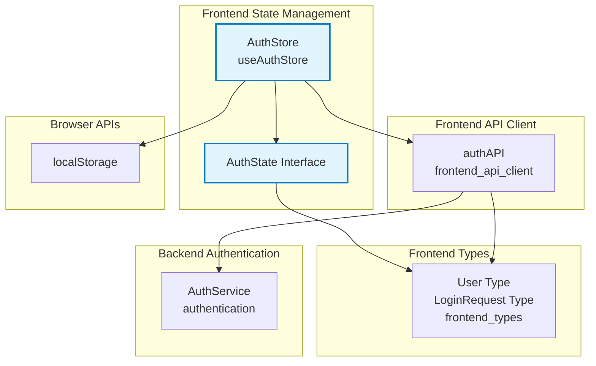
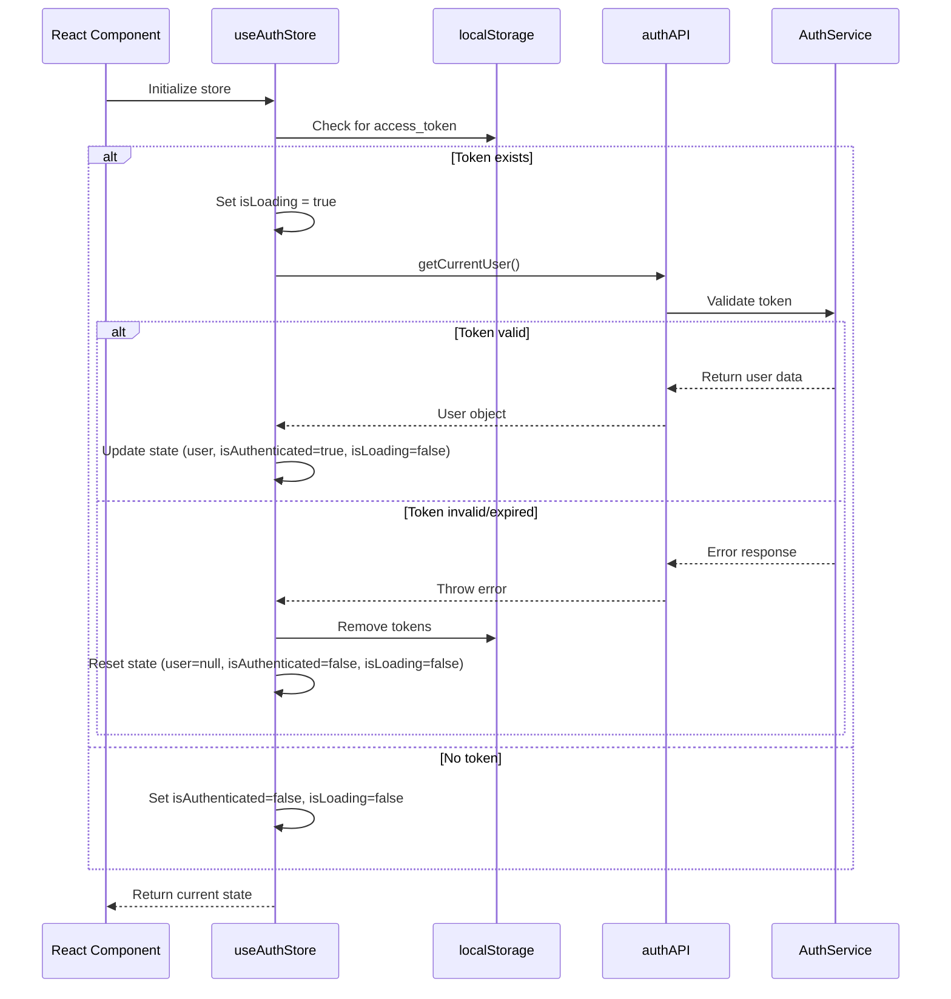
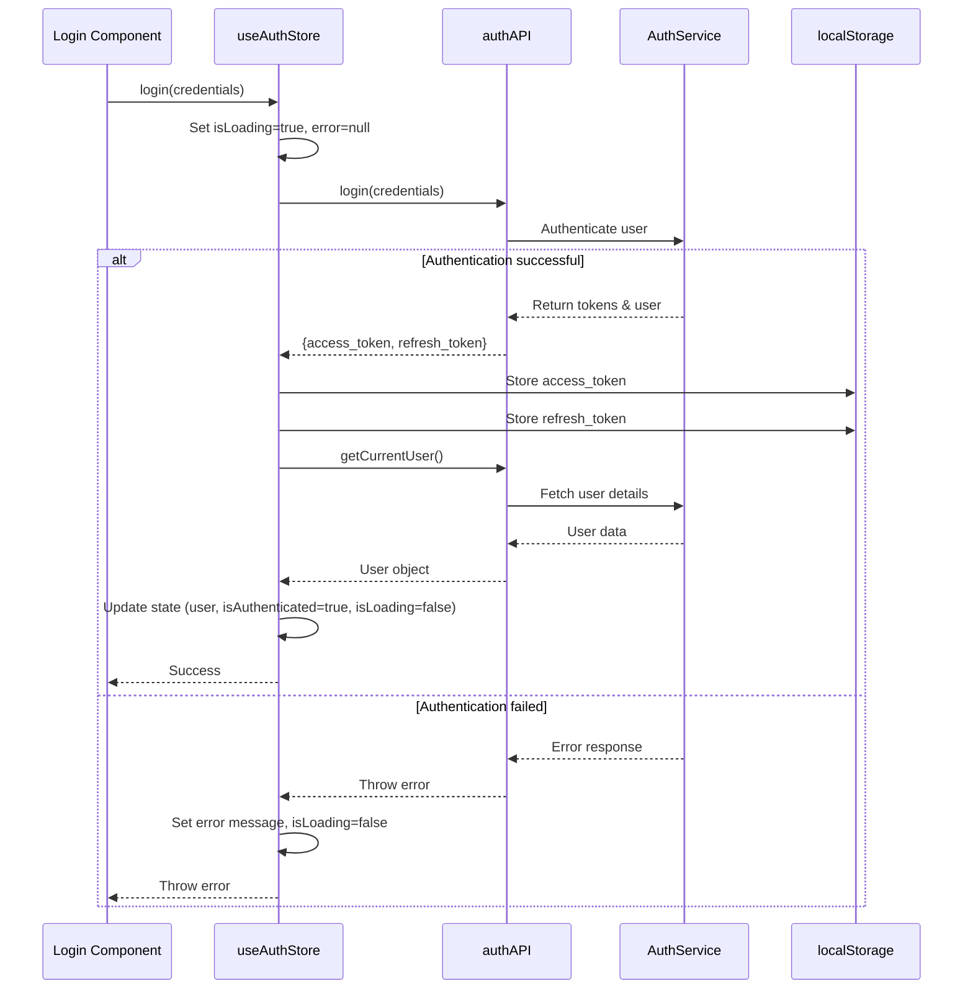
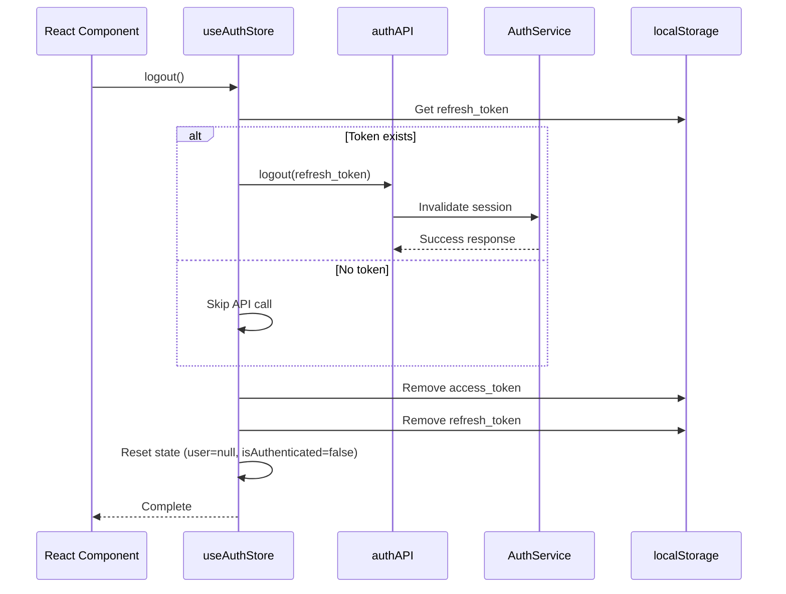
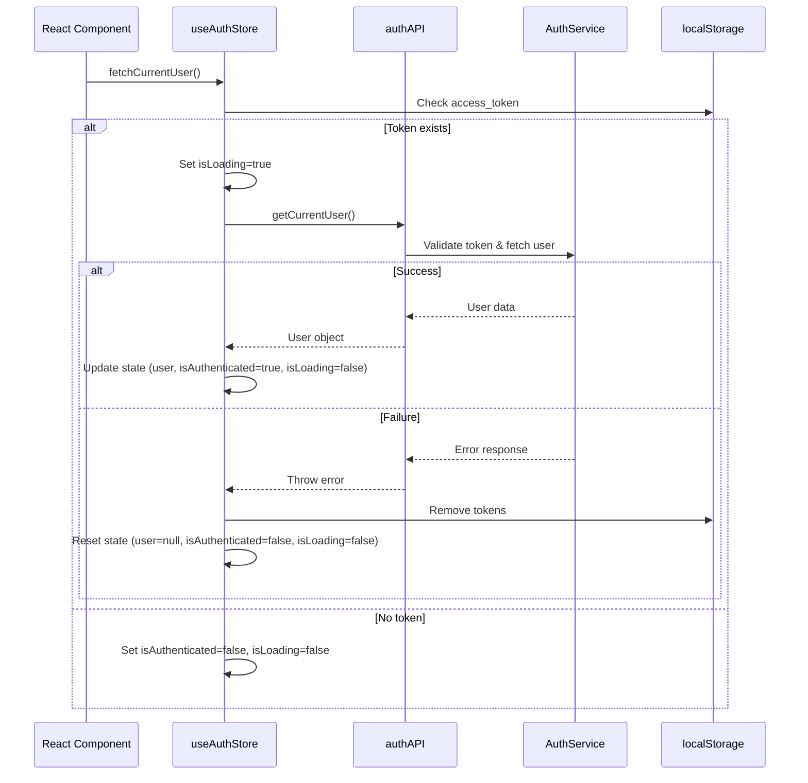

# Frontend State Management Module Documentation

## Overview

The Frontend State Management module provides centralized state management for the React frontend application using [Zustand](https://github.com/pmndrs/zustand), a lightweight and flexible state management solution. This module currently focuses on authentication state management, providing a clean and reactive way to handle user authentication, token persistence, and user session management across the application.

## Architecture Overview



## Core Components

### AuthState Interface

The `AuthState` interface defines the complete structure of the authentication state managed by the store:

```typescript
interface AuthState {
  user: User | null;              // Current authenticated user
  isAuthenticated: boolean;       // Authentication status
  isLoading: boolean;            // Loading state for async operations
  error: string | null;          // Error messages
  login: (credentials: LoginRequest) => Promise<void>;
  logout: () => Promise<void>;
  fetchCurrentUser: () => Promise<void>;
  clearError: () => void;
}
```

### useAuthStore

The main Zustand store that implements the authentication state management. Key characteristics:

- **Persistent State**: Automatically persists authentication tokens in localStorage
- **Reactive Updates**: All components using the store receive real-time updates
- **Async Operation Handling**: Manages loading states and error handling for all async operations
- **Smart Initialization**: Automatically detects existing tokens and attempts to restore sessions

## State Management Flows

### Store Initialization Process



### Login Flow



### Logout Flow



### User Session Recovery Flow



## Dependencies

### Internal Dependencies

| Module | Component | Purpose |
|--------|-----------|---------|
| [frontend_api_client](frontend_api_client.md) | `authAPI` | Handles all authentication API calls |
| [frontend_types](frontend_types.md) | `User`, `LoginRequest` | TypeScript type definitions |

### External Dependencies

| Package | Version | Purpose |
|---------|---------|---------|
| `zustand` | ^4.x | Lightweight state management library |
| `typescript` | ^5.x | TypeScript support |

## State Structure Details

### State Properties

```typescript
{
  user: {
    id: string;
    email: string;
    name: string;
    role: 'teacher' | 'admin';
    created_at: string;
    // ... other user properties
  } | null,
  isAuthenticated: boolean,  // true when user is logged in
  isLoading: boolean,        // true during async operations
  error: string | null       // error message or null
}
```

### Storage Keys

The store automatically manages the following localStorage keys:

- `access_token`: JWT access token for API authentication
- `refresh_token`: JWT refresh token for session renewal

## API Reference

### useAuthStore

React hook that provides access to the authentication state and actions.

**Usage:**
```typescript
import { useAuthStore } from '@/stores/authStore';

function MyComponent() {
  const { user, isAuthenticated, login, logout } = useAuthStore();
  // ...
}
```

### State Properties

| Property | Type | Description |
|----------|------|-------------|
| `user` | `User \| null` | Current authenticated user information |
| `isAuthenticated` | `boolean` | Whether the user is currently authenticated |
| `isLoading` | `boolean` | Whether an async operation is in progress |
| `error` | `string \| null` | Current error message, if any |

### Actions

#### `login(credentials: LoginRequest): Promise<void>`

Authenticates a user with the provided credentials.

**Parameters:**
- `credentials`: Object containing `email` and `password`

**Returns:** `Promise<void>` - Resolves on success, rejects on failure

**Side Effects:**
- Stores tokens in localStorage
- Updates user state
- Sets isAuthenticated to true

**Error Handling:**
- Sets error message in state
- Throws error for UI handling

---

#### `logout(): Promise<void>`

Logs out the current user and clears the session.

**Returns:** `Promise<void>` - Always resolves

**Side Effects:**
- Invalidates refresh token on server (if available)
- Removes tokens from localStorage
- Resets all auth state

---

#### `fetchCurrentUser(): Promise<void>`

Fetches and validates the current user based on stored token.

**Returns:** `Promise<void>` - Resolves on success, rejects on failure

**Use Cases:**
- App initialization
- Page reloads
- Token validation

**Behavior:**
- Checks for existing access_token
- Validates token with backend
- Updates state accordingly
- Handles token expiration

---

#### `clearError(): void`

Clears any existing error message from the state.

**Returns:** `void` - Synchronous operation

## Integration Examples

### Basic Component Usage

```typescript
import { useAuthStore } from '@/stores/authStore';
import { useEffect } from 'react';

function Dashboard() {
  const { user, isAuthenticated, isLoading, fetchCurrentUser } = useAuthStore();

  useEffect(() => {
    if (!isAuthenticated && !isLoading) {
      fetchCurrentUser();
    }
  }, [isAuthenticated, isLoading, fetchCurrentUser]);

  if (isLoading) return <div>Loading...</div>;
  if (!isAuthenticated) return <div>Please log in</div>;

  return <div>Welcome, {user?.name}!</div>;
}
```

### Login Form Implementation

```typescript
import { useAuthStore } from '@/stores/authStore';
import { useState } from 'react';

function LoginForm() {
  const { login, isLoading, error, clearError } = useAuthStore();
  const [credentials, setCredentials] = useState({ email: '', password: '' });

  const handleSubmit = async (e: React.FormEvent) => {
    e.preventDefault();
    try {
      await login(credentials);
      // Redirect to dashboard
    } catch (error) {
      // Error is already handled in store
    }
  };

  useEffect(() => {
    return () => clearError();
  }, []);

  return (
    <form onSubmit={handleSubmit}>
      {error && <div className="error">{error}</div>}
      {/* Form fields */}
      <button type="submit" disabled={isLoading}>
        {isLoading ? 'Logging in...' : 'Login'}
      </button>
    </form>
  );
}
```

### Protected Route Component

```typescript
import { useAuthStore } from '@/stores/authStore';
import { Navigate } from 'react-router-dom';
import { useEffect } from 'react';

function ProtectedRoute({ children }: { children: React.ReactNode }) {
  const { isAuthenticated, isLoading, fetchCurrentUser } = useAuthStore();

  useEffect(() => {
    if (!isAuthenticated && !isLoading) {
      fetchCurrentUser();
    }
  }, [isAuthenticated, isLoading, fetchCurrentUser]);

  if (isLoading) return <div>Loading...</div>;
  
  return isAuthenticated ? children : <Navigate to="/login" />;
}
```

## Best Practices

### 1. Selective State Subscriptions

Zustand supports selective subscriptions to optimize re-renders:

```typescript
// ❌ Subscribes to entire state - causes unnecessary re-renders
const { user, isAuthenticated, isLoading, error } = useAuthStore();

// ✅ Selective subscription - only re-renders when user changes
const user = useAuthStore(state => state.user);
const isAuthenticated = useAuthStore(state => state.isAuthenticated);
```

### 2. Error Handling Pattern

Always handle errors from async actions:

```typescript
try {
  await login(credentials);
  // Success - redirect or show success message
} catch (error) {
  // Error state is automatically set
  // Can show additional UI feedback
}
```

### 3. Token Refresh Strategy

The store handles token validation on initialization. For long-running sessions, consider implementing token refresh logic:

```typescript
// In your API client interceptor
if (response.status === 401) {
  // Clear auth state and redirect to login
  useAuthStore.getState().logout();
}
```

### 4. State Persistence

The store automatically persists tokens, but avoid persisting sensitive user data:

```typescript
// ❌ Don't do this
localStorage.setItem('user', JSON.stringify(user));

// ✅ Store only handles tokens automatically
// User data is fetched on each initialization
```

### 5. Testing

When testing components that use the store:

```typescript
import { useAuthStore } from '@/stores/authStore';

// Mock the store
jest.mock('@/stores/authStore');

const mockUseAuthStore = {
  user: null,
  isAuthenticated: false,
  isLoading: false,
  login: jest.fn(),
  logout: jest.fn(),
};

(useAuthStore as jest.Mock).mockReturnValue(mockUseAuthStore);
```

## Security Considerations

### Token Storage

- Tokens are stored in localStorage (persistent across sessions)
- Consider using httpOnly cookies for enhanced security in production
- Never store tokens in sessionStorage for authentication (lost on tab close)

### Session Management

- Automatic token validation on app initialization
- Graceful handling of expired tokens
- Proper cleanup on logout

### Error Messages

- Generic error messages for security (e.g., "Invalid credentials" instead of "User not found")
- Error state automatically cleared on successful operations

## Performance Considerations

### Bundle Size

Zustand is very lightweight (~1KB) and has minimal impact on bundle size.

### Memory Usage

- Store persists in memory for application lifetime
- User data is automatically garbage collected on logout
- No memory leaks due to proper cleanup

### Re-render Optimization

- Use selective subscriptions to prevent unnecessary re-renders
- Zustand uses shallow comparison by default
- Consider using `useShallow` for complex state selections

## Future Enhancements

Potential extensions to the state management module:

1. **Additional Stores**: Create separate stores for:
   - Lesson management state
   - UI/theme state
   - Notification state
   - Form state

2. **Middleware**: Add Zustand middleware for:
   - Persistence (beyond localStorage)
   - DevTools integration
   - Action logging

3. **Advanced Patterns**:
   - Store composition and derived state
   - Async actions with optimistic updates
   - State migration strategies

## Troubleshooting

### Common Issues

**Issue**: User logged out on page refresh
- **Cause**: Token validation failed or token expired
- **Solution**: Check token expiration and network connectivity

**Issue**: State not updating in components
- **Cause**: Incorrect subscription pattern
- **Solution**: Use proper selector functions or subscribe to specific state slices

**Issue**: Error state persists across navigation
- **Cause**: Error not cleared between operations
- **Solution**: Call `clearError()` or handle in component cleanup

**Issue**: Multiple concurrent login attempts
- **Cause**: Rapid user interaction
- **Solution**: Disable login button when `isLoading` is true

## Related Documentation

- [Frontend API Client](frontend_api_client.md) - API communication layer
- [Frontend Types](frontend_types.md) - TypeScript type definitions
- [Authentication Module](authentication.md) - Backend authentication service
- [Database Models](database_models.md) - User data models