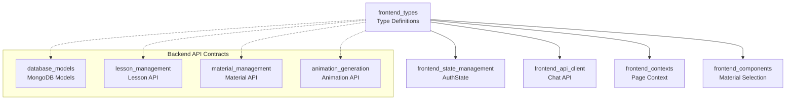
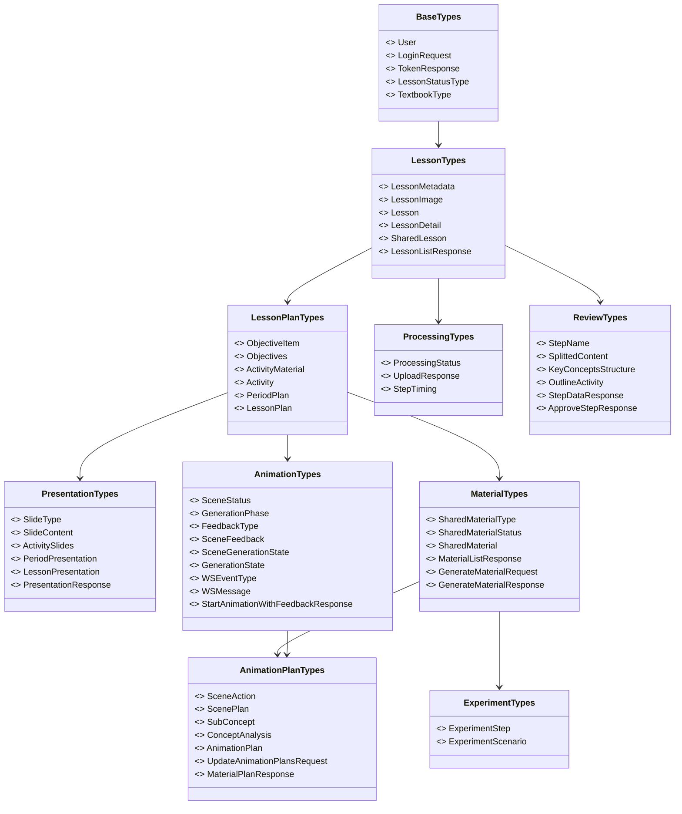
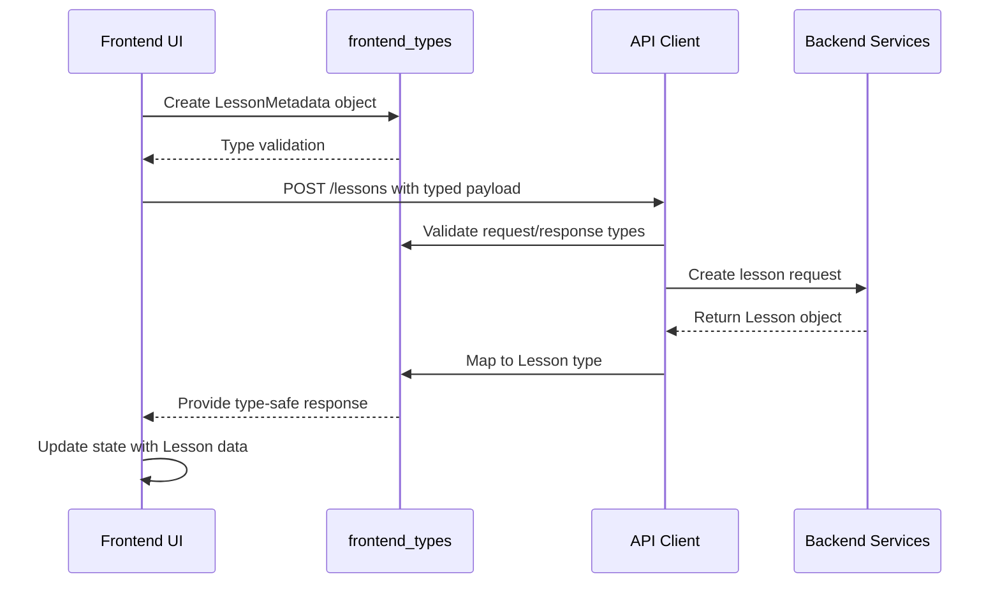
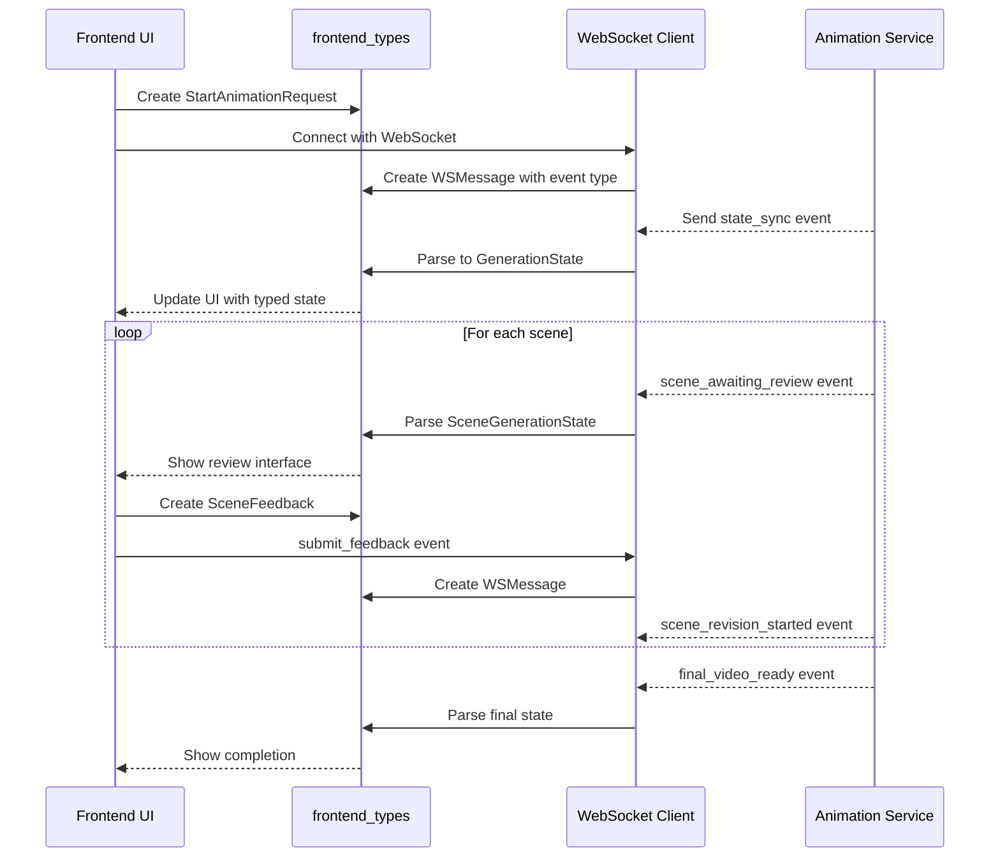

# Frontend Types Module Documentation

## Overview

The **frontend_types** module serves as the central TypeScript type definition layer for the entire frontend application. It provides comprehensive type safety across all frontend features including lesson management, material generation, presentation systems, and real-time collaboration workflows.

This module defines the core data structures that enable type-safe communication between frontend components, API clients, state management stores, and WebSocket services. All frontend modules depend on these types to ensure consistent data handling throughout the application.

## Module Purpose

The primary responsibilities of the frontend_types module are:

1. **Type Safety**: Provide TypeScript interfaces and type definitions for all data structures
2. **API Contract**: Define the shape of data exchanged between frontend and backend
3. **State Management**: Enable type-safe state management across Redux/Zustand stores
4. **Component Props**: Standardize prop types for reusable UI components
5. **Real-time Communication**: Type WebSocket messages and event payloads
6. **Domain Modeling**: Represent the complete domain model for the educational content platform

## Architecture

### Module Dependencies



### Type Hierarchy



## Core Type Definitions

### 1. User & Authentication Types

These types handle user management and authentication flows.

```typescript
// User profile information
interface User {
  id: string;
  email: string;
  name: string;
  role: 'admin' | 'teacher';
  is_active: boolean;
  created_at: string;
}

// Login request payload
interface LoginRequest {
  email: string;
  password: string;
}

// Token response from auth API
interface TokenResponse {
  access_token: string;
  refresh_token: string;
  token_type: string;
  expires_in: number;
}
```

**Related Modules**: [authentication.md](authentication.md), [frontend_state_management.md](frontend_state_management.md)

### 2. Lesson Domain Types

Core lesson management types that represent the educational content lifecycle.

```typescript
// Lesson status workflow
export type LessonStatusType = 
  | 'draft' 
  | 'uploaded' 
  | 'processing' 
  | 'awaiting_content_review'
  | 'awaiting_concepts_review' 
  | 'awaiting_objectives_review' 
  | 'awaiting_outline_review' 
  | 'review' 
  | 'awaiting_presentation_review'
  | 'failed' 
  | 'confirmed' 
  | 'exported';

// Lesson metadata with textbook type support
export interface LessonMetadata {
  subject: string;
  grade: number;
  lesson_name: string;
  duration_periods: number;
  textbook_type?: 'student' | 'teacher'; // 'student' (default) or 'teacher' for teacher's guide
  school?: string;
  week?: number;
  teaching_date?: string;
}

// Complete lesson with images
export interface LessonDetail extends Lesson {
  images: LessonImage[];
  current_step?: string;
  has_plan: boolean;
  is_public?: boolean;
}

// Shared lesson for playground functionality
export interface SharedLesson {
  id: string;
  metadata: LessonMetadata;
  status?: LessonStatusType;
  first_image_url?: string;
  share_url?: string;
  teacher_name?: string;
  playground?: SharedPlaygroundInfo;
  lesson_plan?: LessonPlan;
  presentation?: LessonPresentation;
  can_edit?: boolean;
  created_at: string;
  updated_at?: string;
}
```

**Related Modules**: [lesson_management.md](lesson_management.md), [database_models.md](database_models.md)

### 3. Lesson Plan Types

Comprehensive types for lesson planning with activity-based structure.

```typescript
// Educational objective with cognitive level
export interface ObjectiveItem {
  id: string;
  description: string;
  cognitive_level?: 'nhận biết' | 'thông hiểu' | 'vận dụng' | 'vận dụng cao';
}

// Activity material for generation
export interface ActivityMaterial {
  id: string;
  type: 'image' | 'animation' | 'experiment';
  title: string;
  description: string;
  storage_url?: string;
  generated: boolean;
  pending_manual?: boolean; // Manual mode: teacher will select from library or create manually
  shared_material_id?: string; // Reference to shared material from library
}

// Teaching activity structure
export interface Activity {
  id: string;
  type: 'khởi động' | 'hình thành kiến thúc' | 'luyện tập' | 'vận dụng' | 'tìm tòi mở rộng';
  title: string;
  objectives?: string[];
  content?: string;
  expected_products?: string[];
  implementation: ActivityRow[];
  implementation_steps?: ImplementationStep[];
  materials?: ActivityMaterial[];
  time_estimate_min?: number;
}

// Complete lesson plan
export interface LessonPlan {
  general_info: GeneralInfo;
  periods: PeriodPlan[];
  adjustments: PostLessonAdjustments;
  last_edited_at?: string;
}
```

**Related Modules**: [lesson_management.md](lesson_management.md), [material_management.md](material_management.md)

### 4. Processing & Status Types

Real-time processing status tracking for long-running operations.

```typescript
// Processing status for lesson generation
export interface ProcessingStatus {
  lesson_id: string;
  status: string;
  current_step?: string;
  progress_percent: number;
  error_message?: string;
  elapsed_seconds?: number;
  lesson_plan_ready?: boolean;
  materials_generating?: boolean;
  image_generating?: boolean;
  html_generating?: boolean;
  video_generating?: boolean;
  image_completed_at?: string;
  html_completed_at?: string;
  materials_completed_at?: string;
  step_timings?: Record<string, StepTiming>;
}

// Individual step timing information
export interface StepTiming {
  step: string;
  started_at?: string;
  completed_at?: string;
  duration_seconds?: number;
  status: 'pending' | 'processing' | 'completed' | 'failed';
}
```

**Related Modules**: [lesson_management.md](lesson_management.md), [ai_generation_services.md](ai_generation_services.md)

### 5. Step-by-Step Review Types

Types supporting the collaborative review workflow for lesson content.

```typescript
// Review step names in the workflow
export type StepName = 'content' | 'concepts' | 'objectives' | 'outline' | 'plan' | 'presentation';

// Extracted content from textbook images
export interface SplittedContent {
  period_number: number;
  start_line: number;
  end_line: number;
  period_content: string;
}

// Key concepts structure
export interface KeyConceptsStructure {
  concepts: Concept[];
  formulas: Formula[];
}

// Outline activity for review
export interface OutlineActivity {
  id?: string;
  type: string;
  title: string;
  objectives?: string;
  content?: string;
  expected_products?: string[];
  materials?: MaterialOutline[];
  time_estimate_min?: number;
  duration_minutes?: number;
  description?: string;
}

// Step data response for review UI
export interface StepDataResponse {
  lesson_id: string;
  current_step: StepName;
  step_data: Record<string, any>;
  can_edit: boolean;
  next_step?: string;
}

// Approval response
export interface ApproveStepResponse {
  lesson_id: string;
  approved_step: string;
  next_step?: string;
  status: string;
  message: string;
  has_animations?: boolean;
  animation_count?: number;
  animations_mode?: 'auto' | 'manual';
}
```

**Related Modules**: [lesson_management.md](lesson_management.md), [lesson_review.md](lesson_review.md)

### 6. Presentation Types

Rich presentation system types for slide-based lesson delivery.

```typescript
// Slide template types
export type SlideType = 
  | 'title'       // Title slide with heading and subtitle
  | 'content'     // Bullet point slide
  | 'two-column'  // Two column comparison
  | 'image'       // Full-screen image
  | 'image-text'  // Image alongside text
  | 'video'       // Embedded video/animation
  | 'comparison'  // Left vs Right comparison
  | 'timeline'    // Timeline/process
  | 'experiment'; // Interactive HTML experiment

// Individual slide content
export interface SlideContent {
  id: string;
  order: number;
  slide_type: SlideType;
  title: string;
  teacher_notes?: string;
  duration_seconds: number;
  
  // Type-specific fields
  subtitle?: string;                    // For "title" type
  bullets: string[];                    // For "content" type
  left_column?: ColumnData;             // For "two-column" and "comparison"
  right_column?: ColumnData;            // For "two-column" and "comparison"
  image_url?: string;                   // For "image" and "image-text"
  caption?: string;                     // For "image" and "image-text"
  content?: string;                     // For "image-text"
  image_position?: 'left' | 'right';    // For "image-text"
  video_url?: string;                   // For "video"
  video_type?: string;                  // For "video"
  timeline_items?: TimelineItem[];      // For "timeline"
  experiment_url?: string;              // For "experiment"
  material_id?: string;                 // Material reference for syncing
}

// Complete lesson presentation
export interface LessonPresentation {
  periods: PeriodPresentation[];
  created_at?: string;
  last_edited_at?: string;
}

// Presentation API response
export interface PresentationResponse {
  lesson_id: string;
  presentation: LessonPresentation;
}
```

**Related Modules**: [lesson_management.md](lesson_management.md), [lesson_plan_presentation.md](lesson_plan_presentation.md)

### 7. Animation Generation Types

Advanced types for AI-powered animation generation with real-time feedback.

```typescript
// Scene generation status
export type SceneStatus = 
  | 'queued'
  | 'generating_code'
  | 'rendering'
  | 'awaiting_review'
  | 'revision_requested'
  | 'approved'
  | 'skipped'
  | 'failed';

// Overall generation phase
export type GenerationPhase = 
  | 'initializing'
  | 'scene_planning'
  | 'awaiting_plan_approval'
  | 'scene_rendering'
  | 'post_processing'
  | 'completed'
  | 'failed'
  | 'cancelled';

// Teacher feedback on scenes
export interface SceneFeedback {
  iteration: number;
  feedback_type: 'layout' | 'content' | 'timing' | 'visual' | 'accuracy' | 'other';
  feedback_text: string;
  provided_at: string;
  llm_analysis?: string;
  code_changes_made?: string;
}

// Individual scene state
export interface SceneGenerationState {
  scene_id: string;
  scene_index: number;
  title: string;
  status: SceneStatus;
  current_iteration: number;
  max_iterations: number;
  manim_code?: string;
  video_path?: string;
  video_url?: string;
  video_duration?: number;
  feedback_history: SceneFeedback[];
  error_message?: string;
  render_attempts: number;
  queued_at?: string;
  render_started_at?: string;
  rendered_at?: string;
  approved_at?: string;
}

// Overall generation state
export interface GenerationState {
  current_phase: GenerationPhase;
  total_scenes: number;
  approved_scenes: number;
  failed_scenes: number;
  skipped_scenes: number;
  scenes: SceneGenerationState[];
  current_scene_index?: number;
  final_video_url?: string;
  error_message?: string;
  started_at: string;
  last_updated_at: string;
}

// WebSocket message types
export type WSEventType =
  // Server -> Client
  | 'state_sync' | 'generation_started' | 'scene_code_generating' | 'scene_render_started'
  | 'scene_render_progress' | 'scene_render_completed' | 'scene_render_failed' | 'scene_awaiting_review'
  | 'scene_revision_started' | 'scene_approved' | 'scene_skipped' | 'all_scenes_resolved'
  | 'post_processing_started' | 'final_video_ready' | 'generation_completed' | 'generation_failed'
  | 'generation_cancelled' | 'error' | 'heartbeat'
  // Client -> Server
  | 'submit_feedback' | 'approve_scene' | 'skip_scene' | 'retry_scene' | 'cancel_generation';

// WebSocket message structure
export interface WSMessage {
  event: WSEventType;
  material_id: string;
  data: Record<string, unknown>;
  timestamp: string;
}

// Animation session initiation response
export interface StartAnimationWithFeedbackResponse {
  id: string;
  status: string;
  message: string;
  websocket_url: string;
}
```

**Related Modules**: [animation_generation.md](animation_generation.md), [animation_session.md](animation_session.md), [ai_generation_services.md](ai_generation_services.md)

### 8. Shared Materials Library Types

Types for the collaborative materials library and sharing system.

```typescript
// Material types in library
export type SharedMaterialType = 'animation' | 'experiment' | 'image';

// Material status workflow
export type SharedMaterialStatus = 
  | 'pending' 
  | 'processing' 
  | 'completed' 
  | 'failed' 
  | 'awaiting_plan_review' 
  | 'plan_approved'
  | 'scenes_rendering'
  | 'awaiting_scene_review'
  | 'post_processing'
  | 'cancelled';

// Shared material entity
export interface SharedMaterial {
  id: string;
  type: SharedMaterialType;
  title: string;
  description: string;
  prompt: string;
  subject?: string;
  grade?: number;
  tags: string[];
  storage_url?: string;
  html_content?: string;
  thumbnail_url?: string;
  duration_seconds?: number;
  status: SharedMaterialStatus;
  usage_count: number;
  created_at: string;
  generation_plan?: GenerationPlan;
  plan_approved_at?: string;
}

// Material generation request
export interface GenerateMaterialRequest {
  type: SharedMaterialType;
  title: string;
  prompt: string;
  description?: string;
  subject?: string;
  grade?: number;
  tags?: string[];
  require_approval?: boolean;
}
```

**Related Modules**: [material_management.md](material_management.md), [lesson_sharing.md](lesson_sharing.md)

### 9. Animation & Experiment Plan Types

Detailed planning types for AI-generated educational content.

```typescript
// Animation scene action
export interface SceneAction {
  action_type: string;
  element_type?: string;
  description?: string;
  target?: string;
  duration?: number;
  parameters?: Record<string, unknown>;
}

// Individual scene plan
export interface ScenePlan {
  id: string;
  title: string;
  description: string;
  actions: SceneAction[];
  scene_dependencies: string[];
}

// Concept analysis for animation
export interface ConceptAnalysis {
  main_concept: string;
  sub_concepts: SubConcept[];
}

// Complete animation plan
export interface AnimationPlan {
  concept_analysis: ConceptAnalysis;
  scene_plans: ScenePlan[];
}

// Experiment scenario
export interface ExperimentScenario {
  experiment_name: string;
  experiment_type: string;
  objective: string;
  materials: string[];
  safety_notes: string[];
  steps: ExperimentStep[];
  expected_result: string;
  scientific_explanation: string;
  total_duration?: number;
}

// Update request for animation plans
export interface UpdateAnimationPlansRequest {
  concept_analysis?: Partial<ConceptAnalysis>;
  scene_plans?: UpdateScenePlanRequest[];
}

// Material plan response
export interface MaterialPlanResponse {
  id: string;
  type: SharedMaterialType;
  title: string;
  prompt: string;
  status: SharedMaterialStatus;
  generation_plan: GenerationPlan;
  created_at: string;
}
```

**Related Modules**: [animation_generation.md](animation_generation.md), [experiment_generation.md](experiment_generation.md)

## Data Flow

### Lesson Creation Flow



### Real-time Animation Generation Flow



### Lesson Review Workflow

```mermaid
stateDiagram-v2
    [*] --> UploadComplete: Images uploaded
    UploadComplete --> ContentReview: Extract content
    ContentReview --> ConceptsReview: Approve content
    ConceptsReview --> ObjectivesReview: Approve concepts
    ObjectivesReview --> OutlineReview: Approve objectives
    OutlineReview --> PlanReview: Approve outline
    
    state OutlineReview {
      [*] --> CheckAnimations: Analyze outline
      CheckAnimations --> HasAnimations: Animations found
      CheckAnimations --> NoAnimations: No animations
      HasAnimations --> AnimationMode: Choose generation mode
      AnimationMode --> AutoMode: Auto-generate
      AnimationMode --> ManualMode: Manual creation
      AutoMode --> PlanReview
      ManualMode --> PlanReview
      NoAnimations --> PlanReview
    }
    
    PlanReview --> PresentationReview: Approve plan
    PresentationReview --> Confirmed: Approve presentation
    Confirmed --> [*]
    
    note right of ContentReview
      Each step uses StepDataResponse
      and ApproveStepResponse types
    end note
```



## Integration Patterns

### 1. API Client Integration

The frontend API client modules use these types to ensure type-safe HTTP communication:

```typescript
// API client example
import { LessonDetail, ProcessingStatus } from './types';

class LessonAPI {
  async getLesson(id: string): Promise<LessonDetail> {
    const response = await fetch(`/api/lessons/${id}`);
    return response.json() as Promise<LessonDetail>;
  }
  
  async getProcessingStatus(lessonId: string): Promise<ProcessingStatus> {
    const response = await fetch(`/api/lessons/${lessonId}/status`);
    return response.json() as Promise<ProcessingStatus>;
  }
}
```

**Related Module**: [frontend_api_client.md](frontend_api_client.md)

### 2. State Management Integration

State management stores use these types for type-safe state handling:

```typescript
// Zustand store example
import { create } from 'zustand';
import { LessonDetail, LessonStatusType } from '../types';

interface LessonState {
  lessons: LessonDetail[];
  currentLesson: LessonDetail | null;
  updateLessonStatus: (id: string, status: LessonStatusType) => void;
}

export const useLessonStore = create<LessonState>((set) => ({
  lessons: [],
  currentLesson: null,
  updateLessonStatus: (id, status) => 
    set((state) => ({
      lessons: state.lessons.map((l) => 
        l.id === id ? { ...l, status } : l
      ),
    })),
}));
```

**Related Module**: [frontend_state_management.md](frontend_state_management.md)

### 3. Component Props Integration

UI components receive typed props based on these definitions:

```typescript
// Component props example
import { LessonPlan, SlideContent } from '../types';

interface LessonPlanViewerProps {
  plan: LessonPlan;
  onActivitySelect: (activityId: string) => void;
  readonly mode?: boolean;
}

interface SlideRendererProps {
  slide: SlideContent;
  onTeacherNotesToggle: () => void;
}
```

**Related Module**: [frontend_components.md](frontend_components.md)

### 4. WebSocket Integration

Real-time features use typed WebSocket messages:

```typescript
// WebSocket handler example
import { WSMessage, WSEventType, GenerationState } from '../types';

class AnimationWebSocket {
  private ws: WebSocket;
  
  constructor(url: string, private onStateUpdate: (state: GenerationState) => void) {
    this.ws = new WebSocket(url);
    this.ws.onmessage = this.handleMessage;
  }
  
  private handleMessage = (event: MessageEvent) => {
    const message: WSMessage = JSON.parse(event.data);
    
    switch (message.event) {
      case 'state_sync':
      case 'scene_render_completed':
        this.onStateUpdate(message.data as GenerationState);
        break;
      // Handle other event types...
    }
  };
  
  sendFeedback(materialId: string, feedback: SceneFeedback) {
    const message: WSMessage = {
      event: 'submit_feedback',
      material_id: materialId,
      data: feedback,
      timestamp: new Date().toISOString(),
    };
    this.ws.send(JSON.stringify(message));
  }
}
```

**Related Modules**: [animation_session.md](animation_session.md), [frontend_api_client.md](frontend_api_client.md)

## Key Features

### 1. Comprehensive Status Workflows

The module defines detailed status enums that track complex workflows:

- **LessonStatusType**: 12 different states for lesson lifecycle
- **SharedMaterialStatus**: 10 states for material generation workflow
- **SceneStatus**: 8 states for individual animation scene generation
- **GenerationPhase**: 8 phases for overall animation generation

### 2. Rich Educational Content Modeling

Supports complex educational structures:

- Multi-period lesson plans with time allocation
- Activity-based learning with implementation steps
- Cognitive level classification for objectives
- Material type categorization (image, animation, experiment)
- Slide-based presentations with multiple template types

### 3. Real-time Collaboration Support

Enables advanced collaboration features:

- WebSocket-based real-time updates
- Scene-by-scene animation review and feedback
- Shared lesson playground functionality
- Collaborative material library
- Step-by-step lesson review workflow

### 4. AI Generation Integration

Types support AI-powered content generation:

- Animation scene planning and generation
- Experiment scenario creation
- Content extraction from textbook images
- Automatic lesson plan generation
- Smart material recommendations

## Usage Examples

### Creating a New Lesson

```typescript
import { LessonMetadata, TextbookType } from './types';

const newLessonMetadata: LessonMetadata = {
  subject: 'Toán học',
  grade: 6,
  lesson_name: 'Phép cộng phân số',
  duration_periods: 2,
  textbook_type: 'student', // or 'teacher' for teacher's guide
  school: 'THCS Nguyễn Trãi',
  week: 12,
  teaching_date: '2024-03-15'
};

// Submit to API
const response = await fetch('/api/lessons', {
  method: 'POST',
  headers: { 'Content-Type': 'application/json' },
  body: JSON.stringify(newLessonMetadata)
});

const lesson: LessonDetail = await response.json();
```

### Handling Animation Generation State

```typescript
import { GenerationState, SceneStatus, WSEventType } from './types';

function updateGenerationUI(state: GenerationState) {
  // Update progress bar
  const progress = (state.approved_scenes / state.total_scenes) * 100;
  
  // Show current phase
  const phaseMessages = {
    initializing: 'Khởi tạo...',
    scene_planning: 'Lập kế hoạch cảnh...',
    scene_rendering: 'Đang render cảnh...',
    post_processing: 'Xử lý cuối...',
    completed: 'Hoàn thành!'
  };
  
  // Handle failed scenes
  const failedScenes = state.scenes.filter(s => s.status === SceneStatus.FAILED);
  if (failedScenes.length > 0) {
    console.error(`Có ${failedScenes.length} cảnh thất bại`);
  }
}
```

### Implementing Lesson Review Workflow

```typescript
import { StepName, StepDataResponse, ApproveStepResponse } from './types';

async function approveCurrentStep(
  lessonId: string, 
  currentStep: StepName
): Promise<StepName | undefined> {
  
  // Call approval API
  const response = await fetch(`/api/lessons/${lessonId}/steps/${currentStep}/approve`, {
    method: 'POST'
  });
  
  const result: ApproveStepResponse = await response.json();
  
  // Handle animation mode selection for outline step
  if (currentStep === 'outline' && result.has_animations) {
    const mode = result.animations_mode; // 'auto' or 'manual'
    console.log(`Chế độ tạo animation: ${mode}`);
  }
  
  return result.next_step as StepName | undefined;
}
```

## Best Practices

### 1. Type Safety

Always use the defined types instead of `any` or inline interfaces:

```typescript
// ✅ Good
const lesson: LessonDetail = await fetchLesson(id);

// ❌ Bad
const lesson: any = await fetchLesson(id);
```

### 2. Status Checking

Use type guards and exhaustive checking for status enums:

```typescript
function getStatusText(status: LessonStatusType): string {
  switch (status) {
    case 'draft': return 'Bản nháp';
    case 'processing': return 'Đang xử lý';
    case 'awaiting_content_review': return 'Chờ duyệt nội dung';
    // ... handle all cases
    default:
      // TypeScript will error if new statuses are added
      const _exhaustive: never = status;
      return 'Không xác định';
  }
}
```

### 3. WebSocket Message Handling

Always validate WebSocket message structure:

```typescript
function handleWSMessage(data: unknown) {
  const message = data as WSMessage;
  
  // Validate required fields
  if (!message.event || !message.material_id) {
    console.error('Invalid WebSocket message');
    return;
  }
  
  // Type-safe event handling
  switch (message.event) {
    case 'scene_render_completed':
      const sceneState = message.data as SceneGenerationState;
      // Handle scene completion
      break;
    // ...
  }
}
```

### 4. Partial Updates

Use `Partial<T>` for update operations:

```typescript
// Update lesson metadata
const updates: Partial<LessonMetadata> = {
  lesson_name: 'Tên bài học mới',
  duration_periods: 3
};

// Update animation plans
const planUpdates: UpdateAnimationPlansRequest = {
  scene_plans: [{
    id: 'scene-1',
    title: 'Cảnh mới'
  }]
};
```

## Migration Notes

### Version 1.0 → 2.0

- **Textbook Type Support**: Added `textbook_type` field to `LessonMetadata` to support both student and teacher guide textbooks
- **Manual Material Mode**: Added `pending_manual` and `shared_material_id` fields to `ActivityMaterial` for manual material creation workflow
- **Enhanced Review Steps**: Added `awaiting_content_review`, `awaiting_concepts_review`, `awaiting_objectives_review`, `awaiting_outline_review`, and `awaiting_presentation_review` statuses
- **Animation Review**: Added comprehensive animation generation and review types
- **WebSocket Events**: Expanded `WSEventType` to support real-time animation collaboration

## Testing

### Type Testing

```typescript
// Test type compatibility
const testLesson: LessonDetail = {
  id: 'test-123',
  metadata: {
    subject: 'Toán',
    grade: 6,
    lesson_name: 'Test',
    duration_periods: 1
  },
  status: 'draft',
  image_count: 0,
  images: [],
  has_plan: false,
  created_at: new Date().toISOString(),
  updated_at: new Date().toISOString()
};

// Test status enum
const status: LessonStatusType = 'awaiting_content_review';
```

### Mock Data for Testing

```typescript
// Mock processing status
export const mockProcessingStatus: ProcessingStatus = {
  lesson_id: 'lesson-123',
  status: 'processing',
  current_step: 'extracting_content',
  progress_percent: 65,
  lesson_plan_ready: false,
  materials_generating: true,
  step_timings: {
    upload: {
      step: 'upload',
      completed_at: '2024-01-15T10:00:00Z',
      status: 'completed'
    }
  }
};
```

## Conclusion

The frontend_types module is the foundational layer that enables type-safe, maintainable, and scalable frontend development. By providing comprehensive type definitions for the entire domain model, it ensures consistency across all frontend modules and facilitates collaboration between different development teams.

The module's design supports complex educational workflows, real-time collaboration, AI-powered content generation, and rich multimedia presentations while maintaining type safety and developer productivity.

**Key Strengths:**
- Complete domain model coverage
- Real-time collaboration support
- AI generation workflow integration
- Comprehensive status tracking
- Type-safe WebSocket communication
- Extensible architecture for new features

**Integration Points:**
- All frontend modules depend on these types
- Backend API contracts are mirrored in these types
- State management, API clients, and UI components all use these definitions
- WebSocket communication is fully typed for real-time features