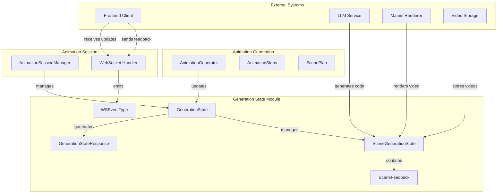
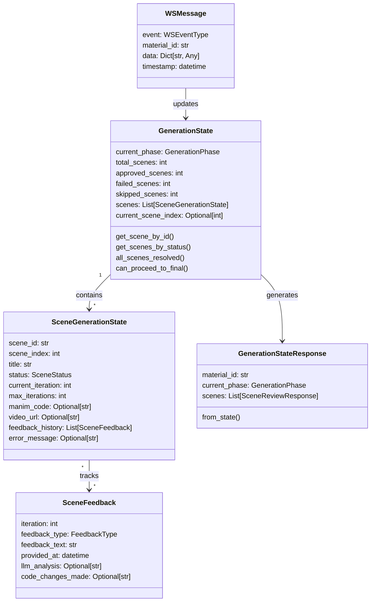
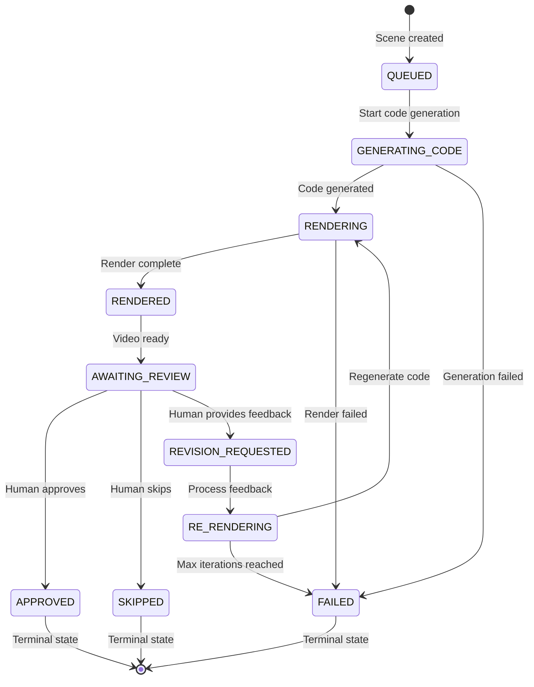
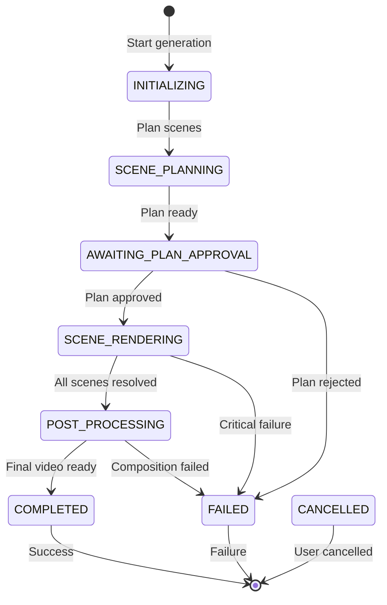
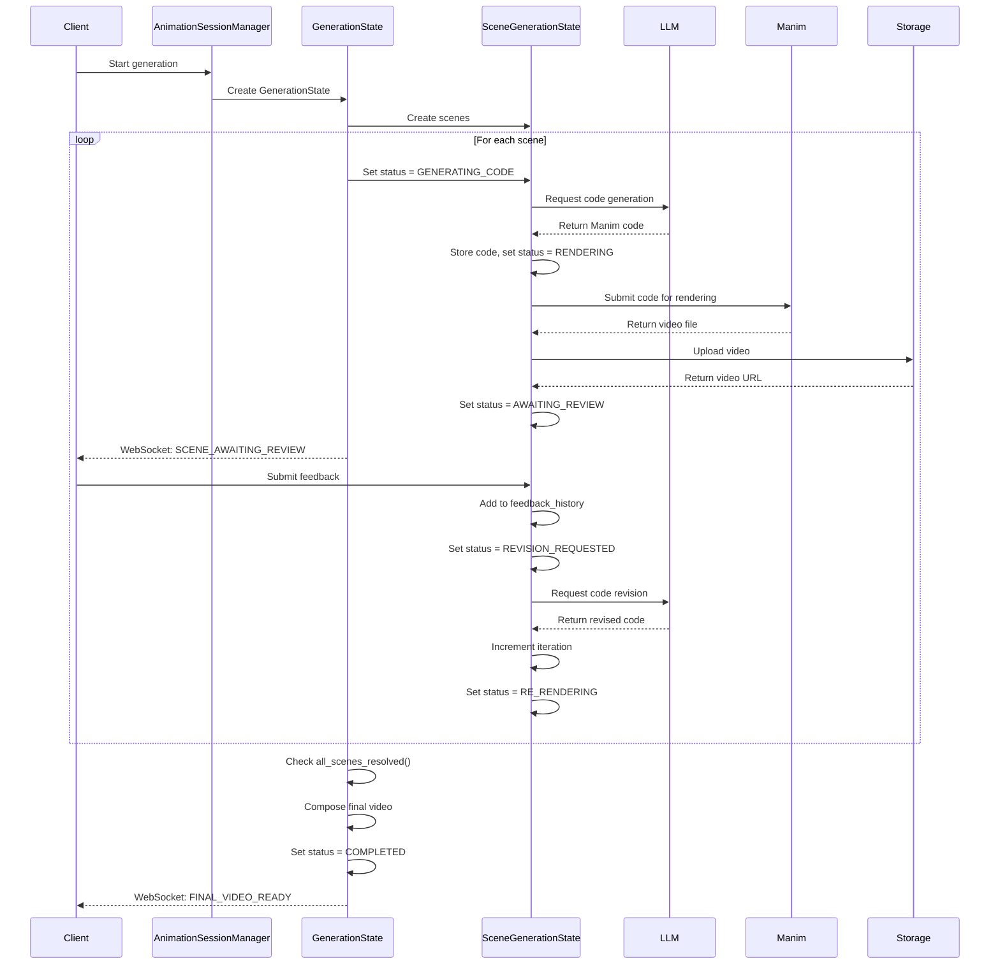
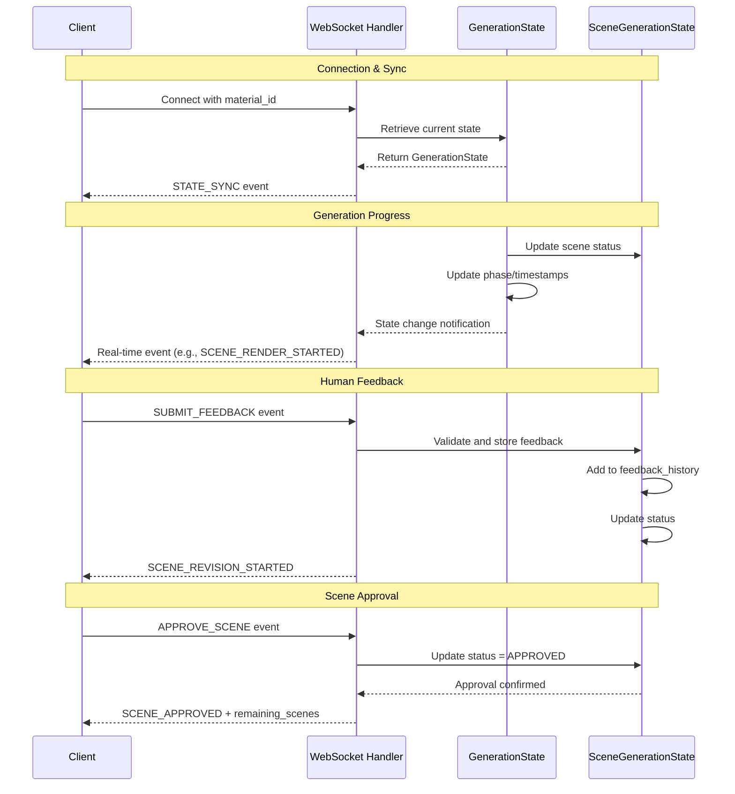

# Generation State Module

## Overview

The `generation_state` module provides comprehensive state management for animation generation with human-in-the-loop feedback. It tracks the entire lifecycle of animated content creation, from initial scene planning through rendering, review, and final composition, enabling real-time collaboration between AI systems and human reviewers.

## Purpose

This module serves as the central orchestration layer for:
- **State Tracking**: Monitoring scene-level and overall generation progress
- **Human Feedback Integration**: Managing review cycles and revision requests
- **Real-time Communication**: WebSocket-based event system for live updates
- **Workflow Coordination**: Coordinating between AI generation, rendering, and human review phases

## Core Components

### 1. State Management Models

#### GenerationState
Tracks the overall animation generation process across multiple scenes and phases.

**Key Responsibilities:**
- Monitor generation phase transitions
- Track scene completion statistics (approved, failed, skipped)
- Coordinate final video composition
- Manage error states and recovery

#### SceneGenerationState
Manages the lifecycle of individual scenes within the generation pipeline.

**Key Responsibilities:**
- Track scene-specific rendering status
- Manage feedback history and iteration cycles
- Handle code generation and video rendering paths
- Control retry logic and failure recovery

### 2. Enumeration Types

#### SceneStatus
```python
QUEUED → GENERATING_CODE → RENDERING → RENDERED → AWAITING_REVIEW → 
REVISION_REQUESTED → RE_RENDERING → APPROVED/SKIPPED/FAILED
```

#### GenerationPhase
```python
INITIALIZING → SCENE_PLANNING → AWAITING_PLAN_APPROVAL → 
SCENE_RENDERING → POST_PROCESSING → COMPLETED/FAILED/CANCELLED
```

#### FeedbackType
Categories for human feedback: `LAYOUT`, `CONTENT`, `TIMING`, `VISUAL`, `ACCURACY`, `OTHER`

#### WSEventType
WebSocket events for real-time communication between server and clients

### 3. Communication Models

#### WebSocket Events (WSMessage)
Real-time bidirectional communication for:
- State synchronization
- Progress updates
- Feedback submission
- Scene approval/rejection

#### REST API Models
Request/response models for HTTP endpoints:
- `SceneReviewResponse`
- `SubmitFeedbackRequest/Response`
- `ApproveSceneResponse`
- `GenerationStateResponse`

## Architecture

### High-Level System Architecture



### Component Relationships



## State Transitions

### Scene Status Lifecycle



### Generation Phase Flow



## Data Flow

### Generation Workflow



### WebSocket Communication Flow



## Key Features

### 1. Iterative Refinement
- Each scene supports up to 50 iteration cycles
- Feedback history preserved for audit trail
- LLM analysis and code changes tracked per iteration

### 2. Real-time Synchronization
- WebSocket events for immediate state updates
- Automatic timestamp management
- Concurrent scene processing support

### 3. Flexible Workflow
- Scenes can be approved, skipped, or failed independently
- Generation can proceed with partial scene approval
- Graceful handling of failures and cancellations

### 4. Comprehensive Tracking
- Detailed timestamps for all state transitions
- Error message preservation
- File path and URL management

## Integration Points

### With Animation Generation
- Receives scene plans from `AnimationGenerator`
- Updates rendering status for `AnimationSteps`
- Provides state for `ScenePlan` execution

### With Animation Session
- Managed by `AnimationSessionManager`
- WebSocket events routed through session handler
- Coordinates with `StartAnimationWithFeedbackRequest/Response`

### With Frontend
- `GenerationStateResponse` serializes state for API consumption
- WebSocket events enable real-time UI updates
- Feedback submission through REST and WebSocket channels

## API Endpoints

### REST Endpoints

```
GET  /api/materials/{material_id}/generation-state
     Returns: GenerationStateResponse

GET  /api/materials/{material_id}/scenes/{scene_id}
     Returns: SceneReviewResponse

POST /api/materials/{material_id}/scenes/{scene_id}/feedback
     Body: SubmitFeedbackRequest
     Returns: SubmitFeedbackResponse

POST /api/materials/{material_id}/scenes/{scene_id}/approve
     Returns: ApproveSceneResponse

POST /api/materials/{material_id}/scenes/{scene_id}/skip
     Returns: SkipSceneResponse
```

### WebSocket Events

**Server → Client:**
- `STATE_SYNC`: Full state on connection
- `SCENE_RENDER_STARTED/PROGRESS/COMPLETED/FAILED`
- `SCENE_AWAITING_REVIEW`: Video ready for feedback
- `SCENE_APPROVED/SKIPPED`: Human decision
- `FINAL_VIDEO_READY`: All scenes processed
- `GENERATION_COMPLETED/FAILED/CANCELLED`

**Client → Server:**
- `SUBMIT_FEEDBACK`: Provide scene feedback
- `APPROVE_SCENE`: Approve current scene
- `SKIP_SCENE`: Skip current scene
- `RETRY_SCENE`: Request scene retry
- `CANCEL_GENERATION`: Cancel entire process

## Error Handling

### Scene-Level Errors
- Failed code generation → `SceneStatus.FAILED`
- Rendering errors → Increment `render_attempts`, retry if < max
- Max iterations exceeded → `SceneStatus.FAILED`

### Generation-Level Errors
- Critical scene failure → `GenerationPhase.FAILED`
- User cancellation → `GenerationPhase.CANCELLED`
- System errors → Preserve error_message, transition to FAILED

### Recovery Mechanisms
- Individual scene failures don't block other scenes
- Failed scenes can be retried independently
- Generation can complete with partial scene success

## Usage Examples

### Creating a Generation State

```python
from backend.app.models.generation_state import (
    GenerationState, SceneGenerationState, SceneStatus, GenerationPhase
)

# Initialize generation state
state = GenerationState(
    current_phase=GenerationPhase.SCENE_RENDERING,
    total_scenes=5,
    scenes=[
        SceneGenerationState(
            scene_id="scene_001",
            scene_index=0,
            title="Introduction to Algebra",
            status=SceneStatus.QUEUED,
            max_iterations=50
        )
        # ... more scenes
    ]
)
```

### Processing Feedback

```python
from backend.app.models.generation_state import SceneFeedback, FeedbackType

# Add feedback to a scene
feedback = SceneFeedback(
    iteration=scene.current_iteration,
    feedback_type=FeedbackType.CONTENT,
    feedback_text="The equation is incorrect. Please use x² + 2x + 1",
    llm_analysis="User identified error in quadratic formula",
    code_changes_made="Updated equation from x² + 3x + 1 to x² + 2x + 1"
)

scene.feedback_history.append(feedback)
scene.status = SceneStatus.REVISION_REQUESTED
```

### WebSocket Event Handling

```python
from backend.app.models.generation_state import WSMessage, WSEventType

# Create progress update event
message = WSMessage(
    event=WSEventType.SCENE_RENDER_PROGRESS,
    material_id="material_123",
    data={
        "scene_id": "scene_001",
        "progress": 65,
        "estimated_time_remaining": 120
    }
)

# Send to connected clients via WebSocket
```

## Related Modules

- [animation_generation](animation_generation.md): Parent module coordinating animation creation
- [animation_pipeline](animation_pipeline.md): Core animation generation logic
- [animation_models](animation_models.md): Scene plan and animation metadata
- [animation_session](animation_session.md): WebSocket session management
- [ai_generation_services](ai_generation_services.md): LLM integration for code generation

## Future Enhancements

1. **Parallel Scene Processing**: Support concurrent rendering of multiple scenes
2. **Advanced Retry Logic**: Exponential backoff and failure pattern analysis
3. **Collaborative Review**: Multiple reviewers per scene with conflict resolution
4. **Analytics Integration**: Track generation metrics and optimization opportunities
5. **Version Control**: Git-like branching for different scene versions
6. **A/B Testing**: Support multiple rendering variants for comparison