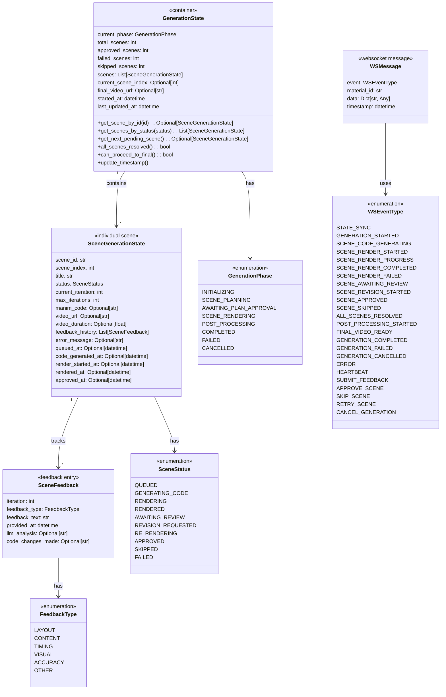
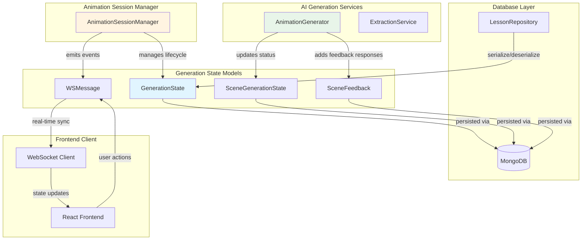
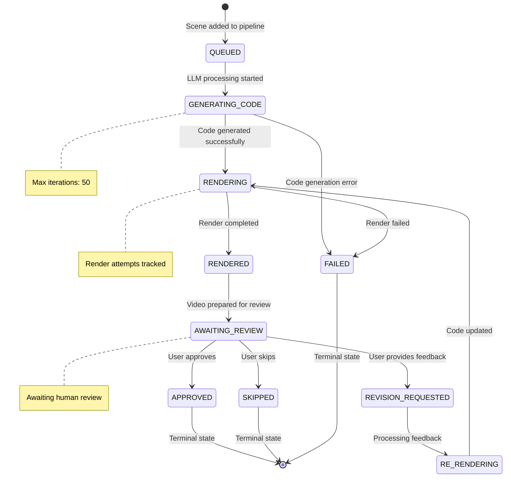
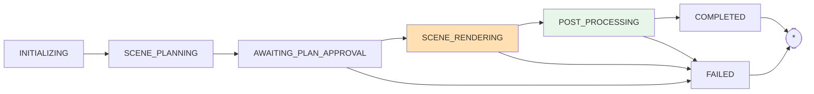
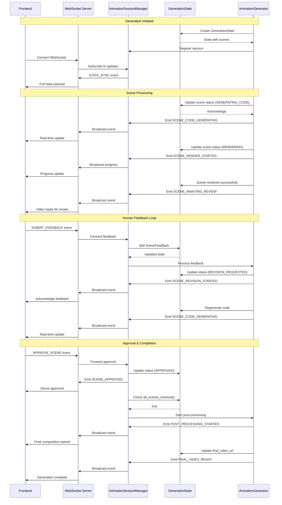
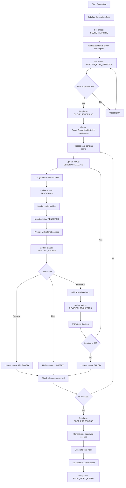
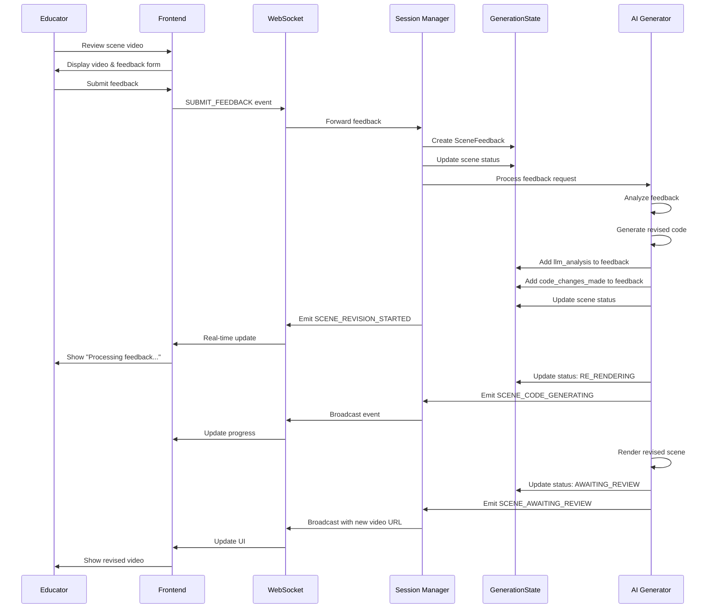
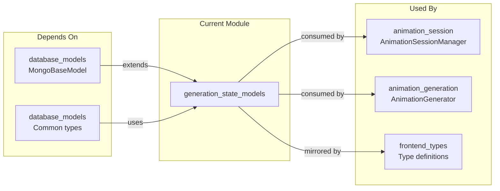

# Generation State Models Module

## Overview

The `generation_state_models` module provides a comprehensive state management system for animation generation with human-in-the-loop feedback. It tracks the entire lifecycle of educational animation creation, from initial scene planning through rendering, review, and final composition.

This module serves as the central data model for the interactive animation generation workflow, enabling real-time collaboration between AI generation services and human educators through WebSocket-based communication.

## Core Purpose

- **State Tracking**: Monitor the status of individual scenes and overall generation process
- **Feedback Management**: Capture, store, and track human feedback across multiple iterations
- **Real-time Communication**: Enable bidirectional communication via WebSocket events
- **Process Coordination**: Orchestrate the complex multi-step animation generation pipeline
- **Audit Trail**: Maintain complete history of generation attempts and feedback loops

## Architecture

### Component Hierarchy



### System Integration



## State Management

### Scene Status Lifecycle



### Generation Phase Flow



## WebSocket Communication

### Event Flow Architecture



### Event Types

#### Server → Client Events (Status Updates)

| Event Type | Trigger | Purpose |
|------------|---------|---------|
| `STATE_SYNC` | WebSocket connection | Initial full state synchronization |
| `GENERATION_STARTED` | Generation initiated | Notify client process started |
| `SCENE_CODE_GENERATING` | LLM code generation | Indicate AI processing scene |
| `SCENE_RENDER_STARTED` | Render job started | Update render progress |
| `SCENE_RENDER_PROGRESS` | Render in progress | Stream render status |
| `SCENE_RENDER_COMPLETED` | Render finished | Scene ready for review |
| `SCENE_RENDER_FAILED` | Render error | Notify failure |
| `SCENE_AWAITING_REVIEW` | Video prepared | Prompt user for feedback |
| `SCENE_REVISION_STARTED` | Feedback processing | Indicate re-rendering |
| `SCENE_APPROVED` | User approval | Update approved count |
| `SCENE_SKIPPED` | User skip | Update skipped count |
| `ALL_SCENES_RESOLVED` | Terminal states reached | Trigger final composition |
| `POST_PROCESSING_STARTED` | Final composition | Indicate video stitching |
| `FINAL_VIDEO_READY` | Composition complete | Provide final video URL |
| `GENERATION_COMPLETED` | All done | Process finished successfully |
| `GENERATION_FAILED` | Critical error | Process terminated |
| `GENERATION_CANCELLED` | User cancellation | Process stopped |
| `ERROR` | Any error | Error notification |
| `HEARTBEAT` | Keep-alive | Connection health check |

#### Client → Server Events (User Actions)

| Event Type | Purpose | Data Payload |
|------------|---------|--------------|
| `SUBMIT_FEEDBACK` | Provide scene feedback | `scene_id`, `feedback_type`, `feedback_text` |
| `APPROVE_SCENE` | Approve scene as-is | `scene_id` |
| `SKIP_SCENE` | Skip unwanted scene | `scene_id`, `reason` |
| `RETRY_SCENE` | Retry failed scene | `scene_id`, `reset_code` |
| `CANCEL_GENERATION` | Abort entire process | (implicit) |

## Data Models

### GenerationState

**Purpose**: Container for entire animation generation process

**Key Responsibilities**:
- Track overall generation phase and progress
- Manage collection of scene states
- Calculate completion metrics
- Determine when to proceed to final composition

**Important Methods**:
```python
# Scene retrieval
get_scene_by_id(scene_id: str) -> Optional[SceneGenerationState]
get_scenes_by_status(status: SceneStatus) -> List[SceneGenerationState]
get_next_pending_scene() -> Optional[SceneGenerationState]

# State checks
all_scenes_resolved() -> bool
can_proceed_to_final() -> bool

# Utility
update_timestamp()
```

**Terminal State Logic**:
- `all_scenes_resolved()`: All scenes in {APPROVED, SKIPPED, FAILED}
- `can_proceed_to_final()`: At least one APPROVED scene AND all scenes resolved

### SceneGenerationState

**Purpose**: Track individual scene lifecycle

**Key Fields**:
- `scene_id`: Unique identifier
- `scene_index`: Order in sequence (0-based)
- `status`: Current SceneStatus
- `current_iteration`: Feedback loop counter (max: 50)
- `manim_code`: Generated Manim code
- `video_url`: Public URL for streaming
- `feedback_history`: Chronological feedback list
- `error_message`: Failure details

**Status Transitions**:
- Each status update sets corresponding timestamp
- `render_attempts` increments on each render try
- `current_iteration` increments when feedback provided
- Terminal statuses set `approved_at` or final error

### SceneFeedback

**Purpose**: Capture human feedback and AI response

**Key Fields**:
- `iteration`: Which attempt this feedback belongs to
- `feedback_type`: Categorized feedback (LAYOUT, CONTENT, etc.)
- `feedback_text`: Human's detailed comments
- `provided_at`: When feedback was given
- `llm_analysis`: AI's understanding of feedback
- `code_changes_made`: Description of code modifications

**Feedback Types**:
- `LAYOUT`: Overlapping, cut off, misaligned elements
- `CONTENT`: Wrong information, missing concepts
- `TIMING`: Too fast, too slow pacing
- `VISUAL`: Colors, sizes, readability issues
- `ACCURACY`: Mathematical/scientific errors
- `OTHER`: Uncategorized feedback

### WSMessage & Event System

**Purpose**: Standardized WebSocket communication

**Structure**:
```python
{
    "event": WSEventType,          # Event type identifier
    "material_id": str,            # Associated material
    "data": Dict[str, Any],        # Event-specific payload
    "timestamp": datetime          # Event time
}
```

**Event Data Examples**:

```python
# SCENE_AWAITING_REVIEW
{
    "event": "scene_awaiting_review",
    "material_id": "lesson_123",
    "data": {
        "scene_id": "scene_3",
        "scene_index": 2,
        "video_url": "https://cdn.example.com/scene_3.mp4",
        "video_duration": 45.2,
        "iteration": 1
    },
    "timestamp": "2024-01-15T10:30:00Z"
}

# SUBMIT_FEEDBACK (client → server)
{
    "event": "submit_feedback",
    "material_id": "lesson_123",
    "data": {
        "scene_id": "scene_3",
        "feedback_type": "layout",
        "feedback_text": "The text overlaps with the diagram on the right side."
    },
    "timestamp": "2024-01-15T10:35:00Z"
}
```

## API Integration Models

### REST API Response Models

The module provides several Pydantic models for REST API endpoints:

#### GenerationStateResponse
- **Purpose**: Serialize full generation state for API clients
- **Usage**: `GET /api/materials/{material_id}/generation-state`
- **Features**: Converts complex state to JSON-serializable format

#### SceneReviewResponse
- **Purpose**: Provide scene details for review interface
- **Usage**: Individual scene status in generation state
- **Includes**: Status, video URL, feedback history, error info

#### Action Response Models
- `SubmitFeedbackResponse`: Acknowledge feedback submission
- `ApproveSceneResponse`: Confirm approval with remaining count
- `SkipSceneResponse`: Confirm skip with remaining count

### Request Models

#### StartAnimationWithFeedbackRequest
- **Purpose**: Initiate interactive generation workflow
- **Fields**: `prompt`, `title`, `subject`, `grade`, `tags`
- **Validation**: Grade range 6-12 (middle to high school)

#### SubmitFeedbackRequest
- **Purpose**: Validate feedback submission
- **Fields**: `feedback_type`, `feedback_text`
- **Usage**: POST `/api/scenes/{scene_id}/feedback`

## Workflows

### Complete Generation Workflow



### Feedback Loop Detail



## Relationships with Other Modules

### Upstream Dependencies



### Integration Points

#### Animation Session Manager
- **Module**: `animation_session`
- **Usage**: Manages lifecycle of GenerationState instances
- **Responsibility**: WebSocket event orchestration, state persistence
- **Reference**: See [animation_session.md](animation_session.md)

#### Animation Generation
- **Module**: `animation_generation`
- **Usage**: Updates scene statuses, adds feedback responses
- **Responsibility**: AI-driven code generation and rendering
- **Reference**: See [animation_generation.md](animation_generation.md)

#### Frontend Types
- **Module**: `frontend_types`
- **Usage**: Mirrors these models for TypeScript type safety
- **Responsibility**: Client-side state management and validation
- **Reference**: See [frontend_types.md](frontend_types.md)

#### Database Layer
- **Module**: `database_layer`
- **Usage**: Persistence of GenerationState to MongoDB
- **Responsibility**: Serialization, querying, atomic updates
- **Reference**: See [database_layer.md](database_layer.md)

## Key Design Decisions

### 1. Immutable Feedback History
- **Decision**: Feedback history is append-only
- **Rationale**: Maintain audit trail of all human-AI interactions
- **Benefit**: Debugging, analytics, and improvement tracking

### 2. Iteration Limits
- **Decision**: Maximum 50 iterations per scene
- **Rationale**: Prevent infinite feedback loops and resource exhaustion
- **Benefit**: System reliability and cost control

### 3. Terminal States
- **Decision**: Explicit terminal states (APPROVED, SKIPPED, FAILED)
- **Rationale**: Clear resolution criteria for workflow progression
- **Benefit**: Deterministic completion detection

### 4. WebSocket-First Design
- **Decision**: Real-time events as primary communication
- **Rationale**: Low latency, bidirectional, stateful connections
- **Benefit**: Responsive user experience for long-running processes

### 5. Separation of Concerns
- **Decision**: State models separate from business logic
- **Rationale**: Pure data models enable multiple consumers
- **Benefit**: Reusability across API, WebSocket, and database layers

## Usage Examples

### Creating a New Generation State

```python
from backend.app.models.generation_state import (
    GenerationState, 
    SceneGenerationState, 
    GenerationPhase
)

# Initialize generation state
state = GenerationState(
    current_phase=GenerationPhase.SCENE_PLANNING,
    total_scenes=5,
    scenes=[
        SceneGenerationState(
            scene_id="scene_1",
            scene_index=0,
            title="Introduction to Quantum Mechanics"
        ),
        # ... more scenes
    ]
)
```

### Processing User Feedback

```python
from backend.app.models.generation_state import (
    SceneFeedback, 
    FeedbackType, 
    SceneStatus
)

# Add feedback to a scene
feedback = SceneFeedback(
    iteration=scene.current_iteration,
    feedback_type=FeedbackType.LAYOUT,
    feedback_text="The electron orbital diagram overlaps with the text label."
)

scene.feedback_history.append(feedback)
scene.status = SceneStatus.REVISION_REQUESTED
scene.current_iteration += 1
```

### WebSocket Event Broadcasting

```python
from backend.app.models.generation_state import WSMessage, WSEventType

# Create status update event
message = WSMessage(
    event=WSEventType.SCENE_AWAITING_REVIEW,
    material_id="lesson_123",
    data={
        "scene_id": scene.scene_id,
        "video_url": scene.video_url,
        "iteration": scene.current_iteration
    }
)

# Broadcast to connected clients
await websocket.send_json(message.dict())
```

### Checking Completion Criteria

```python
# Check if generation can proceed to final video
if state.can_proceed_to_final():
    # All scenes resolved and at least one approved
    await start_post_processing(state)
    state.current_phase = GenerationPhase.POST_PROCESSING
else:
    # Continue processing pending scenes
    next_scene = state.get_next_pending_scene()
    if next_scene:
        await process_scene(next_scene)
```

## Error Handling

### Scene Failure Scenarios

1. **Code Generation Failure**
   - Status: `FAILED`
   - `error_message`: LLM error details
   - `render_attempts`: Not incremented

2. **Render Failure**
   - Status: `FAILED`
   - `error_message`: Manim error output
   - `render_attempts`: Incremented
   - May retry if attempts < limit

3. **Iteration Exhaustion**
   - Status: `FAILED`
   - `error_message`: "Maximum iterations reached"
   - Occurs when `current_iteration >= max_iterations`

4. **System Errors**
   - Status: `FAILED`
   - `error_message`: Exception details
   - Generation phase may become `FAILED`

### Recovery Mechanisms

- **Retry Scene**: Reset status to `QUEUED` or regenerate code from scratch
- **Skip Scene**: Mark as `SKIPPED` to exclude from final video
- **Cancel Generation**: Set phase to `CANCELLED`, clean up resources

## Performance Considerations

### State Size Management

- **Feedback History**: Unbounded per scene, but limited by iteration cap
- **Video URLs**: Store only references, not binary data
- **Code Storage**: Manim code stored as text, may be large for complex scenes

### Database Optimization

- **Indexing**: Index by `material_id`, `scene_id`, and `status`
- **Partial Updates**: Use atomic updates for status changes
- **TTL**: Consider TTL index for failed/cancelled generations

### WebSocket Efficiency

- **Delta Updates**: Send only changed fields when possible
- **Batch Events**: Throttle rapid status updates
- **Compression**: Enable per-message compression for large states

## Security Considerations

### Data Validation

- All models use Pydantic for input validation
- `grade` field validated (6-12 range)
- `video_url` should be validated against allowed CDN domains

### Access Control

- WebSocket connections must be authenticated
- Users can only access their own generation states
- Feedback should be attributed to specific users

### Rate Limiting

- Limit feedback submissions per scene
- Throttle scene retry attempts
- Prevent WebSocket connection flooding

## Future Enhancements

### Potential Improvements

1. **Parallel Scene Processing**: Process multiple scenes concurrently
2. **Smart Feedback Suggestions**: AI-suggested feedback types based on scene content
3. **Version Control**: Git-like versioning for Manim code evolution
4. **Collaborative Review**: Multiple educators reviewing same scene
5. **Analytics Dashboard**: Feedback pattern analysis and improvement metrics
6. **A/B Testing**: Compare different generation strategies
7. **Template System**: Reusable scene templates with parameterization

### Scalability Considerations

- **Sharding**: Distribute generation states by `material_id`
- **Caching**: Cache frequently accessed states in Redis
- **Queue System**: Use message queue for render job distribution
- **Microservices**: Extract state management to dedicated service

## Conclusion

The `generation_state_models` module provides a robust foundation for interactive animation generation, balancing AI automation with human expertise. Its design enables:

- **Real-time Collaboration**: WebSocket events keep all parties synchronized
- **Flexible Workflows**: Support for multiple resolution paths (approve, skip, revise)
- **Complete Audit Trail**: Every action and iteration is recorded
- **Scalable Architecture**: Clean separation allows independent scaling
- **Educator-Friendly**: Feedback categories align with teaching concerns

This module is the backbone of the human-in-the-loop animation system, enabling educators to guide AI generation toward pedagogically sound educational content.