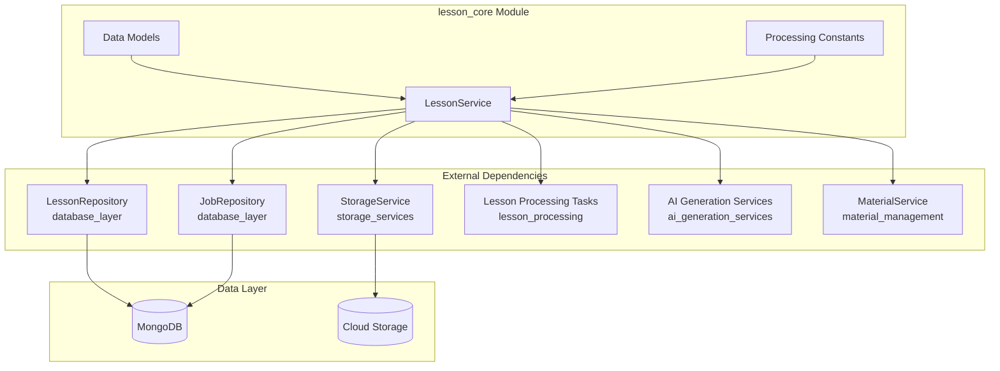
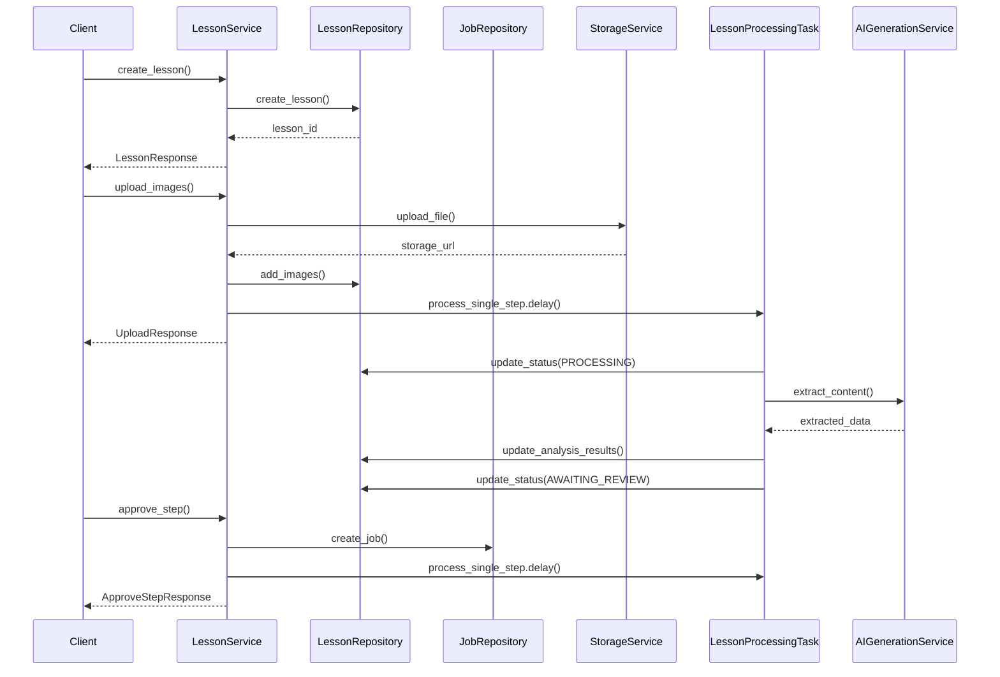
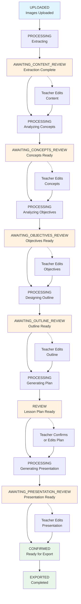
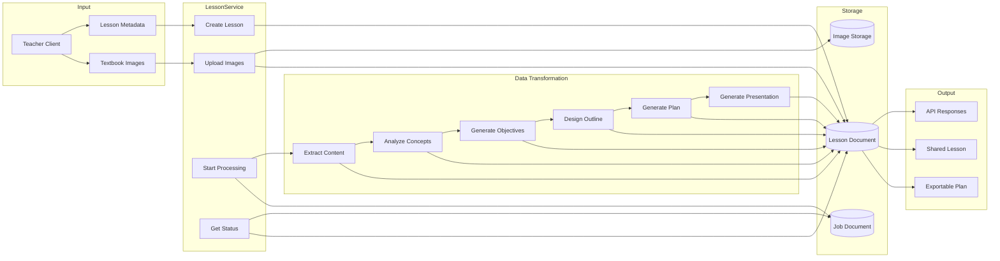
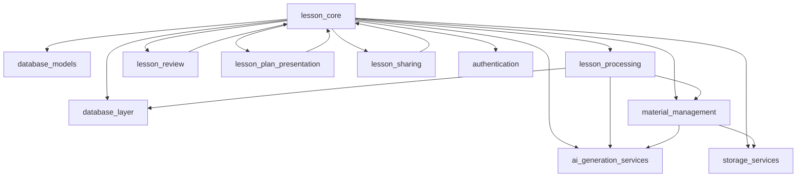

# Lesson Core Module Documentation

## Overview

The `lesson_core` module is the central component of the lesson management system, providing comprehensive functionality for creating, managing, processing, and sharing educational lessons. It orchestrates the entire lesson lifecycle from initial upload through AI-powered analysis to final presentation generation and sharing.

## Module Purpose

The lesson_core module serves as the primary service layer for lesson management, offering:

- **Lesson Lifecycle Management**: Create, read, update, and delete lessons
- **Multi-Step Processing Pipeline**: Orchestrates AI-powered analysis and generation across 6 distinct steps
- **Teacher Review Workflow**: Enables step-by-step review and approval with editing capabilities
- **Collaboration & Sharing**: Provides secure sharing mechanisms with view/edit tokens
- **State Management**: Tracks lesson status and processing progress
- **Material Integration**: Coordinates with material generation services

## Core Components

### 1. LessonService

The `LessonService` class is the main service provider containing 40+ methods for lesson operations:

```python
class LessonService:
    """Service for lesson management operations."""
    
    # CRUD Operations
    async def create_lesson(self, teacher_id: str, request: CreateLessonRequest) -> LessonResponse
    async def get_lesson(self, lesson_id: str, teacher_id: str) -> Optional[LessonDetailResponse]
    async def list_lessons(self, teacher_id: str, ...) -> tuple[list[LessonResponse], int]
    async def update_lesson(self, lesson_id: str, teacher_id: str, request: UpdateLessonRequest) -> Optional[LessonResponse]
    async def delete_lesson(self, lesson_id: str, teacher_id: str) -> bool
    
    # Processing Pipeline
    async def upload_images(self, lesson_id: str, teacher_id: str, files: list[UploadFile]) -> Optional[UploadResponse]
    async def _start_processing(self, lesson_id: str, teacher_id: str) -> Optional[ProcessingStatusResponse]
    async def get_processing_status(self, lesson_id: str, teacher_id: str) -> Optional[ProcessingStatusResponse]
    async def retry_processing(self, lesson_id: str, teacher_id: str) -> Optional[ProcessingStatusResponse]
    
    # Step-by-Step Review
    async def get_step_data(self, lesson_id: str, teacher_id: str) -> Optional[StepDataResponse]
    async def approve_step(self, lesson_id: str, teacher_id: str, ...) -> Optional[ApproveStepResponse]
    async def restart_from_step(self, lesson_id: str, teacher_id: str, step: str, ...) -> Optional[LessonResponse]
    
    # Content Retrieval & Updates
    async def get_extracted_content(self, lesson_id: str, teacher_id: str) -> Optional[ExtractedContentResponse]
    async def update_extracted_content(self, lesson_id: str, teacher_id: str, request: UpdateExtractedContentRequest) -> Optional[ExtractedContentResponse]
    async def get_key_concepts(self, lesson_id: str, teacher_id: str) -> Optional[KeyConceptsResponse]
    async def update_key_concepts(self, lesson_id: str, teacher_id: str, request: UpdateKeyConceptsRequest) -> Optional[KeyConceptsResponse]
    # ... similar methods for objectives, outline, presentation
    
    # Sharing
    async def create_share_link(self, lesson_id: str, teacher_id: str, base_url: str) -> Optional[ShareLinkResponse]
    async def get_shared_lesson(self, share_token: str) -> Optional[SharedLessonResponse]
    async def update_shared_lesson(self, edit_token: str, updates: dict) -> Optional[SharedLessonResponse]
    async def get_shared_lessons_list(self, limit: int = 9) -> list[dict]
```

### 2. Data Models

The module defines comprehensive Pydantic models for all lesson-related data:

#### Request Models
- `CreateLessonRequest` - Initial lesson creation with metadata
- `UpdateLessonRequest` - Metadata updates
- `UpdateExtractedContentRequest` - Content editing
- `UpdateKeyConceptsRequest` - Concepts editing
- `UpdateObjectivesRequest` - Objectives editing
- `UpdateOutlineRequest` - Outline editing
- `UpdateLessonPlanRequest` - Lesson plan editing
- `UpdatePresentationRequest` - Presentation editing

#### Response Models
- `LessonResponse` - Basic lesson information
- `LessonDetailResponse` - Detailed lesson with images and status
- `LessonListResponse` - Paginated lesson list
- `ProcessingStatusResponse` - Real-time processing status
- `LessonPlanResponse` - Complete lesson plan
- `PresentationResponse` - Presentation slides
- `SharedLessonResponse` - Public shared lesson view
- `ShareLinkResponse` - Sharing tokens and URLs

#### Core Data Models
- `LessonInDB` - MongoDB document structure
- `LessonPlan` - Complete lesson plan with periods and activities
- `LessonPresentation` - Slide-based presentation
- `LessonMetadata` - Descriptive lesson information

## Architecture

### High-Level Architecture



### Component Interaction Flow



## Processing Pipeline

### Six-Step Processing Flow

The lesson processing pipeline follows a sequential six-step workflow:



### Status Mapping

The service maintains several critical mapping dictionaries for pipeline management:

```python
# Mapping from status to step name for display
STATUS_TO_STEP = {
    LessonStatus.AWAITING_CONTENT_REVIEW.value: "content",
    LessonStatus.AWAITING_CONCEPTS_REVIEW.value: "concepts",
    LessonStatus.AWAITING_OBJECTIVES_REVIEW.value: "objectives",
    LessonStatus.AWAITING_OUTLINE_REVIEW.value: "outline",
    LessonStatus.REVIEW.value: "plan",
    LessonStatus.AWAITING_PRESENTATION_REVIEW.value: "presentation",
}

# Mapping for next step after approval
NEXT_STEP_MAP = {
    LessonStatus.AWAITING_CONTENT_REVIEW.value: ProcessingStep.ANALYZING_CONCEPTS.value,
    LessonStatus.AWAITING_CONCEPTS_REVIEW.value: ProcessingStep.ANALYZING_OBJECTIVES.value,
    LessonStatus.AWAITING_OBJECTIVES_REVIEW.value: ProcessingStep.DESIGNING_OUTLINE.value,
    LessonStatus.AWAITING_OUTLINE_REVIEW.value: ProcessingStep.GENERATING_PLAN.value,
    LessonStatus.REVIEW.value: ProcessingStep.GENERATING_PRESENTATION.value,
    LessonStatus.CONFIRMED.value: ProcessingStep.GENERATING_PRESENTATION.value,
    LessonStatus.EXPORTED.value: ProcessingStep.GENERATING_PRESENTATION.value,
}

# Mapping from step name to status (for restart functionality)
STEP_TO_STATUS = {
    "content": LessonStatus.AWAITING_CONTENT_REVIEW,
    "concepts": LessonStatus.AWAITING_CONCEPTS_REVIEW,
    "objectives": LessonStatus.AWAITING_OBJECTIVES_REVIEW,
    "outline": LessonStatus.AWAITING_OUTLINE_REVIEW,
    "plan": LessonStatus.REVIEW,
    "presentation": LessonStatus.AWAITING_PRESENTATION_REVIEW,
}
```

## Data Flow

### Lesson Creation and Processing Data Flow



## Key Features

### 1. Step-by-Step Teacher Review

The module implements a sophisticated review system that allows teachers to:

- **Review at each step**: Content extraction, key concepts, learning objectives, outline, lesson plan, and presentation
- **Edit generated content**: Teachers can modify AI-generated content before approval
- **Provide feedback**: Comments are stored for each step to improve regeneration
- **Restart from any step**: Teachers can go back to previous steps and regenerate from that point

```python
# Example: Restarting from a previous step
async def restart_from_step(
    self,
    lesson_id: str,
    teacher_id: str,
    step: str,  # "content", "concepts", "objectives", "outline"
    comment: Optional[str] = None,
) -> Optional[LessonResponse]:
    """Restart lesson processing from a specific step."""
    # Validates step, updates status, triggers regeneration
```

### 2. Intelligent Processing Pipeline

The pipeline processes one step at a time with idempotency and error handling:

```python
# Processing is triggered via Celery tasks
from app.tasks.lesson_processing import process_single_step

task = process_single_step.delay(lesson_id, job_id, ProcessingStep.EXTRACTING.value)
```

### 3. Flexible Sharing System

Lessons can be shared with two access levels:

- **View-only access**: Share token for read-only access
- **Edit access**: Edit token for collaborative editing
- **Public listing**: Optional public display on landing page

```python
# Generate share links with both view and edit tokens
share_token = secrets.token_urlsafe(12)  # View-only
edit_token = secrets.token_urlsafe(12)   # Editable

# Store tokens in lesson document
await lesson_repository.set_share_tokens(lesson_id, share_token, edit_token)
```

### 4. Comprehensive Status Tracking

Real-time processing status includes:

- Current processing step and progress percentage
- Elapsed time and step-specific timings
- Material generation status (images, HTML, videos)
- Error messages and failure handling

```python
class ProcessingStatusResponse(BaseModel):
    lesson_id: str
    status: str
    current_step: Optional[str]
    progress_percent: int
    elapsed_seconds: Optional[int]
    lesson_plan_ready: bool
    materials_generating: bool
    image_generating: bool
    html_generating: bool
    video_generating: bool
    step_timings: Dict[str, StepTimingInfo]
```

## Dependencies

### Internal Module Dependencies



### Key External Components

1. **LessonRepository** ([database_layer](database_layer.md)): MongoDB operations for lessons
2. **JobRepository** ([database_layer](database_layer.md)): Background job tracking
3. **StorageService** ([storage_services](storage_services.md)): File upload and storage
4. **AI Generation Services** ([ai_generation_services](ai_generation_services.md)): Content extraction and generation
5. **MaterialService** ([material_management](material_management.md)): Teaching material generation
6. **Lesson Processing Tasks** ([lesson_processing](lesson_processing.md)): Celery task orchestration

## API Operations

### CRUD Operations

| Method | Endpoint | Description |
|--------|----------|-------------|
| `create_lesson` | POST /api/lessons | Create new lesson with metadata |
| `get_lesson` | GET /api/lessons/{id} | Get lesson details |
| `list_lessons` | GET /api/lessons | List lessons with filtering |
| `update_lesson` | PATCH /api/lessons/{id} | Update lesson metadata |
| `delete_lesson` | DELETE /api/lessons/{id} | Delete lesson and associated data |

### Processing Operations

| Method | Description |
|--------|-------------|
| `upload_images` | Upload textbook images and trigger processing |
| `get_processing_status` | Get real-time processing status |
| `retry_processing` | Retry failed processing from failure point |
| `start_extraction` | Manually start extraction step |

### Review Operations

| Method | Purpose |
|--------|---------|
| `get_step_data` | Get current step data for review interface |
| `approve_step` | Approve current step and trigger next step |
| `restart_from_step` | Go back to previous step and regenerate |
| `get_extracted_content` | Get content extraction results |
| `update_extracted_content` | Edit extracted content |
| `get_key_concepts` | Get AI-analyzed key concepts |
| `update_key_concepts` | Edit key concepts |
| `get_objectives` | Get learning objectives |
| `update_objectives` | Edit objectives |
| `get_outline` | Get lesson outline |
| `update_outline` | Edit outline |
| `get_lesson_plan` | Get complete lesson plan |
| `update_lesson_plan` | Edit lesson plan |
| `confirm_lesson_plan` | Confirm plan for export |
| `get_presentation` | Get presentation slides |
| `update_presentation` | Edit presentation |
| `sync_materials_to_presentation` | Sync generated materials to slides |

### Sharing Operations

| Method | Purpose |
|--------|---------|
| `create_share_link` | Generate view/edit tokens |
| `get_share_link` | Retrieve existing share links |
| `revoke_share_link` | Disable sharing |
| `toggle_public` | Add/remove from public listing |
| `get_shared_lesson` | Public access to shared lesson |
| `update_shared_lesson` | Public editing with edit token |
| `get_shared_lessons_list` | Get public lessons for landing page |

## Data Models Reference

### LessonInDB (MongoDB Document)

```python
class LessonInDB(MongoBaseModel):
    _id: PyObjectId
    teacher_id: PyObjectId
    metadata: LessonMetadata
    images: list[LessonImage]
    
    # Processing state
    status: LessonStatus = LessonStatus.DRAFT
    current_step: Optional[ProcessingStep]
    error_message: Optional[str]
    
    # Analysis results
    raw_content: Optional[str]
    detailed_content: Optional[str]
    web_research_notes: Optional[str]
    key_concepts: Optional[list[KeyConceptsData]]
    learning_objectives: Optional[list[ObjectivesData]]
    lesson_outline: Optional[list[OutlineData]]
    
    # Final outputs
    lesson_plan: Optional[LessonPlan]
    presentation: Optional[LessonPresentation]
    
    # Sharing
    share_token: Optional[str]
    edit_token: Optional[str]
    share_created_at: Optional[datetime]
    is_public: bool = False
    
    # Timestamps
    created_at: datetime
    updated_at: datetime
    processing_started_at: Optional[datetime]
    processing_completed_at: Optional[datetime]
    upload_started_at: Optional[datetime]
    text_generation_completed_at: Optional[datetime]
    generation_completed_at: Optional[datetime]
    total_generation_time_seconds: Optional[int]
    
    # Teacher feedback
    step_comments: Optional[Dict[str, str]]
```

### LessonPlan Structure

```python
class LessonPlan(BaseModel):
    general_info: GeneralInfo
    periods: list[PeriodPlan]  # Each period is 45 minutes
    adjustments: PostLessonAdjustments
    last_edited_at: Optional[datetime]
    edit_history: list[EditHistoryEntry]

class PeriodPlan(BaseModel):
    period_number: int
    objectives: Objectives  # Knowledge, competencies, qualities
    key_concepts: KeyConceptsResult
    teaching_materials: TeachingMaterial
    activities: list[Activity]  # Multiple activities per period
    time_allocation: TimeAllocation  # Minutes per activity type

class Activity(BaseModel):
    id: str
    type: ActivityType  # khoi_dong, hinh_thanh_kien_thuc, luyen_tap, van_dung
    title: str
    objectives: list[str]
    content: str
    expected_products: list[str]
    implementation: list[ActivityRow]  # Teacher-student actions
    implementation_steps: list[ImplementationStep]  # Structured steps
    materials: list[ActivityMaterial]  # Generated materials
    time_estimate_min: int
```

## Error Handling and Edge Cases

### Processing Failures

- **Idempotency**: Checks for existing running jobs before starting new tasks
- **Retry Mechanism**: `retry_processing()` restarts from failed step
- **Error Propagation**: Error messages stored in lesson document
- **Status Rollback**: Failed status allows retry from failure point

### Validation and Authorization

- **Teacher Ownership**: All operations verify `teacher_id` matches lesson
- **Status Validation**: Operations check valid status transitions
- **File Limits**: Maximum 20 images per lesson
- **Shareable Status**: Only certain statuses allow sharing

### Concurrent Processing

- **Job Tracking**: Each processing step creates a job record
- **Celery Task IDs**: Tasks tracked for monitoring and cancellation
- **Step Timing**: Individual step durations recorded for performance analysis

## Performance Considerations

### Database Optimization

- **Indexed Fields**: `teacher_id`, `status`, `share_token`, `edit_token`
- **Selective Updates**: Partial updates using `$set` to minimize write operations
- **Embedded Documents**: Rich documents reduce joins

### Processing Efficiency

- **Single-Step Processing**: Each Celery task processes only one step
- **Base64 Encoding**: Images stored as base64 during extraction to avoid re-downloading
- **Material Syncing**: Lazy sync of materials to presentation only when needed

### Caching Strategy

- **Status Responses**: Processing status cached in job documents
- **Share Tokens**: Tokens generated once and stored for reuse
- **Image URLs**: Storage URLs cached in lesson documents

## Security Considerations

### Access Control

- **Teacher Authorization**: All lesson operations require valid teacher_id
- **Token-Based Sharing**: URL-safe tokens for shared access
- **Edit vs View**: Separate tokens for different permission levels
- **Public Listing**: Explicit opt-in for public display

### Data Protection

- **Secure Token Generation**: `secrets.token_urlsafe(12)` for 16-character tokens
- **File Validation**: Content type checking for uploads
- **No PII in URLs**: Lesson IDs and tokens are random strings

## Integration Points

### Frontend Integration

The module provides comprehensive API responses for frontend consumption:

- **LessonListResponse**: Paginated list for dashboard
- **LessonDetailResponse**: Complete lesson data for editor
- **ProcessingStatusResponse**: Real-time progress updates
- **StepDataResponse**: Current step data for review interface
- **SharedLessonResponse**: Public lesson view

### External Service Integration

- **AI Services**: Content extraction, concept analysis, objective generation
- **Material Generation**: Images, animations, experiments, HTML interactives
- **Export Services**: DOCX and PDF generation
- **Notification Service**: Email alerts for processing completion

## Future Enhancements

### Potential Improvements

1. **Parallel Processing**: Generate materials for different periods concurrently
2. **Caching Layer**: Redis cache for frequently accessed lessons
3. **Advanced Search**: Full-text search across lesson content
4. **Version Control**: Git-like versioning for lesson plans
5. **Collaborative Editing**: Real-time collaborative editing with WebSockets
6. **Template System**: Reusable lesson plan templates
7. **Analytics**: Processing time analytics and optimization recommendations

### Scalability Considerations

- **Horizontal Scaling**: Stateless service design supports multiple instances
- **Queue Management**: Celery queues for background processing
- **Database Sharding**: Potential sharding by teacher_id or school
- **CDN Integration**: Static assets served through CDN

## Conclusion

The `lesson_core` module is a comprehensive, production-ready lesson management system that orchestrates complex AI-powered content generation workflows while providing teachers with full control through step-by-step review and editing capabilities. Its modular architecture, robust error handling, and flexible sharing mechanisms make it suitable for large-scale educational platforms.

The module's design emphasizes:

- **Teacher Agency**: Every AI-generated step is reviewable and editable
- **Reliability**: Idempotent operations, comprehensive error handling, and retry mechanisms
- **Collaboration**: Secure sharing with granular permission levels
- **Extensibility**: Clear separation of concerns enables easy feature additions
- **Performance**: Efficient database operations and background processing

For more details on specific subsystems, refer to:
- [Lesson Processing](lesson_processing.md) - Background task orchestration
- [Lesson Review](lesson_review.md) - Step-by-step review interface
- [Lesson Plan Presentation](lesson_plan_presentation.md) - Slide generation
- [Lesson Sharing](lesson_sharing.md) - Collaboration features
- [Material Management](material_management.md) - Teaching material generation
- [AI Generation Services](ai_generation_services.md) - Core AI capabilities