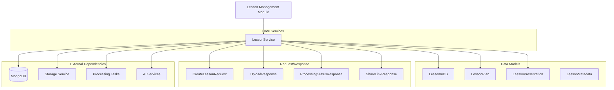
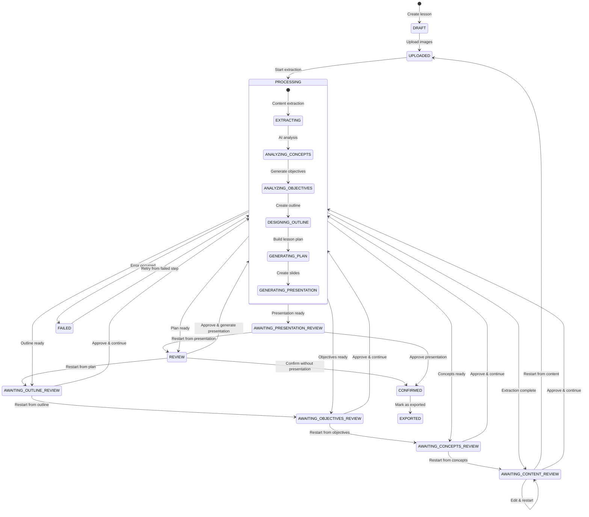
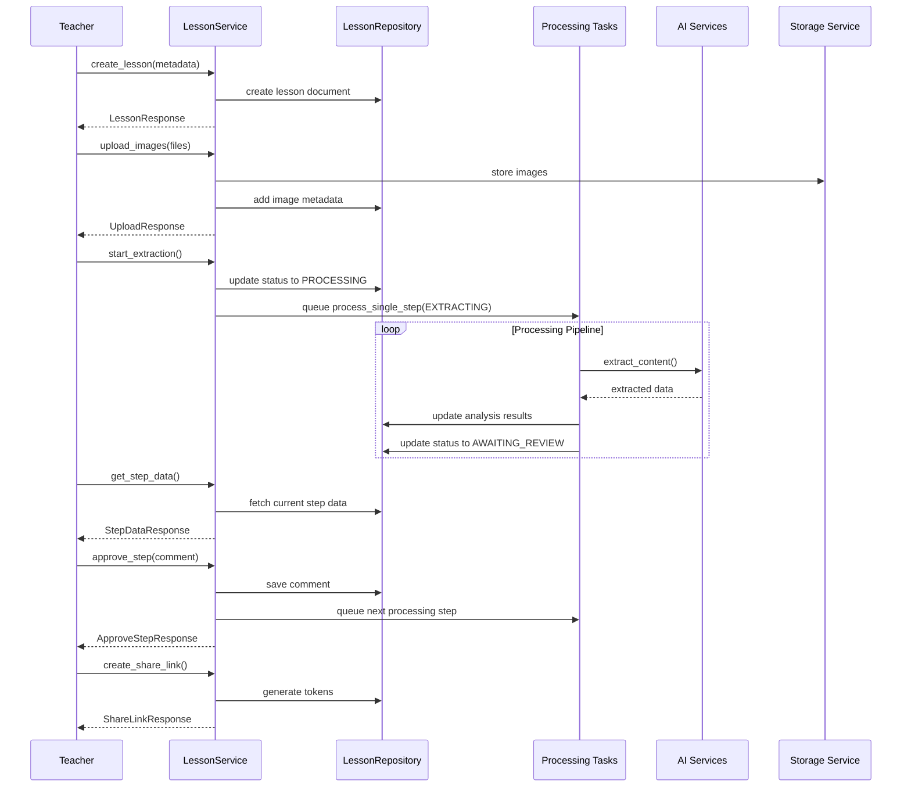
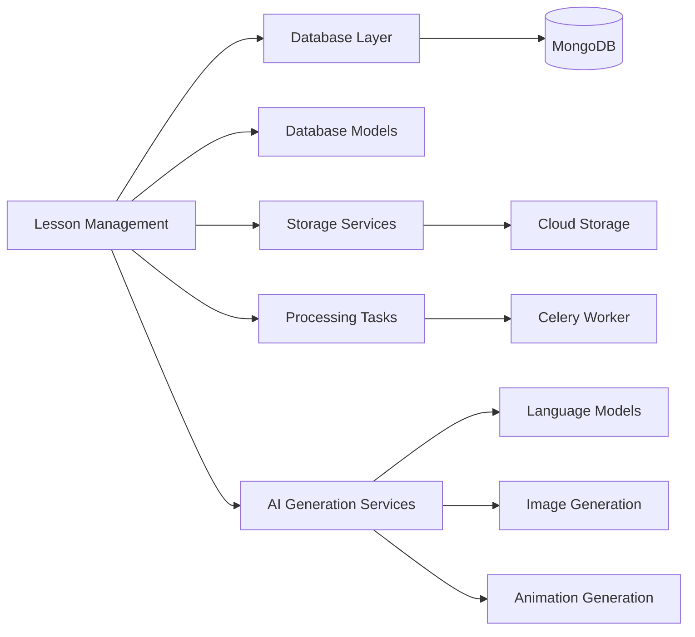

# Lesson Management Module

## Overview

The **Lesson Management** module is the core component of the educational content generation platform, responsible for orchestrating the entire lesson creation workflow from initial image upload through to final lesson plan generation and sharing. It provides a comprehensive step-by-step review process that allows teachers to guide AI-generated content at each stage of development.

### Key Features

- **End-to-End Lesson Creation**: Manages the complete lifecycle from textbook image upload to finalized lesson plans
- **Step-by-Step Review Workflow**: Implements a six-stage review process (content → concepts → objectives → outline → plan → presentation)
- **Intelligent Processing Pipeline**: Coordinates AI services for content extraction, analysis, and generation
- **Collaborative Sharing**: Supports view-only and editable sharing links for lesson collaboration
- **Flexible Restart Mechanism**: Allows teachers to revisit and regenerate any previous step with feedback
- **Real-time Status Tracking**: Provides detailed progress monitoring with step timings and error handling

## Architecture

### High-Level Component Structure

### Processing Workflow

### Data Flow

## Module Structure

The Lesson Management module is organized into several logical sub-modules, each handling specific aspects of the lesson lifecycle:

### 1. [Core Lesson Operations](lesson_core.md)
Manages fundamental lesson CRUD operations, metadata handling, and basic lifecycle management.

**Key Components:**
- `LessonService` - Main service coordinator
- `CreateLessonRequest` / `UpdateLessonRequest` - Lesson metadata management
- `LessonResponse` / `LessonDetailResponse` - Lesson data retrieval
- `LessonListResponse` - Lesson listing and pagination

### 2. [Processing Pipeline](lesson_processing.md)
Orchestrates the AI-powered content extraction and analysis pipeline, managing the transformation of textbook images into structured lesson data.

**Key Components:**
- `UploadResponse` - Image upload handling
- `ProcessingStatusResponse` - Real-time progress tracking
- Integration with Celery tasks for asynchronous processing
- Step-by-step AI service coordination

### 3. [Review Workflow](lesson_review.md)
Implements the collaborative review process that allows teachers to review, edit, and approve AI-generated content at each stage.

**Key Components:**
- `StepDataResponse` - Current step information
- `ApproveStepResponse` - Approval handling and next step triggering
- `ExtractedContentResponse` / `KeyConceptsResponse` / `ObjectivesResponse` / `OutlineResponse` - Step-specific data
- Restart and regeneration capabilities

### 4. [Lesson Plan & Presentation](lesson_plan_presentation.md)
Manages the final lesson plan structure and presentation slide generation, including teacher editing capabilities.

**Key Components:**
- `LessonPlan` / `LessonPlanResponse` - Complete lesson plan structure
- `LessonPresentation` / `PresentationResponse` - Slide deck management
- `PeriodPlan` / `Activity` - Lesson plan building blocks
- `SlideContent` / `PeriodPresentation` - Presentation structure

### 5. [Sharing & Collaboration](lesson_sharing.md)
Provides secure sharing mechanisms for lesson collaboration, including view-only and editable access modes.

**Key Components:**
- `ShareLinkResponse` - Share link generation
- `SharedLessonResponse` - Public lesson access
- Token-based access control (share_token / edit_token)
- Public lesson discovery features

## Key Design Patterns

### 1. **State Machine Pattern**
The lesson status system implements a state machine with explicit transitions:
- `DRFT → UPLOADED → PROCESSING → AWAITING_*_REVIEW → ... → CONFIRMED → EXPORTED`
- Each state represents a specific stage in the lesson lifecycle
- Transitions are triggered by teacher actions or automated processing

### 2. **Step-by-Step Processing**
The module implements a six-step review process:
1. **Content Extraction** - Split textbook content by periods
2. **Key Concepts** - Identify important concepts and formulas
3. **Learning Objectives** - Generate knowledge/competency/quality objectives
4. **Lesson Outline** - Create activity structure for each period
5. **Lesson Plan** - Generate detailed lesson plan with materials
6. **Presentation** - Create slide deck for classroom use

### 3. **Repository Pattern**
Data access is abstracted through repository classes:
- `LessonRepository` - Lesson document operations
- `JobRepository` - Processing job tracking
- Provides clean separation between business logic and data persistence

### 4. **Async Processing**
Long-running AI operations are handled asynchronously:
- Celery tasks for each processing step
- Real-time status polling for UI updates
- Idempotent job creation prevents duplicate processing

## Dependencies

### Internal Modules

- **[Database Models](database_models.md)**: `LessonInDB`, `UserInDB`, `JobInDB`, common enums
- **[Database Layer](database_layer.md)**: `LessonRepository`, `JobRepository`, `MongoDB` connection
- **[Storage Services](storage_services.md)**: File upload and retrieval
- **[AI Generation Services](ai_generation_services.md)**: Content extraction, analysis, and generation
- **[Material Management](material_management.md)**: Teaching material generation and management

### External Services
- **MongoDB**: Primary data storage
- **Cloud Storage** (S3/compatible): Image and file storage
- **Celery**: Background task processing
- **AI/ML Services**: Content extraction and generation

## API Integration

The Lesson Management module serves as the backend for several frontend features:

### Frontend State Management
- `AuthState` - Teacher authentication and authorization
- Lesson list and detail views
- Real-time processing status updates

### Frontend API Client
- `ChatRequest` / `ChatResponse` - Interactive AI assistance
- WebSocket messages for real-time updates

### Frontend Types
- `LessonDetail` - Lesson data structures
- `SharedLesson` - Public lesson access
- `MaterialPlanResponse` - Material generation planning
- `AnimationPlan` / `UpdateAnimationPlansRequest` - Animation management

## Security & Access Control

### Teacher-Owned Resources
- All lessons are owned by a specific teacher
- Operations require `teacher_id` for authorization
- Cross-teacher access is prevented at the service layer

### Sharing Security
- URL-safe tokens for shared access (16 characters)
- Separate tokens for view-only and edit access
- Shareable status validation prevents sharing incomplete lessons
- Optional public listing for discoverability

### Data Validation
- Pydantic models enforce schema validation
- Status transition validation prevents invalid state changes
- File type and size restrictions for uploads

## Performance Considerations

### Asynchronous Processing
- AI operations run in Celery tasks to avoid blocking
- Real-time status polling with efficient database queries
- Step timings tracked for performance monitoring

### Data Optimization
- Lesson plan and presentation stored as embedded documents
- Image metadata includes base64 for extraction (cleared after processing)
- Selective field loading for list views

### Caching Opportunities
- Share link tokens could be cached (currently database-stored)
- Public lesson listings could benefit from Redis caching
- Generated materials URLs are permanent (cloud storage)

## Error Handling & Resilience

### Processing Failures
- Failed lessons can be retried from the failed step
- Error messages stored in lesson document for debugging
- Automatic job duplication prevention

### Validation Errors
- Comprehensive input validation using Pydantic
- Clear error messages for teacher feedback
- Graceful handling of missing or incomplete data

### Recovery Mechanisms
- `restart_from_step` allows recovery from any previous stage
- Teacher comments provide context for regeneration
- Manual animation mode skips problematic auto-generation

## Future Enhancements

### Potential Improvements
- **Version Control**: Track lesson plan versions and changes
- **Collaborative Editing**: Real-time multi-teacher editing
- **Template System**: Reusable lesson plan templates
- **Advanced Search**: Full-text search across lesson content
- **Analytics**: Lesson usage and effectiveness tracking
- **Export Formats**: Additional output formats (PDF, DOCX, etc.)

### Scalability Considerations
- Horizontal scaling of Celery workers for processing
- Database indexing on frequently queried fields
- CDN integration for static assets
- Microservices extraction for AI processing