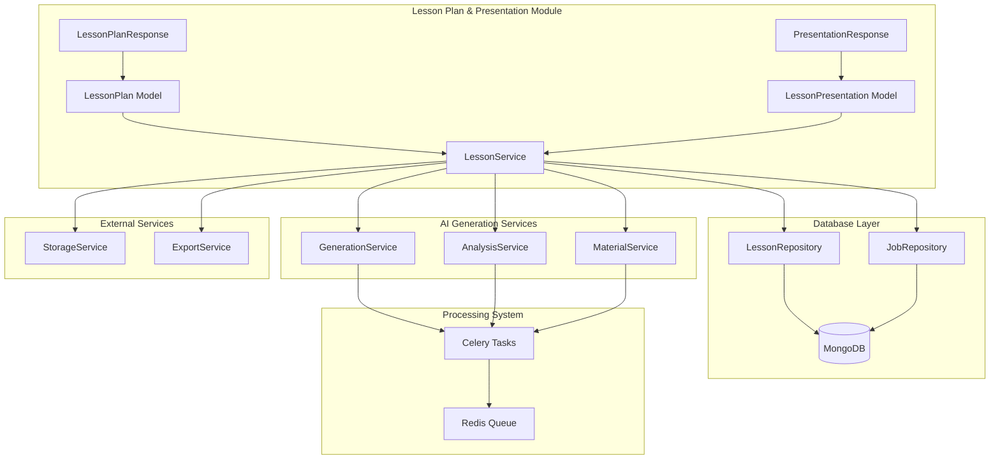
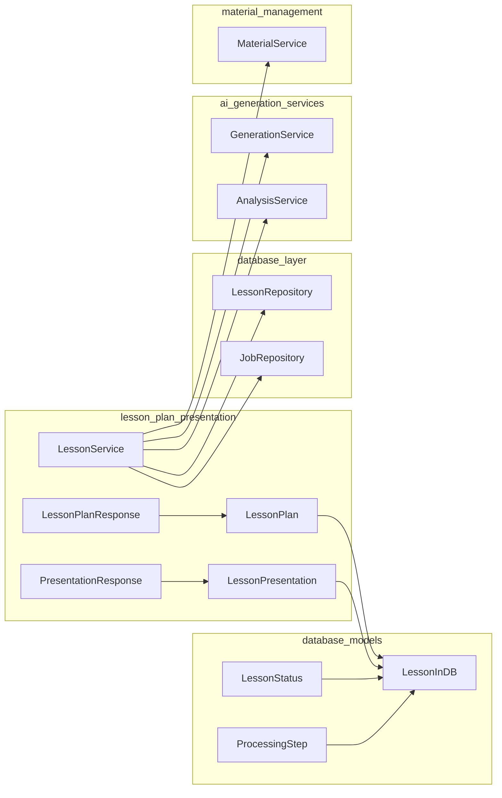
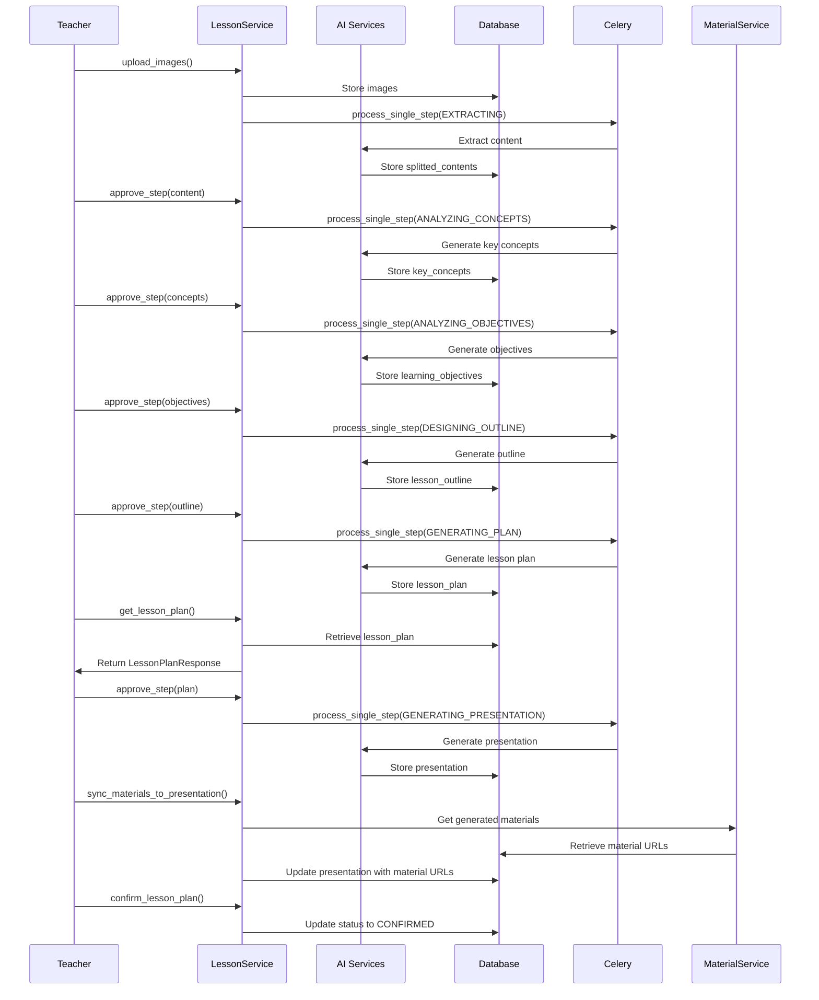
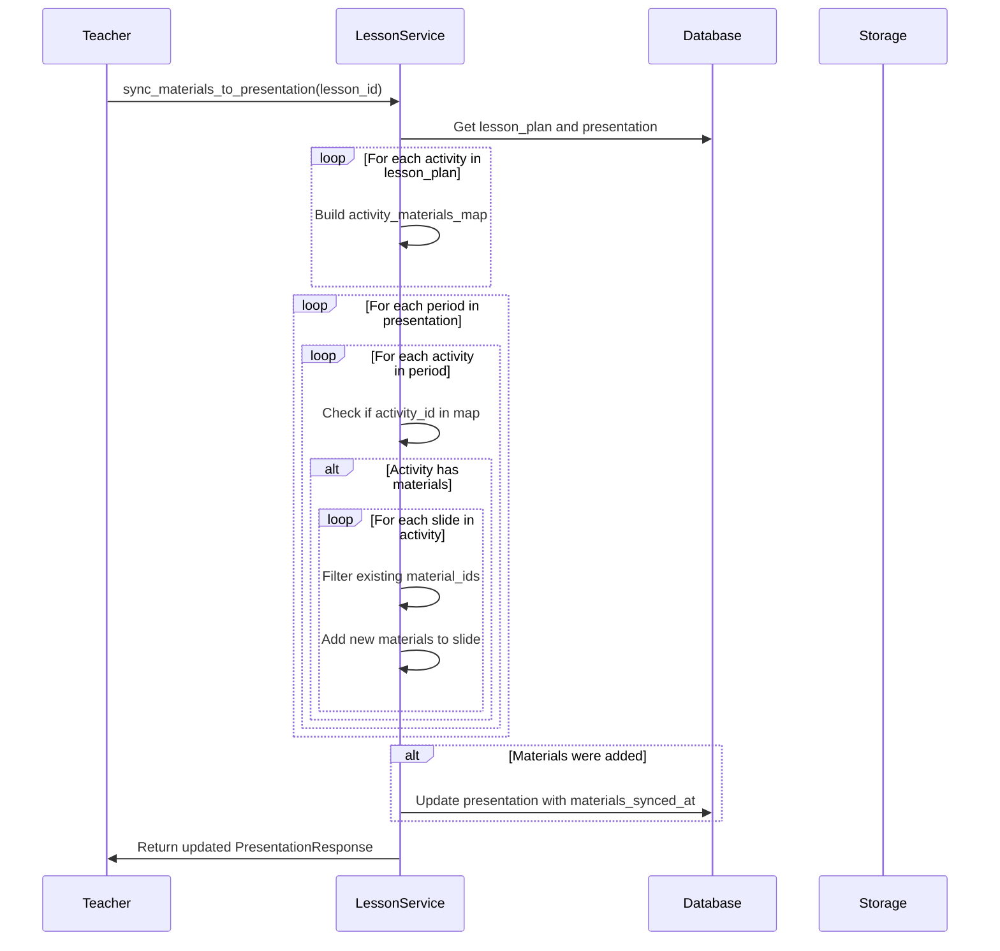
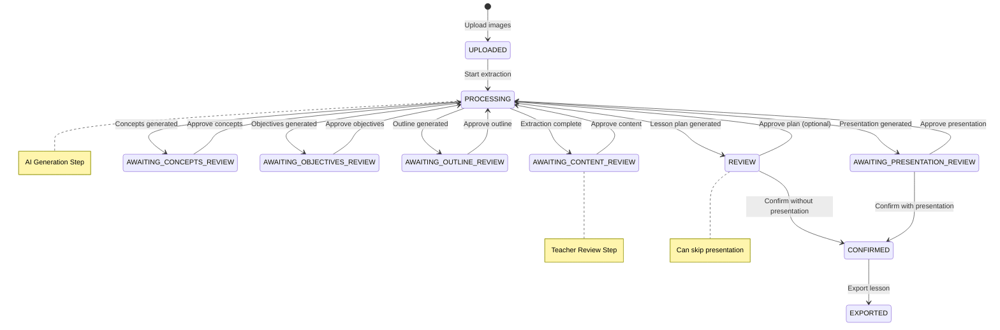
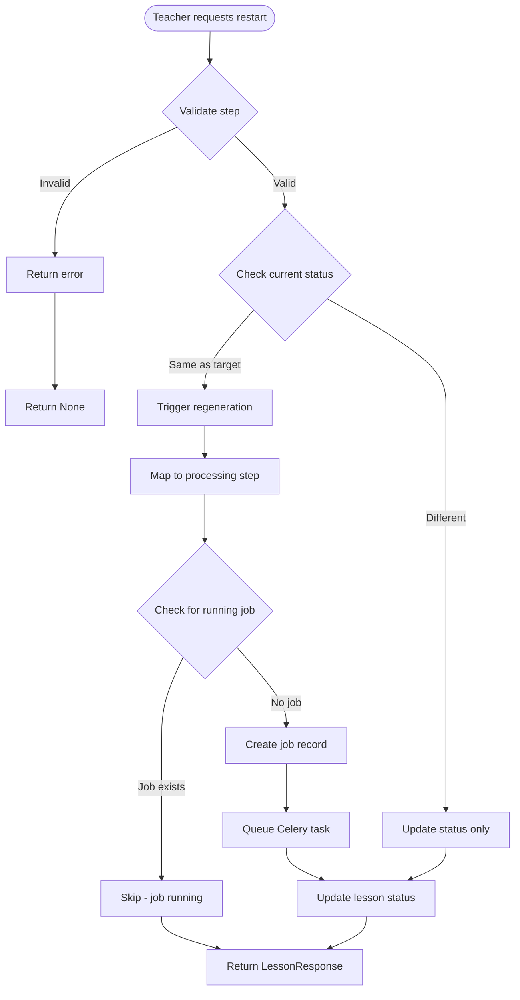
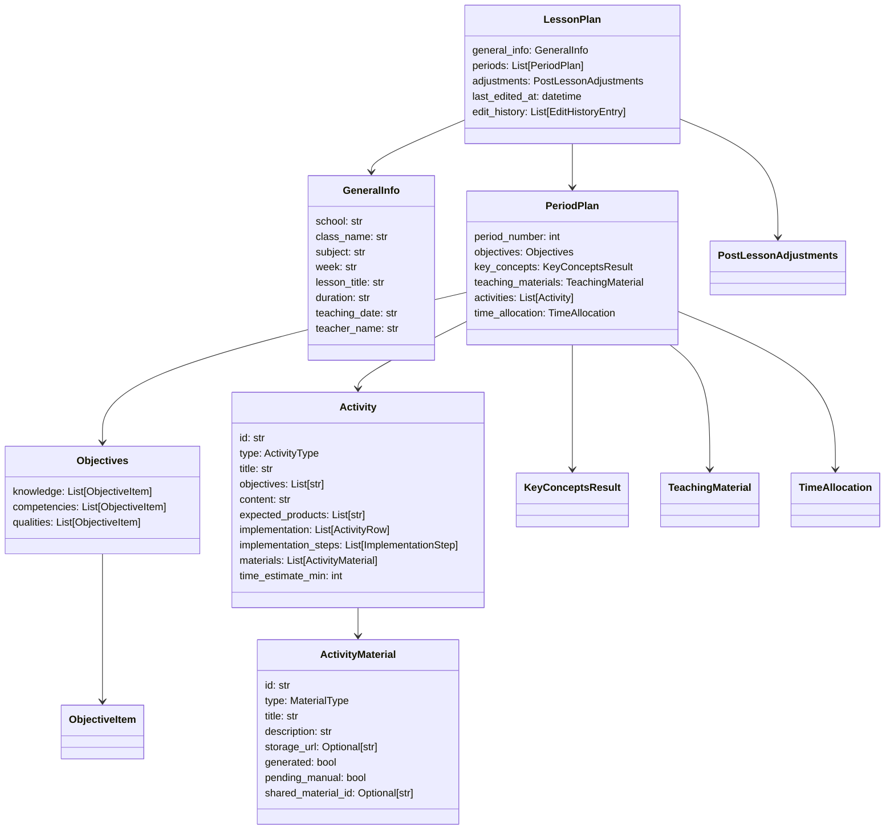
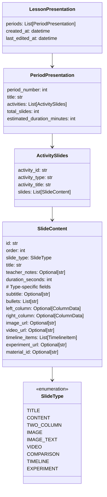

# Lesson Plan & Presentation Module

## Overview

The **Lesson Plan & Presentation** module is the final stage of the lesson creation pipeline, responsible for generating structured lesson plans and presentation slides from analyzed textbook content. It provides teachers with review, editing, and approval workflows, enabling them to refine AI-generated content before confirming lessons for export or sharing.

This module is part of the broader [Lesson Management System](lesson_management.md) and integrates closely with [AI Generation Services](ai_generation_services.md), [Database Layer](database_layer.md), and [Export Services](export_services.md).

## Core Functionality

### 1. Lesson Plan Generation
- Converts analyzed content into structured Vietnamese lesson plans
- Organizes content by class periods with time allocations
- Generates learning objectives, key concepts, and teaching activities
- Creates material requirements and implementation steps

### 2. Presentation Generation
- Transforms lesson plans into slide-based presentations
- Supports multiple slide templates (title, content, image, video, timeline, experiment)
- Syncs generated materials (images, animations, experiments) to slides
- Provides teacher notes and timing estimates

### 3. Teacher Review Workflow
- Step-by-step approval process: Content → Concepts → Objectives → Outline → Plan → Presentation
- Allows editing at each stage with regeneration capabilities
- Supports restart from any previous step with teacher feedback
- Tracks edit history and teacher comments

### 4. Lesson Sharing
- Generates secure share links with view/edit permissions
- Supports public lesson galleries for community sharing
- Enables collaborative editing via edit tokens
- Integrates with playground features for interactive content

## Core Components

### LessonService

The central service class that orchestrates all lesson plan and presentation operations. It provides methods for:

- **Lesson Management**: CRUD operations for lessons
- **Processing Control**: Starting, monitoring, and retrying lesson generation
- **Review Workflow**: Step approval, data retrieval, and updates
- **Presentation Management**: Generation, editing, and material synchronization
- **Sharing**: Link generation, revocation, and public access

### LessonPlan Model

A comprehensive data structure representing a complete Vietnamese lesson plan:

```python
class LessonPlan(BaseModel):
    general_info: GeneralInfo          # School, class, teacher details
    periods: list[PeriodPlan]          # Per-period lesson structures
    adjustments: PostLessonAdjustments # Post-lesson reflection notes
    last_edited_at: Optional[datetime]
    edit_history: list[EditHistoryEntry]
```

Each `PeriodPlan` contains:
- Learning objectives (knowledge, competencies, qualities)
- Key concepts and formulas
- Teaching materials list
- Activities with implementation steps
- Time allocation estimates

### LessonPresentation Model

Represents slide-based presentations for classroom delivery:

```python
class LessonPresentation(BaseModel):
    periods: list[PeriodPresentation]  # Slides organized by period
    created_at: Optional[datetime]
    last_edited_at: Optional[datetime]
```

Each `PeriodPresentation` contains:
- Activity-based slide groups
- Template-based slide content (title, content, image, video, timeline, experiment)
- Teacher notes and duration estimates
- Material references for synchronization

## Architecture

### System Integration



### Component Dependencies



## Data Flow

### Lesson Processing Pipeline



### Material Synchronization Flow



## Process Flows

### Teacher Review and Approval Workflow



### Restart from Step Process



## Key Service Methods

### Lesson Plan Operations

```python
# Retrieve lesson plan
async def get_lesson_plan(
    self, 
    lesson_id: str, 
    teacher_id: str
) -> Optional[LessonPlanResponse]

# Update lesson plan with teacher edits
async def update_lesson_plan(
    self, 
    lesson_id: str, 
    teacher_id: str, 
    request: UpdateLessonPlanRequest
) -> Optional[LessonPlanResponse]

# Confirm lesson plan for export
async def confirm_lesson_plan(
    self, 
    lesson_id: str, 
    teacher_id: str
) -> Optional[LessonResponse]
```

### Presentation Operations

```python
# Retrieve presentation
async def get_presentation(
    self, 
    lesson_id: str, 
    teacher_id: str
) -> Optional[PresentationResponse]

# Update presentation slides
async def update_presentation(
    self, 
    lesson_id: str, 
    teacher_id: str, 
    request: UpdatePresentationRequest
) -> Optional[PresentationResponse]

# Sync materials from lesson plan to presentation
async def sync_materials_to_presentation(
    self, 
    lesson_id: str, 
    teacher_id: str
) -> Optional[PresentationResponse]
```

### Review Workflow Operations

```python
# Get current step data for review
async def get_step_data(
    self, 
    lesson_id: str, 
    teacher_id: str
) -> Optional[StepDataResponse]

# Approve current step and trigger next step
async def approve_step(
    self, 
    lesson_id: str, 
    teacher_id: str,
    comment: Optional[str] = None,
    skip_auto_animations: bool = False
) -> Optional[ApproveStepResponse]

# Restart processing from a specific step
async def restart_from_step(
    self, 
    lesson_id: str, 
    teacher_id: str,
    step: str,
    comment: Optional[str] = None
) -> Optional[LessonResponse]
```

### Sharing Operations

```python
# Create share link for lesson
async def create_share_link(
    self, 
    lesson_id: str, 
    teacher_id: str, 
    base_url: str
) -> Optional[ShareLinkResponse]

# Get shared lesson by token (public access)
async def get_shared_lesson(
    self, 
    share_token: str
) -> Optional[SharedLessonResponse]

# Update shared lesson via edit token
async def update_shared_lesson(
    self, 
    edit_token: str, 
    updates: dict
) -> Optional[SharedLessonResponse]
```

## Data Models

### LessonPlan Structure



### LessonPresentation Structure



## Integration Points

### Database Layer

The module relies on [LessonRepository](database_layer.md) and [JobRepository](database_layer.md) for:

- **Lesson CRUD**: Create, read, update, and delete lesson documents
- **Status Management**: Track processing status and current step
- **Analysis Results**: Store and retrieve extracted content, concepts, objectives, and outlines
- **Job Tracking**: Monitor Celery task progress and timing
- **Sharing**: Manage share tokens and public visibility

### AI Generation Services

Integrates with [AI Generation Services](ai_generation_services.md) for:

- **Content Extraction**: Split textbook content by periods
- **Concept Analysis**: Identify key concepts and formulas
- **Objective Generation**: Create learning objectives by cognitive level
- **Outline Design**: Structure lesson activities and flow
- **Plan Generation**: Compile complete lesson plans
- **Presentation Creation**: Generate slide-based presentations

### Material Management

Works with [Material Management](material_management.md) to:

- **Generate Teaching Materials**: Create images, animations, and experiments
- **Sync Materials**: Update presentation slides with generated content URLs
- **Manual Selection**: Allow teachers to choose materials from libraries
- **Status Tracking**: Monitor material generation progress

### Export Services

Coordinates with [Export Services](export_services.md) for:

- **Document Export**: Convert lesson plans to DOCX/PDF formats
- **Presentation Export**: Generate PowerPoint or PDF slide decks
- **Final Confirmation**: Mark lessons as exported after successful generation

## Configuration

### Status Mappings

```python
# Mapping from status to step name for display
STATUS_TO_STEP = {
    LessonStatus.AWAITING_CONTENT_REVIEW.value: "content",
    LessonStatus.AWAITING_CONCEPTS_REVIEW.value: "concepts",
    LessonStatus.AWAITING_OBJECTIVES_REVIEW.value: "objectives",
    LessonStatus.AWAITING_OUTLINE_REVIEW.value: "outline",
    LessonStatus.REVIEW.value: "plan",
    LessonStatus.AWAITING_PRESENTATION_REVIEW.value: "presentation",
}

# Mapping for next step after approval
NEXT_STEP_MAP = {
    LessonStatus.AWAITING_CONTENT_REVIEW.value: ProcessingStep.ANALYZING_CONCEPTS.value,
    LessonStatus.AWAITING_CONCEPTS_REVIEW.value: ProcessingStep.ANALYZING_OBJECTIVES.value,
    LessonStatus.AWAITING_OBJECTIVES_REVIEW.value: ProcessingStep.DESIGNING_OUTLINE.value,
    LessonStatus.AWAITING_OUTLINE_REVIEW.value: ProcessingStep.GENERATING_PLAN.value,
    LessonStatus.REVIEW.value: ProcessingStep.GENERATING_PRESENTATION.value,
    LessonStatus.CONFIRMED.value: ProcessingStep.GENERATING_PRESENTATION.value,
    LessonStatus.EXPORTED.value: ProcessingStep.GENERATING_PRESENTATION.value,
}
```

### Processing Steps

The module follows a sequential processing pipeline:

1. **EXTRACTING**: Split textbook content by periods
2. **ANALYZING_CONCEPTS**: Extract key concepts and formulas
3. **ANALYZING_OBJECTIVES**: Generate learning objectives
4. **DESIGNING_OUTLINE**: Create lesson activity outline
5. **GENERATING_PLAN**: Compile complete lesson plan
6. **GENERATING_PRESENTATION**: Create slide presentation (optional)

## Error Handling

The module implements comprehensive error handling:

- **Validation**: Check lesson existence, teacher ownership, and status validity
- **Idempotency**: Prevent duplicate job creation with running job checks
- **Graceful Degradation**: Allow skipping optional steps (e.g., presentation generation)
- **Status Recovery**: Retry failed processing from the point of failure
- **Teacher Feedback**: Capture comments for regeneration improvements

## Security Considerations

- **Authorization**: All operations verify teacher ownership via `teacher_id`
- **Token-based Sharing**: URL-safe tokens for view/edit access
- **Status Validation**: Ensure operations are allowed based on current lesson status
- **Public Access Control**: Separate endpoints for shared lessons without authentication

## Performance Optimizations

- **Async Operations**: All database and external service calls are asynchronous
- **Selective Updates**: Only update changed fields in documents
- **Material Caching**: Store base64 content temporarily for extraction
- **Progressive Loading**: Retrieve only necessary data for each step
- **Job Tracking**: Monitor processing status without polling

## Future Enhancements

Potential improvements for the module:

1. **Template System**: Customizable lesson plan and presentation templates
2. **Collaborative Editing**: Real-time multi-teacher editing capabilities
3. **Version Control**: Complete lesson version history and diff viewing
4. **Advanced Analytics**: Processing time metrics and teacher feedback analysis
5. **Integration APIs**: Connect with external LMS and content management systems
6. **Mobile Support**: Optimized interfaces for tablet-based classroom presentation