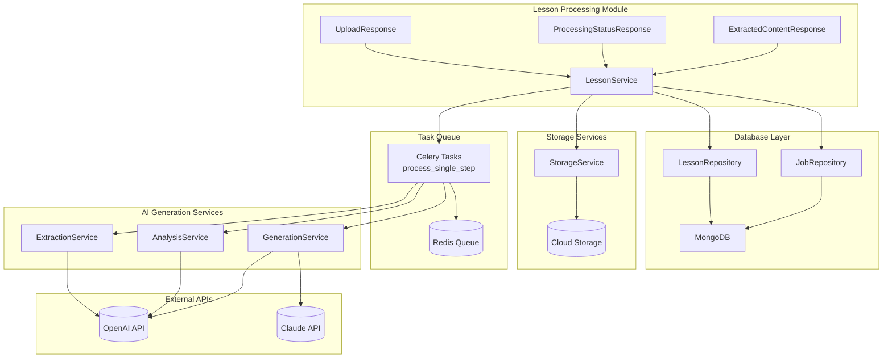
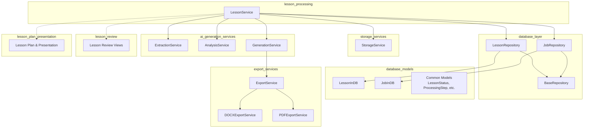
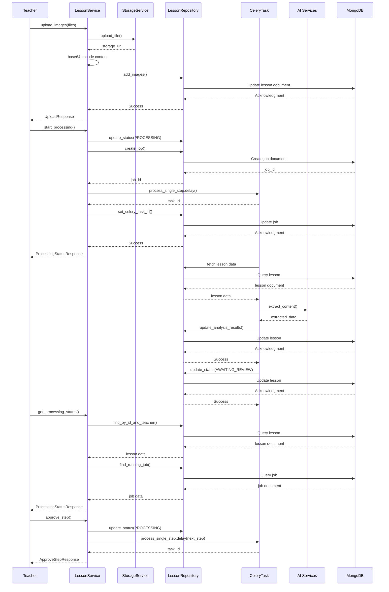
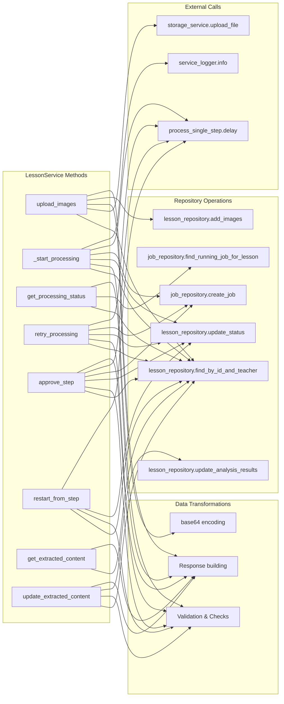

# Lesson Processing Module

## Introduction

The **Lesson Processing Module** is a core component of the educational content generation system, responsible for transforming uploaded textbook images into structured, AI-enhanced lesson plans. It orchestrates a multi-step pipeline that extracts content, analyzes educational concepts, generates learning objectives, designs lesson outlines, and produces comprehensive teaching materials including presentations and interactive content.

This module implements a teacher-in-the-loop workflow where each processing step can be reviewed, edited, and approved before proceeding to the next stage, ensuring pedagogical quality and alignment with curriculum standards.

## Architecture Overview



**Architecture Components:**

- **LessonService**: Central orchestrator that manages the entire lesson processing lifecycle
- **Repositories**: Data access layer for lessons and background jobs
- **StorageService**: Handles file uploads and permanent storage of images/materials
- **Celery Tasks**: Asynchronous processing of long-running AI operations
- **AI Services**: Specialized services for content extraction, analysis, and generation
- **External APIs**: Integration with LLM providers (OpenAI, Claude) for AI capabilities

## Core Components

### LessonService

The `LessonService` class is the primary interface for all lesson processing operations. It provides methods for:

- **Image Upload & Storage**: `upload_images()` handles multi-image uploads with base64 encoding for processing
- **Processing Orchestration**: `_start_processing()` initiates the step-by-step pipeline
- **Status Monitoring**: `get_processing_status()` provides real-time progress tracking
- **Error Recovery**: `retry_processing()` allows restarting from failed steps
- **Teacher Review**: Methods for retrieving and updating content at each processing stage

**Key Design Patterns:**

1. **Idempotent Operations**: All processing methods check for existing running jobs to prevent duplicate work
2. **Step-wise Progression**: Each processing step is atomic and can be independently retried
3. **Teacher-in-the-Loop**: Explicit approval required before advancing to next steps
4. **Status Tracking**: Comprehensive status and timing information for monitoring

### Processing Pipeline Flow

```mermaid
stateDiagram-v2
    [*] --> DRAFT: create_lesson()
    DRAFT --> UPLOADED: upload_images()
    UPLOADED --> PROCESSING: _start_processing()
    
    state PROCESSING {
        [*] --> EXTRACTING: process_single_step()
        EXTRACTING --> AWAITING_CONTENT_REVIEW: Complete
        AWAITING_CONTENT_REVIEW --> PROCESSING: approve_step()
        PROCESSING --> ANALYZING_CONCEPTS: process_single_step()
        ANALYZING_CONCEPTS --> AWAITING_CONCEPTS_REVIEW: Complete
        AWAITING_CONCEPTS_REVIEW --> PROCESSING: approve_step()
        PROCESSING --> ANALYZING_OBJECTIVES: process_single_step()
        ANALYZING_OBJECTIVES --> AWAITING_OBJECTIVES_REVIEW: Complete
        AWAITING_OBJECTIVES_REVIEW --> PROCESSING: approve_step()
        PROCESSING --> DESIGNING_OUTLINE: process_single_step()
        DESIGNING_OUTLINE --> AWAITING_OUTLINE_REVIEW: Complete
        AWAITING_OUTLINE_REVIEW --> PROCESSING: approve_step()
        PROCESSING --> GENERATING_PLAN: process_single_step()
        GENERATING_PLAN --> REVIEW: Complete
        REVIEW --> PROCESSING: approve_step() + generate_presentation
        PROCESSING --> GENERATING_PRESENTATION: process_single_step()
        GENERATING_PRESENTATION --> AWAITING_PRESENTATION_REVIEW: Complete
        AWAITING_PRESENTATION_REVIEW --> REVIEW: approve_step() or skip
    }
    
    REVIEW --> CONFIRMED: confirm_lesson_plan()
    AWAITING_PRESENTATION_REVIEW --> CONFIRMED: confirm_lesson_plan()
    CONFIRMED --> EXPORTED: mark_exported()
    
    PROCESSING --> FAILED: Error
    FAILED --> PROCESSING: retry_processing()
    
    REVIEW --> PROCESSING: restart_from_step()
    AWAITING_CONTENT_REVIEW --> PROCESSING: restart_from_step()
    AWAITING_CONCEPTS_REVIEW --> PROCESSING: restart_from_step()
    AWAITING_OBJECTIVES_REVIEW --> PROCESSING: restart_from_step()
    AWAITING_OUTLINE_REVIEW --> PROCESSING: restart_from_step()
    AWAITING_PRESENTATION_REVIEW --> PROCESSING: restart_from_step()
```

**Processing Steps:**

1. **EXTRACTING**: OCR and content extraction from uploaded textbook images
2. **ANALYZING_CONCEPTS**: AI analysis of key concepts, formulas, and terminology
3. **ANALYZING_OBJECTIVES**: Generation of learning objectives across knowledge, competencies, and qualities
4. **DESIGNING_OUTLINE**: Creation of structured lesson outline with activities and time allocation
5. **GENERATING_PLAN**: Compilation of complete lesson plan with all components
6. **GENERATING_PRESENTATION**: Creation of slide presentations for classroom delivery (optional)

## Dependencies



**Dependency Details:**

- **Database Layer**: Provides data persistence through MongoDB repositories
- **Storage Services**: Handles file uploads and cloud storage integration
- **AI Generation Services**: Powers the content extraction and generation pipeline
- **Export Services**: Enables final lesson plan export to DOCX/PDF formats
- **Lesson Review**: UI components for teacher review and approval
- **Lesson Plan Presentation**: Final lesson plan and presentation generation

## Data Flow



## Component Interactions



## Key Features

### 1. **Step-wise Processing with Teacher Review**

Each processing step generates content that teachers can review and edit before approval:

- **Content Extraction**: Review OCR results and period segmentation
- **Concept Analysis**: Verify extracted key concepts and formulas
- **Objective Generation**: Review and refine learning objectives
- **Outline Design**: Adjust activity structure and time allocation
- **Lesson Plan**: Edit final lesson plan before confirmation
- **Presentation**: Review generated slides (optional step)

### 2. **Idempotent Operations**

All processing operations are idempotent to prevent duplicate work:

```python
# Check for existing running job before starting new processing
existing_job = await job_repository.find_running_job_for_lesson(lesson_id)
if existing_job:
    service_logger.info(f"Job already running for lesson {lesson_id}")
    return await self.get_processing_status(lesson_id, teacher_id)
```

### 3. **Flexible Restart Mechanism**

Teachers can restart processing from any previous step:

```python
# Restart from specific step with optional comment
await lesson_service.restart_from_step(
    lesson_id=lesson_id,
    teacher_id=teacher_id,
    step="concepts",  # content, concepts, objectives, outline, plan
    comment="Need to adjust key concepts based on curriculum changes"
)
```

### 4. **Comprehensive Status Tracking**

Real-time monitoring of processing progress:

- Current processing step and progress percentage
- Elapsed time and step-specific timings
- Generation status for different material types (images, HTML, video)
- Error messages and failure reasons
- Phase completion timestamps

### 5. **Animation Handling**

Special handling for animation materials in lesson outlines:

```python
# Check for animations when approving outline
animation_info = await self.check_outline_animations(lesson_id, teacher_id)
if animation_info.has_animations:
    # Allow manual selection vs automatic generation
    animations_mode = "manual" if skip_auto_animations else "auto"
```

## Data Models

### ProcessingStatusResponse

Tracks the complete processing state of a lesson:

```python
class ProcessingStatusResponse(BaseModel):
    lesson_id: str
    status: str  # DRAFT, UPLOADED, PROCESSING, AWAITING_*_REVIEW, REVIEW, CONFIRMED, EXPORTED, FAILED
    current_step: Optional[str]  # EXTRACTING, ANALYZING_CONCEPTS, etc.
    progress_percent: int  # 0-100 based on step progression
    error_message: Optional[str]
    elapsed_seconds: Optional[int]  # Total processing time
    lesson_plan_ready: bool
    materials_generating: bool
    # Phase-specific generation status
    image_generating: bool
    html_generating: bool
    video_generating: bool
    # Phase completion timestamps
    image_completed_at: Optional[datetime]
    html_completed_at: Optional[datetime]
    materials_completed_at: Optional[datetime]
    step_timings: Dict[str, StepTimingInfo]  # Per-step timing details
```

### UploadResponse

Response after successful image upload:

```python
class UploadResponse(BaseModel):
    lesson_id: str
    images_uploaded: int
    status: str  # UPLOADED
    message: str  # Success message with processing start notification
```

### ExtractedContentResponse

Content extracted from textbook images:

```python
class ExtractedContentResponse(BaseModel):
    lesson_id: str
    splitted_contents: list[SplittedContent]  # Content segmented by period
    total_periods: int  # Number of teaching periods detected
```

## Error Handling & Recovery

### Failure Detection

Processing failures are captured at each step:

```python
# In Celery task
except Exception as e:
    await lesson_repository.update_status(
        lesson_id,
        LessonStatus.FAILED,
        current_step=step,
        error_message=str(e)
    )
    raise
```

### Retry Mechanism

Teachers can retry from the failed step:

```python
async def retry_processing(self, lesson_id: str, teacher_id: str):
    # Only allow retry for failed lessons
    if lesson["status"] != LessonStatus.FAILED.value:
        return None
    
    # Get the step that failed
    failed_step = lesson.get("current_step")
    
    # Restart processing from failed step
    return await self._restart_from_step(lesson_id, failed_step)
```

## Integration Points

### With Database Layer

- **LessonRepository**: CRUD operations for lessons, status updates, analysis results storage
- **JobRepository**: Background job tracking, Celery task ID management, step timing records

### With Storage Services

- **StorageService**: Uploads images to cloud storage, returns permanent URLs
- **Base64 Encoding**: Stores encoded content for direct AI processing without re-downloading

### With AI Generation Services

- **ExtractionService**: OCR and content extraction from images
- **AnalysisService**: Concept analysis, objective generation, outline design
- **GenerationService**: Lesson plan compilation, presentation generation, material creation

### With Task Queue

- **Celery**: Asynchronous processing of long-running AI operations
- **Redis**: Message broker for task distribution
- **process_single_step**: Atomic task for each processing step

## Performance Considerations

1. **Async Operations**: All I/O operations (database, storage, API calls) are async
2. **Background Processing**: AI operations run in Celery tasks to avoid blocking API
3. **Progressive Loading**: Status endpoints provide real-time feedback
4. **Efficient Storage**: Base64 encoding for processing, cloud URLs for permanent storage
5. **Step Timing**: Detailed timing information helps identify bottlenecks

## Security & Access Control

1. **Teacher Authorization**: All operations verify lesson ownership via `teacher_id`
2. **Status Validation**: Operations check valid status transitions
3. **Idempotency**: Prevents duplicate processing and race conditions
4. **Input Validation**: Pydantic models validate all request/response data

## References

- [Database Models](database_models.md) - Data structures and MongoDB schemas
- [Database Layer](database_layer.md) - Repository pattern implementation
- [Lesson Management](lesson_management.md) - Parent module overview
- [Lesson Review](lesson_review.md) - Teacher review and approval workflow
- [Lesson Plan Presentation](lesson_plan_presentation.md) - Final plan and slide generation
- [AI Generation Services](ai_generation_services.md) - Content extraction and generation
- [Storage Services](storage_services.md) - File upload and cloud storage
- [Export Services](export_services.md) - DOCX/PDF export functionality

## API Endpoints (via LessonService)

The following methods are exposed through the LessonService:

| Method | Purpose | Status Transition |
|--------|---------|-------------------|
| `upload_images()` | Upload textbook images | DRAFT → UPLOADED |
| `_start_processing()` | Begin processing pipeline | UPLOADED → PROCESSING |
| `get_processing_status()` | Check current progress | Any status |
| `retry_processing()` | Retry failed processing | FAILED → PROCESSING |
| `approve_step()` | Approve current step and continue | AWAITING_*_REVIEW → PROCESSING |
| `restart_from_step()` | Go back to previous step | Any → PROCESSING/AWAITING_*_REVIEW |
| `get_extracted_content()` | Review extracted content | AWAITING_CONTENT_REVIEW |
| `update_extracted_content()` | Edit extracted content | AWAITING_CONTENT_REVIEW |
| `start_extraction()` | Start only extraction step | UPLOADED → PROCESSING |

## Conclusion

The Lesson Processing Module is the engine that transforms raw textbook content into pedagogically sound, AI-enhanced lesson plans. Its step-wise architecture with teacher review points ensures quality while its asynchronous processing pipeline handles the computational complexity of AI operations. The module's design emphasizes flexibility, allowing teachers to review, edit, and restart processing at any stage, making it a powerful tool for educational content creation.