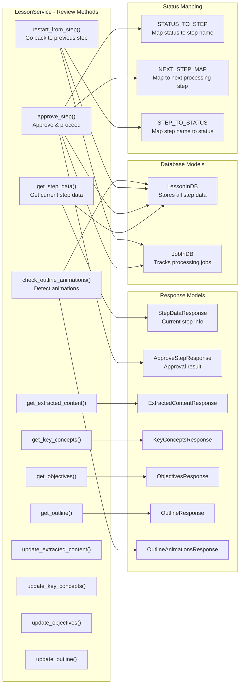
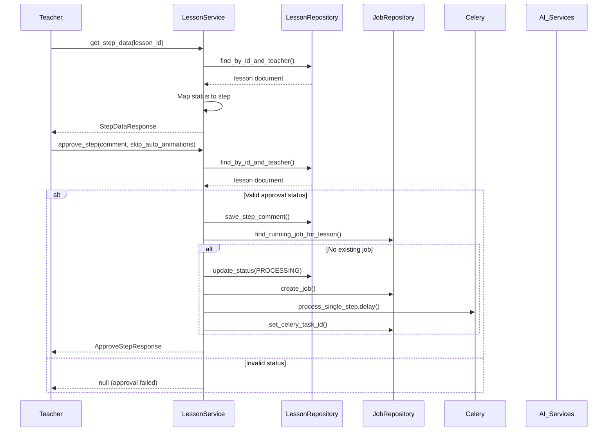
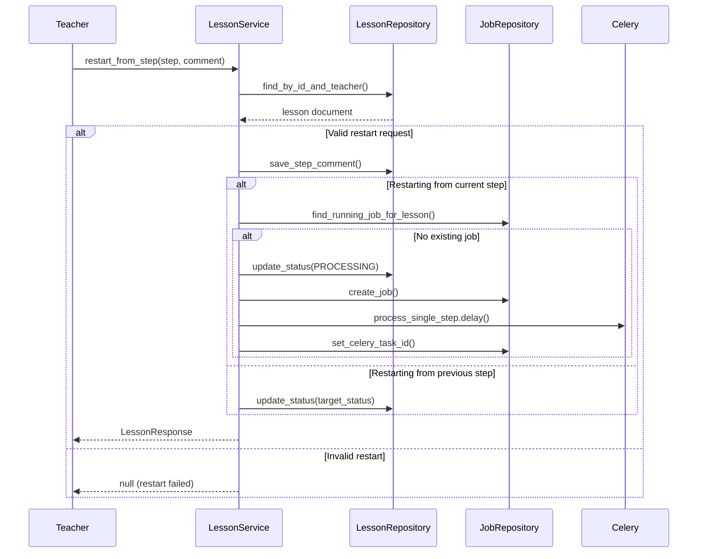
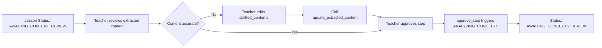
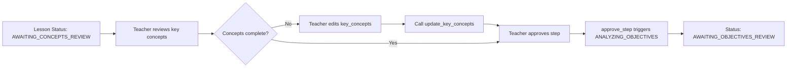
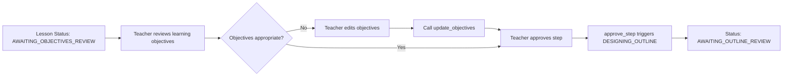
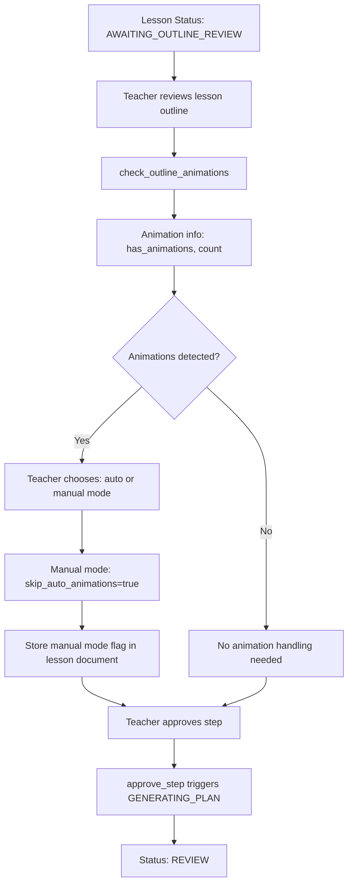
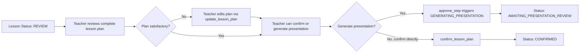

# Lesson Review Module

## Overview

The **Lesson Review Module** provides a step-by-step review and approval workflow for teachers to validate and refine AI-generated lesson content. It enables teachers to review extracted content, key concepts, learning objectives, lesson outlines, and presentations before final confirmation and export.

This module is a critical component of the lesson management system, ensuring teacher oversight and quality control throughout the lesson generation pipeline.

## Core Purpose

- **Step-by-step validation**: Teachers review AI-generated content at each processing stage
- **Quality control**: Ensures lesson content meets educational standards before use
- **Teacher empowerment**: Allows editing, feedback, and regeneration at any step
- **Flexible workflow**: Supports both linear progression and iterative refinement
- **Animation management**: Detects and handles animation materials with manual/auto modes

## Architecture

```mermaid
graph TB
    subgraph "Lesson Review Module"
        LS[LessonService<br/>lesson_review methods]
        
        subgraph "Review Step APIs"
            GSD[get_step_data]
            AS[approve_step]
            RFS[restart_from_step]
            COA[check_outline_animations]
        end
        
        subgraph "Content Retrieval APIs"
            GEC[get_extracted_content]
            GKC[get_key_concepts]
            GO[get_objectives]
            GOL[get_outline]
        end
        
        subgraph "Content Update APIs"
            UEC[update_extracted_content]
            UKC[update_key_concepts]
            UO[update_objectives]
            UOL[update_outline]
        end
        
        subgraph "Response Models"
            SDR[StepDataResponse]
            ASR[ApproveStepResponse]
            ECR[ExtractedContentResponse]
            KCR[KeyConceptsResponse]
            OR[ObjectivesResponse]
            OLR[OutlineResponse]
            OAR[OutlineAnimationsResponse]
        end
    end
    
    subgraph "Database Layer"
        LR[LessonRepository]
        JR[JobRepository]
    end
    
    subgraph "Processing System"
        PS[ProcessingStatusResponse]
        LSS[LessonStatus]
        PSS[ProcessingStep]
    end
    
    subgraph "Related Modules"
        LM[lesson_management]
        LP[lesson_processing]
        LPP[lesson_plan_presentation]
    end
    
    LS --> GSD
    LS --> AS
    LS --> RFS
    LS --> COA
    LS --> GEC
    LS --> GKC
    LS --> GO
    LS --> GOL
    LS --> UEC
    LS --> UKC
    LS --> UO
    LS --> UOL
    
    GSD --> SDR
    AS --> ASR
    GEC --> ECR
    GKC --> KCR
    GO --> OR
    GOL --> OLR
    COA --> OAR
    
    LS --> LR
    LS --> JR
    
    SDR --> PS
    ASR --> PS
    ASR --> LSS
    ASR --> PSS
    
    LS -.-> LM
    LS -.-> LP
    LS -.-> LPP
```



## Component Relationships



## Data Flow

### Step Review Flow



### Restart from Step Flow



## Review Step Process Flow

### Content Review Step



### Concepts Review Step



### Objectives Review Step



### Outline Review Step (with Animation Detection)



### Plan Review Step



## Key Features

### 1. Step-by-Step Review Workflow

The module implements a structured review process where teachers must approve each step before proceeding:

- **Content Review**: Validate AI-extracted textbook content
- **Concepts Review**: Review identified key concepts and formulas
- **Objectives Review**: Verify learning objectives are appropriate
- **Outline Review**: Check lesson structure and activity flow
- **Plan Review**: Review complete lesson plan before confirmation
- **Presentation Review**: (Optional) Review generated presentation slides

### 2. Edit and Refinement

Teachers can edit generated content at any review step:

```python
# Example: Updating extracted content
await lesson_service.update_extracted_content(
    lesson_id="lesson_123",
    teacher_id="teacher_456",
    request=UpdateExtractedContentRequest(
        splitted_contents=[
            SplittedContent(
                period_number=1,
                start_line=0,
                end_line=50,
                period_content="Edited content for period 1"
            )
        ]
    )
)
```

### 3. Restart from Any Step

Teachers can restart processing from any previous step, providing feedback for improvement:

```python
# Example: Restart from concepts step with feedback
await lesson_service.restart_from_step(
    lesson_id="lesson_123",
    teacher_id="teacher_456",
    step="concepts",
    comment="Please focus more on quadratic equations and provide more examples"
)
```

### 4. Animation Detection and Mode Selection

When reviewing outlines, the system detects animation materials and allows teachers to choose:

- **Automatic Mode**: AI generates animations automatically
- **Manual Mode**: Teacher manually selects/creates animations in LessonPlanView

```python
# Example: Approve outline with manual animation mode
await lesson_service.approve_step(
    lesson_id="lesson_123",
    teacher_id="teacher_456",
    skip_auto_animations=True  # Enable manual mode
)
```

### 5. Comment and Feedback System

Teachers can add comments at each step to guide AI regeneration:

```python
# Comments are stored in lesson document
lesson_document = {
    "step_comments": {
        "content": "Please extract more detailed formulas",
        "concepts": "Add more visual concept descriptions",
        "objectives": "Focus on higher-order thinking skills",
        "outline": "Include more group activities"
    }
}
```

## API Methods

### Get Current Step Data

```python
async def get_step_data(
    self,
    lesson_id: str,
    teacher_id: str,
) -> Optional[StepDataResponse]
```

Retrieves the current step data based on lesson status.

**Returns:**
- `current_step`: Name of the current step (content, concepts, objectives, outline, plan, presentation)
- `step_data`: The actual data for review (content, concepts, objectives, outline, or plan)
- `can_edit`: Whether teacher can edit the content
- `next_step`: The next processing step that will be triggered after approval

### Approve Step

```python
async def approve_step(
    self,
    lesson_id: str,
    teacher_id: str,
    comment: Optional[str] = None,
    skip_auto_animations: bool = False,
) -> Optional[ApproveStepResponse]
```

Approves the current step and triggers the next processing step.

**Parameters:**
- `comment`: Optional feedback for the current step
- `skip_auto_animations`: If True, skip automatic animation generation (outline step only)

**Returns:**
- `approved_step`: The step that was approved
- `next_step`: The next processing step
- `status`: Current lesson status
- `has_animations`: Whether animations were detected (outline step only)
- `animation_count`: Number of animations detected
- `animations_mode`: "auto" or "manual" mode

### Restart from Step

```python
async def restart_from_step(
    self,
    lesson_id: str,
    teacher_id: str,
    step: str,
    comment: Optional[str] = None,
) -> Optional[LessonResponse]
```

Restarts lesson processing from a specific step.

**Parameters:**
- `step`: Step to restart from (content, concepts, objectives, outline, plan)
- `comment`: Feedback for improving regeneration

**Behavior:**
- If restarting from current step: Triggers regeneration via Celery task
- If restarting from previous step: Updates status to that step for re-approval

### Check Outline Animations

```python
async def check_outline_animations(
    self,
    lesson_id: str,
    teacher_id: str,
) -> Optional[OutlineAnimationsResponse]
```

Checks if the lesson outline contains animation materials.

**Returns:**
- `has_animations`: Boolean indicating presence of animations
- `animation_count`: Total number of animation materials
- `animations`: List of animation details (period, activity, description)

## Status Mapping

The module uses several mapping dictionaries to manage the review workflow:

```python
# Map status to step name for display
STATUS_TO_STEP = {
    LessonStatus.AWAITING_CONTENT_REVIEW.value: "content",
    LessonStatus.AWAITING_CONCEPTS_REVIEW.value: "concepts",
    LessonStatus.AWAITING_OBJECTIVES_REVIEW.value: "objectives",
    LessonStatus.AWAITING_OUTLINE_REVIEW.value: "outline",
    LessonStatus.REVIEW.value: "plan",
    LessonStatus.AWAITING_PRESENTATION_REVIEW.value: "presentation",
}

# Map for next step after approval
NEXT_STEP_MAP = {
    LessonStatus.AWAITING_CONTENT_REVIEW.value: ProcessingStep.ANALYZING_CONCEPTS.value,
    LessonStatus.AWAITING_CONCEPTS_REVIEW.value: ProcessingStep.ANALYZING_OBJECTIVES.value,
    LessonStatus.AWAITING_OBJECTIVES_REVIEW.value: ProcessingStep.DESIGNING_OUTLINE.value,
    LessonStatus.AWAITING_OUTLINE_REVIEW.value: ProcessingStep.GENERATING_PLAN.value,
    LessonStatus.REVIEW.value: ProcessingStep.GENERATING_PRESENTATION.value,
    LessonStatus.CONFIRMED.value: ProcessingStep.GENERATING_PRESENTATION.value,
    LessonStatus.EXPORTED.value: ProcessingStep.GENERATING_PRESENTATION.value,
}

# Map from step name to status (for restart functionality)
STEP_TO_STATUS = {
    "content": LessonStatus.AWAITING_CONTENT_REVIEW,
    "concepts": LessonStatus.AWAITING_CONCEPTS_REVIEW,
    "objectives": LessonStatus.AWAITING_OBJECTIVES_REVIEW,
    "outline": LessonStatus.AWAITING_OUTLINE_REVIEW,
    "plan": LessonStatus.REVIEW,
    "presentation": LessonStatus.AWAITING_PRESENTATION_REVIEW,
}
```

## Integration with Related Modules

### lesson_management
The review module is part of the broader lesson management system. It shares the `LessonService` class and depends on the core lesson CRUD operations.

**References:**
- [Lesson Management](lesson_management.md) - Parent module documentation
- [Lesson Core](lesson_core.md) - Core lesson operations
- [Lesson Processing](lesson_processing.md) - Processing pipeline integration

### lesson_processing
The review module triggers processing steps via the Celery task system. When a teacher approves a step, it queues the next processing task.

**Integration Points:**
- `process_single_step.delay(lesson_id, job_id, next_step)` - Queues next processing step
- `JobRepository` - Tracks processing jobs and prevents duplicates
- `ProcessingStep` enum - Defines available processing steps

### lesson_plan_presentation
After plan review, teachers can optionally generate presentation slides. The review module handles the approval flow that triggers presentation generation.

**Flow:**
1. Teacher reviews complete lesson plan (REVIEW status)
2. Teacher can approve to generate presentation (triggers GENERATING_PRESENTATION)
3. Or teacher can confirm directly (skips presentation, goes to CONFIRMED)

**References:**
- [Lesson Plan Presentation](lesson_plan_presentation.md) - Presentation generation details

## Data Models

### StepDataResponse

```python
class StepDataResponse(BaseModel):
    lesson_id: str
    current_step: str  # "content", "concepts", "objectives", "outline", "plan", "presentation"
    step_data: dict  # Contains data specific to current step
    can_edit: bool = True
    next_step: Optional[str] = None  # Next ProcessingStep value
```

### ApproveStepResponse

```python
class ApproveStepResponse(BaseModel):
    lesson_id: str
    approved_step: str
    next_step: Optional[str]
    status: str
    message: str
    has_animations: bool = False  # Outline step only
    animation_count: int = 0  # Outline step only
    animations_mode: Optional[str] = None  # "auto" or "manual"
```

### OutlineAnimationsResponse

```python
class OutlineAnimationsResponse(BaseModel):
    lesson_id: str
    has_animations: bool
    animation_count: int
    animations: list[AnimationMaterialInfo]  # Details about each animation
```

## Error Handling

The module includes several validation checks:

1. **Authorization Check**: All methods verify teacher ownership via `find_by_id_and_teacher()`
2. **Status Validation**: Approval only allowed from specific statuses
3. **Idempotency**: Prevents duplicate job creation via `find_running_job_for_lesson()`
4. **Step Validation**: Restart only allowed from valid previous steps

**Error Responses:**
- Returns `null` or `None` for invalid operations
- Logs warnings for invalid status transitions
- Prevents unauthorized access to lessons

## Usage Examples

### Complete Review Workflow

```python
# 1. Get current step data
step_data = await lesson_service.get_step_data(lesson_id, teacher_id)
print(f"Current step: {step_data.current_step}")

# 2. Review and edit if needed
if step_data.current_step == "content":
    content = await lesson_service.get_extracted_content(lesson_id, teacher_id)
    # Make edits...
    await lesson_service.update_extracted_content(lesson_id, teacher_id, updated_content)

# 3. Approve step with comment
result = await lesson_service.approve_step(
    lesson_id,
    teacher_id,
    comment="Content looks good, proceed to concepts analysis"
)

# 4. Check for animations at outline step
if result.has_animations:
    print(f"Found {result.animation_count} animations")
    if result.animations_mode == "manual":
        print("Manual animation mode enabled")

# 5. Restart if needed
await lesson_service.restart_from_step(
    lesson_id,
    teacher_id,
    step="concepts",
    comment="Need more detailed concept explanations"
)
```

## Conclusion

The Lesson Review Module provides a robust, teacher-centric workflow for validating AI-generated lesson content. By enabling step-by-step review, editing, and iterative refinement, it ensures high-quality lesson plans while maintaining teacher control over the educational content.

The module's flexible design supports both linear progression and iterative improvement, making it suitable for various teaching styles and quality requirements. Integration with the processing pipeline and related modules creates a seamless experience from content upload to final lesson confirmation.

For more information about related functionality, see:
- [Lesson Management](lesson_management.md) - Overall lesson management
- [Lesson Processing](lesson_processing.md) - Background processing pipeline
- [Lesson Plan Presentation](lesson_plan_presentation.md) - Presentation generation
- [Database Models](database_models.md) - Data structures
- [Database Layer](database_layer.md) - Repository operations