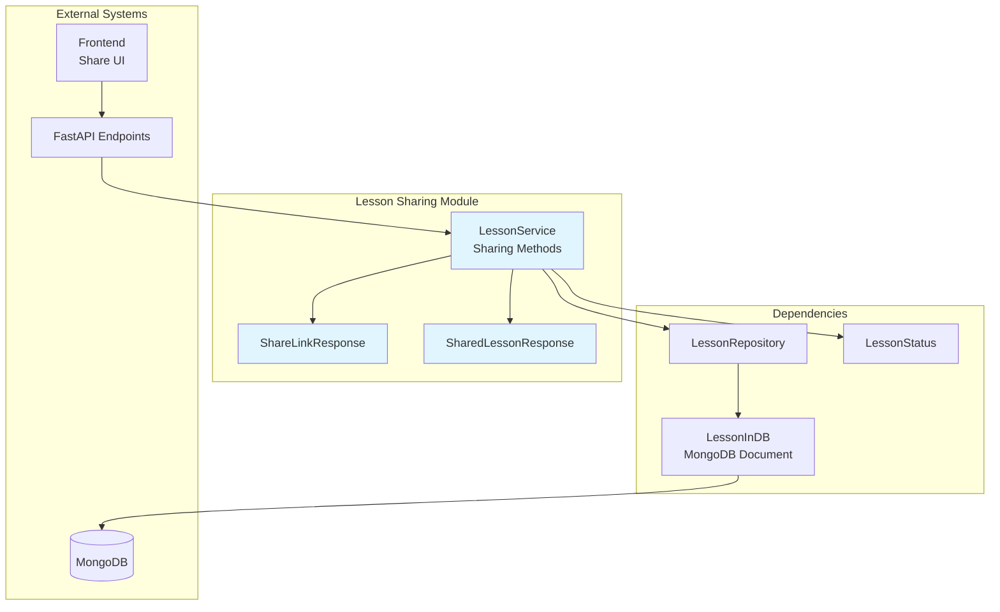
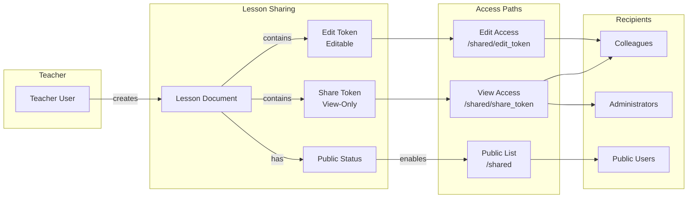
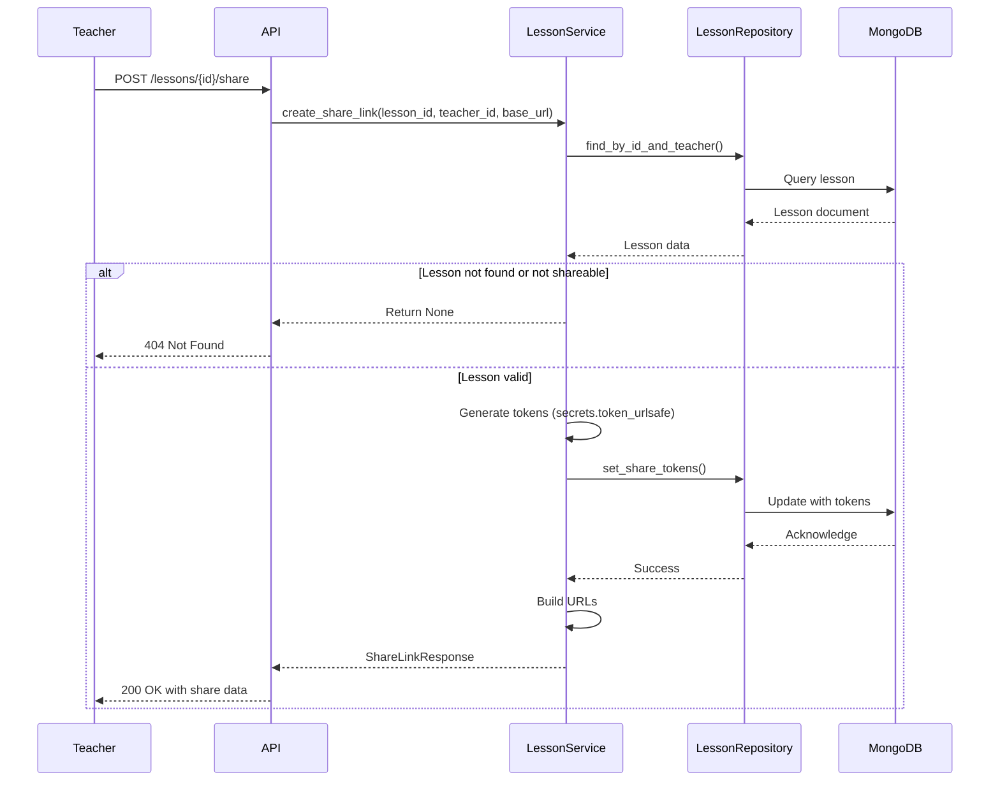
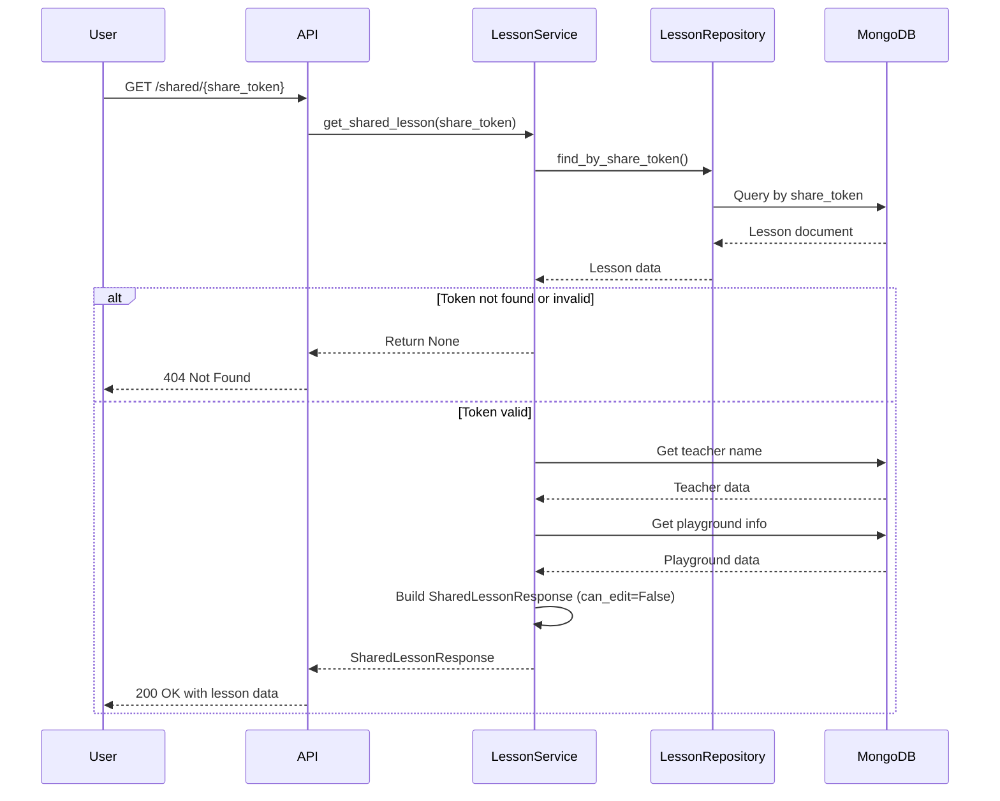
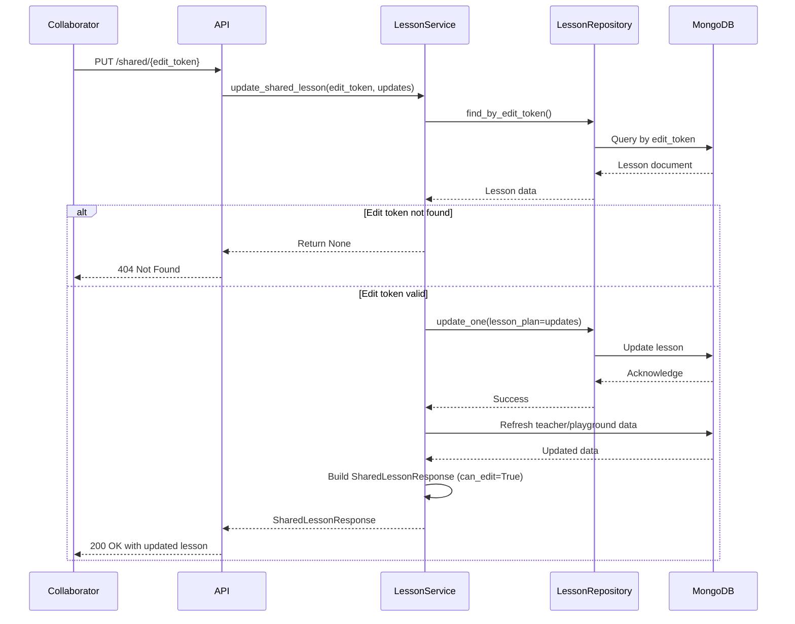
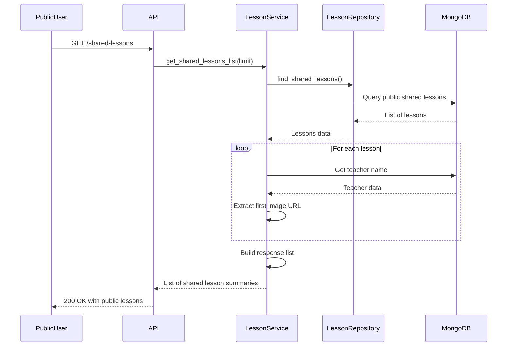
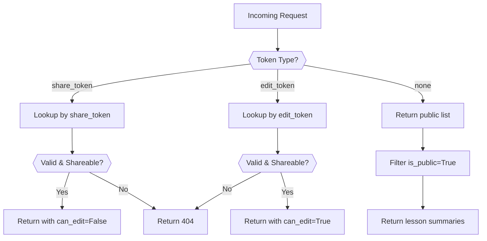
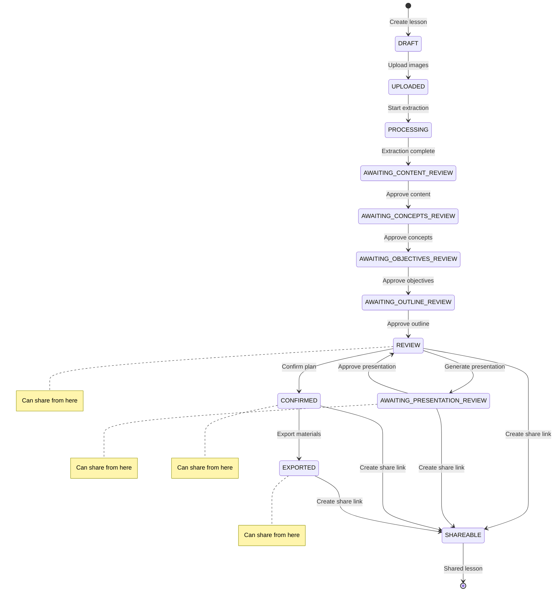
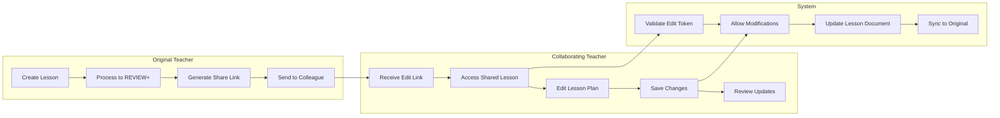

# Lesson Sharing Module

## Overview

The Lesson Sharing module provides secure, token-based sharing capabilities for lesson plans, enabling teachers to share their work with colleagues, administrators, or the public. It supports both view-only and edit access modes, allowing for collaborative lesson planning while maintaining content control.

## Purpose and Core Functionality

The module enables:
- **Secure Sharing**: Generate unique, cryptographically secure tokens for lesson access
- **Dual Access Modes**: Separate view-only and edit tokens for different permission levels
- **Public Discovery**: Share lessons on a public landing page for broader access
- **Collaborative Editing**: Allow authorized users to modify shared lesson plans
- **Access Control**: Revoke sharing permissions at any time
- **Integration**: Seamlessly works with the complete lesson lifecycle from processing to presentation

## Architecture

### Component Structure



### Token-Based Security Model



## Core Components

### LessonService Sharing Methods

The sharing functionality is integrated into the main `LessonService` class ([lesson_management](lesson_management.md) module). Key methods include:

#### Share Link Management

- **`create_share_link()`**: Generates new share and edit tokens for a lesson
- **`get_share_link()`**: Retrieves existing share links
- **`revoke_share_link()`**: Removes sharing permissions
- **`toggle_public()`**: Controls public listing visibility

#### Shared Lesson Access

- **`get_shared_lesson()`**: Public access to shared lessons (no authentication required)
- **`update_shared_lesson()`**: Allows editing via edit token
- **`get_shared_lessons_list()`**: Retrieves public lessons for landing page display

### Data Models

#### ShareLinkResponse

```python
class ShareLinkResponse(BaseModel):
    lesson_id: str
    share_token: str           # View-only access token
    share_url: str             # Full URL for view access
    edit_token: Optional[str]  # Edit access token
    edit_url: Optional[str]    # Full URL for edit access
    created_at: Optional[datetime]
```

**Purpose**: Encapsulates all sharing information for a lesson, providing both view and edit access credentials.

#### SharedLessonResponse

```python
class SharedLessonResponse(BaseModel):
    id: str
    metadata: LessonMetadata
    lesson_plan: Optional[LessonPlan]
    presentation: Optional[LessonPresentation]
    playground: Optional[SharedPlaygroundInfo]
    teacher_name: Optional[str]
    can_edit: bool            # True if accessed via edit_token
    created_at: datetime
```

**Purpose**: Public-facing lesson representation that includes teacher information and playground data while respecting access permissions.

## Process Flows

### Creating a Share Link



### Accessing a Shared Lesson (View Mode)



### Editing a Shared Lesson



### Public Lesson Listing



## Data Storage

### Lesson Document Sharing Fields

The sharing functionality extends the `LessonInDB` model with additional fields:

```python
class LessonInDB(MongoBaseModel):
    # ... existing fields ...
    
    # Sharing fields
    share_token: Optional[str] = None      # URL-safe token for view access
    edit_token: Optional[str] = None       # URL-safe token for edit access  
    share_created_at: Optional[datetime] = None
    is_public: bool = False                # Show on public landing page
    
    # Timestamps
    created_at: datetime
    updated_at: datetime
```

### Token Generation

Tokens are generated using Python's `secrets.token_urlsafe(12)`, producing:
- 16-character URL-safe strings
- Cryptographically secure random generation
- No personal data or predictable patterns
- Example: `dGhpcyBpcyBhIHRva2Vu` (base64url encoded)

## Security and Access Control

### Shareable Statuses

Lessons can only be shared when in specific statuses:

```python
shareable_statuses = [
    LessonStatus.REVIEW.value,                    # Lesson plan ready
    LessonStatus.AWAITING_PRESENTATION_REVIEW.value,  # Presentation generated
    LessonStatus.CONFIRMED.value,                 # Teacher confirmed
    LessonStatus.EXPORTED.value,                  # Fully exported
]
```

This ensures only completed or reviewable lessons are shared.

### Access Validation Flow



## Integration with Lesson Lifecycle

### Sharing in the Lesson Pipeline



### Collaborative Editing Workflow



## API Endpoints

The sharing functionality is typically exposed through these endpoint patterns:

### Teacher Endpoints (Authenticated)

```
POST   /api/v1/lessons/{lesson_id}/share      # Create share link
GET    /api/v1/lessons/{lesson_id}/share      # Get existing share link
DELETE /api/v1/lessons/{lesson_id}/share      # Revoke share link
PUT    /api/v1/lessons/{lesson_id}/public     # Toggle public status
```

### Public Endpoints (Unauthenticated)

```
GET    /shared/{token}                        # Access shared lesson
PUT    /shared/{edit_token}                   # Edit shared lesson
GET    /shared-lessons                        # List public lessons
```

## Dependencies

### Internal Modules

- **[lesson_management](lesson_management.md)**: Parent module containing `LessonService`
- **[database_layer](database_layer.md)**: Provides `LessonRepository` for data access
- **[database_models](database_models.md)**: Defines `LessonInDB`, `LessonStatus`, and response models
- **[authentication](authentication.md)**: Teacher authorization for share management

### External Services

- **MongoDB**: Stores lesson documents with sharing tokens and status
- **Storage Service**: Provides URLs for lesson materials and images
- **Frontend**: Renders shared lesson views and public listing

## Key Features

### 1. Dual Token System
- **View Token**: Read-only access to lesson content
- **Edit Token**: Full editing capabilities for collaborative work
- Independent revocation and regeneration

### 2. Public Discovery
- Lessons marked `is_public=True` appear on landing page
- Curated showcase of quality lesson plans
- Teacher attribution and metadata display

### 3. Smart Image Selection
- Prioritizes AI-generated materials over textbook scans
- Automatic fallback to uploaded images
- Consistent preview experience

### 4. Playground Integration
- Includes interactive quiz/flashcard data when available
- Shows usage statistics (attempts, average score)
- Enables complete lesson experience sharing

### 5. Status-Aware Sharing
- Prevents sharing of incomplete lessons
- Ensures content quality before distribution
- Maintains professional standards

## Error Handling

### Common Scenarios

```python
# Lesson not found or unauthorized
if not lesson:
    return None  # Results in 404 Not Found

# Lesson not in shareable state
if lesson["status"] not in shareable_statuses:
    service_logger.warning(f"Cannot share lesson {lesson_id} in status {lesson['status']}")
    return None

# Invalid edit token
lesson = await lesson_repository.find_by_edit_token(edit_token)
if not lesson:
    return None  # Edit token invalid or expired
```

### Security Considerations

- Tokens are generated using cryptographically secure random
- No personal information embedded in tokens
- Automatic validation against lesson status
- Separate permissions for view vs edit access
- Teacher retains full control over sharing lifecycle

## Usage Examples

### Creating a Share Link

```python
# Teacher creates share link for a completed lesson
response = await lesson_service.create_share_link(
    lesson_id="507f1f77bcf86cd799439011",
    teacher_id="507f1f77bcf86cd799439012", 
    base_url="https://app.example.com"
)

# Returns:
# {
#   "lesson_id": "507f1f77bcf86cd799439011",
#   "share_token": "dGhpcyBpcyBhIHRva2Vu",
#   "share_url": "https://app.example.com/shared/dGhpcyBpcyBhIHRva2Vu",
#   "edit_token": "YW5vdGhlciB0b2tlbg",
#   "edit_url": "https://app.example.com/shared/YW5vdGhlciB0b2tlbg",
#   "created_at": "2024-01-15T10:30:00Z"
# }
```

### Accessing a Shared Lesson

```python
# Public user accesses shared lesson
lesson = await lesson_service.get_shared_lesson(
    share_token="dGhpcyBpcyBhIHRva2Vu"
)

# Returns SharedLessonResponse with:
# - Lesson metadata and content
# - Teacher name for attribution  
# - Playground info if available
# - can_edit=False (view-only access)
```

### Collaborative Editing

```python
# Collaborator edits shared lesson
updated = await lesson_service.update_shared_lesson(
    edit_token="YW5vdGhlciB0b2tlbg",
    updates={
        "lesson_plan": {
            "periods": [...modified periods...]
        }
    }
)

# Returns updated SharedLessonResponse with:
# - Modified lesson plan
# - can_edit=True (verified edit access)
# - Updated timestamps
```

## Future Enhancements

Potential improvements to the sharing system:

1. **Time-Limited Sharing**: Automatic token expiration after set duration
2. **Access Analytics**: Track views, edits, and user engagement
3. **Version Control**: Maintain edit history for collaborative changes
4. **Comment System**: Allow viewers to add feedback without editing
5. **Template Sharing**: Share lesson structures as reusable templates
6. **Organization Sharing**: Share with school/department groups
7. **Permission Levels**: Granular control (view, comment, edit, admin)
8. **Sharing Requests**: Allow users to request access to private lessons

## Conclusion

The Lesson Sharing module provides a robust, secure foundation for collaborative lesson planning and resource sharing. Its token-based architecture ensures both security and flexibility, while tight integration with the lesson lifecycle maintains content quality and professional standards.