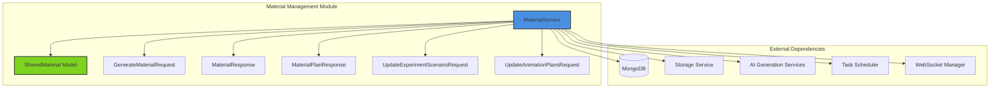
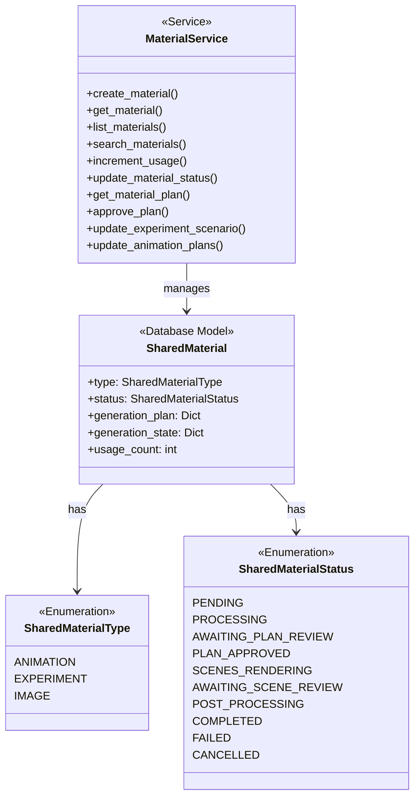
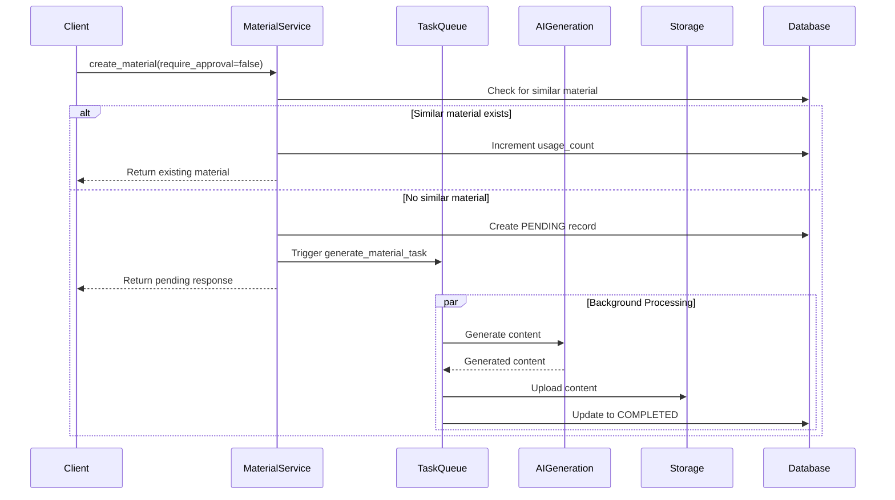
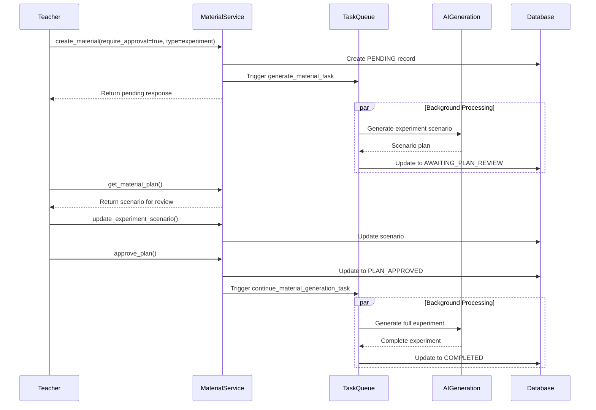
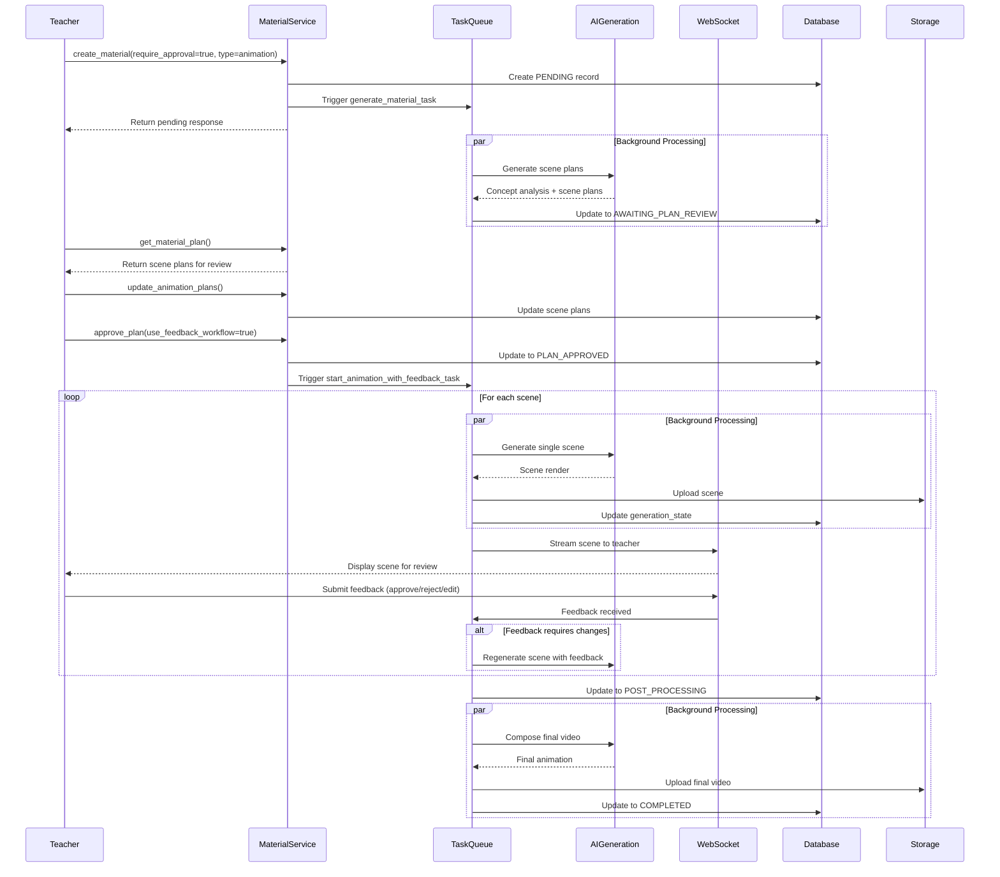
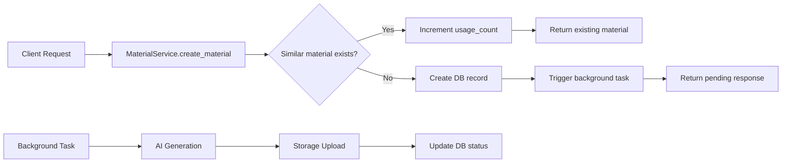
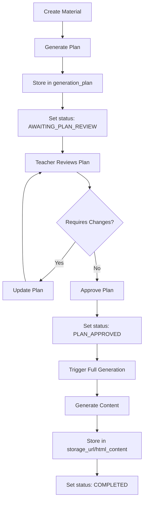

# Material Management Module

## Overview

The Material Management module is a core component of the Connected Learning Platform that provides centralized management of reusable educational materials, including animations, experiments, and images. It implements a sophisticated generation workflow with optional human-in-the-loop approval processes, enabling teachers to review and refine AI-generated content before final production.

### Key Features

- **Shared Material Repository**: Centralized storage of reusable educational content
- **Intelligent Deduplication**: Automatic detection and reuse of similar materials
- **Multi-Stage Approval Workflow**: Optional step-by-step review process for generated content
- **Human-in-the-Loop Feedback**: Real-time scene-by-scene review for animations
- **Comprehensive Search & Filtering**: Advanced querying capabilities with multiple criteria
- **Usage Analytics**: Tracking of material popularity and utilization
- **Background Processing**: Asynchronous generation to ensure responsive user experience

## Architecture

### Module Structure



### Component Relationships



## Core Components

### MaterialService

The `MaterialService` is the central orchestrator for all material-related operations. It provides a unified interface for material lifecycle management, from creation through generation, review, and utilization.

**Key Responsibilities:**
- Material creation and initialization
- Similarity detection and deduplication
- Status management and progress tracking
- Plan retrieval and approval workflow
- Integration with background processing tasks
- Usage analytics and popularity tracking

### Data Models

#### SharedMaterial

The primary database model representing a reusable educational material in the system.

**Fields:**
- `type`: Material type (animation, experiment, image)
- `status`: Current generation status
- `prompt`: Original generation prompt
- `subject`, `grade`, `tags`: Educational metadata
- `storage_url`, `html_content`: Generated content
- `generation_plan`: Review-stage plans (scenario/scene plans)
- `generation_state`: Real-time feedback workflow state
- `usage_count`, `last_used_at`: Analytics data

#### SharedMaterialStatus

Comprehensive status enumeration supporting both direct generation and approval workflows:

**Direct Generation Flow:**
- `PENDING` → `PROCESSING` → `COMPLETED`/`FAILED`

**Approval Workflow Flow:**
- `PENDING` → `PROCESSING` → `AWAITING_PLAN_REVIEW` → `PLAN_APPROVED` → `COMPLETED`/`FAILED`

**Human-in-the-Loop Flow (Animations):**
- `PLAN_APPROVED` → `SCENES_RENDERING` → `AWAITING_SCENE_REVIEW` → `POST_PROCESSING` → `COMPLETED`

## Generation Workflows

### 1. Direct Generation Workflow



### 2. Approval Workflow (Experiments)



### 3. Human-in-the-Loop Workflow (Animations)



## Service Methods

### Material Lifecycle Methods

#### `create_material()`
Creates a new material record and initiates generation workflow.

**Parameters:**
- `request`: GenerateMaterialRequest containing material metadata
- `teacher_id`: Optional creator identifier

**Behavior:**
- Checks for similar materials (when `require_approval=false`)
- Creates database record with PENDING status
- Triggers background generation task
- Returns immediately with material ID and status

**Returns:** `MaterialResponse`

#### `get_material()`
Retrieves a material by ID.

**Parameters:**
- `material_id`: Material identifier

**Returns:** `MaterialResponse` or `None`

#### `list_materials()`
Lists materials with advanced filtering, sorting, and pagination.

**Parameters:**
- `material_type`, `subject`, `grade`, `tags`: Filter criteria
- `query`: Text search string
- `page`, `limit`: Pagination controls
- `sort_by`: Sort field (usage_count, created_at, title, popular, newest, oldest)
- `sort_order`: Sort direction (asc, desc)

**Returns:** `Tuple[List[MaterialResponse], int]` - (items, total_count)

### Search and Discovery Methods

#### `search_materials()`
Performs text search across title, description, prompt, and tags.

**Parameters:**
- `query`: Search string
- `material_type`: Optional type filter
- `limit`: Maximum results

**Returns:** `List[MaterialResponse]`

#### `get_popular_materials()`
Retrieves most frequently used materials.

#### `get_recent_materials()`
Retrieves most recently created materials.

### Usage Tracking Methods

#### `increment_usage()`
Increments usage count and updates last used timestamp.

**Parameters:**
- `material_id`: Material identifier

**Returns:** `bool` - Success status

### Approval Workflow Methods

#### `get_material_plan()`
Retrieves generation plan for materials awaiting review.

**Parameters:**
- `material_id`: Material identifier
- `teacher_id`: Optional teacher filter

**Returns:** `MaterialPlanResponse` or `None`

#### `approve_plan()`
Approves generation plan and continues with full generation.

**Parameters:**
- `material_id`: Material identifier
- `teacher_id`: Optional teacher filter
- `use_feedback_workflow`: Enable scene-by-scene review (animations only)

**Returns:** `Dict[str, Any]` with next step information or `None`

#### `update_experiment_scenario()`
Modifies experiment scenario during plan review phase.

**Parameters:**
- `material_id`: Material identifier
- `updates`: UpdateExperimentScenarioRequest
- `teacher_id`: Optional teacher filter

**Returns:** `MaterialPlanResponse` or `None`

#### `update_animation_plans()`
Modifies animation scene plans during plan review phase.

**Parameters:**
- `material_id`: Material identifier
- `updates`: UpdateAnimationPlansRequest
- `teacher_id`: Optional teacher filter

**Returns:** `MaterialPlanResponse` or `None`

### Administrative Methods

#### `update_material_status()`
Updates material status and associated content (called by background tasks).

**Parameters:**
- `material_id`: Material identifier
- `status`: New status
- `storage_url`, `html_content`, `thumbnail_url`: Generated content
- `duration_seconds`: Animation duration
- `error_message`: Error details

**Returns:** `bool` - Success status

#### `delete_material()`
Deletes a material and associated storage files.

**Parameters:**
- `material_id`: Material identifier
- `teacher_id`: Optional teacher filter (ownership check)

**Returns:** `bool` - Success status

## Integration with Other Modules

### Database Layer Integration

The Material Management module leverages the [database_layer](database_layer.md) for data persistence:

- **MongoDB Connection**: Uses `get_database()` from MongoDB service
- **Repository Pattern**: Direct collection access via `materials` collection
- **Base Models**: Extends `MongoBaseModel` for consistent document structure

```python
# Database interaction pattern
async def _get_collection(self):
    db = get_database()
    return db.materials
```

### AI Generation Services Integration

Integrates with [ai_generation_services](ai_generation_services.md) through background tasks:

- **GenerationService**: Creates initial generation plans
- **ExtractionService**: Extracts content for experiments
- **AnalysisService**: Performs concept analysis for animations
- **ChatService**: Handles feedback-driven regeneration

**Task Integration:**
```python
from app.tasks.material_processing import (
    generate_material_task,
    continue_material_generation_task,
    start_animation_with_feedback_task
)
```

### Animation Generation Integration

For animation materials, integrates with [animation_generation](animation_generation.md):

- **AnimationGenerator**: Generates individual scenes
- **ScenePlan**: Defines scene structure and dependencies
- **GenerationState**: Tracks real-time feedback workflow progress

### Experiment Generation Integration

For experiment materials, integrates with [experiment_generation](experiment_generation.md):

- **ExperimentGenerator**: Creates experiment scenarios
- **ExperimentScenario**: Defines experiment structure and steps
- **UpdateExperimentScenarioRequest**: Enables plan modifications

### Storage Services Integration

Uses [storage_services](storage_services.md) for file management:

- **storage_service**: Handles upload of generated content
- **storage_url**: References stored animation videos and experiment HTML
- **thumbnail_url**: Manages preview images

## Data Flow

### Material Creation Flow



### Approval Workflow Data Flow



## Usage Patterns

### Basic Material Creation (Direct Generation)

```python
# Create a material that generates automatically
request = GenerateMaterialRequest(
    type=SharedMaterialType.ANIMATION,
    title="Pythagorean Theorem Visualization",
    prompt="Create an animation showing how the Pythagorean theorem works...",
    subject="Toán",
    grade=8,
    tags=["geometry", "theorem"],
    require_approval=False
)

response = await material_service.create_material(request, teacher_id="teacher_123")
# Returns immediately, generation happens in background
```

### Approval Workflow Usage

```python
# Step 1: Create material with approval required
request = GenerateMaterialRequest(
    type=SharedMaterialType.EXPERIMENT,
    title="Acid-Base Reaction",
    prompt="Create an experiment showing acid-base neutralization...",
    require_approval=True
)

material = await material_service.create_material(request)

# Step 2: Check plan when ready
plan = await material_service.get_material_plan(material.id)
# Review experiment scenario

# Step 3: Modify if needed
updates = UpdateExperimentScenarioRequest(
    objective="Demonstrate neutralization with pH indicator",
    materials=["HCl", "NaOH", "phenolphthalein"]
)
await material_service.update_experiment_scenario(material.id, updates)

# Step 4: Approve and continue
result = await material_service.approve_plan(material.id)
# Generation continues in background
```

### Human-in-the-Loop Animation Workflow

```python
# Create animation with feedback workflow
request = GenerateMaterialRequest(
    type=SharedMaterialType.ANIMATION,
    title="Cell Division Process",
    prompt="Show the stages of mitosis...",
    require_approval=True
)

material = await material_service.create_material(request)

# Review and approve plan
plan = await material_service.get_material_plan(material.id)
# Modify scene plans if needed
await material_service.update_animation_plans(material.id, updates)

# Approve with feedback workflow enabled
result = await material_service.approve_plan(
    material.id, 
    use_feedback_workflow=True
)
# Connect to WebSocket for real-time scene review
# WebSocket URL: /api/v1/animation/{material_id}/ws
```

## Error Handling

The module implements comprehensive error handling:

- **Database Errors**: Logged and return `None` or `False` as appropriate
- **Invalid IDs**: ObjectId conversion errors caught and logged
- **Storage Failures**: Warning logged, but database record deletion continues
- **Generation Failures**: Status updated to FAILED with error_message

**Error Response Pattern:**
```python
try:
    result = await collection.update_one(...)
    return result.modified_count > 0
except Exception as e:
    logger.error(f"Error description: {e}")
    return False  # or None for retrieval methods
```

## Performance Considerations

### Indexing Recommendations

For optimal performance, ensure MongoDB indexes on:
- `{"status": 1}` - For filtering completed materials
- `{"type": 1, "status": 1}` - For type-based queries
- `{"created_by": 1, "status": 1}` - For teacher's pending materials
- `{"usage_count": -1}` - For popularity sorting
- `{"created_at": -1}` - For recency sorting
- `{"tags": 1}` - For tag-based filtering
- Text index on `{"title": "text", "description": "text", "prompt": "text"}`

### Caching Strategy

- **Popular Materials**: Cache top N materials by usage_count
- **Recent Materials**: Cache recent completions for short period
- **Material Plans**: Cache generation_plan during review phase
- **Similarity Detection**: Cache prompt hash lookups

### Background Processing

- All generation tasks run asynchronously via Celery
- WebSocket connections maintained for real-time feedback
- Task results update database status for polling clients

## Security Considerations

### Access Control

- **Material Creation**: Authenticated teachers only
- **Plan Review**: Restricted to material creator (teacher_id check)
- **Approval**: Only creator can approve their materials
- **Deletion**: Ownership verification required

### Data Validation

- Pydantic models enforce type safety
- ObjectId validation prevents injection
- Enum constraints prevent invalid status values
- Grade level validation (6-12) ensures educational appropriateness

### Privacy

- Teacher identification via created_by field
- No student data stored in material records
- Usage tracking anonymized at material level

## Future Enhancements

### Planned Features

1. **Semantic Similarity**: Vector-based similarity detection using embeddings
2. **Collaborative Review**: Multiple teachers can review and comment on plans
3. **Version Control**: Track plan revisions and content versions
4. **Advanced Analytics**: Detailed usage patterns and effectiveness metrics
5. **Content Recommendations**: AI-powered material suggestions based on lesson context
6. **Batch Operations**: Create multiple materials simultaneously
7. **Template System**: Pre-defined material templates for common scenarios

### Scalability Improvements

- **Sharding**: Distribute materials collection by subject or grade
- **Read Replicas**: Offload search and list operations
- **CDN Integration**: Cache generated content globally
- **Microservices**: Extract generation workflows to dedicated services

## Conclusion

The Material Management module provides a robust foundation for managing reusable educational content in the Connected Learning Platform. Its flexible workflow system supports both rapid direct generation and thorough human-reviewed content creation, while its integration capabilities ensure seamless operation with AI generation services, storage systems, and real-time feedback mechanisms.

The module's design emphasizes scalability, security, and user experience, making it suitable for large-scale educational platforms with diverse content needs and quality requirements.