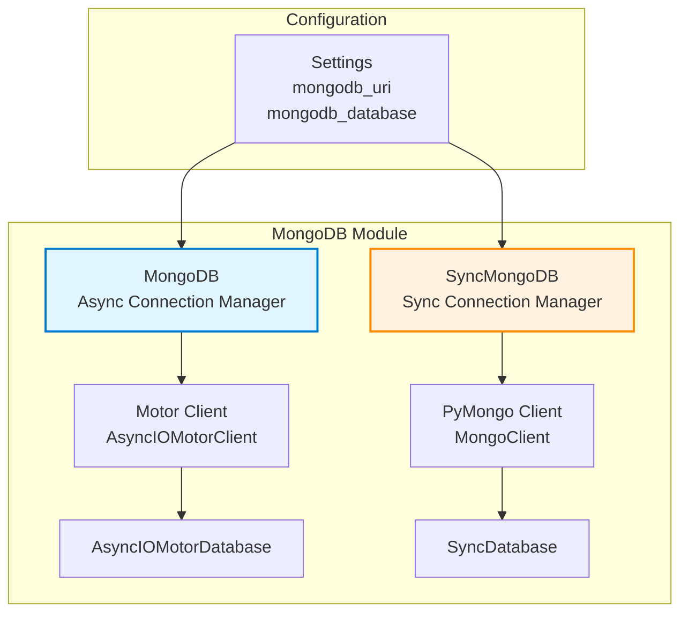
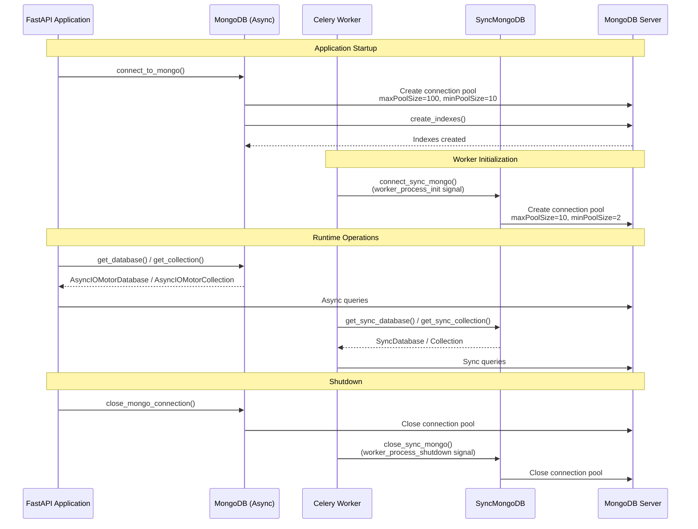
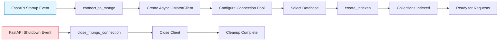
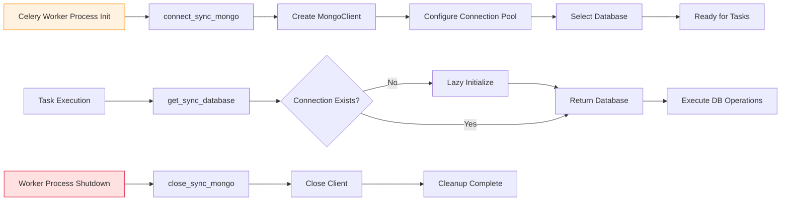
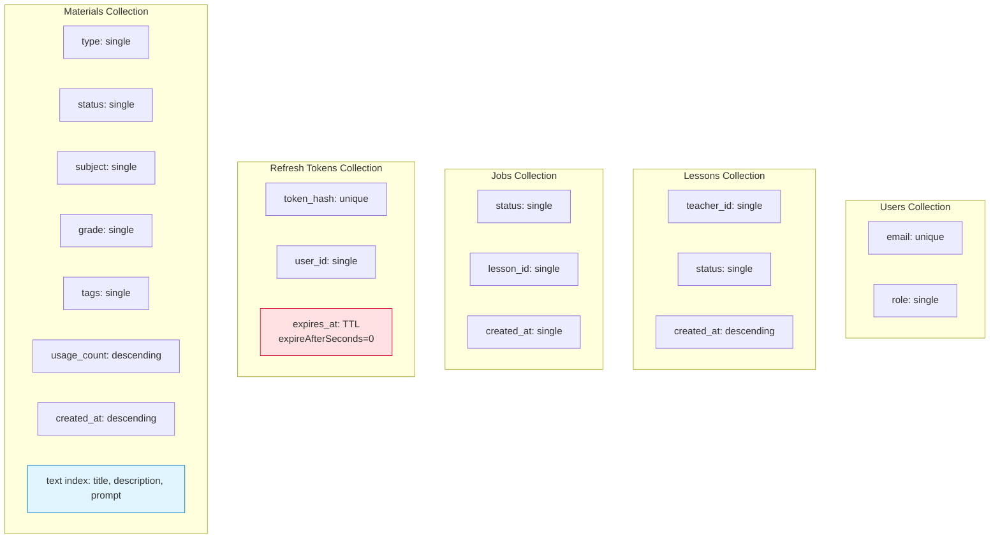
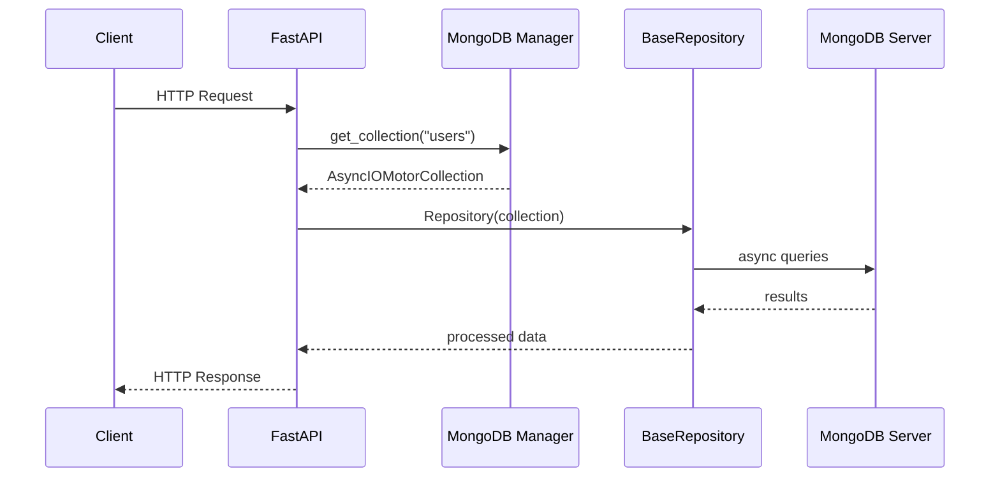
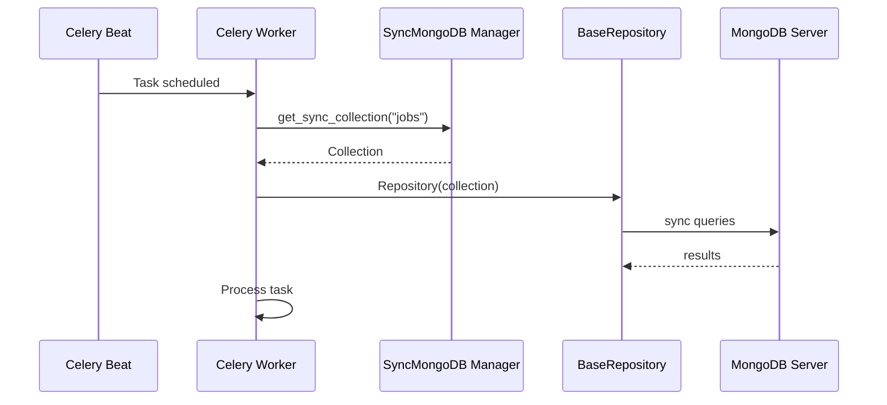
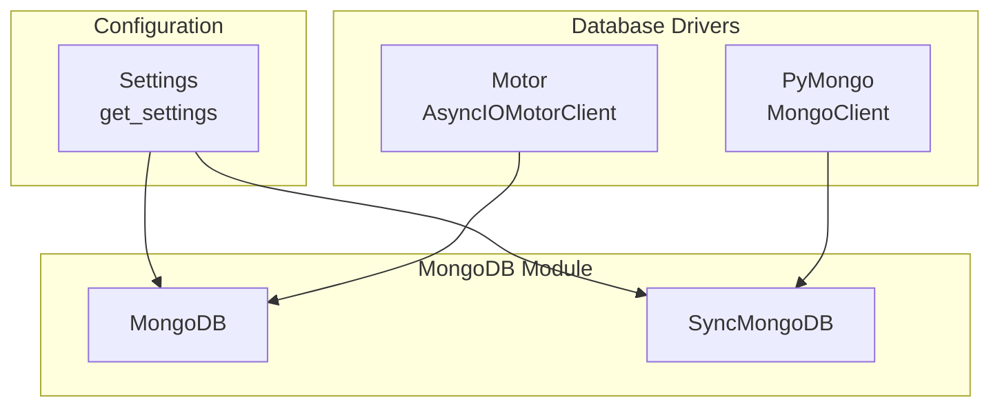
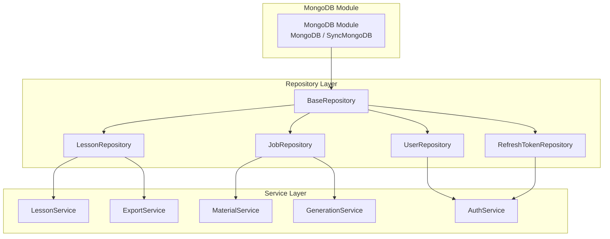

# MongoDB Module Documentation

## Overview

The MongoDB module provides dual-mode database connectivity for the application, managing both asynchronous and synchronous MongoDB connections. It serves as the foundational database layer that enables the entire application to interact with MongoDB, supporting both FastAPI's async request handling and Celery's synchronous task processing.

### Key Features

- **Dual Connection Management**: Separate async and sync connection managers for different use cases
- **Connection Pooling**: Efficient connection pooling with configurable pool sizes
- **Automatic Index Management**: Comprehensive index creation for optimal query performance
- **Lifecycle Integration**: Seamless integration with FastAPI startup/shutdown events and Celery worker lifecycle
- **High Availability**: Robust error handling and connection management for production environments

## Architecture

### Core Components

The module consists of two primary connection managers:

1. **MongoDB**: Async connection manager using Motor (async MongoDB driver for Python)
2. **SyncMongoDB**: Sync connection manager using PyMongo for Celery workers



### Connection Lifecycle



## Component Details

### MongoDB (Async Connection Manager)

The `MongoDB` class provides asynchronous database connectivity using Motor, the official async MongoDB driver for Python. It's designed specifically for FastAPI's async request handling.

**Key Characteristics:**
- Uses `AsyncIOMotorClient` for async operations
- Large connection pool (max: 100, min: 10) to handle high concurrent request loads
- Integrated with FastAPI's startup/shutdown lifecycle
- Supports async/await patterns throughout the application

**Usage Pattern:**
```python
from app.db.mongodb import get_database, get_collection

# Get database instance
db = get_database()

# Get collection instance
users_collection = get_collection("users")

# Perform async operations
user = await users_collection.find_one({"email": "user@example.com"})
```

### SyncMongoDB (Sync Connection Manager)

The `SyncMongoDB` class provides synchronous database connectivity using PyMongo. It's optimized for Celery workers that perform background tasks and don't require async capabilities.

**Key Characteristics:**
- Uses `MongoClient` for synchronous operations
- Smaller connection pool (max: 10, min: 2) suitable for worker processes
- Integrated with Celery's worker lifecycle signals
- Automatic lazy initialization via `get_sync_database()`

**Usage Pattern:**
```python
from app.db.mongodb import get_sync_database, get_sync_collection

# Get database instance (auto-initializes if needed)
db = get_sync_database()

# Get collection instance
jobs_collection = get_sync_collection("jobs")

# Perform sync operations
job = jobs_collection.find_one({"status": "pending"})
```

## Connection Management

### Async Connection Flow (FastAPI)



### Sync Connection Flow (Celery)



## Index Management

The module automatically creates comprehensive indexes to ensure optimal query performance across all collections. Indexes are created during application startup.

### Index Strategy



### Index Details

| Collection | Index Fields | Type | Purpose |
|------------|--------------|------|---------|
| users | email | Unique | Prevent duplicate user registrations |
| users | role | Single | Query users by role (teacher, admin) |
| lessons | teacher_id | Single | Find lessons by teacher |
| lessons | status | Single | Filter lessons by status |
| lessons | created_at | Descending | Sort lessons by creation time |
| jobs | status | Single | Find jobs by processing status |
| jobs | lesson_id | Single | Find jobs for specific lesson |
| jobs | created_at | Single | Sort/filter jobs by creation time |
| refresh_tokens | token_hash | Unique | Secure token lookup |
| refresh_tokens | user_id | Single | Find tokens by user |
| refresh_tokens | expires_at | TTL | Automatic token cleanup |
| materials | type | Single | Filter by material type |
| materials | status | Single | Filter by processing status |
| materials | subject | Single | Filter by subject |
| materials | grade | Single | Filter by grade level |
| materials | tags | Single | Tag-based filtering |
| materials | usage_count | Descending | Sort by popularity |
| materials | created_at | Descending | Sort by creation time |
| materials | title, description, prompt | Text | Full-text search |

## Integration Patterns

### FastAPI Integration

The async MongoDB manager integrates with FastAPI through lifespan events:

```python
# In FastAPI application setup
@app.on_event("startup")
async def startup_event():
    await connect_to_mongo()

@app.on_event("shutdown")
async def shutdown_event():
    await close_mongo_connection()
```

**Request Flow:**


### Celery Integration

The sync MongoDB manager integrates with Celery through worker signals:

```python
# In Celery configuration
@worker_process_init.connect
def init_worker(**kwargs):
    connect_sync_mongo()

@worker_process_shutdown.connect
def shutdown_worker(**kwargs):
    close_sync_mongo()
```

**Task Flow:**


## Dependencies

### Internal Dependencies



### External Module Dependencies

The MongoDB module is depended upon by several other modules:



**See Also:**
- [BaseRepository](repositories.md) - Base repository class that uses MongoDB connections
- [LessonRepository](repositories.md) - Lesson data access using MongoDB
- [JobRepository](repositories.md) - Job data access using MongoDB
- [UserRepository](repositories.md) - User data access using MongoDB
- [RefreshTokenRepository](repositories.md) - Token management using MongoDB

## Configuration

The module uses the following configuration settings:

| Setting | Description | Default | Used By |
|---------|-------------|---------|---------|
| `mongodb_uri` | MongoDB connection URI | Required | Both |
| `mongodb_database` | Database name | Required | Both |

**Connection Pool Configuration:**

**Async (FastAPI):**
- `maxPoolSize`: 100 connections
- `minPoolSize`: 10 connections  
- `maxIdleTimeMS`: 30000ms (30 seconds)

**Sync (Celery):**
- `maxPoolSize`: 10 connections
- `minPoolSize`: 2 connections
- `maxIdleTimeMS`: 30000ms (30 seconds)
- `connectTimeoutMS`: 5000ms (5 seconds)
- `serverSelectionTimeoutMS`: 5000ms (5 seconds)

## Performance Considerations

### Connection Pooling

The module implements connection pooling to efficiently manage database connections:

- **Async Pool**: Large pool (100 max) handles high concurrent request loads from FastAPI
- **Sync Pool**: Smaller pool (10 max) matches typical Celery worker concurrency
- **Idle Timeout**: Connections closed after 30 seconds of inactivity
- **Warm Connections**: Minimum pool sizes ensure ready connections

### Index Optimization

Comprehensive indexing strategy ensures optimal query performance:

- **Unique Indexes**: Prevent data duplication on critical fields (email, token_hash)
- **TTL Indexes**: Automatic cleanup of expired data (refresh tokens)
- **Compound Indexes**: Support common query patterns
- **Text Indexes**: Enable full-text search on materials
- **Descending Indexes**: Optimize sort-by-latest queries

### Best Practices

1. **Always use getters**: Use `get_database()`, `get_collection()`, `get_sync_database()`, `get_sync_collection()` instead of direct access
2. **Connection lifecycle**: Let FastAPI/Celery manage connection lifecycle; don't manually connect/disconnect
3. **Index monitoring**: Monitor index usage and adjust as query patterns evolve
4. **Pool sizing**: Adjust pool sizes based on actual load and MongoDB server capacity
5. **Error handling**: Implement proper error handling for connection failures

## Error Handling

The module includes basic error handling for connection management:

- **Connection Validation**: `get_database()` raises `RuntimeError` if not connected
- **Lazy Initialization**: `get_sync_database()` auto-initializes if needed
- **Idempotent Operations**: Connection functions check existing connections before creating new ones

## Security Considerations

- **Connection URI**: Sensitive credentials should be stored in environment variables
- **Network Security**: Use MongoDB TLS/SSL options in connection URI for production
- **Access Control**: Ensure MongoDB user has minimal required permissions
- **Token Security**: Unique indexes on token hashes prevent collision attacks

## Testing

For testing purposes, the module can be used with:

- **Test Database**: Use separate test database instance
- **Mock Clients**: Replace Motor/PyMongo clients with test doubles
- **Connection Overrides**: Override settings to use in-memory or test MongoDB instances

## Maintenance

### Monitoring

Monitor the following metrics:
- Connection pool usage (current, available, exhausted)
- Query performance (slow queries, index usage)
- Connection errors and timeouts
- Database size and growth

### Troubleshooting

**Common Issues:**

1. **Connection Timeout**: Check network connectivity and MongoDB server status
2. **Pool Exhaustion**: Increase pool size or reduce query execution time
3. **Index Performance**: Use MongoDB's `explain()` to analyze query plans
4. **Authentication Errors**: Verify connection URI and credentials

## API Reference

### Functions

#### `async def connect_to_mongo() -> None`
Initialize async MongoDB connection and create indexes.

#### `async def close_mongo_connection() -> None`
Close async MongoDB connection.

#### `async def create_indexes() -> None`
Create all database indexes.

#### `def get_database() -> AsyncIOMotorDatabase`
Get async database instance. Raises `RuntimeError` if not connected.

#### `def get_collection(name: str) -> AsyncIOMotorCollection`
Get async collection by name.

#### `def connect_sync_mongo() -> None`
Initialize sync MongoDB connection for Celery workers.

#### `def close_sync_mongo() -> None`
Close sync MongoDB connection.

#### `def get_sync_database() -> SyncDatabase`
Get sync database instance. Auto-initializes if needed.

#### `def get_sync_collection(name: str)`
Get sync collection by name.

### Classes

#### `class MongoDB`
Async MongoDB connection manager.

**Attributes:**
- `client: Optional[AsyncIOMotorClient]` - Motor client instance
- `db: Optional[AsyncIOMotorDatabase]` - Database instance

#### `class SyncMongoDB`
Sync MongoDB connection manager.

**Attributes:**
- `client: Optional[MongoClient]` - PyMongo client instance  
- `db: Optional[SyncDatabase]` - Database instance

### Global Instances

- `mongodb: MongoDB` - Global async MongoDB manager instance
- `sync_mongodb: SyncMongoDB` - Global sync MongoDB manager instance