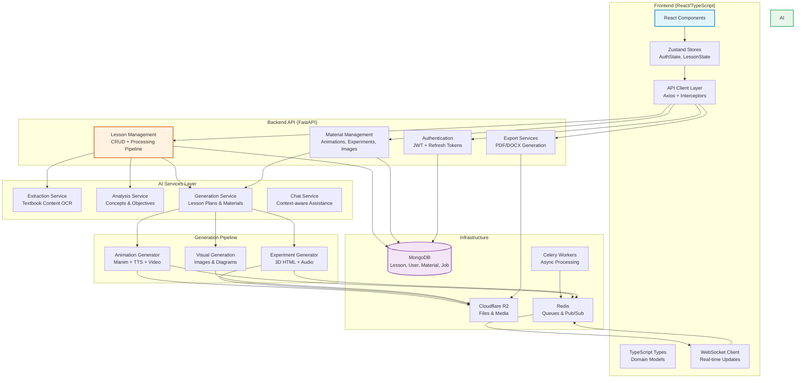

# ConnectED Repository Overview

ConnectED is an AI-powered educational content generation platform designed for Vietnamese teachers, enabling the creation of comprehensive lesson plans, interactive presentations, and multimedia teaching materials from textbook images.

## Purpose

The ConnectED platform automates the entire lesson planning workflow through intelligent AI services, transforming raw textbook content into pedagogically sound lesson plans following Vietnamese educational standards (Thông tư 5512). It provides a collaborative environment where teachers can review, refine, and share AI-generated content while maintaining full control over the final output.

## End-to-End Architecture



## Core Modules Documentation

### Data Layer
- **[database_models](database_models.md)**: Centralized Pydantic models defining all data structures, MongoDB schemas, and API contracts. Includes lesson models, user authentication, job tracking, and comprehensive enums for Vietnamese educational domain.
- **[database_layer](database_layer.md)**: MongoDB connection management with async/sync support, repository pattern implementation, and automated indexing for performance optimization.

### Lesson Management
- **[lesson_management](lesson_management.md)**: Core orchestration service managing the complete lesson lifecycle from image upload to final lesson plan. Implements a six-step review workflow (content → concepts → objectives → outline → plan → presentation) with real-time status tracking and collaborative sharing.

### AI Generation Services
- **[ai_generation_services](ai_generation_services.md)**: Intelligence layer providing content extraction, pedagogical analysis, lesson plan generation, and context-aware chat assistance using LLMs.
- **[animation_generation](animation_generation.md)**: Multi-phase pipeline for creating narrated video animations with human-in-the-loop feedback, step-level caching, and WebSocket-based real-time collaboration.
- **[experiment_generation](experiment_generation.md)**: 3D interactive experiment generation system with audio narration, HTML visualization, and approval workflows for chemistry and physics education.

### Material Management
- **[material_management](material_management.md)**: Centralized repository for reusable educational materials with intelligent deduplication, multi-stage approval workflows, and usage analytics.

### Infrastructure
- **[authentication](authentication.md)**: Secure JWT-based authentication with refresh token rotation, role-based access control, and teacher account management.
- **[export_services](export_services.md)**: Document generation service supporting PDF and DOCX formats with Vietnamese educational standards compliance.
- **[storage_services](storage_services.md)**: Cloudflare R2 integration for file storage with type detection and public URL management.
- **[animation_session](animation_session.md)**: Real-time WebSocket session manager for scene-by-scene animation review and feedback coordination.

### Frontend Architecture
- **[frontend_state_management](frontend_state_management.md)**: Zustand-based state management with persistent authentication and reactive updates.
- **[frontend_api_client](frontend_api_client.md)**: Type-safe Axios client with automatic token refresh, request/response interceptors, and modular API organization.
- **[frontend_types](frontend_types.md)**: Comprehensive TypeScript definitions covering all domain models, API contracts, WebSocket events, and UI state.
- **[frontend_components](frontend_components.md)**: Reusable React components including the MaterialLibraryModal for unified material browsing and generation.

## Key Features

- **AI-Powered Automation**: End-to-end lesson plan generation from textbook images
- **Human-in-the-Loop**: Step-by-step review and feedback at each generation stage
- **Multimedia Generation**: Automated creation of images, animations, and interactive experiments
- **Real-time Collaboration**: WebSocket-based live feedback for animation generation
- **Vietnamese Standards**: Pedagogical alignment with Thông tư 5512
- **Export Capabilities**: Professional PDF/DOCX document generation
- **Material Library**: Shared repository of reusable educational content
- **Secure Authentication**: JWT-based auth with role-based access control

## Technology Stack

- **Backend**: Python, FastAPI, MongoDB, Motor (async driver), Celery, Redis
- **AI/ML**: OpenAI/DeepSeek LLMs, ElevenLabs TTS, Manim (animations), Three.js (3D)
- **Frontend**: React, TypeScript, Zustand, Axios, WebSocket API
- **Storage**: Cloudflare R2 (S3-compatible)
- **Infrastructure**: Docker, async/await throughout, connection pooling

## Data Flow

```mermaid
graph TD
    A[Textbook Images] --> B[ExtractionService]
    B --> C[AnalysisService]
    C --> D[GenerationService]
    D --> E[LessonPlan + Presentation]
    D --> F[Materials (Animation/Experiment/Image)]
    E --> G[ExportService]
    F --> H[StorageService]
    G --> I[PDF/DOCX Documents]
    H --> J[Cloudflare R2]
    
    K[Teacher Feedback] --> L[LessonService]
    L --> M[Review Workflow]
    M --> N[Regeneration Loop]
    N --> D
    
    O[WebSocket Client] --> P[AnimationSession]
    P --> Q[Scene-by-Scene Review]
    Q --> R[Real-time Feedback]
    R --> S[AnimationGenerator]
    
    style A fill:#e1f5ff,stroke:#3498db
    style E fill:#d4edda,stroke:#28a745
    style K fill:#fff3cd,stroke:#ffc107
    style O fill:#f8d7da,stroke:#dc3545
```

This architecture enables a scalable, maintainable platform that bridges AI capabilities with teacher expertise, creating high-quality educational content through collaborative human-AI interaction.