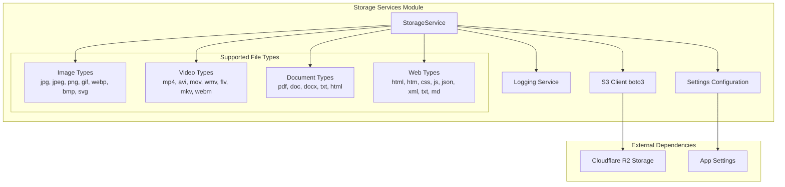
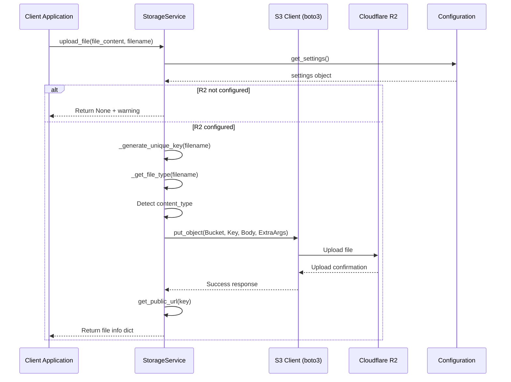
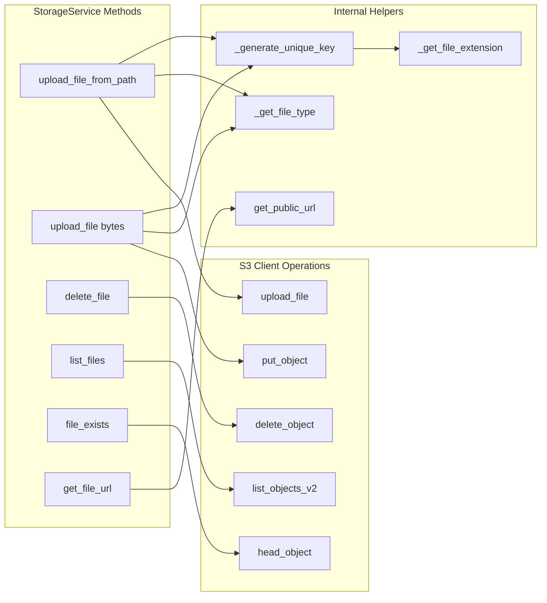
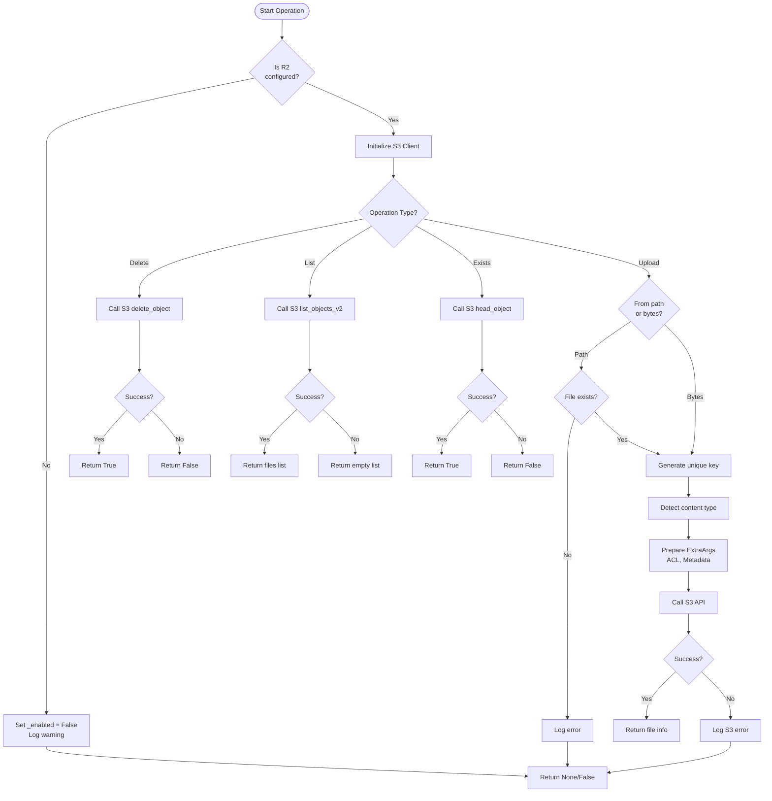

# Storage Services Module

## Overview

The **Storage Services** module provides a unified interface for file storage and management using Cloudflare R2, an S3-compatible object storage service. It handles file uploads, downloads, deletions, and URL generation with support for multiple file types and organizational structures.

## Purpose and Core Functionality

The StorageService class serves as the central component for:
- **File Uploads**: Upload files from local paths or byte content
- **File Management**: Delete, list, and check existence of files
- **URL Generation**: Generate public URLs for accessible files
- **File Organization**: Support for folder-based organization
- **Type Detection**: Automatic detection and categorization of file types
- **Metadata Support**: Attach custom metadata to stored files
- **Configuration Management**: Graceful handling of missing configuration

## Architecture

### Component Structure



### Data Flow for File Upload Operations



### Component Interaction Diagram



### Process Flow for File Operations



## Key Components

### StorageService Class

The `StorageService` class is the main component that provides all storage operations. It's designed as a singleton with the following key attributes:

- **Configuration-based initialization**: Only initializes S3 client if all required settings are present
- **Graceful degradation**: Continues to function (with warnings) if R2 is not configured
- **File type support**: Categorizes files into images, videos, documents, and web files
- **Unique key generation**: Creates organized file paths with timestamps and UUIDs

### Configuration Requirements

The service requires the following configuration settings:
- `r2_account_id`: Cloudflare R2 account identifier
- `r2_access_key_id`: Access key for R2 API
- `r2_secret_access_key`: Secret key for R2 API
- `r2_bucket_name`: Target bucket name
- `r2_public_url_base`: Base URL for public file access

### File Organization

Files are organized using:
- **Folder prefixes**: Optional folder parameters for categorization (e.g., 'images', 'videos')
- **Unique filenames**: Generated as `{timestamp}_{uuid}{extension}`
- **Public URLs**: Constructed from `public_url_base` and file key

## API Reference

### Core Methods

#### `upload_file_from_path(file_path, folder=None, custom_key=None, metadata=None, make_public=True)`
Uploads a file from a local filesystem path to R2 storage.

**Parameters:**
- `file_path`: Path to the file to upload
- `folder`: Optional folder for organization
- `custom_key`: Custom S3 key (auto-generated if None)
- `metadata`: Additional metadata to attach
- `make_public`: Whether to make the file publicly accessible

**Returns:** Dictionary with file_id, url, key, size, file_type, content_type, or None on failure

#### `upload_file(file_content, filename, content_type=None, folder=None, metadata=None, make_public=True)`
Uploads file content from bytes to R2 storage.

**Parameters:**
- `file_content`: File content as bytes
- `filename`: Original filename (for extension and key generation)
- `content_type`: MIME type (auto-detected if None)
- `folder`: Optional folder for organization
- `metadata`: Additional metadata to attach
- `make_public`: Whether to make the file publicly accessible

**Returns:** Dictionary with file_id, url, key, size, file_type, content_type, or None on failure

#### `delete_file(key)`
Deletes a file from R2 storage.

**Parameters:**
- `key`: S3 key of the file to delete

**Returns:** True if successful, False otherwise

#### `list_files(prefix=None, max_keys=1000)`
Lists files in the bucket.

**Parameters:**
- `prefix`: Filter by prefix/folder
- `max_keys`: Maximum number of files to return

**Returns:** List of file information dictionaries

#### `file_exists(key)`
Checks if a file exists in R2 storage.

**Parameters:**
- `key`: S3 key to check

**Returns:** True if file exists, False otherwise

### Helper Methods

#### `_generate_unique_key(original_filename, folder=None)`
Generates a unique S3 key for a file.

**Format:** `{folder}/{timestamp}_{uuid}{extension}`

#### `_get_file_type(filename)`
Determines the file category based on extension.

**Categories:** image, video, document, web, other

#### `get_public_url(key)`
Generates a public URL for a given S3 key.

## Dependencies

### External Dependencies
- **boto3**: AWS SDK for Python, used for S3-compatible API calls
- **botocore**: Low-level AWS service access

### Internal Dependencies
- **app.config**: Application settings management
- **logging**: Python standard logging module

### Configuration Dependencies
The service depends on the following configuration values from the application settings:
- `r2_account_id`
- `r2_access_key_id`
- `r2_secret_access_key`
- `r2_bucket_name`
- `r2_public_url_base`

## Integration Points

### Related Modules

The Storage Services module is used by various other modules in the system:

- **[Lesson Management](lesson_management.md)**: Stores lesson-related files, images, and documents
- **[Material Management](material_management.md)**: Manages educational material files
- **[Export Services](export_services.md)**: Stores generated export files (PDF, DOCX)
- **[Animation Generation](animation_generation.md)**: Stores generated animation files and assets

### Usage Patterns

```python
# Singleton instance
from app.services.storage import storage_service

# Upload a file
result = await storage_service.upload_file_from_path(
    file_path="/path/to/file.pdf",
    folder="documents"
)

if result:
    print(f"File uploaded: {result['url']}")
else:
    print("Upload failed")

# Check if file exists
exists = await storage_service.file_exists("documents/file.pdf")

# Delete a file
success = await storage_service.delete_file("documents/file.pdf")
```

## Error Handling

The service implements comprehensive error handling:

1. **Configuration Errors**: Logs warnings and disables functionality if R2 is not configured
2. **File Not Found**: Validates file existence before upload attempts
3. **S3 API Errors**: Catches and logs `ClientError` exceptions from boto3
4. **General Exceptions**: Catches unexpected errors and logs them appropriately

All error conditions return `None` or `False` to allow graceful failure handling by calling code.

## Security Considerations

- **Access Control**: Uses ACL settings to control public access
- **Credential Management**: Credentials stored in application settings (not hardcoded)
- **Unique Keys**: Prevents filename collisions using UUIDs and timestamps
- **Content Type Validation**: Properly sets Content-Type headers for security

## Performance Characteristics

- **Async Support**: All methods are async-compatible
- **Connection Reuse**: S3 client is initialized once and reused
- **Batch Operations**: Supports listing up to 1000 files per request
- **File Size**: No explicit size limits (subject to R2 constraints)

## Future Enhancements

Potential improvements for the storage service:

1. **CDN Integration**: Direct Cloudflare CDN integration for optimized delivery
2. **Signed URLs**: Support for temporary signed URLs for private files
3. **Multipart Uploads**: Support for large file multipart uploads
4. **File Versioning**: Version control for uploaded files
5. **Cache Control**: Automatic cache header management
6. **Metrics**: Upload/download tracking and analytics